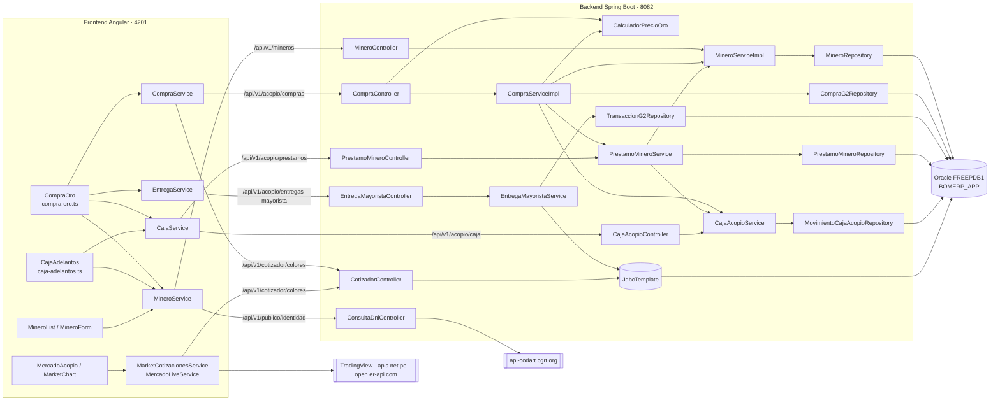
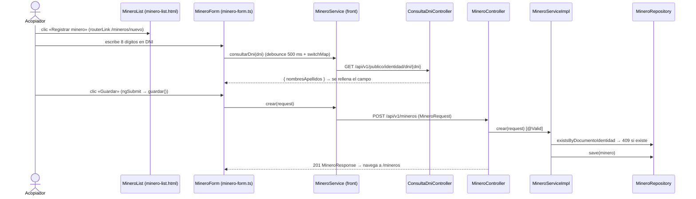
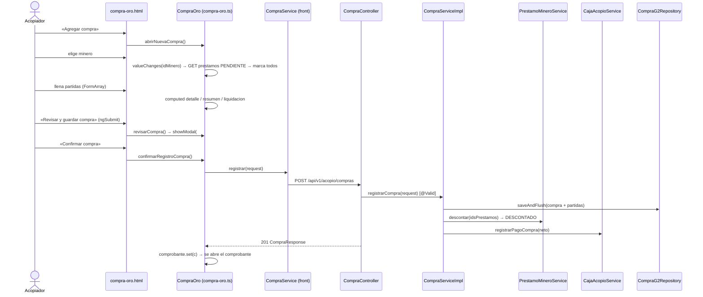
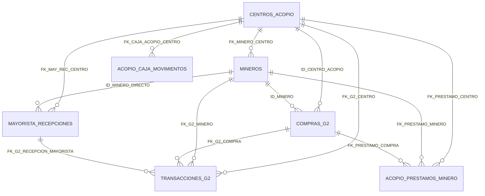

# DOCUMENTACIÓN TÉCNICA COMPLETA DEL PROYECTO

## 1. Portada e identificación del proyecto

| Campo | Valor |
|---|---|
| Proyecto | SITRA-ORO · Módulo Acopiador |
| Directorio raíz | `C:\laragon\modulo_acopiador` |
| Partes | `Backend/` (Java 21 · Spring Boot 4.0.7 · Oracle) y `Frontend/` (Angular 21) |
| Puertos | Backend 8082 · Frontend 4201 · Oracle 1522 |
| Archivos documentados con código completo | 108 (+ 2 scripts generados en el Anexo A) |
| Líneas de código y configuración documentadas | 6318 (sin contar el Anexo A) |
| Fecha de generación | 2026-11-17 |
| Método | Análisis estático: lectura directa de cada archivo; números de línea calculados del archivo real; esquema de BD leído del diccionario de datos de Oracle. |

## Cómo usar este documento

Este expediente reemplaza el acceso a los archivos. Para responder cualquier pedido:

1. Busca la funcionalidad en la **sección 15 (Guía rápida de modificación)** o en la **sección 9 (Mapa de clases y métodos)**.
2. Ve al archivo en la **sección 7–8** (cada archivo tiene su número, ruta, código completo y tabla de métodos con líneas).
3. Usa la **sección 16 (Referencias de líneas)** y la **tabla de eventos de interfaz** para ubicar un método o un botón por número de línea.
4. Si el cambio toca la base de datos, revisa la **sección 12**: las tablas las crea un script externo y Hibernate solo valida (`ddl-auto: validate`), así que una columna nueva **primero** se crea en Oracle.

Los números de línea se calcularon leyendo los archivos reales (contando desde 1). El código de cada archivo está copiado literal; la única alteración son los valores sensibles reemplazados por `[DATO SENSIBLE OMITIDO]` y los finales de línea normalizados a LF.

### Protocolo para el asistente que use este documento

Cuando el usuario envíe una instrucción del docente:

1. Antes de proponer código, identifica el archivo exacto donde debe realizarse el cambio.
2. Indica la ruta completa del archivo.
3. Indica la clase, método o componente que se debe localizar.
4. Señala la línea exacta según este documento.
5. Muestra el código que se debe buscar para ubicarse (copiado de este documento).
6. Indica exactamente después de qué línea o antes de qué bloque se debe escribir.
7. Proporciona el código completo que se debe insertar o reemplazar.
8. Si hay que modificar varias partes, ordénalas paso a paso.
9. Respeta la arquitectura, tecnologías, nombres y convenciones existentes.
10. No inventes archivos, clases, métodos ni funciones que no estén documentados aquí.

Formato de respuesta: **TAREA** · **PASO N — ARCHIVO** · **UBICACIÓN** · **BUSCA ESTE CÓDIGO** · **ACCIÓN** (insertar / reemplazar / modificar) · **CÓDIGO** · **RESULTADO ESPERADO** · **SIGUIENTE PASO**. Respuestas rápidas, prácticas y directas, pensadas para Visual Studio Code. Si falta información en este documento, adviértelo; no inventes una ubicación ni código.


## Contenido

- 1. Portada e identificación
- 2. Descripción general
- 3. Tecnologías utilizadas
- 4. Arquitectura
- 5. Árbol completo de carpetas
- 6. Inventario de archivos
- 7–8. Código fuente completo y análisis individual de cada archivo
- 9. Mapa de clases y métodos
- 10. Mapa de dependencias
- 11. Flujo de funcionamiento
- 12. Estructura de la base de datos
- 13. Endpoints y rutas
- 14. Configuraciones
- 15. Guía rápida de modificación del proyecto
- 16. Referencias de líneas
- 17. Estado actual del sistema
- 18. Índice maestro de archivos
- 19. Informe de integridad y completitud
- Anexo A. Scripts generados (Maven Wrapper)

## 2. Descripción general

**SITRA-ORO · Módulo Acopiador** es un sistema web para un centro de acopio de oro artesanal. Lo usa el acopiador, que compra oro a mineros y luego lo entrega a un mayorista. No hay inicio de sesión: el sistema trabaja siempre sobre un centro de acopio fijo (`sitra.acopio.id-centro: 1`, leído por `CentroActual`, `Backend/src/main/java/pe/edu/upeu/sitraoro/CentroActual.java`).

Funcionalidades implementadas (verificadas en el código):

| N.º | Funcionalidad | Pantalla (ruta del frontend) | API principal |
|---:|---|---|---|
| 1 | Registrar, editar, eliminar y listar mineros; autocompletar el nombre consultando el DNI en RENIEC | Mineros (`/mineros`, `/mineros/nuevo`, `/mineros/:id/editar`) | `/api/v1/mineros`, `/api/v1/publico/identidad/dni/{dni}` |
| 2 | Caja en soles (saldo, ingresos, saldo inicial, anulación) y adelantos a mineros | Caja y adelantos (`/caja`) | `/api/v1/acopio/caja`, `/api/v1/acopio/prestamos` |
| 3 | Compra de oro con una o varias partidas (oro ROJO/VERDE), merma, importe, descuento de adelantos y descuento manual, modal de revisión y comprobante digital (PNG y WhatsApp) | Compras de oro (`/compras`) | `/api/v1/acopio/compras`, `/api/v1/cotizador/colores` |
| 4 | Preparar y enviar compras al mayorista; stock pendiente; reporte de entregas | Compras de oro → «Preparar entrega» y «Reporte de entregas» | `/api/v1/acopio/entregas-mayorista` |
| 5 | Calculadora del precio oficial por gramo | Compras de oro → «Precio del oro» | `/api/v1/acopio/compras/precio-oro` |
| 6 | Mercado del oro en vivo (oro spot, dólar, gráficos de TradingView) | Mercado del oro (`/mercado`) | Servicios externos (TradingView, apis.net.pe, open.er-api.com) y `/api/v1/cotizador/colores` |


## 3. Tecnologías utilizadas

### Backend (`Backend/pom.xml`)

| Elemento | Valor |
|---|---|
| Java | 21 |
| Spring Boot (parent) | 4.0.7 |
| Spring Modulith (BOM) | 2.0.8 |
| Construcción | Maven (Maven Wrapper `mvnw` / `mvnw.cmd`, Maven 3.10.1) |
| Base de datos | Oracle Database 23ai Free (driver `ojdbc17`) |

| Dependencia (groupId:artifactId) | Versión | Ámbito |
|---|---|---|
| `org.springframework.boot:spring-boot-starter-webmvc` | gestionada por Spring Boot / BOM | compile |
| `org.springframework.boot:spring-boot-starter-validation` | gestionada por Spring Boot / BOM | compile |
| `org.springframework.boot:spring-boot-starter-data-jpa` | gestionada por Spring Boot / BOM | compile |
| `org.springframework.boot:spring-boot-starter-actuator` | gestionada por Spring Boot / BOM | compile |
| `org.springframework.modulith:spring-modulith-starter-core` | gestionada por Spring Boot / BOM | compile |
| `org.springdoc:springdoc-openapi-starter-webmvc-ui` | 3.0.0 | compile |
| `com.oracle.database.jdbc:ojdbc17` | gestionada por Spring Boot / BOM | runtime |
| `org.springframework.boot:spring-boot-devtools` | gestionada por Spring Boot / BOM | runtime (optional) |
| `org.projectlombok:lombok` | gestionada por Spring Boot / BOM | compile (optional) |
| `org.springframework.boot:spring-boot-starter-webmvc-test` | gestionada por Spring Boot / BOM | test |
| `org.springframework.modulith:spring-modulith-starter-test` | gestionada por Spring Boot / BOM | test |

### Frontend (`Frontend/package.json`; versión instalada leída de `package-lock.json`)

| Paquete | Rango declarado | Versión instalada | Tipo |
|---|---|---|---|
| `@angular/common` | ^21.2.0 | 21.2.26 | dependencia |
| `@angular/compiler` | ^21.2.0 | 21.2.26 | dependencia |
| `@angular/core` | ^21.2.0 | 21.2.26 | dependencia |
| `@angular/forms` | ^21.2.0 | 21.2.26 | dependencia |
| `@angular/platform-browser` | ^21.2.0 | 21.2.26 | dependencia |
| `@angular/router` | ^21.2.0 | 21.2.26 | dependencia |
| `rxjs` | ~7.8.0 | 7.8.2 | dependencia |
| `tslib` | ^2.3.0 | 2.9.1 | dependencia |
| `@angular/build` | ^21.2.30 | 21.2.30 | desarrollo |
| `@angular/cli` | ^21.2.30 | 21.2.30 | desarrollo |
| `@angular/compiler-cli` | ^21.2.0 | 21.2.26 | desarrollo |
| `prettier` | ^3.8.1 | 3.10.1 | desarrollo |
| `typescript` | ~5.9.2 | 5.9.3 | desarrollo |

Gestor de paquetes: `npm@11.12.1`. Node.js usado en el equipo: v24.

### Servicios externos usados por el código

| Servicio | Usado en | Para qué |
|---|---|---|
| `https://api-codart.cgrt.org/api/v1/consultas/reniec/dni/{dni}` | `ConsultaDniController` (backend) | Nombre completo por DNI (RENIEC). Requiere token Bearer. |
| `wss://data.tradingview.com/socket.io/websocket` | `MercadoLiveService` | Precio en vivo de `OANDA:XAUUSD` y `FX_IDC:USDPEN`. |
| `https://scanner.tradingview.com/cfd/scan`, `/forex/scan` | `MercadoLiveService` | Respaldo HTTP de los precios. |
| `https://api.apis.net.pe/v1/tipo-cambio-sunat`, `https://open.er-api.com/v6/latest/USD` | `MercadoLiveService` | Tipo de cambio SUNAT y de mercado. |
| `https://s3.tradingview.com/external-embedding/*.js` | `MarketChart` | Widgets de gráficos. |

## 4. Arquitectura

### Estilo arquitectónico

- **Backend:** monolito modular (Spring Modulith) con un único módulo de negocio `acopio`, dividido en submódulos (`minero`, `compra`, `prestamo`, `caja`, `entrega`, `cotizador`). Cada submódulo sigue capas: `controller` → `service` → `repository` → `entity`, con `dto` (records) para entrada y salida.
- **Frontend:** Angular 21 con componentes *standalone*, *signals*, formularios reactivos y rutas con *lazy loading*. Una carpeta por módulo de negocio dentro de `Frontend/src/app/acopio/`, con `*.model.ts` (interfaces), `*.service.ts` (HTTP) y componentes (`.ts` + `.html` + `.css`).
- **Comunicación:** HTTP/JSON. El frontend construye las URL con `environment.apiBaseUrl` (`Frontend/src/environments/environment.ts`) y `HttpClient` (registrado en `Frontend/src/app/app.config.ts`, línea 11). El backend permite el origen del frontend con CORS (`Backend/src/main/java/pe/edu/upeu/sitraoro/CorsConfig.java`).
- **Persistencia:** Spring Data JPA (Hibernate) sobre Oracle; además `JdbcTemplate` para dos tablas que no tienen entidad en este proyecto (`MAYORISTA_RECEPCIONES`, `COTIZACIONES_COLOR`) y para leer `CENTROS_ACOPIO`.
- **Errores:** todas las excepciones pasan por `GlobalExceptionHandler` (`Backend/src/main/java/pe/edu/upeu/sitraoro/GlobalExceptionHandler.java`) y vuelven como JSON `{timestamp, status, error, mensaje}`; el frontend muestra `mensaje` con `mensajeError` (`Frontend/src/app/core/api/mensaje-error.ts`).
- **Transacciones:** los métodos de servicio que escriben usan `@Transactional`; los de solo lectura `@Transactional(readOnly = true)`. Si una regla falla a mitad de una compra, se deshace todo.

### Regla de dependencias entre submódulos (como está en el código)

- `CompraServiceImpl` usa el **servicio** público de mineros (`MineroService.obtenerEntidad`) y los servicios de préstamo y caja.
- `PrestamoMineroService` usa `MineroService` y `CajaAcopioService`.
- `EntregaMayoristaService` usa directamente el **repositorio** `TransaccionG2Repository` del submódulo `compra` (excepción a la regla; ver sección 17).
- Las entidades `CompraG2`, `TransaccionG2` y `PrestamoMinero` tienen relación `@ManyToOne` con la entidad `Minero` del submódulo `minero`.

### Diagrama de capas (relaciones reales)



### Autenticación y autorización

**No existen.** No hay Spring Security en `pom.xml`, no hay guards ni interceptores en Angular (`provideHttpClient()` sin interceptores, `Frontend/src/app/app.config.ts` línea 11). Todos los endpoints son públicos. «Cerrar sesión» solo navega a `/compras` (`App.salir`, `Frontend/src/app/app.ts` L30–32). El único control es CORS, que limita qué páginas web pueden llamar a `/api/**` desde un navegador (`Backend/src/main/java/pe/edu/upeu/sitraoro/CorsConfig.java` L12–18).


## 5. Árbol completo de carpetas

```text
modulo_acopiador/
├── .git/   (generado: 197 archivos, no documentado)
├── .github/
│   └── modernize/
│       └── java-upgrade/
│           ├── hooks/
│           │   └── scripts/
│           │       ├── recordToolUse.ps1   (registrado, contenido excluido)
│           │       └── recordToolUse.sh   (registrado, contenido excluido)
│           └── .gitignore   (registrado, contenido excluido)
├── Backend/
│   ├── .mvn/
│   │   └── wrapper/
│   │       └── maven-wrapper.properties   (Archivo N.º 3)
│   ├── src/
│   │   ├── main/
│   │   │   ├── java/
│   │   │   │   └── pe/
│   │   │   │       └── edu/
│   │   │   │           └── upeu/
│   │   │   │               └── sitraoro/
│   │   │   │                   ├── acopio/
│   │   │   │                   │   ├── caja/
│   │   │   │                   │   │   ├── controller/
│   │   │   │                   │   │   │   └── CajaAcopioController.java   (Archivo N.º 43)
│   │   │   │                   │   │   ├── dto/
│   │   │   │                   │   │   │   ├── MovimientoManualRequest.java   (Archivo N.º 44)
│   │   │   │                   │   │   │   ├── MovimientoResponse.java   (Archivo N.º 45)
│   │   │   │                   │   │   │   └── ResumenCaja.java   (Archivo N.º 46)
│   │   │   │                   │   │   ├── entity/
│   │   │   │                   │   │   │   ├── MovimientoCajaAcopio.java   (Archivo N.º 47)
│   │   │   │                   │   │   │   └── OrigenCajaAcopio.java   (Archivo N.º 48)
│   │   │   │                   │   │   ├── repository/
│   │   │   │                   │   │   │   └── MovimientoCajaAcopioRepository.java   (Archivo N.º 49)
│   │   │   │                   │   │   └── service/
│   │   │   │                   │   │       └── CajaAcopioService.java   (Archivo N.º 50)
│   │   │   │                   │   ├── compra/
│   │   │   │                   │   │   ├── controller/
│   │   │   │                   │   │   │   └── CompraController.java   (Archivo N.º 23)
│   │   │   │                   │   │   ├── dto/
│   │   │   │                   │   │   │   ├── CompraRequest.java   (Archivo N.º 24)
│   │   │   │                   │   │   │   ├── CompraResponse.java   (Archivo N.º 26)
│   │   │   │                   │   │   │   ├── PartidaRequest.java   (Archivo N.º 25)
│   │   │   │                   │   │   │   ├── PartidaResponse.java   (Archivo N.º 27)
│   │   │   │                   │   │   │   └── PrecioOroResponse.java   (Archivo N.º 28)
│   │   │   │                   │   │   ├── entity/
│   │   │   │                   │   │   │   ├── CompraG2.java   (Archivo N.º 29)
│   │   │   │                   │   │   │   └── TransaccionG2.java   (Archivo N.º 30)
│   │   │   │                   │   │   ├── repository/
│   │   │   │                   │   │   │   ├── CompraG2Repository.java   (Archivo N.º 31)
│   │   │   │                   │   │   │   └── TransaccionG2Repository.java   (Archivo N.º 32)
│   │   │   │                   │   │   └── service/
│   │   │   │                   │   │       ├── CalculadorPrecioOro.java   (Archivo N.º 35)
│   │   │   │                   │   │       ├── CompraService.java   (Archivo N.º 33)
│   │   │   │                   │   │       └── CompraServiceImpl.java   (Archivo N.º 34)
│   │   │   │                   │   ├── cotizador/
│   │   │   │                   │   │   └── CotizadorController.java   (Archivo N.º 57)
│   │   │   │                   │   ├── entrega/
│   │   │   │                   │   │   ├── controller/
│   │   │   │                   │   │   │   └── EntregaMayoristaController.java   (Archivo N.º 51)
│   │   │   │                   │   │   ├── dto/
│   │   │   │                   │   │   │   ├── DisponibleResponse.java   (Archivo N.º 54)
│   │   │   │                   │   │   │   ├── EntregaRequest.java   (Archivo N.º 52)
│   │   │   │                   │   │   │   ├── EntregaResponse.java   (Archivo N.º 53)
│   │   │   │                   │   │   │   └── StockPendienteResponse.java   (Archivo N.º 55)
│   │   │   │                   │   │   └── service/
│   │   │   │                   │   │       └── EntregaMayoristaService.java   (Archivo N.º 56)
│   │   │   │                   │   ├── minero/
│   │   │   │                   │   │   ├── controller/
│   │   │   │                   │   │   │   ├── ConsultaDniController.java   (Archivo N.º 16)
│   │   │   │                   │   │   │   └── MineroController.java   (Archivo N.º 15)
│   │   │   │                   │   │   ├── dto/
│   │   │   │                   │   │   │   ├── MineroRequest.java   (Archivo N.º 17)
│   │   │   │                   │   │   │   └── MineroResponse.java   (Archivo N.º 18)
│   │   │   │                   │   │   ├── entity/
│   │   │   │                   │   │   │   └── Minero.java   (Archivo N.º 19)
│   │   │   │                   │   │   ├── repository/
│   │   │   │                   │   │   │   └── MineroRepository.java   (Archivo N.º 20)
│   │   │   │                   │   │   └── service/
│   │   │   │                   │   │       ├── MineroService.java   (Archivo N.º 21)
│   │   │   │                   │   │       └── MineroServiceImpl.java   (Archivo N.º 22)
│   │   │   │                   │   └── prestamo/
│   │   │   │                   │       ├── controller/
│   │   │   │                   │       │   └── PrestamoMineroController.java   (Archivo N.º 36)
│   │   │   │                   │       ├── dto/
│   │   │   │                   │       │   ├── PrestamoRequest.java   (Archivo N.º 37)
│   │   │   │                   │       │   └── PrestamoResponse.java   (Archivo N.º 38)
│   │   │   │                   │       ├── entity/
│   │   │   │                   │       │   ├── EstadoPrestamo.java   (Archivo N.º 39)
│   │   │   │                   │       │   └── PrestamoMinero.java   (Archivo N.º 40)
│   │   │   │                   │       ├── repository/
│   │   │   │                   │       │   └── PrestamoMineroRepository.java   (Archivo N.º 41)
│   │   │   │                   │       └── service/
│   │   │   │                   │           └── PrestamoMineroService.java   (Archivo N.º 42)
│   │   │   │                   ├── CentroActual.java   (Archivo N.º 11)
│   │   │   │                   ├── ConflictoNegocioException.java   (Archivo N.º 14)
│   │   │   │                   ├── CorsConfig.java   (Archivo N.º 10)
│   │   │   │                   ├── GlobalExceptionHandler.java   (Archivo N.º 12)
│   │   │   │                   ├── OpenApiConfig.java   (Archivo N.º 9)
│   │   │   │                   ├── RecursoNoEncontradoException.java   (Archivo N.º 13)
│   │   │   │                   └── SitraOroApplication.java   (Archivo N.º 8)
│   │   │   └── resources/
│   │   │       ├── application-dev.yml   (Archivo N.º 7)
│   │   │       └── application.yml   (Archivo N.º 6)
│   │   └── test/
│   │       └── java/
│   │           └── pe/
│   │               └── edu/
│   │                   └── upeu/
│   │                       └── sitraoro/
│   │                           └── ModularityTests.java   (Archivo N.º 58)
│   ├── target/   (generado: 63 archivos, no documentado)
│   ├── .gitignore   (Archivo N.º 5)
│   ├── compose-dev.yml   (Archivo N.º 4)
│   ├── mvnw   (Anexo A, Archivo N.º 109)
│   ├── mvnw.cmd   (Anexo A, Archivo N.º 110)
│   └── pom.xml   (Archivo N.º 2)
├── docs/
│   └── GUIA_DEFENSA.md   (registrado, contenido excluido)
├── Frontend/
│   ├── .vscode/
│   │   ├── extensions.json   (Archivo N.º 68)
│   │   ├── launch.json   (Archivo N.º 69)
│   │   ├── mcp.json   (Archivo N.º 71)
│   │   └── tasks.json   (Archivo N.º 70)
│   ├── dist/   (generado: 18 archivos, no documentado)
│   ├── node_modules/   (generado: 21079 archivos, no documentado)
│   ├── public/
│   │   ├── images/
│   │   │   └── logo-sitra-oro.jpg   (binario)
│   │   └── favicon.ico   (binario)
│   ├── src/
│   │   ├── app/
│   │   │   ├── acopio/
│   │   │   │   ├── caja/
│   │   │   │   │   ├── caja-adelantos.css   (Archivo N.º 96)
│   │   │   │   │   ├── caja-adelantos.html   (Archivo N.º 95)
│   │   │   │   │   ├── caja-adelantos.ts   (Archivo N.º 94)
│   │   │   │   │   ├── caja.model.ts   (Archivo N.º 92)
│   │   │   │   │   └── caja.service.ts   (Archivo N.º 93)
│   │   │   │   ├── compra/
│   │   │   │   │   ├── compra-oro.css   (Archivo N.º 103)
│   │   │   │   │   ├── compra-oro.html   (Archivo N.º 102)
│   │   │   │   │   ├── compra-oro.ts   (Archivo N.º 101)
│   │   │   │   │   ├── compra.model.ts   (Archivo N.º 99)
│   │   │   │   │   ├── compra.service.ts   (Archivo N.º 100)
│   │   │   │   │   └── comprobante-compra.ts   (Archivo N.º 104)
│   │   │   │   ├── entrega/
│   │   │   │   │   ├── entrega.model.ts   (Archivo N.º 97)
│   │   │   │   │   └── entrega.service.ts   (Archivo N.º 98)
│   │   │   │   ├── mercado/
│   │   │   │   │   ├── market-chart.css   (Archivo N.º 108)
│   │   │   │   │   ├── market-chart.html   (Archivo N.º 107)
│   │   │   │   │   ├── market-chart.ts   (Archivo N.º 106)
│   │   │   │   │   └── mercado-acopio.ts   (Archivo N.º 105)
│   │   │   │   └── minero/
│   │   │   │       ├── minero-form.css   (Archivo N.º 91)
│   │   │   │       ├── minero-form.html   (Archivo N.º 90)
│   │   │   │       ├── minero-form.ts   (Archivo N.º 89)
│   │   │   │       ├── minero-list.css   (Archivo N.º 88)
│   │   │   │       ├── minero-list.html   (Archivo N.º 87)
│   │   │   │       ├── minero-list.ts   (Archivo N.º 86)
│   │   │   │       ├── minero.model.ts   (Archivo N.º 84)
│   │   │   │       └── minero.service.ts   (Archivo N.º 85)
│   │   │   ├── core/
│   │   │   │   └── api/
│   │   │   │       ├── market-cotizaciones.service.ts   (Archivo N.º 83)
│   │   │   │       ├── mensaje-error.ts   (Archivo N.º 81)
│   │   │   │       └── mercado-live.service.ts   (Archivo N.º 82)
│   │   │   ├── app.config.ts   (Archivo N.º 76)
│   │   │   ├── app.css   (Archivo N.º 80)
│   │   │   ├── app.html   (Archivo N.º 79)
│   │   │   ├── app.routes.ts   (Archivo N.º 77)
│   │   │   └── app.ts   (Archivo N.º 78)
│   │   ├── environments/
│   │   │   └── environment.ts   (Archivo N.º 75)
│   │   ├── index.html   (Archivo N.º 72)
│   │   ├── main.ts   (Archivo N.º 73)
│   │   └── styles.css   (Archivo N.º 74)
│   ├── .editorconfig   (Archivo N.º 64)
│   ├── .gitignore   (Archivo N.º 66)
│   ├── .prettierrc   (Archivo N.º 65)
│   ├── angular.json   (Archivo N.º 60)
│   ├── package-lock.json   (registrado, contenido excluido)
│   ├── package.json   (Archivo N.º 59)
│   ├── README.md   (Archivo N.º 67)
│   ├── tsconfig.app.json   (Archivo N.º 62)
│   ├── tsconfig.json   (Archivo N.º 61)
│   └── tsconfig.spec.json   (Archivo N.º 63)
└── README.md   (Archivo N.º 1)
```

### Responsabilidad de cada carpeta

| Carpeta | Responsabilidad | Archivos directos | Relación con otros módulos |
|---|---|---|---|
| `modulo_acopiador` | Raíz del proyecto. Separa el backend, el frontend y la documentación. | `README.md` | — |
| `.github` | Configuración de una extensión del editor (no pertenece al sistema). | — | — |
| `.github/modernize` | (carpeta contenedora) | — | — |
| `.github/modernize/java-upgrade` | (carpeta contenedora) | `.gitignore` | — |
| `.github/modernize/java-upgrade/hooks` | (carpeta contenedora) | — | — |
| `.github/modernize/java-upgrade/hooks/scripts` | (carpeta contenedora) | `recordToolUse.ps1`, `recordToolUse.sh` | — |
| `Backend` | API REST en Java 21 + Spring Boot 4.0.7, conectada a Oracle. Puerto 8082. | `.gitignore`, `compose-dev.yml`, `mvnw`, `mvnw.cmd`, `pom.xml` | — |
| `Backend/.mvn` | Configuración de Maven Wrapper. | — | — |
| `Backend/.mvn/wrapper` | (carpeta contenedora) | `maven-wrapper.properties` | — |
| `Backend/src` | (carpeta contenedora) | — | — |
| `Backend/src/main` | (carpeta contenedora) | — | — |
| `Backend/src/main/java` | (carpeta contenedora) | — | — |
| `Backend/src/main/java/pe` | (carpeta contenedora) | — | — |
| `Backend/src/main/java/pe/edu` | (carpeta contenedora) | — | — |
| `Backend/src/main/java/pe/edu/upeu` | (carpeta contenedora) | — | — |
| `Backend/src/main/java/pe/edu/upeu/sitraoro` | Paquete raíz: arranque, configuración global, CORS, centro actual y manejo de errores. | `CentroActual.java`, `ConflictoNegocioException.java`, `CorsConfig.java`, `GlobalExceptionHandler.java`, `OpenApiConfig.java`, `RecursoNoEncontradoException.java`, `SitraOroApplication.java` | — |
| `Backend/src/main/java/pe/edu/upeu/sitraoro/acopio` | Módulo de negocio único (Spring Modulith). Contiene los submódulos. | — | — |
| `Backend/src/main/java/pe/edu/upeu/sitraoro/acopio/caja` | Caja del centro de acopio en soles: saldo y movimientos. | — | Expuesto por sus controladores; usa otros submódulos solo a través de servicios (salvo lo indicado en la sección 17) |
| `Backend/src/main/java/pe/edu/upeu/sitraoro/acopio/caja/controller` | (carpeta contenedora) | `CajaAcopioController.java` | Expuesto por sus controladores; usa otros submódulos solo a través de servicios (salvo lo indicado en la sección 17) |
| `Backend/src/main/java/pe/edu/upeu/sitraoro/acopio/caja/dto` | (carpeta contenedora) | `MovimientoManualRequest.java`, `MovimientoResponse.java`, `ResumenCaja.java` | Expuesto por sus controladores; usa otros submódulos solo a través de servicios (salvo lo indicado en la sección 17) |
| `Backend/src/main/java/pe/edu/upeu/sitraoro/acopio/caja/entity` | (carpeta contenedora) | `MovimientoCajaAcopio.java`, `OrigenCajaAcopio.java` | Expuesto por sus controladores; usa otros submódulos solo a través de servicios (salvo lo indicado en la sección 17) |
| `Backend/src/main/java/pe/edu/upeu/sitraoro/acopio/caja/repository` | (carpeta contenedora) | `MovimientoCajaAcopioRepository.java` | Expuesto por sus controladores; usa otros submódulos solo a través de servicios (salvo lo indicado en la sección 17) |
| `Backend/src/main/java/pe/edu/upeu/sitraoro/acopio/caja/service` | (carpeta contenedora) | `CajaAcopioService.java` | Expuesto por sus controladores; usa otros submódulos solo a través de servicios (salvo lo indicado en la sección 17) |
| `Backend/src/main/java/pe/edu/upeu/sitraoro/acopio/compra` | Compras de oro: cabecera (COMPRAS_G2) y partidas (TRANSACCIONES_G2), precio y merma. | — | Expuesto por sus controladores; usa otros submódulos solo a través de servicios (salvo lo indicado en la sección 17) |
| `Backend/src/main/java/pe/edu/upeu/sitraoro/acopio/compra/controller` | (carpeta contenedora) | `CompraController.java` | Expuesto por sus controladores; usa otros submódulos solo a través de servicios (salvo lo indicado en la sección 17) |
| `Backend/src/main/java/pe/edu/upeu/sitraoro/acopio/compra/dto` | (carpeta contenedora) | `CompraRequest.java`, `CompraResponse.java`, `PartidaRequest.java`, `PartidaResponse.java`, `PrecioOroResponse.java` | Expuesto por sus controladores; usa otros submódulos solo a través de servicios (salvo lo indicado en la sección 17) |
| `Backend/src/main/java/pe/edu/upeu/sitraoro/acopio/compra/entity` | (carpeta contenedora) | `CompraG2.java`, `TransaccionG2.java` | Expuesto por sus controladores; usa otros submódulos solo a través de servicios (salvo lo indicado en la sección 17) |
| `Backend/src/main/java/pe/edu/upeu/sitraoro/acopio/compra/repository` | (carpeta contenedora) | `CompraG2Repository.java`, `TransaccionG2Repository.java` | Expuesto por sus controladores; usa otros submódulos solo a través de servicios (salvo lo indicado en la sección 17) |
| `Backend/src/main/java/pe/edu/upeu/sitraoro/acopio/compra/service` | (carpeta contenedora) | `CalculadorPrecioOro.java`, `CompraService.java`, `CompraServiceImpl.java` | Expuesto por sus controladores; usa otros submódulos solo a través de servicios (salvo lo indicado en la sección 17) |
| `Backend/src/main/java/pe/edu/upeu/sitraoro/acopio/cotizador` | Lectura del precio por gramo publicado (COTIZACIONES_COLOR). | `CotizadorController.java` | Expuesto por sus controladores; usa otros submódulos solo a través de servicios (salvo lo indicado en la sección 17) |
| `Backend/src/main/java/pe/edu/upeu/sitraoro/acopio/entrega` | Entrega de partidas compradas al mayorista. | — | Expuesto por sus controladores; usa otros submódulos solo a través de servicios (salvo lo indicado en la sección 17) |
| `Backend/src/main/java/pe/edu/upeu/sitraoro/acopio/entrega/controller` | (carpeta contenedora) | `EntregaMayoristaController.java` | Expuesto por sus controladores; usa otros submódulos solo a través de servicios (salvo lo indicado en la sección 17) |
| `Backend/src/main/java/pe/edu/upeu/sitraoro/acopio/entrega/dto` | (carpeta contenedora) | `DisponibleResponse.java`, `EntregaRequest.java`, `EntregaResponse.java`, `StockPendienteResponse.java` | Expuesto por sus controladores; usa otros submódulos solo a través de servicios (salvo lo indicado en la sección 17) |
| `Backend/src/main/java/pe/edu/upeu/sitraoro/acopio/entrega/service` | (carpeta contenedora) | `EntregaMayoristaService.java` | Expuesto por sus controladores; usa otros submódulos solo a través de servicios (salvo lo indicado en la sección 17) |
| `Backend/src/main/java/pe/edu/upeu/sitraoro/acopio/minero` | Mineros: alta, edición, baja, listado y consulta de DNI en RENIEC. | — | Expuesto por sus controladores; usa otros submódulos solo a través de servicios (salvo lo indicado en la sección 17) |
| `Backend/src/main/java/pe/edu/upeu/sitraoro/acopio/minero/controller` | (carpeta contenedora) | `ConsultaDniController.java`, `MineroController.java` | Expuesto por sus controladores; usa otros submódulos solo a través de servicios (salvo lo indicado en la sección 17) |
| `Backend/src/main/java/pe/edu/upeu/sitraoro/acopio/minero/dto` | (carpeta contenedora) | `MineroRequest.java`, `MineroResponse.java` | Expuesto por sus controladores; usa otros submódulos solo a través de servicios (salvo lo indicado en la sección 17) |
| `Backend/src/main/java/pe/edu/upeu/sitraoro/acopio/minero/entity` | (carpeta contenedora) | `Minero.java` | Expuesto por sus controladores; usa otros submódulos solo a través de servicios (salvo lo indicado en la sección 17) |
| `Backend/src/main/java/pe/edu/upeu/sitraoro/acopio/minero/repository` | (carpeta contenedora) | `MineroRepository.java` | Expuesto por sus controladores; usa otros submódulos solo a través de servicios (salvo lo indicado en la sección 17) |
| `Backend/src/main/java/pe/edu/upeu/sitraoro/acopio/minero/service` | (carpeta contenedora) | `MineroService.java`, `MineroServiceImpl.java` | Expuesto por sus controladores; usa otros submódulos solo a través de servicios (salvo lo indicado en la sección 17) |
| `Backend/src/main/java/pe/edu/upeu/sitraoro/acopio/prestamo` | Adelantos (préstamos) a mineros y su descuento en las compras. | — | Expuesto por sus controladores; usa otros submódulos solo a través de servicios (salvo lo indicado en la sección 17) |
| `Backend/src/main/java/pe/edu/upeu/sitraoro/acopio/prestamo/controller` | (carpeta contenedora) | `PrestamoMineroController.java` | Expuesto por sus controladores; usa otros submódulos solo a través de servicios (salvo lo indicado en la sección 17) |
| `Backend/src/main/java/pe/edu/upeu/sitraoro/acopio/prestamo/dto` | (carpeta contenedora) | `PrestamoRequest.java`, `PrestamoResponse.java` | Expuesto por sus controladores; usa otros submódulos solo a través de servicios (salvo lo indicado en la sección 17) |
| `Backend/src/main/java/pe/edu/upeu/sitraoro/acopio/prestamo/entity` | (carpeta contenedora) | `EstadoPrestamo.java`, `PrestamoMinero.java` | Expuesto por sus controladores; usa otros submódulos solo a través de servicios (salvo lo indicado en la sección 17) |
| `Backend/src/main/java/pe/edu/upeu/sitraoro/acopio/prestamo/repository` | (carpeta contenedora) | `PrestamoMineroRepository.java` | Expuesto por sus controladores; usa otros submódulos solo a través de servicios (salvo lo indicado en la sección 17) |
| `Backend/src/main/java/pe/edu/upeu/sitraoro/acopio/prestamo/service` | (carpeta contenedora) | `PrestamoMineroService.java` | Expuesto por sus controladores; usa otros submódulos solo a través de servicios (salvo lo indicado en la sección 17) |
| `Backend/src/main/resources` | Configuración de Spring Boot (perfil base y perfil dev). | `application-dev.yml`, `application.yml` | — |
| `Backend/src/test` | (carpeta contenedora) | — | — |
| `Backend/src/test/java` | (carpeta contenedora) | — | — |
| `Backend/src/test/java/pe` | (carpeta contenedora) | — | — |
| `Backend/src/test/java/pe/edu` | (carpeta contenedora) | — | — |
| `Backend/src/test/java/pe/edu/upeu` | (carpeta contenedora) | — | — |
| `Backend/src/test/java/pe/edu/upeu/sitraoro` | Pruebas automatizadas (verificación de modularidad). | `ModularityTests.java` | — |
| `Frontend` | Aplicación Angular 21 (standalone, signals). Puerto 4201. | `.editorconfig`, `.gitignore`, `.prettierrc`, `README.md`, `angular.json`, `package-lock.json`, `package.json`, `tsconfig.app.json`, `tsconfig.json`, `tsconfig.spec.json` | — |
| `Frontend/.vscode` | Configuración de VS Code generada por Angular CLI. | `extensions.json`, `launch.json`, `mcp.json`, `tasks.json` | — |
| `Frontend/public` | Archivos estáticos servidos tal cual (icono y logo). | `favicon.ico` | — |
| `Frontend/public/images` | (carpeta contenedora) | `logo-sitra-oro.jpg` | — |
| `Frontend/src` | Código fuente del frontend: arranque, estilos globales y entorno. | `index.html`, `main.ts`, `styles.css` | — |
| `Frontend/src/app` | Componente raíz (layout), rutas y configuración de la aplicación. | `app.config.ts`, `app.css`, `app.html`, `app.routes.ts`, `app.ts` | — |
| `Frontend/src/app/acopio` | Pantallas de negocio, una carpeta por módulo (igual que el backend). | — | — |
| `Frontend/src/app/acopio/caja` | Pantalla «Caja y adelantos». | `caja-adelantos.css`, `caja-adelantos.html`, `caja-adelantos.ts`, `caja.model.ts`, `caja.service.ts` | Llama al backend mediante su `*.service.ts` |
| `Frontend/src/app/acopio/compra` | Pantalla «Operaciones del acopio» (compras, entrega, historial, reporte, precio) y comprobante. | `compra-oro.css`, `compra-oro.html`, `compra-oro.ts`, `compra.model.ts`, `compra.service.ts`, `comprobante-compra.ts` | Llama al backend mediante su `*.service.ts` |
| `Frontend/src/app/acopio/entrega` | Modelo y servicio HTTP de la entrega al mayorista (sin componente propio: lo usa `compra-oro`). | `entrega.model.ts`, `entrega.service.ts` | Llama al backend mediante su `*.service.ts` |
| `Frontend/src/app/acopio/mercado` | Pantalla «Mercado del oro» con datos en vivo y gráficos de TradingView (copiada de SITRA-ORO). | `market-chart.css`, `market-chart.html`, `market-chart.ts`, `mercado-acopio.ts` | Llama al backend mediante su `*.service.ts` |
| `Frontend/src/app/acopio/minero` | Pantallas de lista y formulario de mineros. | `minero-form.css`, `minero-form.html`, `minero-form.ts`, `minero-list.css`, `minero-list.html`, `minero-list.ts`, `minero.model.ts`, `minero.service.ts` | Llama al backend mediante su `*.service.ts` |
| `Frontend/src/app/core` | (carpeta contenedora) | — | — |
| `Frontend/src/app/core/api` | Utilidad de errores HTTP y servicios de datos de mercado (copiados de SITRA-ORO). | `market-cotizaciones.service.ts`, `mensaje-error.ts`, `mercado-live.service.ts` | — |
| `Frontend/src/environments` | Variables de entorno del frontend (URL del backend). | `environment.ts` | — |
| `docs` | Documentación de estudio. | `GUIA_DEFENSA.md` | — |
| `Frontend/node_modules` | Dependencias instaladas por `npm install` (generado; no se documenta). | 21079 archivos (no listados) | — |
| `Frontend/dist` | Salida de `ng build` (generado; no se documenta). | 18 archivos (no listados) | — |
| `Backend/target` | Salida de compilación de Maven (generado; no se documenta). | 63 archivos (no listados) | — |
| `.git` | Metadatos de un repositorio Git creado en la raíz mientras se generaba este documento (sin remotos; no es código del proyecto; no se documenta). | 197 archivos (no listados) | — |

## 6. Inventario de archivos

| N.º | Ruta | Tipo | Líneas | Bytes | Estado en este documento |
|---:|---|---|---:|---:|---|
| 1 | `README.md` | Markdown | 45 | 1732 | Código completo |
| 2 | `Backend/pom.xml` | XML (Maven POM) | 100 | 3135 | Código completo |
| 3 | `Backend/.mvn/wrapper/maven-wrapper.properties` | Properties | 3 | 168 | Código completo |
| 4 | `Backend/compose-dev.yml` | YAML | 25 | 599 | Código completo · datos sensibles omitidos |
| 5 | `Backend/.gitignore` | Gitignore | 33 | 394 | Código completo |
| 6 | `Backend/src/main/resources/application.yml` | YAML | 5 | 81 | Código completo |
| 7 | `Backend/src/main/resources/application-dev.yml` | YAML | 43 | 872 | Código completo · datos sensibles omitidos |
| 8 | `Backend/src/main/java/pe/edu/upeu/sitraoro/SitraOroApplication.java` | Java | 12 | 328 | Código completo |
| 9 | `Backend/src/main/java/pe/edu/upeu/sitraoro/OpenApiConfig.java` | Java | 18 | 535 | Código completo |
| 10 | `Backend/src/main/java/pe/edu/upeu/sitraoro/CorsConfig.java` | Java | 19 | 806 | Código completo |
| 11 | `Backend/src/main/java/pe/edu/upeu/sitraoro/CentroActual.java` | Java | 22 | 557 | Código completo |
| 12 | `Backend/src/main/java/pe/edu/upeu/sitraoro/GlobalExceptionHandler.java` | Java | 69 | 3260 | Código completo |
| 13 | `Backend/src/main/java/pe/edu/upeu/sitraoro/RecursoNoEncontradoException.java` | Java | 7 | 190 | Código completo |
| 14 | `Backend/src/main/java/pe/edu/upeu/sitraoro/ConflictoNegocioException.java` | Java | 7 | 184 | Código completo |
| 15 | `Backend/src/main/java/pe/edu/upeu/sitraoro/acopio/minero/controller/MineroController.java` | Java | 63 | 2325 | Código completo |
| 16 | `Backend/src/main/java/pe/edu/upeu/sitraoro/acopio/minero/controller/ConsultaDniController.java` | Java | 102 | 4561 | Código completo |
| 17 | `Backend/src/main/java/pe/edu/upeu/sitraoro/acopio/minero/dto/MineroRequest.java` | Java | 11 | 395 | Código completo |
| 18 | `Backend/src/main/java/pe/edu/upeu/sitraoro/acopio/minero/dto/MineroResponse.java` | Java | 12 | 301 | Código completo |
| 19 | `Backend/src/main/java/pe/edu/upeu/sitraoro/acopio/minero/entity/Minero.java` | Java | 44 | 1213 | Código completo |
| 20 | `Backend/src/main/java/pe/edu/upeu/sitraoro/acopio/minero/repository/MineroRepository.java` | Java | 11 | 415 | Código completo |
| 21 | `Backend/src/main/java/pe/edu/upeu/sitraoro/acopio/minero/service/MineroService.java` | Java | 23 | 722 | Código completo |
| 22 | `Backend/src/main/java/pe/edu/upeu/sitraoro/acopio/minero/service/MineroServiceImpl.java` | Java | 93 | 3398 | Código completo |
| 23 | `Backend/src/main/java/pe/edu/upeu/sitraoro/acopio/compra/controller/CompraController.java` | Java | 60 | 2691 | Código completo |
| 24 | `Backend/src/main/java/pe/edu/upeu/sitraoro/acopio/compra/dto/CompraRequest.java` | Java | 19 | 721 | Código completo |
| 25 | `Backend/src/main/java/pe/edu/upeu/sitraoro/acopio/compra/dto/PartidaRequest.java` | Java | 15 | 611 | Código completo |
| 26 | `Backend/src/main/java/pe/edu/upeu/sitraoro/acopio/compra/dto/CompraResponse.java` | Java | 22 | 698 | Código completo |
| 27 | `Backend/src/main/java/pe/edu/upeu/sitraoro/acopio/compra/dto/PartidaResponse.java` | Java | 15 | 447 | Código completo |
| 28 | `Backend/src/main/java/pe/edu/upeu/sitraoro/acopio/compra/dto/PrecioOroResponse.java` | Java | 9 | 203 | Código completo |
| 29 | `Backend/src/main/java/pe/edu/upeu/sitraoro/acopio/compra/entity/CompraG2.java` | Java | 64 | 2079 | Código completo |
| 30 | `Backend/src/main/java/pe/edu/upeu/sitraoro/acopio/compra/entity/TransaccionG2.java` | Java | 72 | 2394 | Código completo |
| 31 | `Backend/src/main/java/pe/edu/upeu/sitraoro/acopio/compra/repository/CompraG2Repository.java` | Java | 15 | 579 | Código completo |
| 32 | `Backend/src/main/java/pe/edu/upeu/sitraoro/acopio/compra/repository/TransaccionG2Repository.java` | Java | 30 | 1302 | Código completo |
| 33 | `Backend/src/main/java/pe/edu/upeu/sitraoro/acopio/compra/service/CompraService.java` | Java | 12 | 338 | Código completo |
| 34 | `Backend/src/main/java/pe/edu/upeu/sitraoro/acopio/compra/service/CompraServiceImpl.java` | Java | 118 | 5806 | Código completo |
| 35 | `Backend/src/main/java/pe/edu/upeu/sitraoro/acopio/compra/service/CalculadorPrecioOro.java` | Java | 39 | 1808 | Código completo |
| 36 | `Backend/src/main/java/pe/edu/upeu/sitraoro/acopio/prestamo/controller/PrestamoMineroController.java` | Java | 52 | 2195 | Código completo |
| 37 | `Backend/src/main/java/pe/edu/upeu/sitraoro/acopio/prestamo/dto/PrestamoRequest.java` | Java | 19 | 803 | Código completo |
| 38 | `Backend/src/main/java/pe/edu/upeu/sitraoro/acopio/prestamo/dto/PrestamoResponse.java` | Java | 16 | 378 | Código completo |
| 39 | `Backend/src/main/java/pe/edu/upeu/sitraoro/acopio/prestamo/entity/EstadoPrestamo.java` | Java | 5 | 120 | Código completo |
| 40 | `Backend/src/main/java/pe/edu/upeu/sitraoro/acopio/prestamo/entity/PrestamoMinero.java` | Java | 70 | 2084 | Código completo |
| 41 | `Backend/src/main/java/pe/edu/upeu/sitraoro/acopio/prestamo/repository/PrestamoMineroRepository.java` | Java | 35 | 1456 | Código completo |
| 42 | `Backend/src/main/java/pe/edu/upeu/sitraoro/acopio/prestamo/service/PrestamoMineroService.java` | Java | 124 | 5482 | Código completo |
| 43 | `Backend/src/main/java/pe/edu/upeu/sitraoro/acopio/caja/controller/CajaAcopioController.java` | Java | 61 | 2537 | Código completo |
| 44 | `Backend/src/main/java/pe/edu/upeu/sitraoro/acopio/caja/dto/MovimientoManualRequest.java` | Java | 21 | 979 | Código completo |
| 45 | `Backend/src/main/java/pe/edu/upeu/sitraoro/acopio/caja/dto/MovimientoResponse.java` | Java | 16 | 368 | Código completo |
| 46 | `Backend/src/main/java/pe/edu/upeu/sitraoro/acopio/caja/dto/ResumenCaja.java` | Java | 11 | 265 | Código completo |
| 47 | `Backend/src/main/java/pe/edu/upeu/sitraoro/acopio/caja/entity/MovimientoCajaAcopio.java` | Java | 72 | 2080 | Código completo |
| 48 | `Backend/src/main/java/pe/edu/upeu/sitraoro/acopio/caja/entity/OrigenCajaAcopio.java` | Java | 23 | 523 | Código completo |
| 49 | `Backend/src/main/java/pe/edu/upeu/sitraoro/acopio/caja/repository/MovimientoCajaAcopioRepository.java` | Java | 37 | 1566 | Código completo |
| 50 | `Backend/src/main/java/pe/edu/upeu/sitraoro/acopio/caja/service/CajaAcopioService.java` | Java | 139 | 6617 | Código completo |
| 51 | `Backend/src/main/java/pe/edu/upeu/sitraoro/acopio/entrega/controller/EntregaMayoristaController.java` | Java | 55 | 2105 | Código completo |
| 52 | `Backend/src/main/java/pe/edu/upeu/sitraoro/acopio/entrega/dto/EntregaRequest.java` | Java | 12 | 396 | Código completo |
| 53 | `Backend/src/main/java/pe/edu/upeu/sitraoro/acopio/entrega/dto/EntregaResponse.java` | Java | 16 | 461 | Código completo |
| 54 | `Backend/src/main/java/pe/edu/upeu/sitraoro/acopio/entrega/dto/DisponibleResponse.java` | Java | 19 | 553 | Código completo |
| 55 | `Backend/src/main/java/pe/edu/upeu/sitraoro/acopio/entrega/dto/StockPendienteResponse.java` | Java | 11 | 299 | Código completo |
| 56 | `Backend/src/main/java/pe/edu/upeu/sitraoro/acopio/entrega/service/EntregaMayoristaService.java` | Java | 172 | 8500 | Código completo |
| 57 | `Backend/src/main/java/pe/edu/upeu/sitraoro/acopio/cotizador/CotizadorController.java` | Java | 42 | 1850 | Código completo |
| 58 | `Backend/src/test/java/pe/edu/upeu/sitraoro/ModularityTests.java` | Java | 14 | 319 | Código completo |
| 59 | `Frontend/package.json` | JSON | 30 | 738 | Código completo |
| 60 | `Frontend/angular.json` | JSON | 95 | 2482 | Código completo |
| 61 | `Frontend/tsconfig.json` | JSON | 30 | 937 | Código completo |
| 62 | `Frontend/tsconfig.app.json` | JSON | 15 | 444 | Código completo |
| 63 | `Frontend/tsconfig.spec.json` | JSON | 15 | 456 | Código completo |
| 64 | `Frontend/.editorconfig` | EditorConfig | 17 | 331 | Código completo |
| 65 | `Frontend/.prettierrc` | JSON (Prettier) | 12 | 173 | Código completo |
| 66 | `Frontend/.gitignore` | Gitignore | 44 | 666 | Código completo |
| 67 | `Frontend/README.md` | Markdown | 59 | 1521 | Código completo |
| 68 | `Frontend/.vscode/extensions.json` | JSON | 4 | 134 | Código completo |
| 69 | `Frontend/.vscode/launch.json` | JSON | 20 | 490 | Código completo |
| 70 | `Frontend/.vscode/tasks.json` | JSON | 42 | 1020 | Código completo |
| 71 | `Frontend/.vscode/mcp.json` | JSON | 9 | 188 | Código completo |
| 72 | `Frontend/src/index.html` | HTML | 13 | 315 | Código completo |
| 73 | `Frontend/src/main.ts` | TypeScript | 6 | 228 | Código completo |
| 74 | `Frontend/src/styles.css` | CSS | 230 | 12084 | Código completo |
| 75 | `Frontend/src/environments/environment.ts` | TypeScript | 3 | 71 | Código completo |
| 76 | `Frontend/src/app/app.config.ts` | TypeScript | 13 | 443 | Código completo |
| 77 | `Frontend/src/app/app.routes.ts` | TypeScript | 37 | 1228 | Código completo |
| 78 | `Frontend/src/app/app.ts` | TypeScript | 41 | 1453 | Código completo |
| 79 | `Frontend/src/app/app.html` | HTML | 33 | 1248 | Código completo |
| 80 | `Frontend/src/app/app.css` | CSS | 33 | 2707 | Código completo |
| 81 | `Frontend/src/app/core/api/mensaje-error.ts` | TypeScript | 11 | 466 | Código completo |
| 82 | `Frontend/src/app/core/api/mercado-live.service.ts` | TypeScript | 276 | 9337 | Código completo |
| 83 | `Frontend/src/app/core/api/market-cotizaciones.service.ts` | TypeScript | 179 | 5193 | Código completo |
| 84 | `Frontend/src/app/acopio/minero/minero.model.ts` | TypeScript | 16 | 424 | Código completo |
| 85 | `Frontend/src/app/acopio/minero/minero.service.ts` | TypeScript | 39 | 1348 | Código completo |
| 86 | `Frontend/src/app/acopio/minero/minero-list.ts` | TypeScript | 55 | 1669 | Código completo |
| 87 | `Frontend/src/app/acopio/minero/minero-list.html` | HTML | 58 | 1797 | Código completo |
| 88 | `Frontend/src/app/acopio/minero/minero-list.css` | CSS | 7 | 488 | Código completo |
| 89 | `Frontend/src/app/acopio/minero/minero-form.ts` | TypeScript | 147 | 5605 | Código completo |
| 90 | `Frontend/src/app/acopio/minero/minero-form.html` | HTML | 54 | 2031 | Código completo |
| 91 | `Frontend/src/app/acopio/minero/minero-form.css` | CSS | 15 | 682 | Código completo |
| 92 | `Frontend/src/app/acopio/caja/caja.model.ts` | TypeScript | 46 | 998 | Código completo |
| 93 | `Frontend/src/app/acopio/caja/caja.service.ts` | TypeScript | 47 | 1608 | Código completo |
| 94 | `Frontend/src/app/acopio/caja/caja-adelantos.ts` | TypeScript | 136 | 5162 | Código completo |
| 95 | `Frontend/src/app/acopio/caja/caja-adelantos.html` | HTML | 132 | 5968 | Código completo |
| 96 | `Frontend/src/app/acopio/caja/caja-adelantos.css` | CSS | 46 | 2915 | Código completo |
| 97 | `Frontend/src/app/acopio/entrega/entrega.model.ts` | TypeScript | 32 | 644 | Código completo |
| 98 | `Frontend/src/app/acopio/entrega/entrega.service.ts` | TypeScript | 29 | 1013 | Código completo |
| 99 | `Frontend/src/app/acopio/compra/compra.model.ts` | TypeScript | 57 | 1416 | Código completo |
| 100 | `Frontend/src/app/acopio/compra/compra.service.ts` | TypeScript | 48 | 1636 | Código completo |
| 101 | `Frontend/src/app/acopio/compra/compra-oro.ts` | TypeScript | 434 | 17366 | Código completo |
| 102 | `Frontend/src/app/acopio/compra/compra-oro.html` | HTML | 391 | 22738 | Código completo |
| 103 | `Frontend/src/app/acopio/compra/compra-oro.css` | CSS | 133 | 9944 | Código completo |
| 104 | `Frontend/src/app/acopio/compra/comprobante-compra.ts` | TypeScript | 287 | 13730 | Código completo |
| 105 | `Frontend/src/app/acopio/mercado/mercado-acopio.ts` | TypeScript | 43 | 1935 | Código completo |
| 106 | `Frontend/src/app/acopio/mercado/market-chart.ts` | TypeScript | 119 | 4150 | Código completo |
| 107 | `Frontend/src/app/acopio/mercado/market-chart.html` | HTML | 105 | 4761 | Código completo |
| 108 | `Frontend/src/app/acopio/mercado/market-chart.css` | CSS | 276 | 5146 | Código completo |
| 109 | `Backend/mvnw` | Script de shell (sh) | 295 | 11790 | Código completo (Anexo A) |
| 110 | `Backend/mvnw.cmd` | Script por lotes de Windows (cmd) | 189 | 8292 | Código completo (Anexo A) |
| — | `Frontend/public/favicon.ico` | Binario | — | 15086 | Registrado (binario): Icono de la pestaña del navegador (generado por Angular CLI). Se referencia en `Frontend/src/index.html` (`<link rel="icon" ... href="favicon.ico">`). |
| — | `Frontend/public/images/logo-sitra-oro.jpg` | Binario | — | 319729 | Registrado (binario): Logo de SITRA-ORO copiado del proyecto original. Se usa en la cabecera (`app.html`, ``), en el comprobante en pantalla y al dibujar el PNG del comprobante (`comprobante-compra.ts`, método `cargarLogo`). |
| — | `Frontend/package-lock.json` | JSON | — | 265719 | Excluido: Archivo generado automáticamente por npm (≈266 KB) con el árbol completo de dependencias resueltas. No contiene código del proyecto. Las versiones instaladas de las dependencias directas se listan en la sección «Tecnologías utilizadas». |
| — | `docs/GUIA_DEFENSA.md` | Markdown | — | 32101 | Excluido: Guía de estudio en lenguaje natural redactada para la defensa. No es código fuente ni configuración; toda la información técnica que contiene está incluida (y actualizada) en este documento. |
| — | `.github/modernize/java-upgrade/.gitignore` | Gitignore | — | 6 | Excluido: Pertenece a una extensión del editor (VS Code «modernize / java-upgrade»), no al proyecto. Contiene `**/*` para que Git ignore esa carpeta. |
| — | `.github/modernize/java-upgrade/hooks/scripts/recordToolUse.ps1` | Texto | — | 695 | Excluido: Script de la extensión del editor «modernize / java-upgrade» que registra llamadas a herramientas en archivos JSONL. No forma parte del sistema ni se ejecuta al compilar o correr el proyecto. |
| — | `.github/modernize/java-upgrade/hooks/scripts/recordToolUse.sh` | Texto | — | 608 | Excluido: Versión bash del script anterior de la extensión del editor. No forma parte del sistema. |

## 7–8. Código fuente completo y análisis individual de cada archivo

Cada archivo incluye su código **literal y completo**. Las tablas de análisis indican las líneas tal como aparecen en el archivo original (empezando en 1).

### Raíz del proyecto

### ARCHIVO N.º 1: README.md

**Ruta:** `README.md`

**Tipo:** Markdown · 45 líneas · 1732 bytes

**Módulo:** Documentación

**Responsabilidad:** Explica la estructura Backend/Frontend/docs, los submódulos del backend y los comandos para arrancar cada parte.

**Dependencias (archivos del proyecto que usa):** ninguna interna

**Usado por:** ninguna referencia directa en otros archivos del proyecto

**Ubicación dentro del proyecto:** carpeta `.`

**Código fuente original completo:**

<!-- INICIO CODIGO README.md -->
````markdown
# SITRA-ORO · Módulo Acopiador

Sistema para el acopiador de oro: registro de mineros (con consulta de DNI en RENIEC), caja y adelantos,
compra de oro con partidas y comprobante digital, entrega al mayorista y mercado del oro en vivo.

```
modulo_acopiador/
├── Backend/      API REST · Java 21 + Spring Boot 4.0.7 + Oracle   → http://localhost:8082
├── Frontend/     Angular (standalone, signals)                      → http://localhost:4201
└── docs/         GUIA_DEFENSA.md (guía de estudio para la defensa)
```

## Backend (`Backend/`)
Un solo módulo `acopio` dividido en submódulos, cada uno con sus capas `controller / dto / entity / repository / service`:

| Submódulo | Responsabilidad |
|---|---|
| `minero` | Alta, edición y baja de mineros · consulta de DNI |
| `compra` | Compra de oro (cabecera + partidas), precio, merma y descuentos |
| `prestamo` | Adelantos a mineros |
| `caja` | Caja del centro en soles |
| `entrega` | Envío de compras al mayorista |
| `cotizador` | Precio por gramo publicado |

Base de datos: Oracle `FREEPDB1` en `localhost:1522` (usuario `BOMERP_APP`), configurada en
`Backend/src/main/resources/application-dev.yml`.

```bash
cd Backend
JAVA_HOME="C:\Program Files\Microsoft\jdk-21.0.12.8-hotspot" ./mvnw spring-boot:run
```

Swagger: http://localhost:8082/swagger-ui.html

## Frontend (`Frontend/`)
Pantallas: **Compras de oro**, **Caja y adelantos**, **Mineros**, **Mercado del oro**.
El código de negocio está en `Frontend/src/app/acopio/` (una carpeta por módulo, igual que el backend).

```bash
cd Frontend
npx ng serve --port 4201
```

## Documentación
`docs/GUIA_DEFENSA.md`: mapa del sistema, endpoints, reglas de negocio y preguntas de estudio.
````
<!-- FIN CODIGO README.md -->

**Análisis técnico:**

---

### Backend · configuración y construcción

### ARCHIVO N.º 2: pom.xml

**Ruta:** `Backend/pom.xml`

**Tipo:** XML (Maven POM) · 100 líneas · 3135 bytes

**Módulo:** Backend · construcción

**Responsabilidad:** Proyecto Maven: padre `spring-boot-starter-parent` 4.0.7, Java 21, Spring Modulith 2.0.8 (BOM) y dependencias (webmvc, validation, data-jpa, actuator, modulith core, springdoc 3.0.0, ojdbc17, devtools, lombok, pruebas). Configura el plugin de Spring Boot excluyendo Lombok del jar.

**Dependencias (archivos del proyecto que usa):** ninguna interna

**Usado por:** ninguna referencia directa en otros archivos del proyecto

**Ubicación dentro del proyecto:** carpeta `Backend`

**Código fuente original completo:**

<!-- INICIO CODIGO Backend/pom.xml -->
```xml
<?xml version="1.0" encoding="UTF-8"?>
<project xmlns="http://maven.apache.org/POM/4.0.0" xmlns:xsi="http://www.w3.org/2001/XMLSchema-instance"
	xsi:schemaLocation="http://maven.apache.org/POM/4.0.0 https://maven.apache.org/xsd/maven-4.0.0.xsd">
	<modelVersion>4.0.0</modelVersion>
	<parent>
		<groupId>org.springframework.boot</groupId>
		<artifactId>spring-boot-starter-parent</artifactId>
		<version>4.0.7</version>
		<relativePath/>
	</parent>
	<groupId>pe.edu.upeu</groupId>
	<artifactId>sitra-acopio-basico</artifactId>
	<version>0.0.1-SNAPSHOT</version>
	<name>sitra-acopio-basico</name>
	<description>Backend REST modular - Modulo Acopiador (SITRA-ORO)</description>
	<properties>
		<java.version>21</java.version>
		<spring-modulith.version>2.0.8</spring-modulith.version>
	</properties>
	<dependencies>
		<dependency>
			<groupId>org.springframework.boot</groupId>
			<artifactId>spring-boot-starter-webmvc</artifactId>
		</dependency>
		<dependency>
			<groupId>org.springframework.boot</groupId>
			<artifactId>spring-boot-starter-validation</artifactId>
		</dependency>
		<dependency>
			<groupId>org.springframework.boot</groupId>
			<artifactId>spring-boot-starter-data-jpa</artifactId>
		</dependency>
		<dependency>
			<groupId>org.springframework.boot</groupId>
			<artifactId>spring-boot-starter-actuator</artifactId>
		</dependency>
		<dependency>
			<groupId>org.springframework.modulith</groupId>
			<artifactId>spring-modulith-starter-core</artifactId>
		</dependency>
		<dependency>
			<groupId>org.springdoc</groupId>
			<artifactId>springdoc-openapi-starter-webmvc-ui</artifactId>
			<version>3.0.0</version>
		</dependency>
		<dependency>
			<groupId>com.oracle.database.jdbc</groupId>
			<artifactId>ojdbc17</artifactId>
			<scope>runtime</scope>
		</dependency>
		<dependency>
			<groupId>org.springframework.boot</groupId>
			<artifactId>spring-boot-devtools</artifactId>
			<scope>runtime</scope>
			<optional>true</optional>
		</dependency>
		<dependency>
			<groupId>org.projectlombok</groupId>
			<artifactId>lombok</artifactId>
			<optional>true</optional>
		</dependency>
		<dependency>
			<groupId>org.springframework.boot</groupId>
			<artifactId>spring-boot-starter-webmvc-test</artifactId>
			<scope>test</scope>
		</dependency>
		<dependency>
			<groupId>org.springframework.modulith</groupId>
			<artifactId>spring-modulith-starter-test</artifactId>
			<scope>test</scope>
		</dependency>
	</dependencies>
	<dependencyManagement>
		<dependencies>
			<dependency>
				<groupId>org.springframework.modulith</groupId>
				<artifactId>spring-modulith-bom</artifactId>
				<version>${spring-modulith.version}</version>
				<type>pom</type>
				<scope>import</scope>
			</dependency>
		</dependencies>
	</dependencyManagement>
	<build>
		<plugins>
			<plugin>
				<groupId>org.springframework.boot</groupId>
				<artifactId>spring-boot-maven-plugin</artifactId>
				<configuration>
					<excludes>
						<exclude>
							<groupId>org.projectlombok</groupId>
							<artifactId>lombok</artifactId>
						</exclude>
					</excludes>
				</configuration>
			</plugin>
		</plugins>
	</build>
</project>
```
<!-- FIN CODIGO Backend/pom.xml -->

**Análisis técnico:**

**Posibles puntos de modificación:** Agregar una dependencia nueva: dentro de `<dependencies>`.

---

### ARCHIVO N.º 3: maven-wrapper.properties

**Ruta:** `Backend/.mvn/wrapper/maven-wrapper.properties`

**Tipo:** Properties · 3 líneas · 168 bytes

**Módulo:** Backend · construcción

**Responsabilidad:** Indica a `mvnw` qué versión de Maven descargar (3.10.1, tipo `only-script`).

**Dependencias (archivos del proyecto que usa):** ninguna interna

**Usado por:** ninguna referencia directa en otros archivos del proyecto

**Ubicación dentro del proyecto:** carpeta `Backend/.mvn/wrapper`

**Código fuente original completo:**

<!-- INICIO CODIGO Backend/.mvn/wrapper/maven-wrapper.properties -->
```properties
wrapperVersion=3.3.4
distributionType=only-script
distributionUrl=https://repo.maven.apache.org/maven2/org/apache/maven/apache-maven/3.10.1/apache-maven-3.10.1-bin.zip
```
<!-- FIN CODIGO Backend/.mvn/wrapper/maven-wrapper.properties -->

**Análisis técnico:**

---

### ARCHIVO N.º 4: compose-dev.yml

**Ruta:** `Backend/compose-dev.yml`

**Tipo:** YAML · 25 líneas · 599 bytes

**Módulo:** Backend · infraestructura

**Responsabilidad:** Docker Compose de desarrollo: contenedor `sitra-oro-oracle23` (imagen `gvenzl/oracle-free:23`) en el puerto 1522 del equipo → 1521 del contenedor, usuario de aplicación `BOMERP_APP`, zona horaria America/Lima y volumen persistente. Documenta cómo levantar la base; el contenedor ya existe en el equipo.

**Dependencias (archivos del proyecto que usa):** ninguna interna

**Usado por:** ninguna referencia directa en otros archivos del proyecto

**Ubicación dentro del proyecto:** carpeta `Backend`

**Datos sensibles omitidos en las líneas:** 12, 14 (valor reemplazado por `[DATO SENSIBLE OMITIDO]`).

**Código fuente original completo:**

<!-- INICIO CODIGO Backend/compose-dev.yml -->
```yaml
name: sitra-oro-dev

# Oracle ya corre en tu maquina como contenedor "sitra-oro-oracle23" (puerto 1522).
# Este archivo documenta como levantarlo desde cero.
services:
  oracle:
    image: gvenzl/oracle-free:23
    container_name: sitra-oro-oracle23
    ports:
      - "1522:1521"
    environment:
      ORACLE_PASSWORD: [DATO SENSIBLE OMITIDO]
      APP_USER: BOMERP_APP
      APP_USER_PASSWORD: [DATO SENSIBLE OMITIDO]
      TZ: America/Lima
    volumes:
      - oracle-data:/opt/oracle/oradata
    healthcheck:
      test: ["CMD", "healthcheck.sh"]
      interval: 10s
      timeout: 5s
      retries: 10

volumes:
  oracle-data:
```
<!-- FIN CODIGO Backend/compose-dev.yml -->

**Análisis técnico:**

---

### ARCHIVO N.º 5: .gitignore

**Ruta:** `Backend/.gitignore`

**Tipo:** Gitignore · 33 líneas · 394 bytes

**Módulo:** Backend · construcción

**Responsabilidad:** Archivos que Git debe ignorar en el backend (target, configuraciones de IDE).

**Dependencias (archivos del proyecto que usa):** ninguna interna

**Usado por:** ninguna referencia directa en otros archivos del proyecto

**Ubicación dentro del proyecto:** carpeta `Backend`

**Código fuente original completo:**

<!-- INICIO CODIGO Backend/.gitignore -->
```gitignore
HELP.md
target/
.mvn/wrapper/maven-wrapper.jar
!**/src/main/**/target/
!**/src/test/**/target/

### STS ###
.apt_generated
.classpath
.factorypath
.project
.settings
.springBeans
.sts4-cache

### IntelliJ IDEA ###
.idea
*.iws
*.iml
*.ipr

### NetBeans ###
/nbproject/private/
/nbbuild/
/dist/
/nbdist/
/.nb-gradle/
build/
!**/src/main/**/build/
!**/src/test/**/build/

### VS Code ###
.vscode/
```
<!-- FIN CODIGO Backend/.gitignore -->

**Análisis técnico:**

---

### ARCHIVO N.º 6: application.yml

**Ruta:** `Backend/src/main/resources/application.yml`

**Tipo:** YAML · 5 líneas · 81 bytes

**Módulo:** Backend · configuración

**Responsabilidad:** Configuración base: nombre de la aplicación `sitra-acopio-basico` y perfil activo `dev`.

**Dependencias (archivos del proyecto que usa):** ninguna interna

**Usado por:** ninguna referencia directa en otros archivos del proyecto

**Ubicación dentro del proyecto:** carpeta `Backend/src/main/resources`

**Código fuente original completo:**

<!-- INICIO CODIGO Backend/src/main/resources/application.yml -->
```yaml
spring:
  application:
    name: sitra-acopio-basico
  profiles:
    active: dev
```
<!-- FIN CODIGO Backend/src/main/resources/application.yml -->

**Análisis técnico:**

---

### ARCHIVO N.º 7: application-dev.yml

**Ruta:** `Backend/src/main/resources/application-dev.yml`

**Tipo:** YAML · 43 líneas · 872 bytes

**Módulo:** Backend · configuración

**Responsabilidad:** Perfil dev: puerto 8082; datasource Oracle `jdbc:oracle:thin:@localhost:1522/FREEPDB1` usuario `BOMERP_APP`; JPA con `open-in-view: false` y `ddl-auto: validate`; `sitra.acopio.id-centro: 1` (centro fijo); token de la API de DNI; ruta de Swagger; logging; Actuator (health, info, metrics) y su CORS.

**Dependencias (archivos del proyecto que usa):** ninguna interna

**Usado por:** ninguna referencia directa en otros archivos del proyecto

**Ubicación dentro del proyecto:** carpeta `Backend/src/main/resources`

**Datos sensibles omitidos en las líneas:** 8, 23 (valor reemplazado por `[DATO SENSIBLE OMITIDO]`).

**Código fuente original completo:**

<!-- INICIO CODIGO Backend/src/main/resources/application-dev.yml -->
```yaml
server:
  port: 8082

spring:
  datasource:
    url: jdbc:oracle:thin:@localhost:1522/FREEPDB1
    username: BOMERP_APP
    password: [DATO SENSIBLE OMITIDO]
    driver-class-name: oracle.jdbc.OracleDriver
  jpa:
    open-in-view: false
    hibernate:
      ddl-auto: validate
    properties:
      hibernate:
        format_sql: true
    show-sql: true

sitra:
  acopio:
    id-centro: 1 # centro de acopio fijo (no hay login en esta version)
  identidad:
    codart-token: [DATO SENSIBLE OMITIDO]

springdoc:
  swagger-ui:
    path: /swagger-ui.html

logging:
  level:
    pe.edu.upeu.sitraoro: DEBUG

management:
  endpoints:
    web:
      exposure:
        include: health,info,metrics
      cors:
        allowed-origins: http://localhost:4200,http://localhost:4201
        allowed-methods: GET
  endpoint:
    health:
      show-details: always
```
<!-- FIN CODIGO Backend/src/main/resources/application-dev.yml -->

**Análisis técnico:**

**Posibles puntos de modificación:** Cambiar puerto, conexión a la BD, centro de acopio o CORS de Actuator.

---

### Backend · paquete raíz `pe.edu.upeu.sitraoro`

### ARCHIVO N.º 8: SitraOroApplication.java

**Ruta:** `Backend/src/main/java/pe/edu/upeu/sitraoro/SitraOroApplication.java`

**Tipo:** Java · 12 líneas · 328 bytes

**Módulo:** Backend · raíz

**Responsabilidad:** Clase principal `@SpringBootApplication`; su `main` arranca Spring Boot.

**Dependencias (archivos del proyecto que usa):** ninguna interna

**Usado por:** `ModularityTests.java` (Archivo N.º 58)

**Ubicación dentro del proyecto:** carpeta `Backend/src/main/java/pe/edu/upeu/sitraoro`

**Código fuente original completo:**

<!-- INICIO CODIGO Backend/src/main/java/pe/edu/upeu/sitraoro/SitraOroApplication.java -->
```java
package pe.edu.upeu.sitraoro;

import org.springframework.boot.SpringApplication;
import org.springframework.boot.autoconfigure.SpringBootApplication;

@SpringBootApplication
public class SitraOroApplication {

    public static void main(String[] args) {
        SpringApplication.run(SitraOroApplication.class, args);
    }
}
```
<!-- FIN CODIGO Backend/src/main/java/pe/edu/upeu/sitraoro/SitraOroApplication.java -->

**Análisis técnico:**

- Paquete: `pe.edu.upeu.sitraoro`
- Importaciones: 2 (0 del proyecto)

| Tipo declarado | Nombre | Líneas | Anotaciones | Declaración |
|---|---|---|---|---|
| class | `SitraOroApplication` | 7–12 | `@SpringBootApplication` | `public class SitraOroApplication` |

| Método / constructor | Líneas | Retorna | Anotaciones | Firma |
|---|---|---|---|---|
| `SitraOroApplication.main` | 9–11 | `void` | — | `public static void main(String[] args)` |

---

### ARCHIVO N.º 9: OpenApiConfig.java

**Ruta:** `Backend/src/main/java/pe/edu/upeu/sitraoro/OpenApiConfig.java`

**Tipo:** Java · 18 líneas · 535 bytes

**Módulo:** Backend · raíz

**Responsabilidad:** Bean `OpenAPI` con título, versión y descripción del contrato que muestra Swagger UI (`/swagger-ui.html`).

**Dependencias (archivos del proyecto que usa):** ninguna interna

**Usado por:** Spring lo registra automáticamente (anotación de componente)

**Ubicación dentro del proyecto:** carpeta `Backend/src/main/java/pe/edu/upeu/sitraoro`

**Código fuente original completo:**

<!-- INICIO CODIGO Backend/src/main/java/pe/edu/upeu/sitraoro/OpenApiConfig.java -->
```java
package pe.edu.upeu.sitraoro;

import io.swagger.v3.oas.models.OpenAPI;
import io.swagger.v3.oas.models.info.Info;
import org.springframework.context.annotation.Bean;
import org.springframework.context.annotation.Configuration;

@Configuration
public class OpenApiConfig {

    @Bean
    OpenAPI sitraOroOpenApi() {
        return new OpenAPI().info(new Info()
                .title("SITRA-ORO API - Modulo Acopiador")
                .version("v1")
                .description("Contrato REST del modulo de acopio de oro"));
    }
}
```
<!-- FIN CODIGO Backend/src/main/java/pe/edu/upeu/sitraoro/OpenApiConfig.java -->

**Análisis técnico:**

- Paquete: `pe.edu.upeu.sitraoro`
- Importaciones: 4 (0 del proyecto)

| Tipo declarado | Nombre | Líneas | Anotaciones | Declaración |
|---|---|---|---|---|
| class | `OpenApiConfig` | 9–18 | `@Configuration` | `public class OpenApiConfig` |

| Método / constructor | Líneas | Retorna | Anotaciones | Firma |
|---|---|---|---|---|
| `OpenApiConfig.sitraOroOpenApi` | 12–17 | `OpenAPI` | `@Bean` | `OpenAPI sitraOroOpenApi()` |

---

### ARCHIVO N.º 10: CorsConfig.java

**Ruta:** `Backend/src/main/java/pe/edu/upeu/sitraoro/CorsConfig.java`

**Tipo:** Java · 19 líneas · 806 bytes

**Módulo:** Backend · raíz

**Responsabilidad:** Implementa `WebMvcConfigurer.addCorsMappings`: permite que `http://localhost:4200` y `http://localhost:4201` llamen a `/api/**` con GET, POST, PUT, DELETE y OPTIONS. Actuator tiene su propio CORS en `application-dev.yml`.

**Dependencias (archivos del proyecto que usa):** ninguna interna

**Usado por:** Spring lo registra automáticamente (anotación de componente)

**Ubicación dentro del proyecto:** carpeta `Backend/src/main/java/pe/edu/upeu/sitraoro`

**Código fuente original completo:**

<!-- INICIO CODIGO Backend/src/main/java/pe/edu/upeu/sitraoro/CorsConfig.java -->
```java
package pe.edu.upeu.sitraoro;

import org.springframework.context.annotation.Configuration;
import org.springframework.web.servlet.config.annotation.CorsRegistry;
import org.springframework.web.servlet.config.annotation.WebMvcConfigurer;

/** Permite que el frontend Angular (4200 / 4201) consuma la API desde el navegador. */
@Configuration
public class CorsConfig implements WebMvcConfigurer {

    @Override
    public void addCorsMappings(CorsRegistry registry) {
        // /actuator tiene su propio CORS: management.endpoints.web.cors en application-dev.yml
        registry.addMapping("/api/**")
                .allowedOrigins("http://localhost:4200", "http://localhost:4201")
                .allowedMethods("GET", "POST", "PUT", "DELETE", "OPTIONS")
                .allowedHeaders("*");
    }
}
```
<!-- FIN CODIGO Backend/src/main/java/pe/edu/upeu/sitraoro/CorsConfig.java -->

**Análisis técnico:**

- Paquete: `pe.edu.upeu.sitraoro`
- Importaciones: 3 (0 del proyecto)

| Tipo declarado | Nombre | Líneas | Anotaciones | Declaración |
|---|---|---|---|---|
| class | `CorsConfig` | 9–19 | `@Configuration` | `public class CorsConfig implements WebMvcConfigurer` |

| Método / constructor | Líneas | Retorna | Anotaciones | Firma |
|---|---|---|---|---|
| `CorsConfig.addCorsMappings` | 12–18 | `void` | `@Override` | `public void addCorsMappings(CorsRegistry registry)` |

Consultas SQL / JPQL:

- Líneas 16: `DELETE`

**Posibles puntos de modificación:** Permitir otro origen (otro puerto del frontend): agregarlo en `allowedOrigins`.

---

### ARCHIVO N.º 11: CentroActual.java

**Ruta:** `Backend/src/main/java/pe/edu/upeu/sitraoro/CentroActual.java`

**Tipo:** Java · 22 líneas · 557 bytes

**Módulo:** Backend · raíz

**Responsabilidad:** Componente que entrega el id del centro de acopio con el que trabaja el sistema, leído de `sitra.acopio.id-centro` (por defecto 1). Sustituye al usuario autenticado, porque no hay login.

**Dependencias (archivos del proyecto que usa):** ninguna interna

**Usado por:** `MineroServiceImpl.java` (Archivo N.º 22), `CompraServiceImpl.java` (Archivo N.º 34), `PrestamoMineroService.java` (Archivo N.º 42), `CajaAcopioService.java` (Archivo N.º 50), `EntregaMayoristaService.java` (Archivo N.º 56)

**Ubicación dentro del proyecto:** carpeta `Backend/src/main/java/pe/edu/upeu/sitraoro`

**Código fuente original completo:**

<!-- INICIO CODIGO Backend/src/main/java/pe/edu/upeu/sitraoro/CentroActual.java -->
```java
package pe.edu.upeu.sitraoro;

import org.springframework.beans.factory.annotation.Value;
import org.springframework.stereotype.Component;

/**
 * Sin login no hay cuenta de acopiador: el centro de acopio sobre el que trabaja este sistema se fija
 * en application.yml (sitra.acopio.id-centro). Por defecto: centro 1 "Acopio Maria".
 */
@Component
public class CentroActual {

    private final Long id;

    public CentroActual(@Value("${sitra.acopio.id-centro:1}") Long id) {
        this.id = id;
    }

    public Long id() {
        return id;
    }
}
```
<!-- FIN CODIGO Backend/src/main/java/pe/edu/upeu/sitraoro/CentroActual.java -->

**Análisis técnico:**

- Paquete: `pe.edu.upeu.sitraoro`
- Importaciones: 2 (0 del proyecto)

| Tipo declarado | Nombre | Líneas | Anotaciones | Declaración |
|---|---|---|---|---|
| class | `CentroActual` | 11–22 | `@Component` | `public class CentroActual` |

| Método / constructor | Líneas | Retorna | Anotaciones | Firma |
|---|---|---|---|---|
| `CentroActual.CentroActual` | 15–17 | `(constructor)` | — | `public CentroActual(@Value("${sitra.acopio.id-centro:1}") Long id)` |
| `CentroActual.id` | 19–21 | `Long` | — | `public Long id()` |

| Atributo / constante | Línea | Tipo | Anotaciones | Valor inicial |
|---|---|---|---|---|
| `CentroActual.id` | 13 | `Long` | — |  |

---

### ARCHIVO N.º 12: GlobalExceptionHandler.java

**Ruta:** `Backend/src/main/java/pe/edu/upeu/sitraoro/GlobalExceptionHandler.java`

**Tipo:** Java · 69 líneas · 3260 bytes

**Módulo:** Backend · raíz

**Responsabilidad:** `@RestControllerAdvice` que convierte excepciones en respuestas JSON uniformes `{timestamp, status, error, mensaje}`: validación (400 con `campos`), JSON inválido (400), `IllegalArgumentException` (400), `RecursoNoEncontradoException` (404), `ConflictoNegocioException` (409), `ResponseStatusException` (su código) y cualquier otra (500 sin detalles).

**Dependencias (archivos del proyecto que usa):** `RecursoNoEncontradoException.java` (Archivo N.º 13), `ConflictoNegocioException.java` (Archivo N.º 14)

**Usado por:** Spring lo registra automáticamente (anotación de componente)

**Ubicación dentro del proyecto:** carpeta `Backend/src/main/java/pe/edu/upeu/sitraoro`

**Código fuente original completo:**

<!-- INICIO CODIGO Backend/src/main/java/pe/edu/upeu/sitraoro/GlobalExceptionHandler.java -->
```java
package pe.edu.upeu.sitraoro;

import java.time.LocalDateTime;
import java.util.LinkedHashMap;
import java.util.Map;

import org.springframework.http.HttpStatus;
import org.springframework.http.ResponseEntity;
import org.springframework.http.converter.HttpMessageNotReadableException;
import org.springframework.web.bind.MethodArgumentNotValidException;
import org.springframework.web.bind.annotation.ExceptionHandler;
import org.springframework.web.bind.annotation.RestControllerAdvice;
import org.springframework.web.server.ResponseStatusException;

/** Contrato de errores: 400 datos invalidos, 404 no existe, 409 conflicto, 500 tecnico sin secretos. */
@RestControllerAdvice
public class GlobalExceptionHandler {

    @ExceptionHandler(MethodArgumentNotValidException.class)
    public ResponseEntity<Map<String, Object>> validacion(MethodArgumentNotValidException ex) {
        Map<String, String> campos = new LinkedHashMap<>();
        ex.getBindingResult().getFieldErrors()
                .forEach(f -> campos.put(f.getField(), f.getDefaultMessage()));
        Map<String, Object> cuerpo = cuerpo(HttpStatus.BAD_REQUEST, "Datos invalidos");
        cuerpo.put("campos", campos);
        return ResponseEntity.badRequest().body(cuerpo);
    }

    @ExceptionHandler(HttpMessageNotReadableException.class)
    public ResponseEntity<Map<String, Object>> jsonInvalido(HttpMessageNotReadableException ex) {
        return ResponseEntity.badRequest().body(cuerpo(HttpStatus.BAD_REQUEST, "El cuerpo de la peticion no es valido"));
    }

    @ExceptionHandler(IllegalArgumentException.class)
    public ResponseEntity<Map<String, Object>> argumentoInvalido(IllegalArgumentException ex) {
        return ResponseEntity.badRequest().body(cuerpo(HttpStatus.BAD_REQUEST, ex.getMessage()));
    }

    @ExceptionHandler(RecursoNoEncontradoException.class)
    public ResponseEntity<Map<String, Object>> noEncontrado(RecursoNoEncontradoException ex) {
        return ResponseEntity.status(HttpStatus.NOT_FOUND).body(cuerpo(HttpStatus.NOT_FOUND, ex.getMessage()));
    }

    @ExceptionHandler(ConflictoNegocioException.class)
    public ResponseEntity<Map<String, Object>> conflicto(ConflictoNegocioException ex) {
        return ResponseEntity.status(HttpStatus.CONFLICT).body(cuerpo(HttpStatus.CONFLICT, ex.getMessage()));
    }

    @ExceptionHandler(ResponseStatusException.class)
    public ResponseEntity<Map<String, Object>> estado(ResponseStatusException ex) {
        HttpStatus status = HttpStatus.valueOf(ex.getStatusCode().value());
        return ResponseEntity.status(status).body(cuerpo(status, ex.getReason()));
    }

    @ExceptionHandler(Exception.class)
    public ResponseEntity<Map<String, Object>> inesperado(Exception ex) {
        return ResponseEntity.status(HttpStatus.INTERNAL_SERVER_ERROR)
                .body(cuerpo(HttpStatus.INTERNAL_SERVER_ERROR, "Error interno del servidor"));
    }

    private Map<String, Object> cuerpo(HttpStatus status, String mensaje) {
        Map<String, Object> m = new LinkedHashMap<>();
        m.put("timestamp", LocalDateTime.now().toString());
        m.put("status", status.value());
        m.put("error", status.getReasonPhrase());
        m.put("mensaje", mensaje);
        return m;
    }
}
```
<!-- FIN CODIGO Backend/src/main/java/pe/edu/upeu/sitraoro/GlobalExceptionHandler.java -->

**Análisis técnico:**

- Paquete: `pe.edu.upeu.sitraoro`
- Importaciones: 10 (0 del proyecto)

| Tipo declarado | Nombre | Líneas | Anotaciones | Declaración |
|---|---|---|---|---|
| class | `GlobalExceptionHandler` | 17–69 | `@RestControllerAdvice` | `public class GlobalExceptionHandler` |

| Método / constructor | Líneas | Retorna | Anotaciones | Firma |
|---|---|---|---|---|
| `GlobalExceptionHandler.validacion` | 20–27 | `ResponseEntity<Map<String, Object>>` | `@ExceptionHandler(MethodArgumentNotValidException.class)` | `public ResponseEntity<Map<String, Object>> validacion(MethodArgumentNotValidException ex)` |
| `GlobalExceptionHandler.jsonInvalido` | 30–32 | `ResponseEntity<Map<String, Object>>` | `@ExceptionHandler(HttpMessageNotReadableException.class)` | `public ResponseEntity<Map<String, Object>> jsonInvalido(HttpMessageNotReadableException ex)` |
| `GlobalExceptionHandler.argumentoInvalido` | 35–37 | `ResponseEntity<Map<String, Object>>` | `@ExceptionHandler(IllegalArgumentException.class)` | `public ResponseEntity<Map<String, Object>> argumentoInvalido(IllegalArgumentException ex)` |
| `GlobalExceptionHandler.noEncontrado` | 40–42 | `ResponseEntity<Map<String, Object>>` | `@ExceptionHandler(RecursoNoEncontradoException.class)` | `public ResponseEntity<Map<String, Object>> noEncontrado(RecursoNoEncontradoException ex)` |
| `GlobalExceptionHandler.conflicto` | 45–47 | `ResponseEntity<Map<String, Object>>` | `@ExceptionHandler(ConflictoNegocioException.class)` | `public ResponseEntity<Map<String, Object>> conflicto(ConflictoNegocioException ex)` |
| `GlobalExceptionHandler.estado` | 50–53 | `ResponseEntity<Map<String, Object>>` | `@ExceptionHandler(ResponseStatusException.class)` | `public ResponseEntity<Map<String, Object>> estado(ResponseStatusException ex)` |
| `GlobalExceptionHandler.inesperado` | 56–59 | `ResponseEntity<Map<String, Object>>` | `@ExceptionHandler(Exception.class)` | `public ResponseEntity<Map<String, Object>> inesperado(Exception ex)` |
| `GlobalExceptionHandler.cuerpo` | 61–68 | `Map<String, Object>` | — | `private Map<String, Object> cuerpo(HttpStatus status, String mensaje)` |

**Posibles puntos de modificación:** Agregar un nuevo tipo de error: crear la excepción y un método `@ExceptionHandler` aquí.

---

### ARCHIVO N.º 13: RecursoNoEncontradoException.java

**Ruta:** `Backend/src/main/java/pe/edu/upeu/sitraoro/RecursoNoEncontradoException.java`

**Tipo:** Java · 7 líneas · 190 bytes

**Módulo:** Backend · raíz

**Responsabilidad:** Excepción de negocio para «no existe» → HTTP 404.

**Dependencias (archivos del proyecto que usa):** ninguna interna

**Usado por:** `GlobalExceptionHandler.java` (Archivo N.º 12), `MineroServiceImpl.java` (Archivo N.º 22), `PrestamoMineroService.java` (Archivo N.º 42), `CajaAcopioService.java` (Archivo N.º 50), `EntregaMayoristaService.java` (Archivo N.º 56)

**Ubicación dentro del proyecto:** carpeta `Backend/src/main/java/pe/edu/upeu/sitraoro`

**Código fuente original completo:**

<!-- INICIO CODIGO Backend/src/main/java/pe/edu/upeu/sitraoro/RecursoNoEncontradoException.java -->
```java
package pe.edu.upeu.sitraoro;

public class RecursoNoEncontradoException extends RuntimeException {
    public RecursoNoEncontradoException(String mensaje) {
        super(mensaje);
    }
}
```
<!-- FIN CODIGO Backend/src/main/java/pe/edu/upeu/sitraoro/RecursoNoEncontradoException.java -->

**Análisis técnico:**

- Paquete: `pe.edu.upeu.sitraoro`
- Importaciones: 0 (0 del proyecto)

| Tipo declarado | Nombre | Líneas | Anotaciones | Declaración |
|---|---|---|---|---|
| class | `RecursoNoEncontradoException` | 3–7 | — | `public class RecursoNoEncontradoException extends RuntimeException` |

| Método / constructor | Líneas | Retorna | Anotaciones | Firma |
|---|---|---|---|---|
| `RecursoNoEncontradoException.RecursoNoEncontradoException` | 4–6 | `(constructor)` | — | `public RecursoNoEncontradoException(String mensaje)` |

---

### ARCHIVO N.º 14: ConflictoNegocioException.java

**Ruta:** `Backend/src/main/java/pe/edu/upeu/sitraoro/ConflictoNegocioException.java`

**Tipo:** Java · 7 líneas · 184 bytes

**Módulo:** Backend · raíz

**Responsabilidad:** Excepción de negocio para conflictos (duplicados, estados no válidos, saldo insuficiente) → HTTP 409.

**Dependencias (archivos del proyecto que usa):** ninguna interna

**Usado por:** `GlobalExceptionHandler.java` (Archivo N.º 12), `MineroServiceImpl.java` (Archivo N.º 22), `PrestamoMineroService.java` (Archivo N.º 42), `CajaAcopioService.java` (Archivo N.º 50), `EntregaMayoristaService.java` (Archivo N.º 56)

**Ubicación dentro del proyecto:** carpeta `Backend/src/main/java/pe/edu/upeu/sitraoro`

**Código fuente original completo:**

<!-- INICIO CODIGO Backend/src/main/java/pe/edu/upeu/sitraoro/ConflictoNegocioException.java -->
```java
package pe.edu.upeu.sitraoro;

public class ConflictoNegocioException extends RuntimeException {
    public ConflictoNegocioException(String mensaje) {
        super(mensaje);
    }
}
```
<!-- FIN CODIGO Backend/src/main/java/pe/edu/upeu/sitraoro/ConflictoNegocioException.java -->

**Análisis técnico:**

- Paquete: `pe.edu.upeu.sitraoro`
- Importaciones: 0 (0 del proyecto)

| Tipo declarado | Nombre | Líneas | Anotaciones | Declaración |
|---|---|---|---|---|
| class | `ConflictoNegocioException` | 3–7 | — | `public class ConflictoNegocioException extends RuntimeException` |

| Método / constructor | Líneas | Retorna | Anotaciones | Firma |
|---|---|---|---|---|
| `ConflictoNegocioException.ConflictoNegocioException` | 4–6 | `(constructor)` | — | `public ConflictoNegocioException(String mensaje)` |

---

### Backend · submódulo `acopio/minero`

### ARCHIVO N.º 15: MineroController.java

**Ruta:** `Backend/src/main/java/pe/edu/upeu/sitraoro/acopio/minero/controller/MineroController.java`

**Tipo:** Java · 63 líneas · 2325 bytes

**Módulo:** Backend · minero

**Responsabilidad:** REST `/api/v1/mineros`: crear (POST, 201), listar (GET), obtener (GET /{id}), actualizar (PUT /{id}) y eliminar (DELETE /{id}, 204). Valida el cuerpo con `@Valid` y delega en `MineroService`.

**Dependencias (archivos del proyecto que usa):** `MineroRequest.java` (Archivo N.º 17), `MineroResponse.java` (Archivo N.º 18), `MineroService.java` (Archivo N.º 21)

**Usado por:** Spring lo registra automáticamente (anotación de componente)

**Ubicación dentro del proyecto:** carpeta `Backend/src/main/java/pe/edu/upeu/sitraoro/acopio/minero/controller`

**Código fuente original completo:**

<!-- INICIO CODIGO Backend/src/main/java/pe/edu/upeu/sitraoro/acopio/minero/controller/MineroController.java -->
```java
package pe.edu.upeu.sitraoro.acopio.minero.controller;

import java.util.List;

import org.springframework.http.HttpStatus;
import org.springframework.web.bind.annotation.DeleteMapping;
import org.springframework.web.bind.annotation.GetMapping;
import org.springframework.web.bind.annotation.PathVariable;
import org.springframework.web.bind.annotation.PostMapping;
import org.springframework.web.bind.annotation.PutMapping;
import org.springframework.web.bind.annotation.RequestBody;
import org.springframework.web.bind.annotation.RequestMapping;
import org.springframework.web.bind.annotation.ResponseStatus;
import org.springframework.web.bind.annotation.RestController;

import io.swagger.v3.oas.annotations.Operation;
import io.swagger.v3.oas.annotations.tags.Tag;
import jakarta.validation.Valid;
import lombok.RequiredArgsConstructor;
import pe.edu.upeu.sitraoro.acopio.minero.dto.MineroRequest;
import pe.edu.upeu.sitraoro.acopio.minero.dto.MineroResponse;
import pe.edu.upeu.sitraoro.acopio.minero.service.MineroService;

@RestController
@RequestMapping("/api/v1/mineros")
@RequiredArgsConstructor
@Tag(name = "1. Mineros", description = "Registro y consulta de mineros artesanales")
public class MineroController {

    private final MineroService service;

    @PostMapping
    @ResponseStatus(HttpStatus.CREATED)
    @Operation(summary = "Registra un nuevo minero")
    public MineroResponse crear(@Valid @RequestBody MineroRequest request) {
        return service.crear(request);
    }

    @GetMapping
    @Operation(summary = "Lista todos los mineros registrados")
    public List<MineroResponse> listar() {
        return service.listar();
    }

    @GetMapping("/{id}")
    @Operation(summary = "Obtiene un minero por ID")
    public MineroResponse obtener(@PathVariable Long id) {
        return service.obtener(id);
    }

    @PutMapping("/{id}")
    @Operation(summary = "Actualiza los datos de un minero")
    public MineroResponse actualizar(@PathVariable Long id, @Valid @RequestBody MineroRequest request) {
        return service.actualizar(id, request);
    }

    @DeleteMapping("/{id}")
    @ResponseStatus(HttpStatus.NO_CONTENT)
    @Operation(summary = "Elimina un minero (409 si ya tiene movimientos)")
    public void eliminar(@PathVariable Long id) {
        service.eliminar(id);
    }
}
```
<!-- FIN CODIGO Backend/src/main/java/pe/edu/upeu/sitraoro/acopio/minero/controller/MineroController.java -->

**Análisis técnico:**

- Paquete: `pe.edu.upeu.sitraoro.acopio.minero.controller`
- Importaciones: 18 (3 del proyecto: `MineroRequest`, `MineroResponse`, `MineroService`)

| Tipo declarado | Nombre | Líneas | Anotaciones | Declaración |
|---|---|---|---|---|
| class | `MineroController` | 28–63 | `@RestController` `@RequestMapping("/api/v1/mineros")` `@RequiredArgsConstructor` `@Tag(name = "1. Mineros", description = "Registro y consulta de mineros artesanales")` | `public class MineroController` |

| Método / constructor | Líneas | Retorna | Anotaciones | Firma |
|---|---|---|---|---|
| `MineroController.crear` | 35–37 | `MineroResponse` | `@PostMapping` `@ResponseStatus(HttpStatus.CREATED)` `@Operation(summary = "Registra un nuevo minero")` | `public MineroResponse crear(@Valid @RequestBody MineroRequest request)` |
| `MineroController.listar` | 41–43 | `List<MineroResponse>` | `@GetMapping` `@Operation(summary = "Lista todos los mineros registrados")` | `public List<MineroResponse> listar()` |
| `MineroController.obtener` | 47–49 | `MineroResponse` | `@GetMapping("/{id}")` `@Operation(summary = "Obtiene un minero por ID")` | `public MineroResponse obtener(@PathVariable Long id)` |
| `MineroController.actualizar` | 53–55 | `MineroResponse` | `@PutMapping("/{id}")` `@Operation(summary = "Actualiza los datos de un minero")` | `public MineroResponse actualizar(@PathVariable Long id, @Valid @RequestBody MineroRequest request)` |
| `MineroController.eliminar` | 60–62 | `void` | `@DeleteMapping("/{id}")` `@ResponseStatus(HttpStatus.NO_CONTENT)` `@Operation(summary = "Elimina un minero (409 si ya tiene movimientos)")` | `public void eliminar(@PathVariable Long id)` |

| Atributo / constante | Línea | Tipo | Anotaciones | Valor inicial |
|---|---|---|---|---|
| `MineroController.service` | 30 | `MineroService` | — |  |

| Endpoint | Método Java | Líneas | Respuesta | Parámetros | `@Valid` |
|---|---|---|---|---|---|
| `POST /api/v1/mineros` | `crear` | 35–37 | CREATED · `MineroResponse` | `@RequestBody MineroRequest request` | sí |
| `GET /api/v1/mineros` | `listar` | 41–43 | OK · `List<MineroResponse>` | — | — |
| `GET /api/v1/mineros/{id}` | `obtener` | 47–49 | OK · `MineroResponse` | `@PathVariable Long id` | — |
| `PUT /api/v1/mineros/{id}` | `actualizar` | 53–55 | OK · `MineroResponse` | `@PathVariable Long id`, `@RequestBody MineroRequest request` | sí |
| `DELETE /api/v1/mineros/{id}` | `eliminar` | 60–62 | NO_CONTENT · `void` | `@PathVariable Long id` | — |

Validaciones:

- Línea 35: `public MineroResponse crear(@Valid @RequestBody MineroRequest request) {`
- Línea 53: `public MineroResponse actualizar(@PathVariable Long id, @Valid @RequestBody MineroRequest request) {`

**Posibles puntos de modificación:** Nuevo endpoint de mineros: agregar un método aquí y su lógica en `MineroService`/`MineroServiceImpl`.

---

### ARCHIVO N.º 16: ConsultaDniController.java

**Ruta:** `Backend/src/main/java/pe/edu/upeu/sitraoro/acopio/minero/controller/ConsultaDniController.java`

**Tipo:** Java · 102 líneas · 4561 bytes

**Módulo:** Backend · minero

**Responsabilidad:** REST `GET /api/v1/publico/identidad/dni/{dni}`: valida 8 dígitos, limita a 10 consultas por minuto por IP (memoria), llama con `RestClient` y token Bearer a `https://api-codart.cgrt.org/api/v1/consultas/reniec/dni/{dni}`, une nombre + apellido paterno + materno y responde `{ nombresApellidos }`. Errores como `ResponseStatusException` (400, 503, 429, 502).

**Dependencias (archivos del proyecto que usa):** ninguna interna

**Usado por:** Spring lo registra automáticamente (anotación de componente)

**Ubicación dentro del proyecto:** carpeta `Backend/src/main/java/pe/edu/upeu/sitraoro/acopio/minero/controller`

**Código fuente original completo:**

<!-- INICIO CODIGO Backend/src/main/java/pe/edu/upeu/sitraoro/acopio/minero/controller/ConsultaDniController.java -->
```java
package pe.edu.upeu.sitraoro.acopio.minero.controller;

import java.net.http.HttpClient;
import java.time.Duration;
import java.util.Map;
import java.util.concurrent.ConcurrentHashMap;

import org.springframework.beans.factory.annotation.Value;
import org.springframework.http.HttpStatus;
import org.springframework.http.MediaType;
import org.springframework.http.client.JdkClientHttpRequestFactory;
import org.springframework.web.bind.annotation.GetMapping;
import org.springframework.web.bind.annotation.PathVariable;
import org.springframework.web.bind.annotation.RequestMapping;
import org.springframework.web.bind.annotation.RestController;
import org.springframework.web.client.RestClient;
import org.springframework.web.server.ResponseStatusException;

import io.swagger.v3.oas.annotations.Operation;
import io.swagger.v3.oas.annotations.tags.Tag;
import jakarta.servlet.http.HttpServletRequest;

/** Consulta el nombre completo de una persona por DNI en RENIEC (API Codart). */
@RestController
@RequestMapping("/api/v1/publico/identidad")
@Tag(name = "1. Mineros")
public class ConsultaDniController {

    public record Resultado(String nombresApellidos) {
    }

    private record Ventana(long inicio, int consultas) {
    }

    private final RestClient cliente;
    private final String token;
    private final ConcurrentHashMap<String, Ventana> limites = new ConcurrentHashMap<>();

    public ConsultaDniController(@Value("${sitra.identidad.codart-token:}") String token) {
        this.token = token;
        var factory = new JdkClientHttpRequestFactory(
                HttpClient.newBuilder().connectTimeout(Duration.ofSeconds(5)).build());
        factory.setReadTimeout(Duration.ofSeconds(10));
        this.cliente = RestClient.builder().requestFactory(factory).baseUrl("https://api-codart.cgrt.org").build();
    }

    @GetMapping("/dni/{dni}")
    @Operation(summary = "Obtiene nombres y apellidos desde RENIEC a partir del DNI")
    public Resultado consultar(@PathVariable String dni, HttpServletRequest request) {
        if (!dni.matches("\\d{8}")) {
            throw new ResponseStatusException(HttpStatus.BAD_REQUEST, "Ingresa un DNI de 8 dígitos");
        }
        if (token.isBlank()) {
            throw new ResponseStatusException(HttpStatus.SERVICE_UNAVAILABLE, "Consulta de DNI no configurada");
        }
        // Limite simple: 10 consultas por minuto desde la misma IP
        long ahora = System.currentTimeMillis();
        limites.entrySet().removeIf(e -> ahora - e.getValue().inicio() >= 60_000);
        Ventana ventana = limites.compute(request.getRemoteAddr(), (ip, anterior) -> anterior == null
                ? new Ventana(ahora, 1)
                : new Ventana(anterior.inicio(), anterior.consultas() + 1));
        if (ventana.consultas() > 10) {
            throw new ResponseStatusException(HttpStatus.TOO_MANY_REQUESTS, "Espera un minuto antes de volver a consultar");
        }
        try {
            Map<?, ?> respuesta = cliente.get().uri("/api/v1/consultas/reniec/dni/{dni}", dni)
                    .headers(h -> {
                        h.setBearerAuth(token);
                        h.setContentType(MediaType.APPLICATION_JSON);
                    })
                    .retrieve().body(Map.class);
            if (respuesta == null || !Boolean.TRUE.equals(respuesta.get("success"))
                    || !(respuesta.get("result") instanceof Map<?, ?> datos)) {
                throw new IllegalStateException();
            }
            String nombre = String.join(" ",
                    campo(datos, "first_name"),
                    campo(datos, "apellidoPaterno", "apellido_paterno", "first_last_name"),
                    campo(datos, "apellidoMaterno", "apellido_materno", "second_last_name"))
                    .trim().replaceAll("\\s+", " ");
            if (nombre.isBlank()) {
                nombre = campo(datos, "full_name");
            }
            if (nombre.isBlank()) {
                throw new IllegalStateException();
            }
            return new Resultado(nombre);
        } catch (Exception e) {
            throw new ResponseStatusException(HttpStatus.BAD_GATEWAY,
                    "No se pudo consultar el DNI. Ingresa los nombres manualmente");
        }
    }

    private static String campo(Map<?, ?> datos, String... claves) {
        for (String clave : claves) {
            if (datos.get(clave) instanceof String valor && !valor.isBlank()) {
                return valor.trim();
            }
        }
        return "";
    }
}
```
<!-- FIN CODIGO Backend/src/main/java/pe/edu/upeu/sitraoro/acopio/minero/controller/ConsultaDniController.java -->

**Análisis técnico:**

- Paquete: `pe.edu.upeu.sitraoro.acopio.minero.controller`
- Importaciones: 17 (0 del proyecto)

| Tipo declarado | Nombre | Líneas | Anotaciones | Declaración |
|---|---|---|---|---|
| class | `ConsultaDniController` | 27–102 | `@RestController` `@RequestMapping("/api/v1/publico/identidad")` `@Tag(name = "1. Mineros")` | `public class ConsultaDniController` |
| record | `Resultado` | 29–30 | — | `public record Resultado(String nombresApellidos)` |
| record | `Ventana` | 32–33 | — | `private record Ventana(long inicio, int consultas)` |

| Método / constructor | Líneas | Retorna | Anotaciones | Firma |
|---|---|---|---|---|
| `ConsultaDniController.ConsultaDniController` | 39–45 | `(constructor)` | — | `public ConsultaDniController(@Value("${sitra.identidad.codart-token:}") String token)` |
| `ConsultaDniController.consultar` | 49–92 | `Resultado` | `@GetMapping("/dni/{dni}")` `@Operation(summary = "Obtiene nombres y apellidos desde RENIEC a partir del DNI")` | `public Resultado consultar(@PathVariable String dni, HttpServletRequest request)` |
| `ConsultaDniController.campo` | 94–101 | `String` | — | `private static String campo(Map<?, ?> datos, String... claves)` |

| Atributo / constante | Línea | Tipo | Anotaciones | Valor inicial |
|---|---|---|---|---|
| `ConsultaDniController.cliente` | 35 | `RestClient` | — |  |
| `ConsultaDniController.token` | 36 | `String` | — |  |
| `ConsultaDniController.limites` | 37 | `ConcurrentHashMap<String, Ventana>` | — | `new ConcurrentHashMap<>()` |

| Endpoint | Método Java | Líneas | Respuesta | Parámetros | `@Valid` |
|---|---|---|---|---|---|
| `GET /api/v1/publico/identidad/dni/{dni}` | `consultar` | 49–92 | OK · `Resultado` | `@PathVariable String dni` | — |

Excepciones que lanza:

- Línea 51: `ResponseStatusException` — `throw new ResponseStatusException(HttpStatus.BAD_REQUEST, "Ingresa un DNI de 8 dígitos");`
- Línea 54: `ResponseStatusException` — `throw new ResponseStatusException(HttpStatus.SERVICE_UNAVAILABLE, "Consulta de DNI no configurada");`
- Línea 63: `ResponseStatusException` — `throw new ResponseStatusException(HttpStatus.TOO_MANY_REQUESTS, "Espera un minuto antes de volver a consultar");`
- Línea 74: `IllegalStateException` — `throw new IllegalStateException();`
- Línea 85: `IllegalStateException` — `throw new IllegalStateException();`
- Línea 89: `ResponseStatusException` — `throw new ResponseStatusException(HttpStatus.BAD_GATEWAY,`

**Posibles puntos de modificación:** Nuevo endpoint: agregar un método con `@GetMapping`/`@PostMapping`/... y delegar en el servicio (sección 15, caso D).

---

### ARCHIVO N.º 17: MineroRequest.java

**Ruta:** `Backend/src/main/java/pe/edu/upeu/sitraoro/acopio/minero/dto/MineroRequest.java`

**Tipo:** Java · 11 líneas · 395 bytes

**Módulo:** Backend · minero

**Responsabilidad:** DTO de entrada (record) para crear/editar un minero, con validaciones: documento 8–15 obligatorio, nombre ≤150 obligatorio, teléfono ≤20, zona ≤100.

**Dependencias (archivos del proyecto que usa):** ninguna interna

**Usado por:** `MineroController.java` (Archivo N.º 15), `MineroService.java` (Archivo N.º 21), `MineroServiceImpl.java` (Archivo N.º 22)

**Ubicación dentro del proyecto:** carpeta `Backend/src/main/java/pe/edu/upeu/sitraoro/acopio/minero/dto`

**Código fuente original completo:**

<!-- INICIO CODIGO Backend/src/main/java/pe/edu/upeu/sitraoro/acopio/minero/dto/MineroRequest.java -->
```java
package pe.edu.upeu.sitraoro.acopio.minero.dto;

import jakarta.validation.constraints.NotBlank;
import jakarta.validation.constraints.Size;

public record MineroRequest(
        @NotBlank @Size(min = 8, max = 15) String documentoIdentidad,
        @NotBlank @Size(max = 150) String nombresApellidos,
        @Size(max = 20) String telefono,
        @Size(max = 100) String zonaProcedencia) {
}
```
<!-- FIN CODIGO Backend/src/main/java/pe/edu/upeu/sitraoro/acopio/minero/dto/MineroRequest.java -->

**Análisis técnico:**

- Paquete: `pe.edu.upeu.sitraoro.acopio.minero.dto`
- Importaciones: 2 (0 del proyecto)

| Tipo declarado | Nombre | Líneas | Anotaciones | Declaración |
|---|---|---|---|---|
| record | `MineroRequest` | 6–11 | — | `public record MineroRequest( @NotBlank @Size(min = 8, max = 15) String documentoIdentidad, @NotBlank @Size(max = 150) String nombresApellidos, @Size(max = 20) String t…` |

Validaciones:

- Línea 7: `@NotBlank @Size(min = 8, max = 15) String documentoIdentidad,`
- Línea 8: `@NotBlank @Size(max = 150) String nombresApellidos,`
- Línea 9: `@Size(max = 20) String telefono,`
- Línea 10: `@Size(max = 100) String zonaProcedencia) {`

- El record `MineroRequest` se construye con `new MineroRequest(...)` en: ningún lugar del código (lo crea Jackson al leer el JSON de la petición). Al agregar un componente, actualizar esas llamadas en el mismo orden.
**Posibles puntos de modificación:** Agregar un campo al formulario de minero: agregarlo aquí con su validación, en `Minero.java`, en `MineroServiceImpl.aplicar`/`toResponse`, en `MineroResponse` y en el frontend (`minero.model.ts`, `minero-form.ts/html`).

---

### ARCHIVO N.º 18: MineroResponse.java

**Ruta:** `Backend/src/main/java/pe/edu/upeu/sitraoro/acopio/minero/dto/MineroResponse.java`

**Tipo:** Java · 12 líneas · 301 bytes

**Módulo:** Backend · minero

**Responsabilidad:** DTO de salida (record) de un minero, incluida la fecha de registro.

**Dependencias (archivos del proyecto que usa):** ninguna interna

**Usado por:** `MineroController.java` (Archivo N.º 15), `MineroService.java` (Archivo N.º 21), `MineroServiceImpl.java` (Archivo N.º 22)

**Ubicación dentro del proyecto:** carpeta `Backend/src/main/java/pe/edu/upeu/sitraoro/acopio/minero/dto`

**Código fuente original completo:**

<!-- INICIO CODIGO Backend/src/main/java/pe/edu/upeu/sitraoro/acopio/minero/dto/MineroResponse.java -->
```java
package pe.edu.upeu.sitraoro.acopio.minero.dto;

import java.time.LocalDateTime;

public record MineroResponse(
        Long idMinero,
        String documentoIdentidad,
        String nombresApellidos,
        String telefono,
        String zonaProcedencia,
        LocalDateTime fechaRegistro) {
}
```
<!-- FIN CODIGO Backend/src/main/java/pe/edu/upeu/sitraoro/acopio/minero/dto/MineroResponse.java -->

**Análisis técnico:**

- Paquete: `pe.edu.upeu.sitraoro.acopio.minero.dto`
- Importaciones: 1 (0 del proyecto)

| Tipo declarado | Nombre | Líneas | Anotaciones | Declaración |
|---|---|---|---|---|
| record | `MineroResponse` | 5–12 | — | `public record MineroResponse( Long idMinero, String documentoIdentidad, String nombresApellidos, String telefono, String zonaProcedencia,` |

- El record `MineroResponse` se construye con `new MineroResponse(...)` en: `MineroServiceImpl.java` línea 90. Al agregar un componente, actualizar esas llamadas en el mismo orden.
**Posibles puntos de modificación:** Nuevo dato de salida: agregar un componente al record y actualizar las llamadas `new ...(...)` indicadas arriba.

---

### ARCHIVO N.º 19: Minero.java

**Ruta:** `Backend/src/main/java/pe/edu/upeu/sitraoro/acopio/minero/entity/Minero.java`

**Tipo:** Java · 44 líneas · 1213 bytes

**Módulo:** Backend · minero

**Responsabilidad:** Entidad JPA de la tabla `MINEROS` (id identidad, documento único, nombres, teléfono, zona, centro de acopio y fecha de registro).

**Dependencias (archivos del proyecto que usa):** ninguna interna

**Usado por:** `MineroRepository.java` (Archivo N.º 20), `MineroService.java` (Archivo N.º 21), `MineroServiceImpl.java` (Archivo N.º 22), `CompraG2.java` (Archivo N.º 29), `TransaccionG2.java` (Archivo N.º 30), `CompraServiceImpl.java` (Archivo N.º 34), `PrestamoMinero.java` (Archivo N.º 40), `PrestamoMineroService.java` (Archivo N.º 42)

**Ubicación dentro del proyecto:** carpeta `Backend/src/main/java/pe/edu/upeu/sitraoro/acopio/minero/entity`

**Código fuente original completo:**

<!-- INICIO CODIGO Backend/src/main/java/pe/edu/upeu/sitraoro/acopio/minero/entity/Minero.java -->
```java
package pe.edu.upeu.sitraoro.acopio.minero.entity;

import java.time.LocalDateTime;

import jakarta.persistence.Column;
import jakarta.persistence.Entity;
import jakarta.persistence.GeneratedValue;
import jakarta.persistence.GenerationType;
import jakarta.persistence.Id;
import jakarta.persistence.Table;
import lombok.Getter;
import lombok.NoArgsConstructor;
import lombok.Setter;

@Entity
@Table(name = "MINEROS")
@Getter
@Setter
@NoArgsConstructor
public class Minero {

    @Id
    @GeneratedValue(strategy = GenerationType.IDENTITY)
    @Column(name = "ID_MINERO")
    private Long idMinero;

    @Column(name = "DOCUMENTO_IDENTIDAD", nullable = false, unique = true, length = 15)
    private String documentoIdentidad;

    @Column(name = "NOMBRES_APELLIDOS", nullable = false, length = 150)
    private String nombresApellidos;

    @Column(name = "TELEFONO", length = 20)
    private String telefono;

    @Column(name = "ZONA_PROCEDENCIA", length = 100)
    private String zonaProcedencia;

    @Column(name = "ID_CENTRO_ACOPIO")
    private Long idCentroAcopio;

    @Column(name = "FECHA_REGISTRO", nullable = false, updatable = false)
    private LocalDateTime fechaRegistro = LocalDateTime.now();
}
```
<!-- FIN CODIGO Backend/src/main/java/pe/edu/upeu/sitraoro/acopio/minero/entity/Minero.java -->

**Análisis técnico:**

- Paquete: `pe.edu.upeu.sitraoro.acopio.minero.entity`
- Importaciones: 10 (0 del proyecto)

| Tipo declarado | Nombre | Líneas | Anotaciones | Declaración |
|---|---|---|---|---|
| class | `Minero` | 20–44 | `@Entity` `@Table(name = "MINEROS")` `@Getter` `@Setter` `@NoArgsConstructor` | `public class Minero` |

| Atributo / constante | Línea | Tipo | Anotaciones | Valor inicial |
|---|---|---|---|---|
| `Minero.idMinero` | 25 | `Long` | `@Id` `@GeneratedValue(strategy = GenerationType.IDENTITY)` `@Column(name = "ID_MINERO")` |  |
| `Minero.documentoIdentidad` | 28 | `String` | `@Column(name = "DOCUMENTO_IDENTIDAD", nullable = false, unique = true, length = 15)` |  |
| `Minero.nombresApellidos` | 31 | `String` | `@Column(name = "NOMBRES_APELLIDOS", nullable = false, length = 150)` |  |
| `Minero.telefono` | 34 | `String` | `@Column(name = "TELEFONO", length = 20)` |  |
| `Minero.zonaProcedencia` | 37 | `String` | `@Column(name = "ZONA_PROCEDENCIA", length = 100)` |  |
| `Minero.idCentroAcopio` | 40 | `Long` | `@Column(name = "ID_CENTRO_ACOPIO")` |  |
| `Minero.fechaRegistro` | 43 | `LocalDateTime` | `@Column(name = "FECHA_REGISTRO", nullable = false, updatable = false)` | `LocalDateTime.now()` |

**Posibles puntos de modificación:** Nueva columna: atributo con `@Column(name=...)`. La columna debe existir antes en Oracle (`ddl-auto: validate`).

---

### ARCHIVO N.º 20: MineroRepository.java

**Ruta:** `Backend/src/main/java/pe/edu/upeu/sitraoro/acopio/minero/repository/MineroRepository.java`

**Tipo:** Java · 11 líneas · 415 bytes

**Módulo:** Backend · minero

**Responsabilidad:** `JpaRepository<Minero, Long>` con consultas derivadas para detectar DNI duplicado al crear y al editar.

**Dependencias (archivos del proyecto que usa):** `Minero.java` (Archivo N.º 19)

**Usado por:** `MineroServiceImpl.java` (Archivo N.º 22)

**Ubicación dentro del proyecto:** carpeta `Backend/src/main/java/pe/edu/upeu/sitraoro/acopio/minero/repository`

**Código fuente original completo:**

<!-- INICIO CODIGO Backend/src/main/java/pe/edu/upeu/sitraoro/acopio/minero/repository/MineroRepository.java -->
```java
package pe.edu.upeu.sitraoro.acopio.minero.repository;

import org.springframework.data.jpa.repository.JpaRepository;

import pe.edu.upeu.sitraoro.acopio.minero.entity.Minero;

public interface MineroRepository extends JpaRepository<Minero, Long> {
    boolean existsByDocumentoIdentidad(String documentoIdentidad);

    boolean existsByDocumentoIdentidadAndIdMineroNot(String documentoIdentidad, Long idMinero);
}
```
<!-- FIN CODIGO Backend/src/main/java/pe/edu/upeu/sitraoro/acopio/minero/repository/MineroRepository.java -->

**Análisis técnico:**

- Paquete: `pe.edu.upeu.sitraoro.acopio.minero.repository`
- Importaciones: 2 (1 del proyecto: `Minero`)

| Tipo declarado | Nombre | Líneas | Anotaciones | Declaración |
|---|---|---|---|---|
| interface | `MineroRepository` | 7–11 | — | `public interface MineroRepository extends JpaRepository<Minero, Long>` |

| Método / constructor | Líneas | Retorna | Anotaciones | Firma |
|---|---|---|---|---|
| `MineroRepository.existsByDocumentoIdentidad` | 8 | `boolean` | — | `boolean existsByDocumentoIdentidad(String documentoIdentidad);` |
| `MineroRepository.existsByDocumentoIdentidadAndIdMineroNot` | 10 | `boolean` | — | `boolean existsByDocumentoIdentidadAndIdMineroNot(String documentoIdentidad, Long idMinero);` |

**Posibles puntos de modificación:** Nueva consulta: método derivado (`findBy...`) o `@Query` (sección 15, caso G).

---

### ARCHIVO N.º 21: MineroService.java

**Ruta:** `Backend/src/main/java/pe/edu/upeu/sitraoro/acopio/minero/service/MineroService.java`

**Tipo:** Java · 23 líneas · 722 bytes

**Módulo:** Backend · minero

**Responsabilidad:** Interfaz pública del submódulo minero. `obtenerEntidad` la usan los otros submódulos (compra, préstamo) en lugar del repositorio.

**Dependencias (archivos del proyecto que usa):** `MineroRequest.java` (Archivo N.º 17), `MineroResponse.java` (Archivo N.º 18), `Minero.java` (Archivo N.º 19)

**Usado por:** `MineroController.java` (Archivo N.º 15), `MineroServiceImpl.java` (Archivo N.º 22), `CompraServiceImpl.java` (Archivo N.º 34), `PrestamoMineroService.java` (Archivo N.º 42)

**Ubicación dentro del proyecto:** carpeta `Backend/src/main/java/pe/edu/upeu/sitraoro/acopio/minero/service`

**Código fuente original completo:**

<!-- INICIO CODIGO Backend/src/main/java/pe/edu/upeu/sitraoro/acopio/minero/service/MineroService.java -->
```java
package pe.edu.upeu.sitraoro.acopio.minero.service;

import java.util.List;

import pe.edu.upeu.sitraoro.acopio.minero.dto.MineroRequest;
import pe.edu.upeu.sitraoro.acopio.minero.dto.MineroResponse;
import pe.edu.upeu.sitraoro.acopio.minero.entity.Minero;

public interface MineroService {
    MineroResponse crear(MineroRequest request);

    List<MineroResponse> listar();

    MineroResponse obtener(Long idMinero);

    MineroResponse actualizar(Long idMinero, MineroRequest request);

    /** 409 si el minero ya tiene compras o adelantos registrados. */
    void eliminar(Long idMinero);

    /** Para otros submodulos (ej. compra): evita acceder al repository ajeno. */
    Minero obtenerEntidad(Long idMinero);
}
```
<!-- FIN CODIGO Backend/src/main/java/pe/edu/upeu/sitraoro/acopio/minero/service/MineroService.java -->

**Análisis técnico:**

- Paquete: `pe.edu.upeu.sitraoro.acopio.minero.service`
- Importaciones: 4 (3 del proyecto: `MineroRequest`, `MineroResponse`, `Minero`)

| Tipo declarado | Nombre | Líneas | Anotaciones | Declaración |
|---|---|---|---|---|
| interface | `MineroService` | 9–23 | — | `public interface MineroService` |

| Método / constructor | Líneas | Retorna | Anotaciones | Firma |
|---|---|---|---|---|
| `MineroService.crear` | 10 | `MineroResponse` | — | `MineroResponse crear(MineroRequest request);` |
| `MineroService.listar` | 12 | `List<MineroResponse>` | — | `List<MineroResponse> listar();` |
| `MineroService.obtener` | 14 | `MineroResponse` | — | `MineroResponse obtener(Long idMinero);` |
| `MineroService.actualizar` | 16 | `MineroResponse` | — | `MineroResponse actualizar(Long idMinero, MineroRequest request);` |
| `MineroService.eliminar` | 19 | `void` | — | `void eliminar(Long idMinero);` |
| `MineroService.obtenerEntidad` | 22 | `Minero` | — | `Minero obtenerEntidad(Long idMinero);` |

**Posibles puntos de modificación:** Nueva regla de negocio: dentro del método que ejecuta la operación; lanzar `IllegalArgumentException` (400), `RecursoNoEncontradoException` (404) o `ConflictoNegocioException` (409) (sección 15, caso F).

---

### ARCHIVO N.º 22: MineroServiceImpl.java

**Ruta:** `Backend/src/main/java/pe/edu/upeu/sitraoro/acopio/minero/service/MineroServiceImpl.java`

**Tipo:** Java · 93 líneas · 3398 bytes

**Módulo:** Backend · minero

**Responsabilidad:** Implementa las reglas de mineros: DNI único (409), alta con el centro actual, edición, baja con control de integridad (409 si tiene compras/adelantos) y búsqueda (404).

**Dependencias (archivos del proyecto que usa):** `CentroActual.java` (Archivo N.º 11), `RecursoNoEncontradoException.java` (Archivo N.º 13), `ConflictoNegocioException.java` (Archivo N.º 14), `MineroRequest.java` (Archivo N.º 17), `MineroResponse.java` (Archivo N.º 18), `Minero.java` (Archivo N.º 19), `MineroRepository.java` (Archivo N.º 20), `MineroService.java` (Archivo N.º 21)

**Usado por:** Spring lo inyecta (`@Service`) donde se declara la interfaz `MineroService` (Archivo N.º 21); ningún archivo lo nombra directamente

**Ubicación dentro del proyecto:** carpeta `Backend/src/main/java/pe/edu/upeu/sitraoro/acopio/minero/service`

**Código fuente original completo:**

<!-- INICIO CODIGO Backend/src/main/java/pe/edu/upeu/sitraoro/acopio/minero/service/MineroServiceImpl.java -->
```java
package pe.edu.upeu.sitraoro.acopio.minero.service;

import java.util.List;

import org.springframework.dao.DataIntegrityViolationException;
import org.springframework.stereotype.Service;
import org.springframework.transaction.annotation.Transactional;

import lombok.RequiredArgsConstructor;
import pe.edu.upeu.sitraoro.CentroActual;
import pe.edu.upeu.sitraoro.ConflictoNegocioException;
import pe.edu.upeu.sitraoro.RecursoNoEncontradoException;
import pe.edu.upeu.sitraoro.acopio.minero.dto.MineroRequest;
import pe.edu.upeu.sitraoro.acopio.minero.dto.MineroResponse;
import pe.edu.upeu.sitraoro.acopio.minero.entity.Minero;
import pe.edu.upeu.sitraoro.acopio.minero.repository.MineroRepository;

@Service
@RequiredArgsConstructor
public class MineroServiceImpl implements MineroService {

    private final MineroRepository repository;
    private final CentroActual centro;

    @Override
    @Transactional
    public MineroResponse crear(MineroRequest request) {
        if (repository.existsByDocumentoIdentidad(request.documentoIdentidad())) {
            throw new ConflictoNegocioException(
                    "Ya existe un minero con el documento: " + request.documentoIdentidad());
        }
        Minero m = new Minero();
        m.setIdCentroAcopio(centro.id());
        aplicar(m, request);
        return toResponse(repository.save(m));
    }

    @Override
    @Transactional(readOnly = true)
    public List<MineroResponse> listar() {
        return repository.findAll().stream().map(this::toResponse).toList();
    }

    @Override
    @Transactional(readOnly = true)
    public MineroResponse obtener(Long idMinero) {
        return toResponse(obtenerEntidad(idMinero));
    }

    @Override
    @Transactional
    public MineroResponse actualizar(Long idMinero, MineroRequest request) {
        Minero m = obtenerEntidad(idMinero);
        if (repository.existsByDocumentoIdentidadAndIdMineroNot(request.documentoIdentidad(), idMinero)) {
            throw new ConflictoNegocioException(
                    "Ya existe otro minero con el documento: " + request.documentoIdentidad());
        }
        aplicar(m, request);
        return toResponse(m);
    }

    @Override
    @Transactional
    public void eliminar(Long idMinero) {
        Minero m = obtenerEntidad(idMinero);
        try {
            repository.delete(m);
            repository.flush();
        } catch (DataIntegrityViolationException e) {
            throw new ConflictoNegocioException(
                    "No se puede eliminar: el minero ya tiene compras o adelantos registrados");
        }
    }

    @Override
    @Transactional(readOnly = true)
    public Minero obtenerEntidad(Long idMinero) {
        return repository.findById(idMinero)
                .orElseThrow(() -> new RecursoNoEncontradoException("Minero no encontrado con ID: " + idMinero));
    }

    private void aplicar(Minero m, MineroRequest request) {
        m.setDocumentoIdentidad(request.documentoIdentidad());
        m.setNombresApellidos(request.nombresApellidos());
        m.setTelefono(request.telefono());
        m.setZonaProcedencia(request.zonaProcedencia());
    }

    private MineroResponse toResponse(Minero m) {
        return new MineroResponse(m.getIdMinero(), m.getDocumentoIdentidad(), m.getNombresApellidos(),
                m.getTelefono(), m.getZonaProcedencia(), m.getFechaRegistro());
    }
}
```
<!-- FIN CODIGO Backend/src/main/java/pe/edu/upeu/sitraoro/acopio/minero/service/MineroServiceImpl.java -->

**Análisis técnico:**

- Paquete: `pe.edu.upeu.sitraoro.acopio.minero.service`
- Importaciones: 12 (7 del proyecto: `CentroActual`, `ConflictoNegocioException`, `RecursoNoEncontradoException`, `MineroRequest`, `MineroResponse`, `Minero`, `MineroRepository`)

| Tipo declarado | Nombre | Líneas | Anotaciones | Declaración |
|---|---|---|---|---|
| class | `MineroServiceImpl` | 20–93 | `@Service` `@RequiredArgsConstructor` | `public class MineroServiceImpl implements MineroService` |

| Método / constructor | Líneas | Retorna | Anotaciones | Firma |
|---|---|---|---|---|
| `MineroServiceImpl.crear` | 27–36 | `MineroResponse` | `@Override` `@Transactional` | `public MineroResponse crear(MineroRequest request)` |
| `MineroServiceImpl.listar` | 40–42 | `List<MineroResponse>` | `@Override` `@Transactional(readOnly = true)` | `public List<MineroResponse> listar()` |
| `MineroServiceImpl.obtener` | 46–48 | `MineroResponse` | `@Override` `@Transactional(readOnly = true)` | `public MineroResponse obtener(Long idMinero)` |
| `MineroServiceImpl.actualizar` | 52–60 | `MineroResponse` | `@Override` `@Transactional` | `public MineroResponse actualizar(Long idMinero, MineroRequest request)` |
| `MineroServiceImpl.eliminar` | 64–73 | `void` | `@Override` `@Transactional` | `public void eliminar(Long idMinero)` |
| `MineroServiceImpl.obtenerEntidad` | 77–80 | `Minero` | `@Override` `@Transactional(readOnly = true)` | `public Minero obtenerEntidad(Long idMinero)` |
| `MineroServiceImpl.aplicar` | 82–87 | `void` | — | `private void aplicar(Minero m, MineroRequest request)` |
| `MineroServiceImpl.toResponse` | 89–92 | `MineroResponse` | — | `private MineroResponse toResponse(Minero m)` |

| Atributo / constante | Línea | Tipo | Anotaciones | Valor inicial |
|---|---|---|---|---|
| `MineroServiceImpl.repository` | 22 | `MineroRepository` | — |  |
| `MineroServiceImpl.centro` | 23 | `CentroActual` | — |  |

Excepciones que lanza:

- Línea 29: `ConflictoNegocioException` — `throw new ConflictoNegocioException(`
- Línea 55: `ConflictoNegocioException` — `throw new ConflictoNegocioException(`
- Línea 70: `ConflictoNegocioException` — `throw new ConflictoNegocioException(`

**Posibles puntos de modificación:** Nueva regla de negocio: dentro del método que ejecuta la operación; lanzar `IllegalArgumentException` (400), `RecursoNoEncontradoException` (404) o `ConflictoNegocioException` (409) (sección 15, caso F).

---

### Backend · submódulo `acopio/compra`

### ARCHIVO N.º 23: CompraController.java

**Ruta:** `Backend/src/main/java/pe/edu/upeu/sitraoro/acopio/compra/controller/CompraController.java`

**Tipo:** Java · 60 líneas · 2691 bytes

**Módulo:** Backend · compra

**Responsabilidad:** REST `/api/v1/acopio/compras` (alias `/api/v1/compras`): calcula el precio por gramo (`GET /precio-oro`), registra una compra (POST, 201) y lista el historial (GET).

**Dependencias (archivos del proyecto que usa):** `CompraRequest.java` (Archivo N.º 24), `CompraResponse.java` (Archivo N.º 26), `PrecioOroResponse.java` (Archivo N.º 28), `CompraService.java` (Archivo N.º 33), `CalculadorPrecioOro.java` (Archivo N.º 35)

**Usado por:** Spring lo registra automáticamente (anotación de componente)

**Ubicación dentro del proyecto:** carpeta `Backend/src/main/java/pe/edu/upeu/sitraoro/acopio/compra/controller`

**Código fuente original completo:**

<!-- INICIO CODIGO Backend/src/main/java/pe/edu/upeu/sitraoro/acopio/compra/controller/CompraController.java -->
```java
package pe.edu.upeu.sitraoro.acopio.compra.controller;

import java.math.BigDecimal;
import java.util.List;

import org.springframework.http.HttpStatus;
import org.springframework.web.bind.annotation.GetMapping;
import org.springframework.web.bind.annotation.PostMapping;
import org.springframework.web.bind.annotation.RequestBody;
import org.springframework.web.bind.annotation.RequestMapping;
import org.springframework.web.bind.annotation.RequestParam;
import org.springframework.web.bind.annotation.ResponseStatus;
import org.springframework.web.bind.annotation.RestController;

import io.swagger.v3.oas.annotations.Operation;
import io.swagger.v3.oas.annotations.tags.Tag;
import jakarta.validation.Valid;
import lombok.RequiredArgsConstructor;
import pe.edu.upeu.sitraoro.acopio.compra.dto.CompraRequest;
import pe.edu.upeu.sitraoro.acopio.compra.dto.CompraResponse;
import pe.edu.upeu.sitraoro.acopio.compra.dto.PrecioOroResponse;
import pe.edu.upeu.sitraoro.acopio.compra.service.CalculadorPrecioOro;
import pe.edu.upeu.sitraoro.acopio.compra.service.CompraService;

@RestController
@RequestMapping({ "/api/v1/acopio/compras", "/api/v1/compras" })
@RequiredArgsConstructor
@Tag(name = "2. Compras de Oro", description = "Calculo de precio y compra multipartida a mineros")
public class CompraController {

    private final CompraService compraService;
    private final CalculadorPrecioOro calculador;

    @GetMapping("/precio-oro")
    @Operation(summary = "Calcula el precio por gramo de Oro Rojo (90%) o Verde (80%)")
    public PrecioOroResponse calcularPrecio(
            @RequestParam String tipoOro,
            @RequestParam BigDecimal onzaUsd,
            @RequestParam BigDecimal tipoCambioPen,
            @RequestParam(defaultValue = "5") BigDecimal margenExportacionPct) {
        if (!"ROJO".equalsIgnoreCase(tipoOro) && !"VERDE".equalsIgnoreCase(tipoOro)) {
            throw new IllegalArgumentException("tipoOro debe ser ROJO o VERDE");
        }
        BigDecimal precio = calculador.calcularPrecioGramoPen(tipoOro, onzaUsd, tipoCambioPen, margenExportacionPct);
        return new PrecioOroResponse(tipoOro.toUpperCase(), "ROJO".equalsIgnoreCase(tipoOro) ? 90 : 80, precio);
    }

    @PostMapping
    @ResponseStatus(HttpStatus.CREATED)
    @Operation(summary = "Registra una compra con una o varias partidas de un mismo minero")
    public CompraResponse registrar(@Valid @RequestBody CompraRequest request) {
        return compraService.registrarCompra(request);
    }

    @GetMapping
    @Operation(summary = "Lista las compras con sus partidas y mermas")
    public List<CompraResponse> listar() {
        return compraService.listarCompras();
    }
}
```
<!-- FIN CODIGO Backend/src/main/java/pe/edu/upeu/sitraoro/acopio/compra/controller/CompraController.java -->

**Análisis técnico:**

- Paquete: `pe.edu.upeu.sitraoro.acopio.compra.controller`
- Importaciones: 19 (5 del proyecto: `CompraRequest`, `CompraResponse`, `PrecioOroResponse`, `CalculadorPrecioOro`, `CompraService`)

| Tipo declarado | Nombre | Líneas | Anotaciones | Declaración |
|---|---|---|---|---|
| class | `CompraController` | 29–60 | `@RestController` `@RequestMapping({ "/api/v1/acopio/compras", "/api/v1/compras" })` `@RequiredArgsConstructor` `@Tag(name = "2. Compras de Oro", description = "Calculo de precio y compra multipartida a mineros")` | `public class CompraController` |

| Método / constructor | Líneas | Retorna | Anotaciones | Firma |
|---|---|---|---|---|
| `CompraController.calcularPrecio` | 36–46 | `PrecioOroResponse` | `@GetMapping("/precio-oro")` `@Operation(summary = "Calcula el precio por gramo de Oro Rojo (90%) o Verde (80%)")` | `public PrecioOroResponse calcularPrecio( @RequestParam String tipoOro, @RequestParam BigDecimal onzaUsd, @RequestParam BigDecimal tipoCambioPen, @RequestParam(defaultV…` |
| `CompraController.registrar` | 51–53 | `CompraResponse` | `@PostMapping` `@ResponseStatus(HttpStatus.CREATED)` `@Operation(summary = "Registra una compra con una o varias partidas de un mismo minero")` | `public CompraResponse registrar(@Valid @RequestBody CompraRequest request)` |
| `CompraController.listar` | 57–59 | `List<CompraResponse>` | `@GetMapping` `@Operation(summary = "Lista las compras con sus partidas y mermas")` | `public List<CompraResponse> listar()` |

| Atributo / constante | Línea | Tipo | Anotaciones | Valor inicial |
|---|---|---|---|---|
| `CompraController.compraService` | 31 | `CompraService` | — |  |
| `CompraController.calculador` | 32 | `CalculadorPrecioOro` | — |  |

| Endpoint | Método Java | Líneas | Respuesta | Parámetros | `@Valid` |
|---|---|---|---|---|---|
| `GET /api/v1/acopio/compras/precio-oro` (alias `/api/v1/compras/precio-oro`) | `calcularPrecio` | 36–46 | OK · `PrecioOroResponse` | `@RequestParam String tipoOro`, `@RequestParam BigDecimal onzaUsd`, `@RequestParam BigDecimal tipoCambioPen`, `@RequestParam(defaultValue = "5") BigDecimal margenExportacionPct` | — |
| `POST /api/v1/acopio/compras` (alias `/api/v1/compras`) | `registrar` | 51–53 | CREATED · `CompraResponse` | `@RequestBody CompraRequest request` | sí |
| `GET /api/v1/acopio/compras` (alias `/api/v1/compras`) | `listar` | 57–59 | OK · `List<CompraResponse>` | — | — |

Validaciones:

- Línea 51: `public CompraResponse registrar(@Valid @RequestBody CompraRequest request) {`

Excepciones que lanza:

- Línea 42: `IllegalArgumentException` — `throw new IllegalArgumentException("tipoOro debe ser ROJO o VERDE");`

**Posibles puntos de modificación:** Nuevo endpoint: agregar un método con `@GetMapping`/`@PostMapping`/... y delegar en el servicio (sección 15, caso D).

---

### ARCHIVO N.º 24: CompraRequest.java

**Ruta:** `Backend/src/main/java/pe/edu/upeu/sitraoro/acopio/compra/dto/CompraRequest.java`

**Tipo:** Java · 19 líneas · 721 bytes

**Módulo:** Backend · compra

**Responsabilidad:** DTO de entrada de una compra: minero, lista de partidas (`@NotEmpty @Valid`), ids de adelantos a descontar, descuento manual (≥0) y su motivo (≤200).

**Dependencias (archivos del proyecto que usa):** `PartidaRequest.java` (Archivo N.º 25)

**Usado por:** `CompraController.java` (Archivo N.º 23), `CompraService.java` (Archivo N.º 33), `CompraServiceImpl.java` (Archivo N.º 34)

**Ubicación dentro del proyecto:** carpeta `Backend/src/main/java/pe/edu/upeu/sitraoro/acopio/compra/dto`

**Código fuente original completo:**

<!-- INICIO CODIGO Backend/src/main/java/pe/edu/upeu/sitraoro/acopio/compra/dto/CompraRequest.java -->
```java
package pe.edu.upeu.sitraoro.acopio.compra.dto;

import java.math.BigDecimal;
import java.util.List;

import jakarta.validation.Valid;
import jakarta.validation.constraints.DecimalMin;
import jakarta.validation.constraints.NotEmpty;
import jakarta.validation.constraints.NotNull;
import jakarta.validation.constraints.Size;

public record CompraRequest(
        @NotNull Long idMinero,
        @NotEmpty @Valid List<PartidaRequest> partidas,
        /** Adelantos PENDIENTES del minero que se descuentan en esta compra. */
        List<Long> idsPrestamos,
        @DecimalMin(value = "0", message = "El descuento no puede ser negativo") BigDecimal descuentoManualPen,
        @Size(max = 200) String motivoDescuento) {
}
```
<!-- FIN CODIGO Backend/src/main/java/pe/edu/upeu/sitraoro/acopio/compra/dto/CompraRequest.java -->

**Análisis técnico:**

- Paquete: `pe.edu.upeu.sitraoro.acopio.compra.dto`
- Importaciones: 7 (0 del proyecto)

| Tipo declarado | Nombre | Líneas | Anotaciones | Declaración |
|---|---|---|---|---|
| record | `CompraRequest` | 12–19 | — | `public record CompraRequest( @NotNull Long idMinero, @NotEmpty @Valid List<PartidaRequest> partidas, /** Adelantos PENDIENTES del minero que se descuentan en esta comp…` |

Validaciones:

- Línea 13: `@NotNull Long idMinero,`
- Línea 14: `@NotEmpty @Valid List<PartidaRequest> partidas,`
- Línea 17: `@DecimalMin(value = "0", message = "El descuento no puede ser negativo") BigDecimal descuentoManualPen,`
- Línea 18: `@Size(max = 200) String motivoDescuento) {`

- El record `CompraRequest` se construye con `new CompraRequest(...)` en: ningún lugar del código (lo crea Jackson al leer el JSON de la petición). Al agregar un componente, actualizar esas llamadas en el mismo orden.
**Posibles puntos de modificación:** Nuevo dato de entrada o validación: agregar un componente al record con su anotación (sección 15, casos B y E).

---

### ARCHIVO N.º 25: PartidaRequest.java

**Ruta:** `Backend/src/main/java/pe/edu/upeu/sitraoro/acopio/compra/dto/PartidaRequest.java`

**Tipo:** Java · 15 líneas · 611 bytes

**Módulo:** Backend · compra

**Responsabilidad:** DTO de una partida: tipo de oro `ROJO|VERDE`, peso sin fundir ≥0.001, peso fundido ≥0.001 y precio por gramo ≥0.01.

**Dependencias (archivos del proyecto que usa):** ninguna interna

**Usado por:** `CompraRequest.java` (Archivo N.º 24), `CompraServiceImpl.java` (Archivo N.º 34)

**Ubicación dentro del proyecto:** carpeta `Backend/src/main/java/pe/edu/upeu/sitraoro/acopio/compra/dto`

**Código fuente original completo:**

<!-- INICIO CODIGO Backend/src/main/java/pe/edu/upeu/sitraoro/acopio/compra/dto/PartidaRequest.java -->
```java
package pe.edu.upeu.sitraoro.acopio.compra.dto;

import java.math.BigDecimal;

import jakarta.validation.constraints.DecimalMin;
import jakarta.validation.constraints.NotBlank;
import jakarta.validation.constraints.NotNull;
import jakarta.validation.constraints.Pattern;

public record PartidaRequest(
        @NotBlank @Pattern(regexp = "ROJO|VERDE", message = "tipoOro debe ser ROJO o VERDE") String tipoOro,
        @NotNull @DecimalMin("0.001") BigDecimal pesoSinFundirG,
        @NotNull @DecimalMin("0.001") BigDecimal pesoFundidoNetoG,
        @NotNull @DecimalMin("0.01") BigDecimal precioGramoPen) {
}
```
<!-- FIN CODIGO Backend/src/main/java/pe/edu/upeu/sitraoro/acopio/compra/dto/PartidaRequest.java -->

**Análisis técnico:**

- Paquete: `pe.edu.upeu.sitraoro.acopio.compra.dto`
- Importaciones: 5 (0 del proyecto)

| Tipo declarado | Nombre | Líneas | Anotaciones | Declaración |
|---|---|---|---|---|
| record | `PartidaRequest` | 10–15 | — | `public record PartidaRequest( @NotBlank @Pattern(regexp = "ROJO\|VERDE", message = "tipoOro debe ser ROJO o VERDE") String tipoOro, @NotNull @DecimalMin("0.001") BigDec…` |

Validaciones:

- Línea 11: `@NotBlank @Pattern(regexp = "ROJO\|VERDE", message = "tipoOro debe ser ROJO o VERDE") String tipoOro,`
- Línea 12: `@NotNull @DecimalMin("0.001") BigDecimal pesoSinFundirG,`
- Línea 13: `@NotNull @DecimalMin("0.001") BigDecimal pesoFundidoNetoG,`
- Línea 14: `@NotNull @DecimalMin("0.01") BigDecimal precioGramoPen) {`

- El record `PartidaRequest` se construye con `new PartidaRequest(...)` en: ningún lugar del código (lo crea Jackson al leer el JSON de la petición). Al agregar un componente, actualizar esas llamadas en el mismo orden.
**Posibles puntos de modificación:** Nuevo dato de entrada o validación: agregar un componente al record con su anotación (sección 15, casos B y E).

---

### ARCHIVO N.º 26: CompraResponse.java

**Ruta:** `Backend/src/main/java/pe/edu/upeu/sitraoro/acopio/compra/dto/CompraResponse.java`

**Tipo:** Java · 22 líneas · 698 bytes

**Módulo:** Backend · compra

**Responsabilidad:** DTO de salida de una compra: datos del minero, fecha, valor del oro, partidas, descuentos, neto pagado, adelantos descontados y motivo.

**Dependencias (archivos del proyecto que usa):** `PartidaResponse.java` (Archivo N.º 27)

**Usado por:** `CompraController.java` (Archivo N.º 23), `CompraService.java` (Archivo N.º 33), `CompraServiceImpl.java` (Archivo N.º 34)

**Ubicación dentro del proyecto:** carpeta `Backend/src/main/java/pe/edu/upeu/sitraoro/acopio/compra/dto`

**Código fuente original completo:**

<!-- INICIO CODIGO Backend/src/main/java/pe/edu/upeu/sitraoro/acopio/compra/dto/CompraResponse.java -->
```java
package pe.edu.upeu.sitraoro.acopio.compra.dto;

import java.math.BigDecimal;
import java.time.LocalDateTime;
import java.util.List;

public record CompraResponse(
        Long idCompraG2,
        Long idMinero,
        String nombreMinero,
        String dniMinero,
        LocalDateTime fechaCompra,
        /** Valor del oro: suma de los importes de las partidas. */
        BigDecimal totalPagadoCompraPen,
        List<PartidaResponse> partidas,
        BigDecimal descuentoPen,
        BigDecimal descuentoManualPen,
        /** Valor del oro - descuentos = lo que se entrega al minero. */
        BigDecimal totalNetoPen,
        List<Long> idsPrestamos,
        String descuentoMotivo) {
}
```
<!-- FIN CODIGO Backend/src/main/java/pe/edu/upeu/sitraoro/acopio/compra/dto/CompraResponse.java -->

**Análisis técnico:**

- Paquete: `pe.edu.upeu.sitraoro.acopio.compra.dto`
- Importaciones: 3 (0 del proyecto)

| Tipo declarado | Nombre | Líneas | Anotaciones | Declaración |
|---|---|---|---|---|
| record | `CompraResponse` | 7–22 | — | `public record CompraResponse( Long idCompraG2, Long idMinero, String nombreMinero, String dniMinero, LocalDateTime fechaCompra,` |

- El record `CompraResponse` se construye con `new CompraResponse(...)` en: `CompraServiceImpl.java` línea 112. Al agregar un componente, actualizar esas llamadas en el mismo orden.
**Posibles puntos de modificación:** Nuevo dato de salida: agregar un componente al record y actualizar las llamadas `new ...(...)` indicadas arriba.

---

### ARCHIVO N.º 27: PartidaResponse.java

**Ruta:** `Backend/src/main/java/pe/edu/upeu/sitraoro/acopio/compra/dto/PartidaResponse.java`

**Tipo:** Java · 15 líneas · 447 bytes

**Módulo:** Backend · compra

**Responsabilidad:** DTO de salida de una partida, con merma calculada y número de entrega al mayorista (null si sigue disponible).

**Dependencias (archivos del proyecto que usa):** ninguna interna

**Usado por:** `CompraResponse.java` (Archivo N.º 26), `CompraServiceImpl.java` (Archivo N.º 34)

**Ubicación dentro del proyecto:** carpeta `Backend/src/main/java/pe/edu/upeu/sitraoro/acopio/compra/dto`

**Código fuente original completo:**

<!-- INICIO CODIGO Backend/src/main/java/pe/edu/upeu/sitraoro/acopio/compra/dto/PartidaResponse.java -->
```java
package pe.edu.upeu.sitraoro.acopio.compra.dto;

import java.math.BigDecimal;

public record PartidaResponse(
        Long idTransaccionG2,
        String tipoOro,
        BigDecimal pesoSinFundirG,
        BigDecimal pesoFundidoNetoG,
        BigDecimal mermaG,
        BigDecimal precioAplicadoPen,
        BigDecimal totalPagadoPen,
        /** N.º de entrega al mayorista, o null si aun no se envio. */
        Long idRecepcionMayorista) {
}
```
<!-- FIN CODIGO Backend/src/main/java/pe/edu/upeu/sitraoro/acopio/compra/dto/PartidaResponse.java -->

**Análisis técnico:**

- Paquete: `pe.edu.upeu.sitraoro.acopio.compra.dto`
- Importaciones: 1 (0 del proyecto)

| Tipo declarado | Nombre | Líneas | Anotaciones | Declaración |
|---|---|---|---|---|
| record | `PartidaResponse` | 5–15 | — | `public record PartidaResponse( Long idTransaccionG2, String tipoOro, BigDecimal pesoSinFundirG, BigDecimal pesoFundidoNetoG, BigDecimal mermaG,` |

- El record `PartidaResponse` se construye con `new PartidaResponse(...)` en: `CompraServiceImpl.java` línea 97. Al agregar un componente, actualizar esas llamadas en el mismo orden.
**Posibles puntos de modificación:** Nuevo dato de salida: agregar un componente al record y actualizar las llamadas `new ...(...)` indicadas arriba.

---

### ARCHIVO N.º 28: PrecioOroResponse.java

**Ruta:** `Backend/src/main/java/pe/edu/upeu/sitraoro/acopio/compra/dto/PrecioOroResponse.java`

**Tipo:** Java · 9 líneas · 203 bytes

**Módulo:** Backend · compra

**Responsabilidad:** DTO de salida del cálculo de precio: tipo de oro, ley aplicada (90/80) y precio por gramo.

**Dependencias (archivos del proyecto que usa):** ninguna interna

**Usado por:** `CompraController.java` (Archivo N.º 23)

**Ubicación dentro del proyecto:** carpeta `Backend/src/main/java/pe/edu/upeu/sitraoro/acopio/compra/dto`

**Código fuente original completo:**

<!-- INICIO CODIGO Backend/src/main/java/pe/edu/upeu/sitraoro/acopio/compra/dto/PrecioOroResponse.java -->
```java
package pe.edu.upeu.sitraoro.acopio.compra.dto;

import java.math.BigDecimal;

public record PrecioOroResponse(
        String tipoOro,
        int leyAplicadaPct,
        BigDecimal precioGramoPen) {
}
```
<!-- FIN CODIGO Backend/src/main/java/pe/edu/upeu/sitraoro/acopio/compra/dto/PrecioOroResponse.java -->

**Análisis técnico:**

- Paquete: `pe.edu.upeu.sitraoro.acopio.compra.dto`
- Importaciones: 1 (0 del proyecto)

| Tipo declarado | Nombre | Líneas | Anotaciones | Declaración |
|---|---|---|---|---|
| record | `PrecioOroResponse` | 5–9 | — | `public record PrecioOroResponse( String tipoOro, int leyAplicadaPct, BigDecimal precioGramoPen)` |

- El record `PrecioOroResponse` se construye con `new PrecioOroResponse(...)` en: `CompraController.java` línea 45. Al agregar un componente, actualizar esas llamadas en el mismo orden.
**Posibles puntos de modificación:** Nuevo dato de salida: agregar un componente al record y actualizar las llamadas `new ...(...)` indicadas arriba.

---

### ARCHIVO N.º 29: CompraG2.java

**Ruta:** `Backend/src/main/java/pe/edu/upeu/sitraoro/acopio/compra/entity/CompraG2.java`

**Tipo:** Java · 64 líneas · 2079 bytes

**Módulo:** Backend · compra

**Responsabilidad:** Entidad cabecera `COMPRAS_G2`: minero (`@ManyToOne`), centro, fecha, descuentos y lista de partidas (`@OneToMany(mappedBy="compra", cascade=PERSIST)`). `agregarPartida` enlaza ambos lados de la relación.

**Dependencias (archivos del proyecto que usa):** `Minero.java` (Archivo N.º 19), `TransaccionG2.java` (Archivo N.º 30)

**Usado por:** `TransaccionG2.java` (Archivo N.º 30), `CompraG2Repository.java` (Archivo N.º 31), `CompraServiceImpl.java` (Archivo N.º 34)

**Ubicación dentro del proyecto:** carpeta `Backend/src/main/java/pe/edu/upeu/sitraoro/acopio/compra/entity`

**Código fuente original completo:**

<!-- INICIO CODIGO Backend/src/main/java/pe/edu/upeu/sitraoro/acopio/compra/entity/CompraG2.java -->
```java
package pe.edu.upeu.sitraoro.acopio.compra.entity;

import java.math.BigDecimal;
import java.time.LocalDateTime;
import java.util.ArrayList;
import java.util.List;

import jakarta.persistence.CascadeType;
import jakarta.persistence.Column;
import jakarta.persistence.Entity;
import jakarta.persistence.FetchType;
import jakarta.persistence.GeneratedValue;
import jakarta.persistence.GenerationType;
import jakarta.persistence.Id;
import jakarta.persistence.JoinColumn;
import jakarta.persistence.ManyToOne;
import jakarta.persistence.OneToMany;
import jakarta.persistence.Table;
import lombok.Getter;
import lombok.NoArgsConstructor;
import lombok.Setter;
import pe.edu.upeu.sitraoro.acopio.minero.entity.Minero;

/** Cabecera de la compra: un minero entrega una o varias partidas de oro. */
@Entity
@Table(name = "COMPRAS_G2")
@Getter
@Setter
@NoArgsConstructor
public class CompraG2 {

    @Id
    @GeneratedValue(strategy = GenerationType.IDENTITY)
    @Column(name = "ID_COMPRA_G2")
    private Long idCompraG2;

    @ManyToOne(fetch = FetchType.LAZY)
    @JoinColumn(name = "ID_MINERO", nullable = false)
    private Minero minero;

    @Column(name = "ID_CENTRO_ACOPIO", nullable = false)
    private Long idCentroAcopio = 1L;

    @Column(name = "FECHA_COMPRA", nullable = false, updatable = false)
    private LocalDateTime fechaCompra = LocalDateTime.now();

    /** Descuento total = adelantos descontados + descuento manual. */
    @Column(name = "DESCUENTO_PEN", nullable = false, precision = 14, scale = 2)
    private BigDecimal descuentoPen = BigDecimal.ZERO;

    @Column(name = "DESCUENTO_MANUAL_PEN", nullable = false, precision = 14, scale = 2)
    private BigDecimal descuentoManualPen = BigDecimal.ZERO;

    @Column(name = "DESCUENTO_MOTIVO", length = 200)
    private String descuentoMotivo;

    @OneToMany(mappedBy = "compra", cascade = CascadeType.PERSIST)
    private List<TransaccionG2> detalles = new ArrayList<>();

    public void agregarPartida(TransaccionG2 partida) {
        partida.setCompra(this);
        this.detalles.add(partida);
    }
}
```
<!-- FIN CODIGO Backend/src/main/java/pe/edu/upeu/sitraoro/acopio/compra/entity/CompraG2.java -->

**Análisis técnico:**

- Paquete: `pe.edu.upeu.sitraoro.acopio.compra.entity`
- Importaciones: 19 (1 del proyecto: `Minero`)

| Tipo declarado | Nombre | Líneas | Anotaciones | Declaración |
|---|---|---|---|---|
| class | `CompraG2` | 30–64 | `@Entity` `@Table(name = "COMPRAS_G2")` `@Getter` `@Setter` `@NoArgsConstructor` | `public class CompraG2` |

| Método / constructor | Líneas | Retorna | Anotaciones | Firma |
|---|---|---|---|---|
| `CompraG2.agregarPartida` | 60–63 | `void` | — | `public void agregarPartida(TransaccionG2 partida)` |

| Atributo / constante | Línea | Tipo | Anotaciones | Valor inicial |
|---|---|---|---|---|
| `CompraG2.idCompraG2` | 35 | `Long` | `@Id` `@GeneratedValue(strategy = GenerationType.IDENTITY)` `@Column(name = "ID_COMPRA_G2")` |  |
| `CompraG2.minero` | 39 | `Minero` | `@ManyToOne(fetch = FetchType.LAZY)` `@JoinColumn(name = "ID_MINERO", nullable = false)` |  |
| `CompraG2.idCentroAcopio` | 42 | `Long` | `@Column(name = "ID_CENTRO_ACOPIO", nullable = false)` | `1L` |
| `CompraG2.fechaCompra` | 45 | `LocalDateTime` | `@Column(name = "FECHA_COMPRA", nullable = false, updatable = false)` | `LocalDateTime.now()` |
| `CompraG2.descuentoPen` | 49 | `BigDecimal` | `@Column(name = "DESCUENTO_PEN", nullable = false, precision = 14, scale = 2)` | `BigDecimal.ZERO` |
| `CompraG2.descuentoManualPen` | 52 | `BigDecimal` | `@Column(name = "DESCUENTO_MANUAL_PEN", nullable = false, precision = 14, scale = 2)` | `BigDecimal.ZERO` |
| `CompraG2.descuentoMotivo` | 55 | `String` | `@Column(name = "DESCUENTO_MOTIVO", length = 200)` |  |
| `CompraG2.detalles` | 58 | `List<TransaccionG2>` | `@OneToMany(mappedBy = "compra", cascade = CascadeType.PERSIST)` | `new ArrayList<>()` |

**Posibles puntos de modificación:** Nueva columna: atributo con `@Column(name = "...")`; la columna debe existir en Oracle (`ddl-auto: validate`).

---

### ARCHIVO N.º 30: TransaccionG2.java

**Ruta:** `Backend/src/main/java/pe/edu/upeu/sitraoro/acopio/compra/entity/TransaccionG2.java`

**Tipo:** Java · 72 líneas · 2394 bytes

**Módulo:** Backend · compra

**Responsabilidad:** Entidad detalle `TRANSACCIONES_G2` (una partida): compra y minero (`@ManyToOne`), tipo de oro, pesos, precio, total, fecha, anulada, entrega al mayorista y liquidación.

**Dependencias (archivos del proyecto que usa):** `Minero.java` (Archivo N.º 19), `CompraG2.java` (Archivo N.º 29)

**Usado por:** `CompraG2.java` (Archivo N.º 29), `TransaccionG2Repository.java` (Archivo N.º 32), `CompraServiceImpl.java` (Archivo N.º 34), `EntregaMayoristaService.java` (Archivo N.º 56)

**Ubicación dentro del proyecto:** carpeta `Backend/src/main/java/pe/edu/upeu/sitraoro/acopio/compra/entity`

**Código fuente original completo:**

<!-- INICIO CODIGO Backend/src/main/java/pe/edu/upeu/sitraoro/acopio/compra/entity/TransaccionG2.java -->
```java
package pe.edu.upeu.sitraoro.acopio.compra.entity;

import java.math.BigDecimal;
import java.time.LocalDateTime;

import jakarta.persistence.Column;
import jakarta.persistence.Entity;
import jakarta.persistence.FetchType;
import jakarta.persistence.GeneratedValue;
import jakarta.persistence.GenerationType;
import jakarta.persistence.Id;
import jakarta.persistence.JoinColumn;
import jakarta.persistence.ManyToOne;
import jakarta.persistence.Table;
import lombok.Getter;
import lombok.NoArgsConstructor;
import lombok.Setter;
import pe.edu.upeu.sitraoro.acopio.minero.entity.Minero;

/** Detalle de la compra: una partida de oro (ROJO 90% o VERDE 80%). */
@Entity
@Table(name = "TRANSACCIONES_G2")
@Getter
@Setter
@NoArgsConstructor
public class TransaccionG2 {

    @Id
    @GeneratedValue(strategy = GenerationType.IDENTITY)
    @Column(name = "ID_TRANSACCION_G2")
    private Long idTransaccionG2;

    @ManyToOne(fetch = FetchType.LAZY)
    @JoinColumn(name = "ID_COMPRA_G2")
    private CompraG2 compra;

    @ManyToOne(fetch = FetchType.LAZY)
    @JoinColumn(name = "ID_MINERO", nullable = false)
    private Minero minero;

    @Column(name = "ID_CENTRO_ACOPIO", nullable = false)
    private Long idCentroAcopio = 1L;

    @Column(name = "TIPO_ORO", nullable = false, length = 10)
    private String tipoOro;

    @Column(name = "PESO_SIN_FUNDIR_G", nullable = false, precision = 10, scale = 3)
    private BigDecimal pesoSinFundirG;

    @Column(name = "PESO_FUNDIDO_NETO_G", nullable = false, precision = 10, scale = 3)
    private BigDecimal pesoFundidoNetoG;

    @Column(name = "PRECIO_APLICADO_PEN", nullable = false, precision = 10, scale = 2)
    private BigDecimal precioAplicadoPen;

    @Column(name = "TOTAL_PAGADO_PEN", nullable = false, precision = 12, scale = 2)
    private BigDecimal totalPagadoPen;

    @Column(name = "FECHA_TRANSACCION", nullable = false, updatable = false)
    private LocalDateTime fechaTransaccion = LocalDateTime.now();

    @Column(name = "ANULADA", nullable = false)
    private Integer anulada = 0;

    /** Entrega al mayorista en la que se envio esta partida (null = aun disponible). */
    @Column(name = "ID_RECEPCION_MAYORISTA")
    private Long idRecepcionMayorista;

    /** Liquidacion del mayorista que cerro esta partida (el acopiador no la modifica). */
    @Column(name = "ID_LIQUIDACION_G1")
    private Long idLiquidacionG1;
}
```
<!-- FIN CODIGO Backend/src/main/java/pe/edu/upeu/sitraoro/acopio/compra/entity/TransaccionG2.java -->

**Análisis técnico:**

- Paquete: `pe.edu.upeu.sitraoro.acopio.compra.entity`
- Importaciones: 15 (1 del proyecto: `Minero`)

| Tipo declarado | Nombre | Líneas | Anotaciones | Declaración |
|---|---|---|---|---|
| class | `TransaccionG2` | 26–72 | `@Entity` `@Table(name = "TRANSACCIONES_G2")` `@Getter` `@Setter` `@NoArgsConstructor` | `public class TransaccionG2` |

| Atributo / constante | Línea | Tipo | Anotaciones | Valor inicial |
|---|---|---|---|---|
| `TransaccionG2.idTransaccionG2` | 31 | `Long` | `@Id` `@GeneratedValue(strategy = GenerationType.IDENTITY)` `@Column(name = "ID_TRANSACCION_G2")` |  |
| `TransaccionG2.compra` | 35 | `CompraG2` | `@ManyToOne(fetch = FetchType.LAZY)` `@JoinColumn(name = "ID_COMPRA_G2")` |  |
| `TransaccionG2.minero` | 39 | `Minero` | `@ManyToOne(fetch = FetchType.LAZY)` `@JoinColumn(name = "ID_MINERO", nullable = false)` |  |
| `TransaccionG2.idCentroAcopio` | 42 | `Long` | `@Column(name = "ID_CENTRO_ACOPIO", nullable = false)` | `1L` |
| `TransaccionG2.tipoOro` | 45 | `String` | `@Column(name = "TIPO_ORO", nullable = false, length = 10)` |  |
| `TransaccionG2.pesoSinFundirG` | 48 | `BigDecimal` | `@Column(name = "PESO_SIN_FUNDIR_G", nullable = false, precision = 10, scale = 3)` |  |
| `TransaccionG2.pesoFundidoNetoG` | 51 | `BigDecimal` | `@Column(name = "PESO_FUNDIDO_NETO_G", nullable = false, precision = 10, scale = 3)` |  |
| `TransaccionG2.precioAplicadoPen` | 54 | `BigDecimal` | `@Column(name = "PRECIO_APLICADO_PEN", nullable = false, precision = 10, scale = 2)` |  |
| `TransaccionG2.totalPagadoPen` | 57 | `BigDecimal` | `@Column(name = "TOTAL_PAGADO_PEN", nullable = false, precision = 12, scale = 2)` |  |
| `TransaccionG2.fechaTransaccion` | 60 | `LocalDateTime` | `@Column(name = "FECHA_TRANSACCION", nullable = false, updatable = false)` | `LocalDateTime.now()` |
| `TransaccionG2.anulada` | 63 | `Integer` | `@Column(name = "ANULADA", nullable = false)` | `0` |
| `TransaccionG2.idRecepcionMayorista` | 67 | `Long` | `@Column(name = "ID_RECEPCION_MAYORISTA")` |  |
| `TransaccionG2.idLiquidacionG1` | 71 | `Long` | `@Column(name = "ID_LIQUIDACION_G1")` |  |

**Posibles puntos de modificación:** Nueva columna: atributo con `@Column(name = "...")`; la columna debe existir en Oracle (`ddl-auto: validate`).

---

### ARCHIVO N.º 31: CompraG2Repository.java

**Ruta:** `Backend/src/main/java/pe/edu/upeu/sitraoro/acopio/compra/repository/CompraG2Repository.java`

**Tipo:** Java · 15 líneas · 579 bytes

**Módulo:** Backend · compra

**Responsabilidad:** Repositorio de compras; consulta derivada por centro ordenada por fecha con `@EntityGraph` (minero + partidas) para evitar N+1.

**Dependencias (archivos del proyecto que usa):** `CompraG2.java` (Archivo N.º 29)

**Usado por:** `CompraServiceImpl.java` (Archivo N.º 34)

**Ubicación dentro del proyecto:** carpeta `Backend/src/main/java/pe/edu/upeu/sitraoro/acopio/compra/repository`

**Código fuente original completo:**

<!-- INICIO CODIGO Backend/src/main/java/pe/edu/upeu/sitraoro/acopio/compra/repository/CompraG2Repository.java -->
```java
package pe.edu.upeu.sitraoro.acopio.compra.repository;

import java.util.List;

import org.springframework.data.jpa.repository.EntityGraph;
import org.springframework.data.jpa.repository.JpaRepository;

import pe.edu.upeu.sitraoro.acopio.compra.entity.CompraG2;

public interface CompraG2Repository extends JpaRepository<CompraG2, Long> {

    /** Trae cabecera + minero + partidas en una sola consulta (evita N+1). */
    @EntityGraph(attributePaths = { "minero", "detalles" })
    List<CompraG2> findByIdCentroAcopioOrderByFechaCompraDescIdCompraG2Desc(Long idCentroAcopio);
}
```
<!-- FIN CODIGO Backend/src/main/java/pe/edu/upeu/sitraoro/acopio/compra/repository/CompraG2Repository.java -->

**Análisis técnico:**

- Paquete: `pe.edu.upeu.sitraoro.acopio.compra.repository`
- Importaciones: 4 (1 del proyecto: `CompraG2`)

| Tipo declarado | Nombre | Líneas | Anotaciones | Declaración |
|---|---|---|---|---|
| interface | `CompraG2Repository` | 10–15 | — | `public interface CompraG2Repository extends JpaRepository<CompraG2, Long>` |

| Método / constructor | Líneas | Retorna | Anotaciones | Firma |
|---|---|---|---|---|
| `CompraG2Repository.findByIdCentroAcopioOrderByFechaCompraDescIdCompraG2Desc` | 14 | `List<CompraG2>` | `@EntityGraph(attributePaths = { "minero", "detalles" })` | `List<CompraG2> findByIdCentroAcopioOrderByFechaCompraDescIdCompraG2Desc(Long idCentroAcopio);` |

**Posibles puntos de modificación:** Nueva consulta: método derivado (`findBy...`) o `@Query` (sección 15, caso G).

---

### ARCHIVO N.º 32: TransaccionG2Repository.java

**Ruta:** `Backend/src/main/java/pe/edu/upeu/sitraoro/acopio/compra/repository/TransaccionG2Repository.java`

**Tipo:** Java · 30 líneas · 1302 bytes

**Módulo:** Backend · compra

**Responsabilidad:** Repositorio de partidas: `disponibles` (JPQL: no anuladas, no enviadas, no liquidadas), `bloquearPorIds` (bloqueo pesimista) y `findByIdRecepcionMayoristaIn`. Lo usa el submódulo entrega.

**Dependencias (archivos del proyecto que usa):** `TransaccionG2.java` (Archivo N.º 30)

**Usado por:** `EntregaMayoristaService.java` (Archivo N.º 56)

**Ubicación dentro del proyecto:** carpeta `Backend/src/main/java/pe/edu/upeu/sitraoro/acopio/compra/repository`

**Código fuente original completo:**

<!-- INICIO CODIGO Backend/src/main/java/pe/edu/upeu/sitraoro/acopio/compra/repository/TransaccionG2Repository.java -->
```java
package pe.edu.upeu.sitraoro.acopio.compra.repository;

import java.util.Collection;
import java.util.List;

import org.springframework.data.jpa.repository.JpaRepository;
import org.springframework.data.jpa.repository.Lock;
import org.springframework.data.jpa.repository.Query;
import org.springframework.data.repository.query.Param;

import jakarta.persistence.LockModeType;
import pe.edu.upeu.sitraoro.acopio.compra.entity.TransaccionG2;

public interface TransaccionG2Repository extends JpaRepository<TransaccionG2, Long> {

    /** Partidas activas que todavia no se enviaron al mayorista ni se liquidaron. */
    @Query("""
            SELECT t FROM TransaccionG2 t JOIN FETCH t.minero
            WHERE t.idCentroAcopio = :idCentro AND t.anulada = 0
              AND t.idRecepcionMayorista IS NULL AND t.idLiquidacionG1 IS NULL
            ORDER BY t.fechaTransaccion DESC, t.idTransaccionG2 DESC
            """)
    List<TransaccionG2> disponibles(@Param("idCentro") Long idCentro);

    @Lock(LockModeType.PESSIMISTIC_WRITE)
    @Query("SELECT t FROM TransaccionG2 t WHERE t.idTransaccionG2 IN :ids ORDER BY t.idTransaccionG2")
    List<TransaccionG2> bloquearPorIds(@Param("ids") Collection<Long> ids);

    List<TransaccionG2> findByIdRecepcionMayoristaIn(Collection<Long> idsRecepcion);
}
```
<!-- FIN CODIGO Backend/src/main/java/pe/edu/upeu/sitraoro/acopio/compra/repository/TransaccionG2Repository.java -->

**Análisis técnico:**

- Paquete: `pe.edu.upeu.sitraoro.acopio.compra.repository`
- Importaciones: 8 (1 del proyecto: `TransaccionG2`)

| Tipo declarado | Nombre | Líneas | Anotaciones | Declaración |
|---|---|---|---|---|
| interface | `TransaccionG2Repository` | 14–30 | — | `public interface TransaccionG2Repository extends JpaRepository<TransaccionG2, Long>` |

| Método / constructor | Líneas | Retorna | Anotaciones | Firma |
|---|---|---|---|---|
| `TransaccionG2Repository.disponibles` | 23 | `List<TransaccionG2>` | `@Query("""` | `List<TransaccionG2> disponibles(@Param("idCentro") Long idCentro);` |
| `TransaccionG2Repository.bloquearPorIds` | 27 | `List<TransaccionG2>` | `@Lock(LockModeType.PESSIMISTIC_WRITE)` `@Query("SELECT t FROM TransaccionG2 t WHERE t.idTransaccionG2 IN :ids ORDER BY t.idTransaccionG2")` | `List<TransaccionG2> bloquearPorIds(@Param("ids") Collection<Long> ids);` |
| `TransaccionG2Repository.findByIdRecepcionMayoristaIn` | 29 | `List<TransaccionG2>` | — | `List<TransaccionG2> findByIdRecepcionMayoristaIn(Collection<Long> idsRecepcion);` |

Consultas SQL / JPQL:

- Líneas 17–22: `SELECT t FROM TransaccionG2 t JOIN FETCH t.minero WHERE t.idCentroAcopio = :idCentro AND t.anulada = 0 AND t.idRecepcionMayorista IS NULL AND t.idLiquidacionG1 IS NULL ORDER BY t.fechaTransaccion DESC, t.idTransaccionG2 DESC`
- Líneas 26: `SELECT t FROM TransaccionG2 t WHERE t.idTransaccionG2 IN :ids ORDER BY t.idTransaccionG2`

**Posibles puntos de modificación:** Nueva consulta: método derivado (`findBy...`) o `@Query` (sección 15, caso G).

---

### ARCHIVO N.º 33: CompraService.java

**Ruta:** `Backend/src/main/java/pe/edu/upeu/sitraoro/acopio/compra/service/CompraService.java`

**Tipo:** Java · 12 líneas · 338 bytes

**Módulo:** Backend · compra

**Responsabilidad:** Interfaz del servicio de compras (registrar y listar).

**Dependencias (archivos del proyecto que usa):** `CompraRequest.java` (Archivo N.º 24), `CompraResponse.java` (Archivo N.º 26)

**Usado por:** `CompraController.java` (Archivo N.º 23), `CompraServiceImpl.java` (Archivo N.º 34)

**Ubicación dentro del proyecto:** carpeta `Backend/src/main/java/pe/edu/upeu/sitraoro/acopio/compra/service`

**Código fuente original completo:**

<!-- INICIO CODIGO Backend/src/main/java/pe/edu/upeu/sitraoro/acopio/compra/service/CompraService.java -->
```java
package pe.edu.upeu.sitraoro.acopio.compra.service;

import java.util.List;

import pe.edu.upeu.sitraoro.acopio.compra.dto.CompraRequest;
import pe.edu.upeu.sitraoro.acopio.compra.dto.CompraResponse;

public interface CompraService {
    CompraResponse registrarCompra(CompraRequest request);

    List<CompraResponse> listarCompras();
}
```
<!-- FIN CODIGO Backend/src/main/java/pe/edu/upeu/sitraoro/acopio/compra/service/CompraService.java -->

**Análisis técnico:**

- Paquete: `pe.edu.upeu.sitraoro.acopio.compra.service`
- Importaciones: 3 (2 del proyecto: `CompraRequest`, `CompraResponse`)

| Tipo declarado | Nombre | Líneas | Anotaciones | Declaración |
|---|---|---|---|---|
| interface | `CompraService` | 8–12 | — | `public interface CompraService` |

| Método / constructor | Líneas | Retorna | Anotaciones | Firma |
|---|---|---|---|---|
| `CompraService.registrarCompra` | 9 | `CompraResponse` | — | `CompraResponse registrarCompra(CompraRequest request);` |
| `CompraService.listarCompras` | 11 | `List<CompraResponse>` | — | `List<CompraResponse> listarCompras();` |

**Posibles puntos de modificación:** Nueva regla de negocio: dentro del método que ejecuta la operación; lanzar `IllegalArgumentException` (400), `RecursoNoEncontradoException` (404) o `ConflictoNegocioException` (409) (sección 15, caso F).

---

### ARCHIVO N.º 34: CompraServiceImpl.java

**Ruta:** `Backend/src/main/java/pe/edu/upeu/sitraoro/acopio/compra/service/CompraServiceImpl.java`

**Tipo:** Java · 118 líneas · 5806 bytes

**Módulo:** Backend · compra

**Responsabilidad:** Registra la compra en una transacción: valida minero, crea cabecera y partidas (merma e importe), guarda, descuenta adelantos, valida descuentos ≤ valor del oro, registra el egreso en caja y arma la respuesta.

**Dependencias (archivos del proyecto que usa):** `CentroActual.java` (Archivo N.º 11), `Minero.java` (Archivo N.º 19), `MineroService.java` (Archivo N.º 21), `CompraRequest.java` (Archivo N.º 24), `PartidaRequest.java` (Archivo N.º 25), `CompraResponse.java` (Archivo N.º 26), `PartidaResponse.java` (Archivo N.º 27), `CompraG2.java` (Archivo N.º 29), `TransaccionG2.java` (Archivo N.º 30), `CompraG2Repository.java` (Archivo N.º 31), `CompraService.java` (Archivo N.º 33), `CalculadorPrecioOro.java` (Archivo N.º 35), `PrestamoMineroService.java` (Archivo N.º 42), `CajaAcopioService.java` (Archivo N.º 50)

**Usado por:** Spring lo inyecta (`@Service`) donde se declara la interfaz `CompraService` (Archivo N.º 33); ningún archivo lo nombra directamente

**Ubicación dentro del proyecto:** carpeta `Backend/src/main/java/pe/edu/upeu/sitraoro/acopio/compra/service`

**Código fuente original completo:**

<!-- INICIO CODIGO Backend/src/main/java/pe/edu/upeu/sitraoro/acopio/compra/service/CompraServiceImpl.java -->
```java
package pe.edu.upeu.sitraoro.acopio.compra.service;

import java.math.BigDecimal;
import java.math.RoundingMode;
import java.util.List;

import org.springframework.stereotype.Service;
import org.springframework.transaction.annotation.Transactional;

import lombok.RequiredArgsConstructor;
import pe.edu.upeu.sitraoro.CentroActual;
import pe.edu.upeu.sitraoro.acopio.caja.service.CajaAcopioService;
import pe.edu.upeu.sitraoro.acopio.compra.dto.CompraRequest;
import pe.edu.upeu.sitraoro.acopio.compra.dto.CompraResponse;
import pe.edu.upeu.sitraoro.acopio.compra.dto.PartidaRequest;
import pe.edu.upeu.sitraoro.acopio.compra.dto.PartidaResponse;
import pe.edu.upeu.sitraoro.acopio.compra.entity.CompraG2;
import pe.edu.upeu.sitraoro.acopio.compra.entity.TransaccionG2;
import pe.edu.upeu.sitraoro.acopio.compra.repository.CompraG2Repository;
import pe.edu.upeu.sitraoro.acopio.minero.entity.Minero;
import pe.edu.upeu.sitraoro.acopio.minero.service.MineroService;
import pe.edu.upeu.sitraoro.acopio.prestamo.service.PrestamoMineroService;

@Service
@RequiredArgsConstructor
public class CompraServiceImpl implements CompraService {

    private final CompraG2Repository compraRepository;
    private final MineroService mineroService; // usa el servicio publico del otro submodulo, no su repository
    private final PrestamoMineroService prestamos;
    private final CajaAcopioService caja;
    private final CalculadorPrecioOro calculador;
    private final CentroActual centro;

    @Override
    @Transactional
    public CompraResponse registrarCompra(CompraRequest request) {
        Minero minero = mineroService.obtenerEntidad(request.idMinero());

        CompraG2 compra = new CompraG2();
        compra.setMinero(minero);
        compra.setIdCentroAcopio(centro.id());

        for (PartidaRequest item : request.partidas()) {
            calculador.calcularMermaGramos(item.pesoSinFundirG(), item.pesoFundidoNetoG());
            BigDecimal importe = calculador.calcularImportePartida(item.pesoFundidoNetoG(), item.precioGramoPen());

            TransaccionG2 partida = new TransaccionG2();
            partida.setMinero(minero);
            partida.setIdCentroAcopio(centro.id());
            partida.setTipoOro(item.tipoOro());
            partida.setPesoSinFundirG(item.pesoSinFundirG());
            partida.setPesoFundidoNetoG(item.pesoFundidoNetoG());
            partida.setPrecioAplicadoPen(item.precioGramoPen());
            partida.setTotalPagadoPen(importe);
            compra.agregarPartida(partida);
        }

        CompraG2 guardada = compraRepository.saveAndFlush(compra);

        // Liquidacion: valor del oro - adelantos - descuento manual (nunca mas que el oro)
        BigDecimal material = guardada.getDetalles().stream().map(TransaccionG2::getTotalPagadoPen)
                .reduce(BigDecimal.ZERO, BigDecimal::add);
        BigDecimal manual = request.descuentoManualPen() == null
                ? BigDecimal.ZERO : request.descuentoManualPen().setScale(2, RoundingMode.HALF_UP);
        String motivo = request.motivoDescuento() == null || request.motivoDescuento().isBlank()
                ? null : request.motivoDescuento().trim();
        if (manual.signum() > 0 && motivo == null) {
            throw new IllegalArgumentException(
                    "Escribe el motivo del descuento (por ejemplo: deuda de viveres, herramientas)");
        }
        BigDecimal descuento = prestamos
                .descontar(request.idsPrestamos(), minero.getIdMinero(), guardada.getIdCompraG2())
                .add(manual);
        if (descuento.compareTo(material) > 0) {
            throw new IllegalArgumentException("Los adelantos y descuentos (S/ " + descuento.toPlainString()
                    + ") superan el valor del oro (S/ " + material.toPlainString() + ")");
        }
        guardada.setDescuentoPen(descuento);
        guardada.setDescuentoManualPen(manual);
        guardada.setDescuentoMotivo(manual.signum() > 0 ? motivo : null);

        // Lo que se entrega al minero sale de la caja (el adelanto ya salio cuando se entrego)
        caja.registrarPagoCompra(guardada.getIdCompraG2(), material.subtract(descuento), minero.getNombresApellidos());

        return toResponse(guardada);
    }

    @Override
    @Transactional(readOnly = true)
    public List<CompraResponse> listarCompras() {
        return compraRepository.findByIdCentroAcopioOrderByFechaCompraDescIdCompraG2Desc(centro.id())
                .stream().map(this::toResponse).toList();
    }

    private CompraResponse toResponse(CompraG2 c) {
        List<PartidaResponse> partidas = c.getDetalles().stream().map(d -> new PartidaResponse(
                d.getIdTransaccionG2(),
                d.getTipoOro(),
                d.getPesoSinFundirG(),
                d.getPesoFundidoNetoG(),
                calculador.calcularMermaGramos(d.getPesoSinFundirG(), d.getPesoFundidoNetoG()),
                d.getPrecioAplicadoPen(),
                d.getTotalPagadoPen(),
                d.getIdRecepcionMayorista())).toList();

        BigDecimal total = partidas.stream().map(PartidaResponse::totalPagadoPen)
                .reduce(BigDecimal.ZERO, BigDecimal::add);
        BigDecimal descuento = c.getDescuentoPen() == null ? BigDecimal.ZERO : c.getDescuentoPen();
        BigDecimal manual = c.getDescuentoManualPen() == null ? BigDecimal.ZERO : c.getDescuentoManualPen();

        return new CompraResponse(c.getIdCompraG2(), c.getMinero().getIdMinero(),
                c.getMinero().getNombresApellidos(), c.getMinero().getDocumentoIdentidad(),
                c.getFechaCompra(), total, partidas, descuento, manual,
                total.subtract(descuento).max(BigDecimal.ZERO),
                prestamos.idsDescontados(c.getIdCompraG2()), c.getDescuentoMotivo());
    }
}
```
<!-- FIN CODIGO Backend/src/main/java/pe/edu/upeu/sitraoro/acopio/compra/service/CompraServiceImpl.java -->

**Análisis técnico:**

- Paquete: `pe.edu.upeu.sitraoro.acopio.compra.service`
- Importaciones: 18 (12 del proyecto: `CentroActual`, `CajaAcopioService`, `CompraRequest`, `CompraResponse`, `PartidaRequest`, `PartidaResponse`, `CompraG2`, `TransaccionG2`, `CompraG2Repository`, `Minero`, `MineroService`, `PrestamoMineroService`)

| Tipo declarado | Nombre | Líneas | Anotaciones | Declaración |
|---|---|---|---|---|
| class | `CompraServiceImpl` | 26–118 | `@Service` `@RequiredArgsConstructor` | `public class CompraServiceImpl implements CompraService` |

| Método / constructor | Líneas | Retorna | Anotaciones | Firma |
|---|---|---|---|---|
| `CompraServiceImpl.registrarCompra` | 37–87 | `CompraResponse` | `@Override` `@Transactional` | `public CompraResponse registrarCompra(CompraRequest request)` |
| `CompraServiceImpl.listarCompras` | 91–94 | `List<CompraResponse>` | `@Override` `@Transactional(readOnly = true)` | `public List<CompraResponse> listarCompras()` |
| `CompraServiceImpl.toResponse` | 96–117 | `CompraResponse` | — | `private CompraResponse toResponse(CompraG2 c)` |

| Atributo / constante | Línea | Tipo | Anotaciones | Valor inicial |
|---|---|---|---|---|
| `CompraServiceImpl.compraRepository` | 28 | `CompraG2Repository` | — |  |
| `CompraServiceImpl.prestamos` | 30 | `PrestamoMineroService` | — |  |
| `CompraServiceImpl.caja` | 31 | `CajaAcopioService` | — |  |
| `CompraServiceImpl.calculador` | 32 | `CalculadorPrecioOro` | — |  |
| `CompraServiceImpl.centro` | 33 | `CentroActual` | — |  |

Excepciones que lanza:

- Línea 69: `IllegalArgumentException` — `throw new IllegalArgumentException(`
- Línea 76: `IllegalArgumentException` — `throw new IllegalArgumentException("Los adelantos y descuentos (S/ " + descuento.toPlainString()`

**Posibles puntos de modificación:** Nueva regla al registrar una compra: dentro de `registrarCompra`, antes de `saveAndFlush` (validar datos) o después (validar totales).

---

### ARCHIVO N.º 35: CalculadorPrecioOro.java

**Ruta:** `Backend/src/main/java/pe/edu/upeu/sitraoro/acopio/compra/service/CalculadorPrecioOro.java`

**Tipo:** Java · 39 líneas · 1808 bytes

**Módulo:** Backend · compra

**Responsabilidad:** Componente con la matemática: precio por gramo (onza × TC × ley × (1−export%) ÷ 31.0999), merma (falla si fundido > recibido) e importe (fundido × precio, 2 decimales).

**Dependencias (archivos del proyecto que usa):** ninguna interna

**Usado por:** `CompraController.java` (Archivo N.º 23), `CompraServiceImpl.java` (Archivo N.º 34)

**Ubicación dentro del proyecto:** carpeta `Backend/src/main/java/pe/edu/upeu/sitraoro/acopio/compra/service`

**Código fuente original completo:**

<!-- INICIO CODIGO Backend/src/main/java/pe/edu/upeu/sitraoro/acopio/compra/service/CalculadorPrecioOro.java -->
```java
package pe.edu.upeu.sitraoro.acopio.compra.service;

import java.math.BigDecimal;
import java.math.RoundingMode;

import org.springframework.stereotype.Component;

/** Concentra toda la matematica del acopio: precio por gramo, merma e importe. */
@Component
public class CalculadorPrecioOro {

    private static final BigDecimal GRAMOS_POR_ONZA_TROY = new BigDecimal("31.0999");

    /**
     * PrecioGramo = (OnzaUSD * TipoCambio * Ley * (1 - Margen/100)) / 31.0999
     * ROJO: ley 0.90 | VERDE: ley 0.80
     */
    public BigDecimal calcularPrecioGramoPen(String tipoOro, BigDecimal onzaUsd,
            BigDecimal tipoCambioPen, BigDecimal margenExportacionPct) {
        BigDecimal ley = "ROJO".equalsIgnoreCase(tipoOro) ? new BigDecimal("0.90") : new BigDecimal("0.80");
        BigDecimal factorExportacion = BigDecimal.ONE.subtract(margenExportacionPct.movePointLeft(2));
        return onzaUsd.multiply(tipoCambioPen).multiply(ley).multiply(factorExportacion)
                .divide(GRAMOS_POR_ONZA_TROY, 2, RoundingMode.HALF_UP);
    }

    /** Merma (g) = peso sin fundir - peso fundido neto. */
    public BigDecimal calcularMermaGramos(BigDecimal pesoSinFundirG, BigDecimal pesoFundidoNetoG) {
        if (pesoFundidoNetoG.compareTo(pesoSinFundirG) > 0) {
            throw new IllegalArgumentException("El peso fundido (" + pesoFundidoNetoG
                    + " g) no puede superar al peso sin fundir (" + pesoSinFundirG + " g)");
        }
        return pesoSinFundirG.subtract(pesoFundidoNetoG);
    }

    /** Importe (S/) = peso fundido neto (g) * precio por gramo (S/). */
    public BigDecimal calcularImportePartida(BigDecimal pesoFundidoNetoG, BigDecimal precioPorGramoPen) {
        return pesoFundidoNetoG.multiply(precioPorGramoPen).setScale(2, RoundingMode.HALF_UP);
    }
}
```
<!-- FIN CODIGO Backend/src/main/java/pe/edu/upeu/sitraoro/acopio/compra/service/CalculadorPrecioOro.java -->

**Análisis técnico:**

- Paquete: `pe.edu.upeu.sitraoro.acopio.compra.service`
- Importaciones: 3 (0 del proyecto)

| Tipo declarado | Nombre | Líneas | Anotaciones | Declaración |
|---|---|---|---|---|
| class | `CalculadorPrecioOro` | 10–39 | `@Component` | `public class CalculadorPrecioOro` |

| Método / constructor | Líneas | Retorna | Anotaciones | Firma |
|---|---|---|---|---|
| `CalculadorPrecioOro.calcularPrecioGramoPen` | 18–24 | `BigDecimal` | — | `public BigDecimal calcularPrecioGramoPen(String tipoOro, BigDecimal onzaUsd, BigDecimal tipoCambioPen, BigDecimal margenExportacionPct)` |
| `CalculadorPrecioOro.calcularMermaGramos` | 27–33 | `BigDecimal` | — | `public BigDecimal calcularMermaGramos(BigDecimal pesoSinFundirG, BigDecimal pesoFundidoNetoG)` |
| `CalculadorPrecioOro.calcularImportePartida` | 36–38 | `BigDecimal` | — | `public BigDecimal calcularImportePartida(BigDecimal pesoFundidoNetoG, BigDecimal precioPorGramoPen)` |

| Atributo / constante | Línea | Tipo | Anotaciones | Valor inicial |
|---|---|---|---|---|
| `CalculadorPrecioOro.GRAMOS_POR_ONZA_TROY` | 12 | `BigDecimal` | — | `new BigDecimal("31.0999")` |

Excepciones que lanza:

- Línea 29: `IllegalArgumentException` — `throw new IllegalArgumentException("El peso fundido (" + pesoFundidoNetoG`

**Posibles puntos de modificación:** Nueva regla de negocio: dentro del método que ejecuta la operación; lanzar `IllegalArgumentException` (400), `RecursoNoEncontradoException` (404) o `ConflictoNegocioException` (409) (sección 15, caso F).

---

### Backend · submódulo `acopio/prestamo`

### ARCHIVO N.º 36: PrestamoMineroController.java

**Ruta:** `Backend/src/main/java/pe/edu/upeu/sitraoro/acopio/prestamo/controller/PrestamoMineroController.java`

**Tipo:** Java · 52 líneas · 2195 bytes

**Módulo:** Backend · préstamo

**Responsabilidad:** REST `/api/v1/acopio/prestamos` (alias `/api/v1/prestamos`): registrar (POST, 201), listar con filtros opcionales `idMinero` y `estado` (GET) y anular (PATCH /{id}/anular).

**Dependencias (archivos del proyecto que usa):** `PrestamoRequest.java` (Archivo N.º 37), `PrestamoResponse.java` (Archivo N.º 38), `EstadoPrestamo.java` (Archivo N.º 39), `PrestamoMineroService.java` (Archivo N.º 42)

**Usado por:** Spring lo registra automáticamente (anotación de componente)

**Ubicación dentro del proyecto:** carpeta `Backend/src/main/java/pe/edu/upeu/sitraoro/acopio/prestamo/controller`

**Código fuente original completo:**

<!-- INICIO CODIGO Backend/src/main/java/pe/edu/upeu/sitraoro/acopio/prestamo/controller/PrestamoMineroController.java -->
```java
package pe.edu.upeu.sitraoro.acopio.prestamo.controller;

import java.util.List;

import org.springframework.http.HttpStatus;
import org.springframework.web.bind.annotation.GetMapping;
import org.springframework.web.bind.annotation.PatchMapping;
import org.springframework.web.bind.annotation.PathVariable;
import org.springframework.web.bind.annotation.PostMapping;
import org.springframework.web.bind.annotation.RequestBody;
import org.springframework.web.bind.annotation.RequestMapping;
import org.springframework.web.bind.annotation.RequestParam;
import org.springframework.web.bind.annotation.ResponseStatus;
import org.springframework.web.bind.annotation.RestController;

import io.swagger.v3.oas.annotations.Operation;
import io.swagger.v3.oas.annotations.tags.Tag;
import jakarta.validation.Valid;
import lombok.RequiredArgsConstructor;
import pe.edu.upeu.sitraoro.acopio.prestamo.dto.PrestamoRequest;
import pe.edu.upeu.sitraoro.acopio.prestamo.dto.PrestamoResponse;
import pe.edu.upeu.sitraoro.acopio.prestamo.entity.EstadoPrestamo;
import pe.edu.upeu.sitraoro.acopio.prestamo.service.PrestamoMineroService;

@RestController
@RequestMapping({ "/api/v1/acopio/prestamos", "/api/v1/prestamos" })
@RequiredArgsConstructor
@Tag(name = "3. Caja y adelantos")
public class PrestamoMineroController {

    private final PrestamoMineroService service;

    @PostMapping
    @ResponseStatus(HttpStatus.CREATED)
    @Operation(summary = "Registra un adelanto en soles a un minero (sale de la caja)")
    public PrestamoResponse registrar(@Valid @RequestBody PrestamoRequest request) {
        return service.registrar(request);
    }

    @GetMapping
    @Operation(summary = "Adelantos del centro, opcionalmente por minero y estado (PENDIENTE, DESCONTADO, ANULADO)")
    public List<PrestamoResponse> listar(@RequestParam(required = false) Long idMinero,
            @RequestParam(required = false) EstadoPrestamo estado) {
        return service.listar(idMinero, estado);
    }

    @PatchMapping("/{id}/anular")
    @Operation(summary = "Anula un adelanto pendiente registrado por error")
    public PrestamoResponse anular(@PathVariable Long id) {
        return service.anular(id);
    }
}
```
<!-- FIN CODIGO Backend/src/main/java/pe/edu/upeu/sitraoro/acopio/prestamo/controller/PrestamoMineroController.java -->

**Análisis técnico:**

- Paquete: `pe.edu.upeu.sitraoro.acopio.prestamo.controller`
- Importaciones: 19 (4 del proyecto: `PrestamoRequest`, `PrestamoResponse`, `EstadoPrestamo`, `PrestamoMineroService`)

| Tipo declarado | Nombre | Líneas | Anotaciones | Declaración |
|---|---|---|---|---|
| class | `PrestamoMineroController` | 29–52 | `@RestController` `@RequestMapping({ "/api/v1/acopio/prestamos", "/api/v1/prestamos" })` `@RequiredArgsConstructor` `@Tag(name = "3. Caja y adelantos")` | `public class PrestamoMineroController` |

| Método / constructor | Líneas | Retorna | Anotaciones | Firma |
|---|---|---|---|---|
| `PrestamoMineroController.registrar` | 36–38 | `PrestamoResponse` | `@PostMapping` `@ResponseStatus(HttpStatus.CREATED)` `@Operation(summary = "Registra un adelanto en soles a un minero (sale de la caja)")` | `public PrestamoResponse registrar(@Valid @RequestBody PrestamoRequest request)` |
| `PrestamoMineroController.listar` | 42–45 | `List<PrestamoResponse>` | `@GetMapping` `@Operation(summary = "Adelantos del centro, opcionalmente por minero y estado (PENDIENTE, DESCONTADO, ANULADO)")` | `public List<PrestamoResponse> listar(@RequestParam(required = false) Long idMinero, @RequestParam(required = false) EstadoPrestamo estado)` |
| `PrestamoMineroController.anular` | 49–51 | `PrestamoResponse` | `@PatchMapping("/{id}/anular")` `@Operation(summary = "Anula un adelanto pendiente registrado por error")` | `public PrestamoResponse anular(@PathVariable Long id)` |

| Atributo / constante | Línea | Tipo | Anotaciones | Valor inicial |
|---|---|---|---|---|
| `PrestamoMineroController.service` | 31 | `PrestamoMineroService` | — |  |

| Endpoint | Método Java | Líneas | Respuesta | Parámetros | `@Valid` |
|---|---|---|---|---|---|
| `POST /api/v1/acopio/prestamos` (alias `/api/v1/prestamos`) | `registrar` | 36–38 | CREATED · `PrestamoResponse` | `@RequestBody PrestamoRequest request` | sí |
| `GET /api/v1/acopio/prestamos` (alias `/api/v1/prestamos`) | `listar` | 42–45 | OK · `List<PrestamoResponse>` | `@RequestParam(required = false) Long idMinero`, `@RequestParam(required = false) EstadoPrestamo estado` | — |
| `PATCH /api/v1/acopio/prestamos/{id}/anular` (alias `/api/v1/prestamos/{id}/anular`) | `anular` | 49–51 | OK · `PrestamoResponse` | `@PathVariable Long id` | — |

Validaciones:

- Línea 36: `public PrestamoResponse registrar(@Valid @RequestBody PrestamoRequest request) {`

**Posibles puntos de modificación:** Nuevo endpoint: agregar un método con `@GetMapping`/`@PostMapping`/... y delegar en el servicio (sección 15, caso D).

---

### ARCHIVO N.º 37: PrestamoRequest.java

**Ruta:** `Backend/src/main/java/pe/edu/upeu/sitraoro/acopio/prestamo/dto/PrestamoRequest.java`

**Tipo:** Java · 19 líneas · 803 bytes

**Módulo:** Backend · préstamo

**Responsabilidad:** DTO de entrada de un adelanto: minero, monto > 0 (12 enteros, 2 decimales), fecha no futura y observación ≤200.

**Dependencias (archivos del proyecto que usa):** ninguna interna

**Usado por:** `PrestamoMineroController.java` (Archivo N.º 36), `PrestamoMineroService.java` (Archivo N.º 42)

**Ubicación dentro del proyecto:** carpeta `Backend/src/main/java/pe/edu/upeu/sitraoro/acopio/prestamo/dto`

**Código fuente original completo:**

<!-- INICIO CODIGO Backend/src/main/java/pe/edu/upeu/sitraoro/acopio/prestamo/dto/PrestamoRequest.java -->
```java
package pe.edu.upeu.sitraoro.acopio.prestamo.dto;

import java.math.BigDecimal;
import java.time.LocalDate;

import jakarta.validation.constraints.DecimalMin;
import jakarta.validation.constraints.Digits;
import jakarta.validation.constraints.NotNull;
import jakarta.validation.constraints.PastOrPresent;
import jakarta.validation.constraints.Positive;
import jakarta.validation.constraints.Size;

public record PrestamoRequest(
        @NotNull(message = "Elige el minero") @Positive Long idMinero,
        @NotNull @DecimalMin(value = "0", inclusive = false, message = "El monto debe ser mayor que cero")
        @Digits(integer = 12, fraction = 2) BigDecimal montoPen,
        @PastOrPresent(message = "La fecha no puede ser futura") LocalDate fecha,
        @Size(max = 200) String observacion) {
}
```
<!-- FIN CODIGO Backend/src/main/java/pe/edu/upeu/sitraoro/acopio/prestamo/dto/PrestamoRequest.java -->

**Análisis técnico:**

- Paquete: `pe.edu.upeu.sitraoro.acopio.prestamo.dto`
- Importaciones: 8 (0 del proyecto)

| Tipo declarado | Nombre | Líneas | Anotaciones | Declaración |
|---|---|---|---|---|
| record | `PrestamoRequest` | 13–19 | — | `public record PrestamoRequest( @NotNull(message = "Elige el minero") @Positive Long idMinero, @NotNull @DecimalMin(value = "0", inclusive = false, message = "El monto …` |

Validaciones:

- Línea 14: `@NotNull(message = "Elige el minero") @Positive Long idMinero,`
- Línea 15: `@NotNull @DecimalMin(value = "0", inclusive = false, message = "El monto debe ser mayor que cero")`
- Línea 16: `@Digits(integer = 12, fraction = 2) BigDecimal montoPen,`
- Línea 17: `@PastOrPresent(message = "La fecha no puede ser futura") LocalDate fecha,`
- Línea 18: `@Size(max = 200) String observacion) {`

- El record `PrestamoRequest` se construye con `new PrestamoRequest(...)` en: ningún lugar del código (lo crea Jackson al leer el JSON de la petición). Al agregar un componente, actualizar esas llamadas en el mismo orden.
**Posibles puntos de modificación:** Nuevo dato de entrada o validación: agregar un componente al record con su anotación (sección 15, casos B y E).

---

### ARCHIVO N.º 38: PrestamoResponse.java

**Ruta:** `Backend/src/main/java/pe/edu/upeu/sitraoro/acopio/prestamo/dto/PrestamoResponse.java`

**Tipo:** Java · 16 líneas · 378 bytes

**Módulo:** Backend · préstamo

**Responsabilidad:** DTO de salida de un adelanto con datos del minero, estado y compra en que se descontó.

**Dependencias (archivos del proyecto que usa):** ninguna interna

**Usado por:** `PrestamoMineroController.java` (Archivo N.º 36), `PrestamoMineroService.java` (Archivo N.º 42)

**Ubicación dentro del proyecto:** carpeta `Backend/src/main/java/pe/edu/upeu/sitraoro/acopio/prestamo/dto`

**Código fuente original completo:**

<!-- INICIO CODIGO Backend/src/main/java/pe/edu/upeu/sitraoro/acopio/prestamo/dto/PrestamoResponse.java -->
```java
package pe.edu.upeu.sitraoro.acopio.prestamo.dto;

import java.math.BigDecimal;
import java.time.LocalDate;

public record PrestamoResponse(
        Long idPrestamo,
        Long idMinero,
        String minero,
        String documentoMinero,
        LocalDate fecha,
        BigDecimal montoPen,
        String observacion,
        String estado,
        Long idCompraG2) {
}
```
<!-- FIN CODIGO Backend/src/main/java/pe/edu/upeu/sitraoro/acopio/prestamo/dto/PrestamoResponse.java -->

**Análisis técnico:**

- Paquete: `pe.edu.upeu.sitraoro.acopio.prestamo.dto`
- Importaciones: 2 (0 del proyecto)

| Tipo declarado | Nombre | Líneas | Anotaciones | Declaración |
|---|---|---|---|---|
| record | `PrestamoResponse` | 6–16 | — | `public record PrestamoResponse( Long idPrestamo, Long idMinero, String minero, String documentoMinero, LocalDate fecha,` |

- El record `PrestamoResponse` se construye con `new PrestamoResponse(...)` en: `PrestamoMineroService.java` línea 120. Al agregar un componente, actualizar esas llamadas en el mismo orden.
**Posibles puntos de modificación:** Nuevo dato de salida: agregar un componente al record y actualizar las llamadas `new ...(...)` indicadas arriba.

---

### ARCHIVO N.º 39: EstadoPrestamo.java

**Ruta:** `Backend/src/main/java/pe/edu/upeu/sitraoro/acopio/prestamo/entity/EstadoPrestamo.java`

**Tipo:** Java · 5 líneas · 120 bytes

**Módulo:** Backend · préstamo

**Responsabilidad:** Enum de estados del adelanto: PENDIENTE, DESCONTADO, ANULADO (coincide con el CHECK de la tabla).

**Dependencias (archivos del proyecto que usa):** ninguna interna

**Usado por:** `PrestamoMineroController.java` (Archivo N.º 36), `PrestamoMinero.java` (Archivo N.º 40), `PrestamoMineroRepository.java` (Archivo N.º 41), `PrestamoMineroService.java` (Archivo N.º 42)

**Ubicación dentro del proyecto:** carpeta `Backend/src/main/java/pe/edu/upeu/sitraoro/acopio/prestamo/entity`

**Código fuente original completo:**

<!-- INICIO CODIGO Backend/src/main/java/pe/edu/upeu/sitraoro/acopio/prestamo/entity/EstadoPrestamo.java -->
```java
package pe.edu.upeu.sitraoro.acopio.prestamo.entity;

public enum EstadoPrestamo {
    PENDIENTE, DESCONTADO, ANULADO
}
```
<!-- FIN CODIGO Backend/src/main/java/pe/edu/upeu/sitraoro/acopio/prestamo/entity/EstadoPrestamo.java -->

**Análisis técnico:**

- Paquete: `pe.edu.upeu.sitraoro.acopio.prestamo.entity`
- Importaciones: 0 (0 del proyecto)

| Tipo declarado | Nombre | Líneas | Anotaciones | Declaración |
|---|---|---|---|---|
| enum | `EstadoPrestamo` | 3–5 | — | `public enum EstadoPrestamo` |

| Atributo / constante | Línea | Tipo | Anotaciones | Valor inicial |
|---|---|---|---|---|
| `EstadoPrestamo.PENDIENTE` | 4 | `constante del enum` | — |  |
| `EstadoPrestamo.DESCONTADO` | 4 | `constante del enum` | — |  |
| `EstadoPrestamo.ANULADO` | 4 | `constante del enum` | — |  |

**Posibles puntos de modificación:** Nueva columna: atributo con `@Column(name = "...")`; la columna debe existir en Oracle (`ddl-auto: validate`).

---

### ARCHIVO N.º 40: PrestamoMinero.java

**Ruta:** `Backend/src/main/java/pe/edu/upeu/sitraoro/acopio/prestamo/entity/PrestamoMinero.java`

**Tipo:** Java · 70 líneas · 2084 bytes

**Módulo:** Backend · préstamo

**Responsabilidad:** Entidad `ACOPIO_PRESTAMOS_MINERO`: centro, minero (`@ManyToOne`), fecha, monto, observación, estado (`@Enumerated(STRING)`), compra donde se descontó y fecha de creación.

**Dependencias (archivos del proyecto que usa):** `Minero.java` (Archivo N.º 19), `EstadoPrestamo.java` (Archivo N.º 39)

**Usado por:** `PrestamoMineroRepository.java` (Archivo N.º 41), `PrestamoMineroService.java` (Archivo N.º 42)

**Ubicación dentro del proyecto:** carpeta `Backend/src/main/java/pe/edu/upeu/sitraoro/acopio/prestamo/entity`

**Código fuente original completo:**

<!-- INICIO CODIGO Backend/src/main/java/pe/edu/upeu/sitraoro/acopio/prestamo/entity/PrestamoMinero.java -->
```java
package pe.edu.upeu.sitraoro.acopio.prestamo.entity;

import java.math.BigDecimal;
import java.time.LocalDate;
import java.time.LocalDateTime;

import jakarta.persistence.Column;
import jakarta.persistence.Entity;
import jakarta.persistence.EnumType;
import jakarta.persistence.Enumerated;
import jakarta.persistence.FetchType;
import jakarta.persistence.GeneratedValue;
import jakarta.persistence.GenerationType;
import jakarta.persistence.Id;
import jakarta.persistence.JoinColumn;
import jakarta.persistence.ManyToOne;
import jakarta.persistence.PrePersist;
import jakarta.persistence.Table;
import lombok.Getter;
import lombok.NoArgsConstructor;
import lombok.Setter;
import pe.edu.upeu.sitraoro.acopio.minero.entity.Minero;

/** Dinero que el acopiador adelanta a un minero (soles); se descuenta al pagarle su oro. */
@Entity
@Table(name = "ACOPIO_PRESTAMOS_MINERO")
@Getter
@Setter
@NoArgsConstructor
public class PrestamoMinero {

    @Id
    @GeneratedValue(strategy = GenerationType.IDENTITY)
    @Column(name = "ID_PRESTAMO")
    private Long idPrestamo;

    @Column(name = "ID_CENTRO_ACOPIO", nullable = false)
    private Long idCentroAcopio;

    @ManyToOne(fetch = FetchType.LAZY, optional = false)
    @JoinColumn(name = "ID_MINERO", nullable = false)
    private Minero minero;

    @Column(name = "FECHA", nullable = false)
    private LocalDate fecha;

    @Column(name = "MONTO_PEN", nullable = false, precision = 14, scale = 2)
    private BigDecimal montoPen;

    @Column(name = "OBSERVACION", length = 800)
    private String observacion;

    @Enumerated(EnumType.STRING)
    @Column(name = "ESTADO", nullable = false, length = 12)
    private EstadoPrestamo estado = EstadoPrestamo.PENDIENTE;

    /** Compra en la que se descontó. */
    @Column(name = "ID_COMPRA_G2")
    private Long idCompraG2;

    @Column(name = "FECHA_CREACION", nullable = false, updatable = false)
    private LocalDateTime fechaCreacion;

    @PrePersist
    void alCrear() {
        if (fechaCreacion == null) {
            fechaCreacion = LocalDateTime.now();
        }
    }
}
```
<!-- FIN CODIGO Backend/src/main/java/pe/edu/upeu/sitraoro/acopio/prestamo/entity/PrestamoMinero.java -->

**Análisis técnico:**

- Paquete: `pe.edu.upeu.sitraoro.acopio.prestamo.entity`
- Importaciones: 19 (1 del proyecto: `Minero`)

| Tipo declarado | Nombre | Líneas | Anotaciones | Declaración |
|---|---|---|---|---|
| class | `PrestamoMinero` | 30–70 | `@Entity` `@Table(name = "ACOPIO_PRESTAMOS_MINERO")` `@Getter` `@Setter` `@NoArgsConstructor` | `public class PrestamoMinero` |

| Método / constructor | Líneas | Retorna | Anotaciones | Firma |
|---|---|---|---|---|
| `PrestamoMinero.alCrear` | 65–69 | `void` | `@PrePersist` | `void alCrear()` |

| Atributo / constante | Línea | Tipo | Anotaciones | Valor inicial |
|---|---|---|---|---|
| `PrestamoMinero.idPrestamo` | 35 | `Long` | `@Id` `@GeneratedValue(strategy = GenerationType.IDENTITY)` `@Column(name = "ID_PRESTAMO")` |  |
| `PrestamoMinero.idCentroAcopio` | 38 | `Long` | `@Column(name = "ID_CENTRO_ACOPIO", nullable = false)` |  |
| `PrestamoMinero.minero` | 42 | `Minero` | `@ManyToOne(fetch = FetchType.LAZY, optional = false)` `@JoinColumn(name = "ID_MINERO", nullable = false)` |  |
| `PrestamoMinero.fecha` | 45 | `LocalDate` | `@Column(name = "FECHA", nullable = false)` |  |
| `PrestamoMinero.montoPen` | 48 | `BigDecimal` | `@Column(name = "MONTO_PEN", nullable = false, precision = 14, scale = 2)` |  |
| `PrestamoMinero.observacion` | 51 | `String` | `@Column(name = "OBSERVACION", length = 800)` |  |
| `PrestamoMinero.estado` | 55 | `EstadoPrestamo` | `@Enumerated(EnumType.STRING)` `@Column(name = "ESTADO", nullable = false, length = 12)` | `EstadoPrestamo.PENDIENTE` |
| `PrestamoMinero.idCompraG2` | 59 | `Long` | `@Column(name = "ID_COMPRA_G2")` |  |
| `PrestamoMinero.fechaCreacion` | 62 | `LocalDateTime` | `@Column(name = "FECHA_CREACION", nullable = false, updatable = false)` |  |

**Posibles puntos de modificación:** Nueva columna: atributo con `@Column(name = "...")`; la columna debe existir en Oracle (`ddl-auto: validate`).

---

### ARCHIVO N.º 41: PrestamoMineroRepository.java

**Ruta:** `Backend/src/main/java/pe/edu/upeu/sitraoro/acopio/prestamo/repository/PrestamoMineroRepository.java`

**Tipo:** Java · 35 líneas · 1456 bytes

**Módulo:** Backend · préstamo

**Responsabilidad:** Repositorio de adelantos: `buscar` con filtros opcionales, `bloquear` con bloqueo pesimista y `findByIdCompraG2`.

**Dependencias (archivos del proyecto que usa):** `EstadoPrestamo.java` (Archivo N.º 39), `PrestamoMinero.java` (Archivo N.º 40)

**Usado por:** `PrestamoMineroService.java` (Archivo N.º 42)

**Ubicación dentro del proyecto:** carpeta `Backend/src/main/java/pe/edu/upeu/sitraoro/acopio/prestamo/repository`

**Código fuente original completo:**

<!-- INICIO CODIGO Backend/src/main/java/pe/edu/upeu/sitraoro/acopio/prestamo/repository/PrestamoMineroRepository.java -->
```java
package pe.edu.upeu.sitraoro.acopio.prestamo.repository;

import java.util.Collection;
import java.util.List;

import org.springframework.data.jpa.repository.EntityGraph;
import org.springframework.data.jpa.repository.JpaRepository;
import org.springframework.data.jpa.repository.Lock;
import org.springframework.data.jpa.repository.Query;
import org.springframework.data.repository.query.Param;

import jakarta.persistence.LockModeType;
import pe.edu.upeu.sitraoro.acopio.prestamo.entity.EstadoPrestamo;
import pe.edu.upeu.sitraoro.acopio.prestamo.entity.PrestamoMinero;

public interface PrestamoMineroRepository extends JpaRepository<PrestamoMinero, Long> {

    @EntityGraph(attributePaths = "minero")
    @Query("""
            SELECT p FROM PrestamoMinero p
            WHERE p.idCentroAcopio = :idCentro
              AND (:idMinero IS NULL OR p.minero.idMinero = :idMinero)
              AND (:estado IS NULL OR p.estado = :estado)
            ORDER BY p.fecha DESC, p.idPrestamo DESC
            """)
    List<PrestamoMinero> buscar(@Param("idCentro") Long idCentro, @Param("idMinero") Long idMinero,
            @Param("estado") EstadoPrestamo estado);

    @Lock(LockModeType.PESSIMISTIC_WRITE)
    @EntityGraph(attributePaths = "minero")
    @Query("SELECT p FROM PrestamoMinero p WHERE p.idPrestamo IN :ids")
    List<PrestamoMinero> bloquear(@Param("ids") Collection<Long> ids);

    List<PrestamoMinero> findByIdCompraG2(Long idCompraG2);
}
```
<!-- FIN CODIGO Backend/src/main/java/pe/edu/upeu/sitraoro/acopio/prestamo/repository/PrestamoMineroRepository.java -->

**Análisis técnico:**

- Paquete: `pe.edu.upeu.sitraoro.acopio.prestamo.repository`
- Importaciones: 10 (2 del proyecto: `EstadoPrestamo`, `PrestamoMinero`)

| Tipo declarado | Nombre | Líneas | Anotaciones | Declaración |
|---|---|---|---|---|
| interface | `PrestamoMineroRepository` | 16–35 | — | `public interface PrestamoMineroRepository extends JpaRepository<PrestamoMinero, Long>` |

| Método / constructor | Líneas | Retorna | Anotaciones | Firma |
|---|---|---|---|---|
| `PrestamoMineroRepository.buscar` | 26–27 | `List<PrestamoMinero>` | `@EntityGraph(attributePaths = "minero")` `@Query("""` | `List<PrestamoMinero> buscar(@Param("idCentro") Long idCentro, @Param("idMinero") Long idMinero, @Param("estado") EstadoPrestamo estado);` |
| `PrestamoMineroRepository.bloquear` | 32 | `List<PrestamoMinero>` | `@Lock(LockModeType.PESSIMISTIC_WRITE)` `@EntityGraph(attributePaths = "minero")` `@Query("SELECT p FROM PrestamoMinero p WHERE p.idPrestamo IN :ids")` | `List<PrestamoMinero> bloquear(@Param("ids") Collection<Long> ids);` |
| `PrestamoMineroRepository.findByIdCompraG2` | 34 | `List<PrestamoMinero>` | — | `List<PrestamoMinero> findByIdCompraG2(Long idCompraG2);` |

Consultas SQL / JPQL:

- Líneas 19–25: `SELECT p FROM PrestamoMinero p WHERE p.idCentroAcopio = :idCentro AND (:idMinero IS NULL OR p.minero.idMinero = :idMinero) AND (:estado IS NULL OR p.estado = :estado) ORDER BY p.fecha DESC, p.idPrestamo DESC`
- Líneas 31: `SELECT p FROM PrestamoMinero p WHERE p.idPrestamo IN :ids`

**Posibles puntos de modificación:** Nueva consulta: método derivado (`findBy...`) o `@Query` (sección 15, caso G).

---

### ARCHIVO N.º 42: PrestamoMineroService.java

**Ruta:** `Backend/src/main/java/pe/edu/upeu/sitraoro/acopio/prestamo/service/PrestamoMineroService.java`

**Tipo:** Java · 124 líneas · 5482 bytes

**Módulo:** Backend · préstamo

**Responsabilidad:** Reglas de adelantos: registrar (sale de caja, falla si no alcanza), listar, anular solo pendientes (anula también el egreso de caja), ids descontados por compra y `descontar` (mismo minero, pendientes, pasan a DESCONTADO).

**Dependencias (archivos del proyecto que usa):** `CentroActual.java` (Archivo N.º 11), `RecursoNoEncontradoException.java` (Archivo N.º 13), `ConflictoNegocioException.java` (Archivo N.º 14), `Minero.java` (Archivo N.º 19), `MineroService.java` (Archivo N.º 21), `PrestamoRequest.java` (Archivo N.º 37), `PrestamoResponse.java` (Archivo N.º 38), `EstadoPrestamo.java` (Archivo N.º 39), `PrestamoMinero.java` (Archivo N.º 40), `PrestamoMineroRepository.java` (Archivo N.º 41), `OrigenCajaAcopio.java` (Archivo N.º 48), `CajaAcopioService.java` (Archivo N.º 50)

**Usado por:** `CompraServiceImpl.java` (Archivo N.º 34), `PrestamoMineroController.java` (Archivo N.º 36)

**Ubicación dentro del proyecto:** carpeta `Backend/src/main/java/pe/edu/upeu/sitraoro/acopio/prestamo/service`

**Código fuente original completo:**

<!-- INICIO CODIGO Backend/src/main/java/pe/edu/upeu/sitraoro/acopio/prestamo/service/PrestamoMineroService.java -->
```java
package pe.edu.upeu.sitraoro.acopio.prestamo.service;

import java.math.BigDecimal;
import java.math.RoundingMode;
import java.time.LocalDate;
import java.time.ZoneId;
import java.util.HashSet;
import java.util.List;
import java.util.Objects;

import org.springframework.stereotype.Service;
import org.springframework.transaction.annotation.Transactional;

import lombok.RequiredArgsConstructor;
import pe.edu.upeu.sitraoro.CentroActual;
import pe.edu.upeu.sitraoro.ConflictoNegocioException;
import pe.edu.upeu.sitraoro.RecursoNoEncontradoException;
import pe.edu.upeu.sitraoro.acopio.caja.entity.OrigenCajaAcopio;
import pe.edu.upeu.sitraoro.acopio.caja.service.CajaAcopioService;
import pe.edu.upeu.sitraoro.acopio.minero.entity.Minero;
import pe.edu.upeu.sitraoro.acopio.minero.service.MineroService;
import pe.edu.upeu.sitraoro.acopio.prestamo.dto.PrestamoRequest;
import pe.edu.upeu.sitraoro.acopio.prestamo.dto.PrestamoResponse;
import pe.edu.upeu.sitraoro.acopio.prestamo.entity.EstadoPrestamo;
import pe.edu.upeu.sitraoro.acopio.prestamo.entity.PrestamoMinero;
import pe.edu.upeu.sitraoro.acopio.prestamo.repository.PrestamoMineroRepository;

/**
 * Adelantos del acopiador a sus mineros. Quedan PENDIENTES hasta descontarse en una compra
 * al mismo minero.
 */
@Service
@RequiredArgsConstructor
public class PrestamoMineroService {

    private static final ZoneId LIMA = ZoneId.of("America/Lima");

    private final PrestamoMineroRepository repository;
    private final MineroService mineros;
    private final CajaAcopioService caja;
    private final CentroActual centro;

    @Transactional
    public PrestamoResponse registrar(PrestamoRequest request) {
        Minero minero = mineros.obtenerEntidad(request.idMinero());
        String obs = request.observacion() == null || request.observacion().isBlank()
                ? null : request.observacion().trim();
        PrestamoMinero p = new PrestamoMinero();
        p.setIdCentroAcopio(centro.id());
        p.setMinero(minero);
        p.setFecha(request.fecha() == null ? LocalDate.now(LIMA) : request.fecha());
        p.setMontoPen(request.montoPen().setScale(2, RoundingMode.HALF_UP));
        p.setObservacion(obs);
        p.setEstado(EstadoPrestamo.PENDIENTE);
        PrestamoMinero guardado = repository.saveAndFlush(p);
        // El adelanto sale de la caja el dia que se entrega (falla si no alcanza el saldo)
        caja.registrarPrestamo(guardado.getIdPrestamo(), guardado.getMontoPen(),
                minero.getNombresApellidos(), guardado.getFecha());
        return respuesta(guardado);
    }

    @Transactional(readOnly = true)
    public List<PrestamoResponse> listar(Long idMinero, EstadoPrestamo estado) {
        return repository.buscar(centro.id(), idMinero, estado).stream().map(PrestamoMineroService::respuesta).toList();
    }

    @Transactional
    public PrestamoResponse anular(Long id) {
        PrestamoMinero p = repository.bloquear(List.of(id)).stream()
                .filter(x -> Objects.equals(x.getIdCentroAcopio(), centro.id())).findFirst()
                .orElseThrow(() -> new RecursoNoEncontradoException("Adelanto no encontrado: " + id));
        if (p.getEstado() != EstadoPrestamo.PENDIENTE) {
            throw new ConflictoNegocioException("Solo se anula un adelanto pendiente; este ya esta " + p.getEstado());
        }
        p.setEstado(EstadoPrestamo.ANULADO);
        caja.anularAutomatico(OrigenCajaAcopio.PRESTAMO, id);
        return respuesta(p);
    }

    @Transactional(readOnly = true)
    public List<Long> idsDescontados(Long idCompra) {
        return repository.findByIdCompraG2(idCompra).stream().map(PrestamoMinero::getIdPrestamo).sorted().toList();
    }

    /**
     * Descuenta los adelantos elegidos en la compra y devuelve su suma. Valida que sean del mismo minero
     * y que sigan pendientes.
     */
    @Transactional
    public BigDecimal descontar(List<Long> ids, Long idMinero, Long idCompra) {
        if (ids == null || ids.isEmpty()) {
            return BigDecimal.ZERO;
        }
        if (new HashSet<>(ids).size() != ids.size()) {
            throw new IllegalArgumentException("Un adelanto no puede repetirse");
        }
        List<PrestamoMinero> elegidos = repository.bloquear(ids);
        if (elegidos.size() != ids.size()) {
            throw new RecursoNoEncontradoException("Uno de los adelantos seleccionados no existe");
        }
        BigDecimal suma = BigDecimal.ZERO;
        for (PrestamoMinero p : elegidos) {
            if (!Objects.equals(p.getMinero().getIdMinero(), idMinero)) {
                throw new IllegalArgumentException("El adelanto #" + p.getIdPrestamo() + " no es de este minero");
            }
            if (p.getEstado() != EstadoPrestamo.PENDIENTE) {
                throw new ConflictoNegocioException("El adelanto #" + p.getIdPrestamo() + " ya no esta pendiente");
            }
            suma = suma.add(p.getMontoPen());
        }
        for (PrestamoMinero p : elegidos) {
            p.setEstado(EstadoPrestamo.DESCONTADO);
            p.setIdCompraG2(idCompra);
        }
        return suma;
    }

    private static PrestamoResponse respuesta(PrestamoMinero p) {
        Minero m = p.getMinero();
        return new PrestamoResponse(p.getIdPrestamo(), m.getIdMinero(), m.getNombresApellidos(),
                m.getDocumentoIdentidad(), p.getFecha(), p.getMontoPen(), p.getObservacion(),
                p.getEstado().name(), p.getIdCompraG2());
    }
}
```
<!-- FIN CODIGO Backend/src/main/java/pe/edu/upeu/sitraoro/acopio/prestamo/service/PrestamoMineroService.java -->

**Análisis técnico:**

- Paquete: `pe.edu.upeu.sitraoro.acopio.prestamo.service`
- Importaciones: 22 (12 del proyecto: `CentroActual`, `ConflictoNegocioException`, `RecursoNoEncontradoException`, `OrigenCajaAcopio`, `CajaAcopioService`, `Minero`, `MineroService`, `PrestamoRequest`, `PrestamoResponse`, `EstadoPrestamo`, `PrestamoMinero`, `PrestamoMineroRepository`)

| Tipo declarado | Nombre | Líneas | Anotaciones | Declaración |
|---|---|---|---|---|
| class | `PrestamoMineroService` | 34–124 | `@Service` `@RequiredArgsConstructor` | `public class PrestamoMineroService` |

| Método / constructor | Líneas | Retorna | Anotaciones | Firma |
|---|---|---|---|---|
| `PrestamoMineroService.registrar` | 44–60 | `PrestamoResponse` | `@Transactional` | `public PrestamoResponse registrar(PrestamoRequest request)` |
| `PrestamoMineroService.listar` | 63–65 | `List<PrestamoResponse>` | `@Transactional(readOnly = true)` | `public List<PrestamoResponse> listar(Long idMinero, EstadoPrestamo estado)` |
| `PrestamoMineroService.anular` | 68–78 | `PrestamoResponse` | `@Transactional` | `public PrestamoResponse anular(Long id)` |
| `PrestamoMineroService.idsDescontados` | 81–83 | `List<Long>` | `@Transactional(readOnly = true)` | `public List<Long> idsDescontados(Long idCompra)` |
| `PrestamoMineroService.descontar` | 90–116 | `BigDecimal` | `@Transactional` | `public BigDecimal descontar(List<Long> ids, Long idMinero, Long idCompra)` |
| `PrestamoMineroService.respuesta` | 118–123 | `PrestamoResponse` | — | `private static PrestamoResponse respuesta(PrestamoMinero p)` |

| Atributo / constante | Línea | Tipo | Anotaciones | Valor inicial |
|---|---|---|---|---|
| `PrestamoMineroService.LIMA` | 36 | `ZoneId` | — | `ZoneId.of("America/Lima")` |
| `PrestamoMineroService.repository` | 38 | `PrestamoMineroRepository` | — |  |
| `PrestamoMineroService.mineros` | 39 | `MineroService` | — |  |
| `PrestamoMineroService.caja` | 40 | `CajaAcopioService` | — |  |
| `PrestamoMineroService.centro` | 41 | `CentroActual` | — |  |

Excepciones que lanza:

- Línea 73: `ConflictoNegocioException` — `throw new ConflictoNegocioException("Solo se anula un adelanto pendiente; este ya esta " + p.getEstado());`
- Línea 95: `IllegalArgumentException` — `throw new IllegalArgumentException("Un adelanto no puede repetirse");`
- Línea 99: `RecursoNoEncontradoException` — `throw new RecursoNoEncontradoException("Uno de los adelantos seleccionados no existe");`
- Línea 104: `IllegalArgumentException` — `throw new IllegalArgumentException("El adelanto #" + p.getIdPrestamo() + " no es de este minero");`
- Línea 107: `ConflictoNegocioException` — `throw new ConflictoNegocioException("El adelanto #" + p.getIdPrestamo() + " ya no esta pendiente");`

**Posibles puntos de modificación:** Nueva regla de negocio: dentro del método que ejecuta la operación; lanzar `IllegalArgumentException` (400), `RecursoNoEncontradoException` (404) o `ConflictoNegocioException` (409) (sección 15, caso F).

---

### Backend · submódulo `acopio/caja`

### ARCHIVO N.º 43: CajaAcopioController.java

**Ruta:** `Backend/src/main/java/pe/edu/upeu/sitraoro/acopio/caja/controller/CajaAcopioController.java`

**Tipo:** Java · 61 líneas · 2537 bytes

**Módulo:** Backend · caja

**Responsabilidad:** REST `/api/v1/acopio/caja`: resumen (GET), movimientos por fechas (GET /movimientos), registrar movimiento manual o saldo inicial (POST /movimientos, 201) y anular (PATCH /movimientos/{id}/anular).

**Dependencias (archivos del proyecto que usa):** `MovimientoManualRequest.java` (Archivo N.º 44), `MovimientoResponse.java` (Archivo N.º 45), `ResumenCaja.java` (Archivo N.º 46), `CajaAcopioService.java` (Archivo N.º 50)

**Usado por:** Spring lo registra automáticamente (anotación de componente)

**Ubicación dentro del proyecto:** carpeta `Backend/src/main/java/pe/edu/upeu/sitraoro/acopio/caja/controller`

**Código fuente original completo:**

<!-- INICIO CODIGO Backend/src/main/java/pe/edu/upeu/sitraoro/acopio/caja/controller/CajaAcopioController.java -->
```java
package pe.edu.upeu.sitraoro.acopio.caja.controller;

import java.time.LocalDate;
import java.util.List;

import org.springframework.format.annotation.DateTimeFormat;
import org.springframework.http.HttpStatus;
import org.springframework.web.bind.annotation.GetMapping;
import org.springframework.web.bind.annotation.PatchMapping;
import org.springframework.web.bind.annotation.PathVariable;
import org.springframework.web.bind.annotation.PostMapping;
import org.springframework.web.bind.annotation.RequestBody;
import org.springframework.web.bind.annotation.RequestMapping;
import org.springframework.web.bind.annotation.RequestParam;
import org.springframework.web.bind.annotation.ResponseStatus;
import org.springframework.web.bind.annotation.RestController;

import io.swagger.v3.oas.annotations.Operation;
import io.swagger.v3.oas.annotations.tags.Tag;
import jakarta.validation.Valid;
import lombok.RequiredArgsConstructor;
import pe.edu.upeu.sitraoro.acopio.caja.dto.MovimientoManualRequest;
import pe.edu.upeu.sitraoro.acopio.caja.dto.MovimientoResponse;
import pe.edu.upeu.sitraoro.acopio.caja.dto.ResumenCaja;
import pe.edu.upeu.sitraoro.acopio.caja.service.CajaAcopioService;

@RestController
@RequestMapping("/api/v1/acopio/caja")
@RequiredArgsConstructor
@Tag(name = "3. Caja y adelantos")
public class CajaAcopioController {

    private final CajaAcopioService service;

    @GetMapping
    @Operation(summary = "Saldo de caja en soles, totales del mes y ultimos movimientos")
    public ResumenCaja resumen() {
        return service.resumen();
    }

    @GetMapping("/movimientos")
    @Operation(summary = "Movimientos de caja, opcionalmente por rango de fechas")
    public List<MovimientoResponse> movimientos(
            @RequestParam(required = false) @DateTimeFormat(iso = DateTimeFormat.ISO.DATE) LocalDate desde,
            @RequestParam(required = false) @DateTimeFormat(iso = DateTimeFormat.ISO.DATE) LocalDate hasta) {
        return service.listar(desde, hasta);
    }

    @PostMapping("/movimientos")
    @ResponseStatus(HttpStatus.CREATED)
    @Operation(summary = "Registra un ingreso o egreso manual, o el saldo inicial")
    public MovimientoResponse registrar(@Valid @RequestBody MovimientoManualRequest request) {
        return service.registrarManual(request);
    }

    @PatchMapping("/movimientos/{id}/anular")
    @Operation(summary = "Anula un movimiento manual registrado por error")
    public MovimientoResponse anular(@PathVariable Long id) {
        return service.anular(id);
    }
}
```
<!-- FIN CODIGO Backend/src/main/java/pe/edu/upeu/sitraoro/acopio/caja/controller/CajaAcopioController.java -->

**Análisis técnico:**

- Paquete: `pe.edu.upeu.sitraoro.acopio.caja.controller`
- Importaciones: 21 (4 del proyecto: `MovimientoManualRequest`, `MovimientoResponse`, `ResumenCaja`, `CajaAcopioService`)

| Tipo declarado | Nombre | Líneas | Anotaciones | Declaración |
|---|---|---|---|---|
| class | `CajaAcopioController` | 31–61 | `@RestController` `@RequestMapping("/api/v1/acopio/caja")` `@RequiredArgsConstructor` `@Tag(name = "3. Caja y adelantos")` | `public class CajaAcopioController` |

| Método / constructor | Líneas | Retorna | Anotaciones | Firma |
|---|---|---|---|---|
| `CajaAcopioController.resumen` | 37–39 | `ResumenCaja` | `@GetMapping` `@Operation(summary = "Saldo de caja en soles, totales del mes y ultimos movimientos")` | `public ResumenCaja resumen()` |
| `CajaAcopioController.movimientos` | 43–47 | `List<MovimientoResponse>` | `@GetMapping("/movimientos")` `@Operation(summary = "Movimientos de caja, opcionalmente por rango de fechas")` | `public List<MovimientoResponse> movimientos( @RequestParam(required = false) @DateTimeFormat(iso = DateTimeFormat.ISO.DATE) LocalDate desde, @RequestParam(required = f…` |
| `CajaAcopioController.registrar` | 52–54 | `MovimientoResponse` | `@PostMapping("/movimientos")` `@ResponseStatus(HttpStatus.CREATED)` `@Operation(summary = "Registra un ingreso o egreso manual, o el saldo inicial")` | `public MovimientoResponse registrar(@Valid @RequestBody MovimientoManualRequest request)` |
| `CajaAcopioController.anular` | 58–60 | `MovimientoResponse` | `@PatchMapping("/movimientos/{id}/anular")` `@Operation(summary = "Anula un movimiento manual registrado por error")` | `public MovimientoResponse anular(@PathVariable Long id)` |

| Atributo / constante | Línea | Tipo | Anotaciones | Valor inicial |
|---|---|---|---|---|
| `CajaAcopioController.service` | 33 | `CajaAcopioService` | — |  |

| Endpoint | Método Java | Líneas | Respuesta | Parámetros | `@Valid` |
|---|---|---|---|---|---|
| `GET /api/v1/acopio/caja` | `resumen` | 37–39 | OK · `ResumenCaja` | — | — |
| `GET /api/v1/acopio/caja/movimientos` | `movimientos` | 43–47 | OK · `List<MovimientoResponse>` | — | — |
| `POST /api/v1/acopio/caja/movimientos` | `registrar` | 52–54 | CREATED · `MovimientoResponse` | `@RequestBody MovimientoManualRequest request` | sí |
| `PATCH /api/v1/acopio/caja/movimientos/{id}/anular` | `anular` | 58–60 | OK · `MovimientoResponse` | `@PathVariable Long id` | — |

Validaciones:

- Línea 52: `public MovimientoResponse registrar(@Valid @RequestBody MovimientoManualRequest request) {`

**Posibles puntos de modificación:** Nuevo endpoint: agregar un método con `@GetMapping`/`@PostMapping`/... y delegar en el servicio (sección 15, caso D).

---

### ARCHIVO N.º 44: MovimientoManualRequest.java

**Ruta:** `Backend/src/main/java/pe/edu/upeu/sitraoro/acopio/caja/dto/MovimientoManualRequest.java`

**Tipo:** Java · 21 líneas · 979 bytes

**Módulo:** Backend · caja

**Responsabilidad:** DTO de entrada de un movimiento manual: tipo INGRESO|EGRESO, monto > 0, concepto obligatorio ≤200, fecha no futura y `saldoInicial` (Boolean, opcional).

**Dependencias (archivos del proyecto que usa):** ninguna interna

**Usado por:** `CajaAcopioController.java` (Archivo N.º 43), `CajaAcopioService.java` (Archivo N.º 50)

**Ubicación dentro del proyecto:** carpeta `Backend/src/main/java/pe/edu/upeu/sitraoro/acopio/caja/dto`

**Código fuente original completo:**

<!-- INICIO CODIGO Backend/src/main/java/pe/edu/upeu/sitraoro/acopio/caja/dto/MovimientoManualRequest.java -->
```java
package pe.edu.upeu.sitraoro.acopio.caja.dto;

import java.math.BigDecimal;
import java.time.LocalDate;

import jakarta.validation.constraints.DecimalMin;
import jakarta.validation.constraints.Digits;
import jakarta.validation.constraints.NotBlank;
import jakarta.validation.constraints.NotNull;
import jakarta.validation.constraints.Pattern;
import jakarta.validation.constraints.PastOrPresent;
import jakarta.validation.constraints.Size;

public record MovimientoManualRequest(
        @NotBlank @Pattern(regexp = "INGRESO|EGRESO", message = "El tipo debe ser INGRESO o EGRESO") String tipo,
        @NotNull @DecimalMin(value = "0", inclusive = false, message = "El monto debe ser mayor que cero")
        @Digits(integer = 14, fraction = 2) BigDecimal monto,
        @NotBlank(message = "Escribe el concepto del movimiento") @Size(max = 200) String concepto,
        @PastOrPresent(message = "La fecha no puede ser futura") LocalDate fecha,
        Boolean saldoInicial) {
}
```
<!-- FIN CODIGO Backend/src/main/java/pe/edu/upeu/sitraoro/acopio/caja/dto/MovimientoManualRequest.java -->

**Análisis técnico:**

- Paquete: `pe.edu.upeu.sitraoro.acopio.caja.dto`
- Importaciones: 9 (0 del proyecto)

| Tipo declarado | Nombre | Líneas | Anotaciones | Declaración |
|---|---|---|---|---|
| record | `MovimientoManualRequest` | 14–21 | — | `public record MovimientoManualRequest( @NotBlank @Pattern(regexp = "INGRESO\|EGRESO", message = "El tipo debe ser INGRESO o EGRESO") String tipo, @NotNull @DecimalMin(v…` |

Validaciones:

- Línea 15: `@NotBlank @Pattern(regexp = "INGRESO\|EGRESO", message = "El tipo debe ser INGRESO o EGRESO") String tipo,`
- Línea 16: `@NotNull @DecimalMin(value = "0", inclusive = false, message = "El monto debe ser mayor que cero")`
- Línea 17: `@Digits(integer = 14, fraction = 2) BigDecimal monto,`
- Línea 18: `@NotBlank(message = "Escribe el concepto del movimiento") @Size(max = 200) String concepto,`
- Línea 19: `@PastOrPresent(message = "La fecha no puede ser futura") LocalDate fecha,`

- El record `MovimientoManualRequest` se construye con `new MovimientoManualRequest(...)` en: ningún lugar del código (lo crea Jackson al leer el JSON de la petición). Al agregar un componente, actualizar esas llamadas en el mismo orden.
**Posibles puntos de modificación:** Nuevo dato de entrada o validación: agregar un componente al record con su anotación (sección 15, casos B y E).

---

### ARCHIVO N.º 45: MovimientoResponse.java

**Ruta:** `Backend/src/main/java/pe/edu/upeu/sitraoro/acopio/caja/dto/MovimientoResponse.java`

**Tipo:** Java · 16 líneas · 368 bytes

**Módulo:** Backend · caja

**Responsabilidad:** DTO de salida de un movimiento de caja (incluye si está anulado y si se puede anular).

**Dependencias (archivos del proyecto que usa):** ninguna interna

**Usado por:** `CajaAcopioController.java` (Archivo N.º 43), `ResumenCaja.java` (Archivo N.º 46), `CajaAcopioService.java` (Archivo N.º 50)

**Ubicación dentro del proyecto:** carpeta `Backend/src/main/java/pe/edu/upeu/sitraoro/acopio/caja/dto`

**Código fuente original completo:**

<!-- INICIO CODIGO Backend/src/main/java/pe/edu/upeu/sitraoro/acopio/caja/dto/MovimientoResponse.java -->
```java
package pe.edu.upeu.sitraoro.acopio.caja.dto;

import java.math.BigDecimal;
import java.time.LocalDate;

public record MovimientoResponse(
        Long idMovimiento,
        LocalDate fecha,
        String tipo,
        String origen,
        BigDecimal monto,
        String concepto,
        Long idReferencia,
        boolean anulado,
        boolean anulable) {
}
```
<!-- FIN CODIGO Backend/src/main/java/pe/edu/upeu/sitraoro/acopio/caja/dto/MovimientoResponse.java -->

**Análisis técnico:**

- Paquete: `pe.edu.upeu.sitraoro.acopio.caja.dto`
- Importaciones: 2 (0 del proyecto)

| Tipo declarado | Nombre | Líneas | Anotaciones | Declaración |
|---|---|---|---|---|
| record | `MovimientoResponse` | 6–16 | — | `public record MovimientoResponse( Long idMovimiento, LocalDate fecha, String tipo, String origen, BigDecimal monto,` |

- El record `MovimientoResponse` se construye con `new MovimientoResponse(...)` en: `CajaAcopioService.java` línea 135. Al agregar un componente, actualizar esas llamadas en el mismo orden.
**Posibles puntos de modificación:** Nuevo dato de salida: agregar un componente al record y actualizar las llamadas `new ...(...)` indicadas arriba.

---

### ARCHIVO N.º 46: ResumenCaja.java

**Ruta:** `Backend/src/main/java/pe/edu/upeu/sitraoro/acopio/caja/dto/ResumenCaja.java`

**Tipo:** Java · 11 líneas · 265 bytes

**Módulo:** Backend · caja

**Responsabilidad:** DTO del resumen de caja: saldo, ingresos y egresos del mes y últimos 15 movimientos.

**Dependencias (archivos del proyecto que usa):** `MovimientoResponse.java` (Archivo N.º 45)

**Usado por:** `CajaAcopioController.java` (Archivo N.º 43), `CajaAcopioService.java` (Archivo N.º 50)

**Ubicación dentro del proyecto:** carpeta `Backend/src/main/java/pe/edu/upeu/sitraoro/acopio/caja/dto`

**Código fuente original completo:**

<!-- INICIO CODIGO Backend/src/main/java/pe/edu/upeu/sitraoro/acopio/caja/dto/ResumenCaja.java -->
```java
package pe.edu.upeu.sitraoro.acopio.caja.dto;

import java.math.BigDecimal;
import java.util.List;

public record ResumenCaja(
        BigDecimal saldoPen,
        BigDecimal ingresosMes,
        BigDecimal egresosMes,
        List<MovimientoResponse> ultimos) {
}
```
<!-- FIN CODIGO Backend/src/main/java/pe/edu/upeu/sitraoro/acopio/caja/dto/ResumenCaja.java -->

**Análisis técnico:**

- Paquete: `pe.edu.upeu.sitraoro.acopio.caja.dto`
- Importaciones: 2 (0 del proyecto)

| Tipo declarado | Nombre | Líneas | Anotaciones | Declaración |
|---|---|---|---|---|
| record | `ResumenCaja` | 6–11 | — | `public record ResumenCaja( BigDecimal saldoPen, BigDecimal ingresosMes, BigDecimal egresosMes, List<MovimientoResponse> ultimos)` |

- El record `ResumenCaja` se construye con `new ResumenCaja(...)` en: `CajaAcopioService.java` línea 47. Al agregar un componente, actualizar esas llamadas en el mismo orden.
**Posibles puntos de modificación:** Nuevo dato de salida: agregar un componente al record y actualizar las llamadas `new ...(...)` indicadas arriba.

---

### ARCHIVO N.º 47: MovimientoCajaAcopio.java

**Ruta:** `Backend/src/main/java/pe/edu/upeu/sitraoro/acopio/caja/entity/MovimientoCajaAcopio.java`

**Tipo:** Java · 72 líneas · 2080 bytes

**Módulo:** Backend · caja

**Responsabilidad:** Entidad `ACOPIO_CAJA_MOVIMIENTOS`: centro, fecha, moneda (PEN), ingreso (boolean), origen (enum), monto, concepto, referencia, anulado y fecha de creación.

**Dependencias (archivos del proyecto que usa):** `OrigenCajaAcopio.java` (Archivo N.º 48)

**Usado por:** `MovimientoCajaAcopioRepository.java` (Archivo N.º 49), `CajaAcopioService.java` (Archivo N.º 50)

**Ubicación dentro del proyecto:** carpeta `Backend/src/main/java/pe/edu/upeu/sitraoro/acopio/caja/entity`

**Código fuente original completo:**

<!-- INICIO CODIGO Backend/src/main/java/pe/edu/upeu/sitraoro/acopio/caja/entity/MovimientoCajaAcopio.java -->
```java
package pe.edu.upeu.sitraoro.acopio.caja.entity;

import java.math.BigDecimal;
import java.time.LocalDate;
import java.time.LocalDateTime;

import jakarta.persistence.Column;
import jakarta.persistence.Entity;
import jakarta.persistence.EnumType;
import jakarta.persistence.Enumerated;
import jakarta.persistence.GeneratedValue;
import jakarta.persistence.GenerationType;
import jakarta.persistence.Id;
import jakarta.persistence.PrePersist;
import jakarta.persistence.Table;
import lombok.Getter;
import lombok.NoArgsConstructor;
import lombok.Setter;

/** Entrada o salida de dinero de la caja del centro (solo soles). */
@Entity
@Table(name = "ACOPIO_CAJA_MOVIMIENTOS")
@Getter
@Setter
@NoArgsConstructor
public class MovimientoCajaAcopio {

    @Id
    @GeneratedValue(strategy = GenerationType.IDENTITY)
    @Column(name = "ID_MOVIMIENTO")
    private Long idMovimiento;

    @Column(name = "ID_CENTRO_ACOPIO", nullable = false)
    private Long idCentroAcopio;

    @Column(name = "FECHA", nullable = false)
    private LocalDate fecha;

    @Column(name = "MONEDA", nullable = false, length = 3)
    private String moneda = "PEN";

    /** true = ingreso, false = egreso. */
    @Column(name = "INGRESO", nullable = false)
    private boolean ingreso;

    @Enumerated(EnumType.STRING)
    @Column(name = "ORIGEN", nullable = false, length = 15)
    private OrigenCajaAcopio origen;

    @Column(name = "MONTO", nullable = false, precision = 16, scale = 2)
    private BigDecimal monto;

    @Column(name = "CONCEPTO", nullable = false, length = 800)
    private String concepto;

    /** Compra (PAGO_COMPRA) o adelanto (PRESTAMO) que origino el movimiento. */
    @Column(name = "ID_REFERENCIA")
    private Long idReferencia;

    @Column(name = "ANULADO", nullable = false)
    private boolean anulado = false;

    @Column(name = "FECHA_CREACION", nullable = false, updatable = false)
    private LocalDateTime fechaCreacion;

    @PrePersist
    void alCrear() {
        if (fechaCreacion == null) {
            fechaCreacion = LocalDateTime.now();
        }
    }
}
```
<!-- FIN CODIGO Backend/src/main/java/pe/edu/upeu/sitraoro/acopio/caja/entity/MovimientoCajaAcopio.java -->

**Análisis técnico:**

- Paquete: `pe.edu.upeu.sitraoro.acopio.caja.entity`
- Importaciones: 15 (0 del proyecto)

| Tipo declarado | Nombre | Líneas | Anotaciones | Declaración |
|---|---|---|---|---|
| class | `MovimientoCajaAcopio` | 26–72 | `@Entity` `@Table(name = "ACOPIO_CAJA_MOVIMIENTOS")` `@Getter` `@Setter` `@NoArgsConstructor` | `public class MovimientoCajaAcopio` |

| Método / constructor | Líneas | Retorna | Anotaciones | Firma |
|---|---|---|---|---|
| `MovimientoCajaAcopio.alCrear` | 67–71 | `void` | `@PrePersist` | `void alCrear()` |

| Atributo / constante | Línea | Tipo | Anotaciones | Valor inicial |
|---|---|---|---|---|
| `MovimientoCajaAcopio.idMovimiento` | 31 | `Long` | `@Id` `@GeneratedValue(strategy = GenerationType.IDENTITY)` `@Column(name = "ID_MOVIMIENTO")` |  |
| `MovimientoCajaAcopio.idCentroAcopio` | 34 | `Long` | `@Column(name = "ID_CENTRO_ACOPIO", nullable = false)` |  |
| `MovimientoCajaAcopio.fecha` | 37 | `LocalDate` | `@Column(name = "FECHA", nullable = false)` |  |
| `MovimientoCajaAcopio.moneda` | 40 | `String` | `@Column(name = "MONEDA", nullable = false, length = 3)` | `"PEN"` |
| `MovimientoCajaAcopio.ingreso` | 44 | `boolean` | `@Column(name = "INGRESO", nullable = false)` |  |
| `MovimientoCajaAcopio.origen` | 48 | `OrigenCajaAcopio` | `@Enumerated(EnumType.STRING)` `@Column(name = "ORIGEN", nullable = false, length = 15)` |  |
| `MovimientoCajaAcopio.monto` | 51 | `BigDecimal` | `@Column(name = "MONTO", nullable = false, precision = 16, scale = 2)` |  |
| `MovimientoCajaAcopio.concepto` | 54 | `String` | `@Column(name = "CONCEPTO", nullable = false, length = 800)` |  |
| `MovimientoCajaAcopio.idReferencia` | 58 | `Long` | `@Column(name = "ID_REFERENCIA")` |  |
| `MovimientoCajaAcopio.anulado` | 61 | `boolean` | `@Column(name = "ANULADO", nullable = false)` | `false` |
| `MovimientoCajaAcopio.fechaCreacion` | 64 | `LocalDateTime` | `@Column(name = "FECHA_CREACION", nullable = false, updatable = false)` |  |

**Posibles puntos de modificación:** Nueva columna: atributo con `@Column(name = "...")`; la columna debe existir en Oracle (`ddl-auto: validate`).

---

### ARCHIVO N.º 48: OrigenCajaAcopio.java

**Ruta:** `Backend/src/main/java/pe/edu/upeu/sitraoro/acopio/caja/entity/OrigenCajaAcopio.java`

**Tipo:** Java · 23 líneas · 523 bytes

**Módulo:** Backend · caja

**Responsabilidad:** Enum del origen del movimiento; `esManual()` indica si el acopiador lo puede anular (SALDO_INICIAL, MAYORISTA, MANUAL) o lo genera el sistema (PAGO_COMPRA, PRESTAMO).

**Dependencias (archivos del proyecto que usa):** ninguna interna

**Usado por:** `PrestamoMineroService.java` (Archivo N.º 42), `MovimientoCajaAcopio.java` (Archivo N.º 47), `MovimientoCajaAcopioRepository.java` (Archivo N.º 49), `CajaAcopioService.java` (Archivo N.º 50)

**Ubicación dentro del proyecto:** carpeta `Backend/src/main/java/pe/edu/upeu/sitraoro/acopio/caja/entity`

**Código fuente original completo:**

<!-- INICIO CODIGO Backend/src/main/java/pe/edu/upeu/sitraoro/acopio/caja/entity/OrigenCajaAcopio.java -->
```java
package pe.edu.upeu.sitraoro.acopio.caja.entity;

/**
 * Origen de un movimiento de caja. PAGO_COMPRA y PRESTAMO los genera el sistema; el resto los registra
 * el acopiador y solo esos se anulan a mano.
 */
public enum OrigenCajaAcopio {
    SALDO_INICIAL(true),
    MAYORISTA(true),
    MANUAL(true),
    PAGO_COMPRA(false),
    PRESTAMO(false);

    private final boolean manual;

    OrigenCajaAcopio(boolean manual) {
        this.manual = manual;
    }

    public boolean esManual() {
        return manual;
    }
}
```
<!-- FIN CODIGO Backend/src/main/java/pe/edu/upeu/sitraoro/acopio/caja/entity/OrigenCajaAcopio.java -->

**Análisis técnico:**

- Paquete: `pe.edu.upeu.sitraoro.acopio.caja.entity`
- Importaciones: 0 (0 del proyecto)

| Tipo declarado | Nombre | Líneas | Anotaciones | Declaración |
|---|---|---|---|---|
| enum | `OrigenCajaAcopio` | 7–23 | — | `public enum OrigenCajaAcopio` |

| Método / constructor | Líneas | Retorna | Anotaciones | Firma |
|---|---|---|---|---|
| `OrigenCajaAcopio.OrigenCajaAcopio` | 16–18 | `(constructor)` | — | `OrigenCajaAcopio(boolean manual)` |
| `OrigenCajaAcopio.esManual` | 20–22 | `boolean` | — | `public boolean esManual()` |

| Atributo / constante | Línea | Tipo | Anotaciones | Valor inicial |
|---|---|---|---|---|
| `OrigenCajaAcopio.SALDO_INICIAL` | 8 | `constante del enum` | — |  |
| `OrigenCajaAcopio.MAYORISTA` | 9 | `constante del enum` | — |  |
| `OrigenCajaAcopio.MANUAL` | 10 | `constante del enum` | — |  |
| `OrigenCajaAcopio.PAGO_COMPRA` | 11 | `constante del enum` | — |  |
| `OrigenCajaAcopio.PRESTAMO` | 12 | `constante del enum` | — |  |
| `OrigenCajaAcopio.manual` | 14 | `boolean` | — |  |

**Posibles puntos de modificación:** Nueva columna: atributo con `@Column(name = "...")`; la columna debe existir en Oracle (`ddl-auto: validate`).

---

### ARCHIVO N.º 49: MovimientoCajaAcopioRepository.java

**Ruta:** `Backend/src/main/java/pe/edu/upeu/sitraoro/acopio/caja/repository/MovimientoCajaAcopioRepository.java`

**Tipo:** Java · 37 líneas · 1566 bytes

**Módulo:** Backend · caja

**Responsabilidad:** Repositorio de caja: `buscar` por rango de fechas, `saldo` (suma de ingresos menos egresos no anulados), búsqueda por origen/referencia y por id y centro.

**Dependencias (archivos del proyecto que usa):** `MovimientoCajaAcopio.java` (Archivo N.º 47), `OrigenCajaAcopio.java` (Archivo N.º 48)

**Usado por:** `CajaAcopioService.java` (Archivo N.º 50)

**Ubicación dentro del proyecto:** carpeta `Backend/src/main/java/pe/edu/upeu/sitraoro/acopio/caja/repository`

**Código fuente original completo:**

<!-- INICIO CODIGO Backend/src/main/java/pe/edu/upeu/sitraoro/acopio/caja/repository/MovimientoCajaAcopioRepository.java -->
```java
package pe.edu.upeu.sitraoro.acopio.caja.repository;

import java.math.BigDecimal;
import java.time.LocalDate;
import java.util.List;
import java.util.Optional;

import org.springframework.data.jpa.repository.JpaRepository;
import org.springframework.data.jpa.repository.Query;
import org.springframework.data.repository.query.Param;

import pe.edu.upeu.sitraoro.acopio.caja.entity.MovimientoCajaAcopio;
import pe.edu.upeu.sitraoro.acopio.caja.entity.OrigenCajaAcopio;

public interface MovimientoCajaAcopioRepository extends JpaRepository<MovimientoCajaAcopio, Long> {

    @Query("""
            SELECT m FROM MovimientoCajaAcopio m
            WHERE m.idCentroAcopio = :idCentro
              AND (:desde IS NULL OR m.fecha >= :desde)
              AND (:hasta IS NULL OR m.fecha <= :hasta)
            ORDER BY m.fecha DESC, m.idMovimiento DESC
            """)
    List<MovimientoCajaAcopio> buscar(@Param("idCentro") Long idCentro, @Param("desde") LocalDate desde,
            @Param("hasta") LocalDate hasta);

    @Query("""
            SELECT COALESCE(SUM(CASE WHEN m.ingreso = true THEN m.monto ELSE -m.monto END), 0)
            FROM MovimientoCajaAcopio m
            WHERE m.idCentroAcopio = :idCentro AND m.moneda = 'PEN' AND m.anulado = false
            """)
    BigDecimal saldo(@Param("idCentro") Long idCentro);

    List<MovimientoCajaAcopio> findByOrigenAndIdReferenciaAndAnuladoFalse(OrigenCajaAcopio origen, Long idReferencia);

    Optional<MovimientoCajaAcopio> findByIdMovimientoAndIdCentroAcopio(Long idMovimiento, Long idCentroAcopio);
}
```
<!-- FIN CODIGO Backend/src/main/java/pe/edu/upeu/sitraoro/acopio/caja/repository/MovimientoCajaAcopioRepository.java -->

**Análisis técnico:**

- Paquete: `pe.edu.upeu.sitraoro.acopio.caja.repository`
- Importaciones: 9 (2 del proyecto: `MovimientoCajaAcopio`, `OrigenCajaAcopio`)

| Tipo declarado | Nombre | Líneas | Anotaciones | Declaración |
|---|---|---|---|---|
| interface | `MovimientoCajaAcopioRepository` | 15–37 | — | `public interface MovimientoCajaAcopioRepository extends JpaRepository<MovimientoCajaAcopio, Long>` |

| Método / constructor | Líneas | Retorna | Anotaciones | Firma |
|---|---|---|---|---|
| `MovimientoCajaAcopioRepository.buscar` | 24–25 | `List<MovimientoCajaAcopio>` | `@Query("""` | `List<MovimientoCajaAcopio> buscar(@Param("idCentro") Long idCentro, @Param("desde") LocalDate desde, @Param("hasta") LocalDate hasta);` |
| `MovimientoCajaAcopioRepository.saldo` | 32 | `BigDecimal` | `@Query("""` | `BigDecimal saldo(@Param("idCentro") Long idCentro);` |
| `MovimientoCajaAcopioRepository.findByOrigenAndIdReferenciaAndAnuladoFalse` | 34 | `List<MovimientoCajaAcopio>` | — | `List<MovimientoCajaAcopio> findByOrigenAndIdReferenciaAndAnuladoFalse(OrigenCajaAcopio origen, Long idReferencia);` |
| `MovimientoCajaAcopioRepository.findByIdMovimientoAndIdCentroAcopio` | 36 | `Optional<MovimientoCajaAcopio>` | — | `Optional<MovimientoCajaAcopio> findByIdMovimientoAndIdCentroAcopio(Long idMovimiento, Long idCentroAcopio);` |

Consultas SQL / JPQL:

- Líneas 17–23: `SELECT m FROM MovimientoCajaAcopio m WHERE m.idCentroAcopio = :idCentro AND (:desde IS NULL OR m.fecha >= :desde) AND (:hasta IS NULL OR m.fecha <= :hasta) ORDER BY m.fecha DESC, m.idMovimiento DESC`
- Líneas 27–31: `SELECT COALESCE(SUM(CASE WHEN m.ingreso = true THEN m.monto ELSE -m.monto END), 0) FROM MovimientoCajaAcopio m WHERE m.idCentroAcopio = :idCentro AND m.moneda = 'PEN' AND m.anulado = false`

**Posibles puntos de modificación:** Nueva consulta: método derivado (`findBy...`) o `@Query` (sección 15, caso G).

---

### ARCHIVO N.º 50: CajaAcopioService.java

**Ruta:** `Backend/src/main/java/pe/edu/upeu/sitraoro/acopio/caja/service/CajaAcopioService.java`

**Tipo:** Java · 139 líneas · 6617 bytes

**Módulo:** Backend · caja

**Responsabilidad:** Reglas de caja: resumen del mes, listado, movimiento manual/saldo inicial, anulación de movimientos manuales, egreso automático por compra, egreso por adelanto con control de saldo (409) y anulación automática.

**Dependencias (archivos del proyecto que usa):** `CentroActual.java` (Archivo N.º 11), `RecursoNoEncontradoException.java` (Archivo N.º 13), `ConflictoNegocioException.java` (Archivo N.º 14), `MovimientoManualRequest.java` (Archivo N.º 44), `MovimientoResponse.java` (Archivo N.º 45), `ResumenCaja.java` (Archivo N.º 46), `MovimientoCajaAcopio.java` (Archivo N.º 47), `OrigenCajaAcopio.java` (Archivo N.º 48), `MovimientoCajaAcopioRepository.java` (Archivo N.º 49)

**Usado por:** `CompraServiceImpl.java` (Archivo N.º 34), `PrestamoMineroService.java` (Archivo N.º 42), `CajaAcopioController.java` (Archivo N.º 43)

**Ubicación dentro del proyecto:** carpeta `Backend/src/main/java/pe/edu/upeu/sitraoro/acopio/caja/service`

**Código fuente original completo:**

<!-- INICIO CODIGO Backend/src/main/java/pe/edu/upeu/sitraoro/acopio/caja/service/CajaAcopioService.java -->
```java
package pe.edu.upeu.sitraoro.acopio.caja.service;

import java.math.BigDecimal;
import java.math.RoundingMode;
import java.time.LocalDate;
import java.time.ZoneId;
import java.util.List;

import org.springframework.stereotype.Service;
import org.springframework.transaction.annotation.Transactional;

import lombok.RequiredArgsConstructor;
import pe.edu.upeu.sitraoro.CentroActual;
import pe.edu.upeu.sitraoro.ConflictoNegocioException;
import pe.edu.upeu.sitraoro.RecursoNoEncontradoException;
import pe.edu.upeu.sitraoro.acopio.caja.dto.MovimientoManualRequest;
import pe.edu.upeu.sitraoro.acopio.caja.dto.MovimientoResponse;
import pe.edu.upeu.sitraoro.acopio.caja.dto.ResumenCaja;
import pe.edu.upeu.sitraoro.acopio.caja.entity.MovimientoCajaAcopio;
import pe.edu.upeu.sitraoro.acopio.caja.entity.OrigenCajaAcopio;
import pe.edu.upeu.sitraoro.acopio.caja.repository.MovimientoCajaAcopioRepository;

/**
 * Caja del centro, solo en soles. Los pagos a mineros y los adelantos se registran solos;
 * el saldo inicial, lo que paga el mayorista y otros movimientos los registra el acopiador.
 */
@Service
@RequiredArgsConstructor
public class CajaAcopioService {

    private static final ZoneId LIMA = ZoneId.of("America/Lima");

    private final MovimientoCajaAcopioRepository repository;
    private final CentroActual centro;

    @Transactional(readOnly = true)
    public ResumenCaja resumen() {
        LocalDate hoy = LocalDate.now(LIMA);
        List<MovimientoCajaAcopio> mes = repository.buscar(centro.id(), hoy.withDayOfMonth(1), hoy).stream()
                .filter(m -> !m.isAnulado()).toList();
        BigDecimal ingresos = mes.stream().filter(MovimientoCajaAcopio::isIngreso)
                .map(MovimientoCajaAcopio::getMonto).reduce(BigDecimal.ZERO, BigDecimal::add);
        BigDecimal egresos = mes.stream().filter(m -> !m.isIngreso())
                .map(MovimientoCajaAcopio::getMonto).reduce(BigDecimal.ZERO, BigDecimal::add);
        List<MovimientoResponse> ultimos = repository.buscar(centro.id(), null, null).stream().limit(15)
                .map(CajaAcopioService::respuesta).toList();
        return new ResumenCaja(saldo(), ingresos, egresos, ultimos);
    }

    @Transactional(readOnly = true)
    public List<MovimientoResponse> listar(LocalDate desde, LocalDate hasta) {
        if (desde != null && hasta != null && desde.isAfter(hasta)) {
            throw new IllegalArgumentException("La fecha inicial no puede superar la fecha final");
        }
        return repository.buscar(centro.id(), desde, hasta).stream().map(CajaAcopioService::respuesta).toList();
    }

    @Transactional
    public MovimientoResponse registrarManual(MovimientoManualRequest request) {
        boolean ingreso = "INGRESO".equals(request.tipo());
        boolean saldoInicial = Boolean.TRUE.equals(request.saldoInicial());
        if (saldoInicial && !ingreso) {
            throw new IllegalArgumentException("El saldo inicial se registra como ingreso");
        }
        OrigenCajaAcopio origen = saldoInicial ? OrigenCajaAcopio.SALDO_INICIAL : OrigenCajaAcopio.MANUAL;
        return respuesta(guardar(ingreso, origen, request.monto(), request.concepto(), null, request.fecha()));
    }

    @Transactional
    public MovimientoResponse anular(Long id) {
        MovimientoCajaAcopio m = repository.findByIdMovimientoAndIdCentroAcopio(id, centro.id())
                .orElseThrow(() -> new RecursoNoEncontradoException("Movimiento de caja no encontrado: " + id));
        if (!m.getOrigen().esManual()) {
            throw new ConflictoNegocioException(
                    "Este movimiento lo genera el sistema; se corrige desde la compra o el adelanto");
        }
        if (m.isAnulado()) {
            throw new ConflictoNegocioException("El movimiento ya esta anulado");
        }
        m.setAnulado(true);
        return respuesta(m);
    }

    // ---- Movimientos automaticos ----------------------------------------------------------

    /** Egreso por lo que se entrego al minero en una compra (neto, en soles). */
    @Transactional
    public void registrarPagoCompra(Long idCompra, BigDecimal neto, String minero) {
        if (neto == null || neto.signum() <= 0) {
            return;
        }
        guardar(false, OrigenCajaAcopio.PAGO_COMPRA, neto, "Compra #" + idCompra + " · " + minero, idCompra, null);
    }

    /** Egreso por un adelanto. Nunca se entrega mas dinero del que hay en caja. */
    @Transactional
    public void registrarPrestamo(Long idPrestamo, BigDecimal monto, String minero, LocalDate fecha) {
        BigDecimal disponible = saldo();
        if (disponible.compareTo(monto) < 0) {
            throw new ConflictoNegocioException("No hay suficiente dinero en caja: tienes S/ "
                    + disponible.setScale(2, RoundingMode.HALF_UP).toPlainString()
                    + " y el adelanto es de S/ " + monto.setScale(2, RoundingMode.HALF_UP).toPlainString()
                    + ". Registra primero el ingreso en la caja.");
        }
        guardar(false, OrigenCajaAcopio.PRESTAMO, monto, "Adelanto #" + idPrestamo + " · " + minero, idPrestamo, fecha);
    }

    @Transactional
    public void anularAutomatico(OrigenCajaAcopio origen, Long idReferencia) {
        repository.findByOrigenAndIdReferenciaAndAnuladoFalse(origen, idReferencia).forEach(m -> m.setAnulado(true));
    }

    private BigDecimal saldo() {
        BigDecimal s = repository.saldo(centro.id());
        return s == null ? BigDecimal.ZERO : s;
    }

    private MovimientoCajaAcopio guardar(boolean ingreso, OrigenCajaAcopio origen, BigDecimal monto,
            String concepto, Long idReferencia, LocalDate fecha) {
        String texto = concepto == null ? "" : concepto.trim();
        MovimientoCajaAcopio m = new MovimientoCajaAcopio();
        m.setIdCentroAcopio(centro.id());
        m.setFecha(fecha == null ? LocalDate.now(LIMA) : fecha);
        m.setMoneda("PEN");
        m.setIngreso(ingreso);
        m.setOrigen(origen);
        m.setMonto(monto.setScale(2, RoundingMode.HALF_UP));
        m.setConcepto(texto.length() > 200 ? texto.substring(0, 200) : texto);
        m.setIdReferencia(idReferencia);
        m.setAnulado(false);
        return repository.save(m);
    }

    private static MovimientoResponse respuesta(MovimientoCajaAcopio m) {
        return new MovimientoResponse(m.getIdMovimiento(), m.getFecha(), m.isIngreso() ? "INGRESO" : "EGRESO",
                m.getOrigen().name(), m.getMonto(), m.getConcepto(), m.getIdReferencia(), m.isAnulado(),
                m.getOrigen().esManual() && !m.isAnulado());
    }
}
```
<!-- FIN CODIGO Backend/src/main/java/pe/edu/upeu/sitraoro/acopio/caja/service/CajaAcopioService.java -->

**Análisis técnico:**

- Paquete: `pe.edu.upeu.sitraoro.acopio.caja.service`
- Importaciones: 17 (9 del proyecto: `CentroActual`, `ConflictoNegocioException`, `RecursoNoEncontradoException`, `MovimientoManualRequest`, `MovimientoResponse`, `ResumenCaja`, `MovimientoCajaAcopio`, `OrigenCajaAcopio`, `MovimientoCajaAcopioRepository`)

| Tipo declarado | Nombre | Líneas | Anotaciones | Declaración |
|---|---|---|---|---|
| class | `CajaAcopioService` | 29–139 | `@Service` `@RequiredArgsConstructor` | `public class CajaAcopioService` |

| Método / constructor | Líneas | Retorna | Anotaciones | Firma |
|---|---|---|---|---|
| `CajaAcopioService.resumen` | 37–48 | `ResumenCaja` | `@Transactional(readOnly = true)` | `public ResumenCaja resumen()` |
| `CajaAcopioService.listar` | 51–56 | `List<MovimientoResponse>` | `@Transactional(readOnly = true)` | `public List<MovimientoResponse> listar(LocalDate desde, LocalDate hasta)` |
| `CajaAcopioService.registrarManual` | 59–67 | `MovimientoResponse` | `@Transactional` | `public MovimientoResponse registrarManual(MovimientoManualRequest request)` |
| `CajaAcopioService.anular` | 70–82 | `MovimientoResponse` | `@Transactional` | `public MovimientoResponse anular(Long id)` |
| `CajaAcopioService.registrarPagoCompra` | 88–93 | `void` | `@Transactional` | `public void registrarPagoCompra(Long idCompra, BigDecimal neto, String minero)` |
| `CajaAcopioService.registrarPrestamo` | 97–106 | `void` | `@Transactional` | `public void registrarPrestamo(Long idPrestamo, BigDecimal monto, String minero, LocalDate fecha)` |
| `CajaAcopioService.anularAutomatico` | 109–111 | `void` | `@Transactional` | `public void anularAutomatico(OrigenCajaAcopio origen, Long idReferencia)` |
| `CajaAcopioService.saldo` | 113–116 | `BigDecimal` | — | `private BigDecimal saldo()` |
| `CajaAcopioService.guardar` | 118–132 | `MovimientoCajaAcopio` | — | `private MovimientoCajaAcopio guardar(boolean ingreso, OrigenCajaAcopio origen, BigDecimal monto, String concepto, Long idReferencia, LocalDate fecha)` |
| `CajaAcopioService.respuesta` | 134–138 | `MovimientoResponse` | — | `private static MovimientoResponse respuesta(MovimientoCajaAcopio m)` |

| Atributo / constante | Línea | Tipo | Anotaciones | Valor inicial |
|---|---|---|---|---|
| `CajaAcopioService.LIMA` | 31 | `ZoneId` | — | `ZoneId.of("America/Lima")` |
| `CajaAcopioService.repository` | 33 | `MovimientoCajaAcopioRepository` | — |  |
| `CajaAcopioService.centro` | 34 | `CentroActual` | — |  |

Excepciones que lanza:

- Línea 53: `IllegalArgumentException` — `throw new IllegalArgumentException("La fecha inicial no puede superar la fecha final");`
- Línea 63: `IllegalArgumentException` — `throw new IllegalArgumentException("El saldo inicial se registra como ingreso");`
- Línea 74: `ConflictoNegocioException` — `throw new ConflictoNegocioException(`
- Línea 78: `ConflictoNegocioException` — `throw new ConflictoNegocioException("El movimiento ya esta anulado");`
- Línea 100: `ConflictoNegocioException` — `throw new ConflictoNegocioException("No hay suficiente dinero en caja: tienes S/ "`

**Posibles puntos de modificación:** Nueva regla de negocio: dentro del método que ejecuta la operación; lanzar `IllegalArgumentException` (400), `RecursoNoEncontradoException` (404) o `ConflictoNegocioException` (409) (sección 15, caso F).

---

### Backend · submódulo `acopio/entrega`

### ARCHIVO N.º 51: EntregaMayoristaController.java

**Ruta:** `Backend/src/main/java/pe/edu/upeu/sitraoro/acopio/entrega/controller/EntregaMayoristaController.java`

**Tipo:** Java · 55 líneas · 2105 bytes

**Módulo:** Backend · entrega

**Responsabilidad:** REST `/api/v1/acopio/entregas-mayorista`: partidas disponibles (GET /disponibles), stock pendiente (GET /stock), enviar (POST, 201) y reporte de entregas (GET).

**Dependencias (archivos del proyecto que usa):** `EntregaRequest.java` (Archivo N.º 52), `EntregaResponse.java` (Archivo N.º 53), `DisponibleResponse.java` (Archivo N.º 54), `StockPendienteResponse.java` (Archivo N.º 55), `EntregaMayoristaService.java` (Archivo N.º 56)

**Usado por:** Spring lo registra automáticamente (anotación de componente)

**Ubicación dentro del proyecto:** carpeta `Backend/src/main/java/pe/edu/upeu/sitraoro/acopio/entrega/controller`

**Código fuente original completo:**

<!-- INICIO CODIGO Backend/src/main/java/pe/edu/upeu/sitraoro/acopio/entrega/controller/EntregaMayoristaController.java -->
```java
package pe.edu.upeu.sitraoro.acopio.entrega.controller;

import java.util.List;

import org.springframework.http.HttpStatus;
import org.springframework.web.bind.annotation.GetMapping;
import org.springframework.web.bind.annotation.PostMapping;
import org.springframework.web.bind.annotation.RequestBody;
import org.springframework.web.bind.annotation.RequestMapping;
import org.springframework.web.bind.annotation.ResponseStatus;
import org.springframework.web.bind.annotation.RestController;

import io.swagger.v3.oas.annotations.Operation;
import io.swagger.v3.oas.annotations.tags.Tag;
import jakarta.validation.Valid;
import lombok.RequiredArgsConstructor;
import pe.edu.upeu.sitraoro.acopio.entrega.dto.DisponibleResponse;
import pe.edu.upeu.sitraoro.acopio.entrega.dto.EntregaRequest;
import pe.edu.upeu.sitraoro.acopio.entrega.dto.EntregaResponse;
import pe.edu.upeu.sitraoro.acopio.entrega.dto.StockPendienteResponse;
import pe.edu.upeu.sitraoro.acopio.entrega.service.EntregaMayoristaService;

@RestController
@RequestMapping("/api/v1/acopio/entregas-mayorista")
@RequiredArgsConstructor
@Tag(name = "4. Entrega al mayorista")
public class EntregaMayoristaController {

    private final EntregaMayoristaService service;

    @GetMapping("/disponibles")
    @Operation(summary = "Compras (partidas) todavia disponibles para enviar al mayorista")
    public List<DisponibleResponse> disponibles() {
        return service.disponibles();
    }

    @GetMapping("/stock")
    @Operation(summary = "Stock pendiente de envio por color (gramos y soles)")
    public StockPendienteResponse stock() {
        return service.stock();
    }

    @PostMapping
    @ResponseStatus(HttpStatus.CREATED)
    @Operation(summary = "Envia las compras seleccionadas al mayorista y las marca como entregadas")
    public EntregaResponse registrar(@Valid @RequestBody EntregaRequest request) {
        return service.registrar(request);
    }

    @GetMapping
    @Operation(summary = "Reporte de entregas enviadas al mayorista")
    public List<EntregaResponse> reporte() {
        return service.reporte();
    }
}
```
<!-- FIN CODIGO Backend/src/main/java/pe/edu/upeu/sitraoro/acopio/entrega/controller/EntregaMayoristaController.java -->

**Análisis técnico:**

- Paquete: `pe.edu.upeu.sitraoro.acopio.entrega.controller`
- Importaciones: 17 (5 del proyecto: `DisponibleResponse`, `EntregaRequest`, `EntregaResponse`, `StockPendienteResponse`, `EntregaMayoristaService`)

| Tipo declarado | Nombre | Líneas | Anotaciones | Declaración |
|---|---|---|---|---|
| class | `EntregaMayoristaController` | 27–55 | `@RestController` `@RequestMapping("/api/v1/acopio/entregas-mayorista")` `@RequiredArgsConstructor` `@Tag(name = "4. Entrega al mayorista")` | `public class EntregaMayoristaController` |

| Método / constructor | Líneas | Retorna | Anotaciones | Firma |
|---|---|---|---|---|
| `EntregaMayoristaController.disponibles` | 33–35 | `List<DisponibleResponse>` | `@GetMapping("/disponibles")` `@Operation(summary = "Compras (partidas) todavia disponibles para enviar al mayorista")` | `public List<DisponibleResponse> disponibles()` |
| `EntregaMayoristaController.stock` | 39–41 | `StockPendienteResponse` | `@GetMapping("/stock")` `@Operation(summary = "Stock pendiente de envio por color (gramos y soles)")` | `public StockPendienteResponse stock()` |
| `EntregaMayoristaController.registrar` | 46–48 | `EntregaResponse` | `@PostMapping` `@ResponseStatus(HttpStatus.CREATED)` `@Operation(summary = "Envia las compras seleccionadas al mayorista y las marca como entregadas")` | `public EntregaResponse registrar(@Valid @RequestBody EntregaRequest request)` |
| `EntregaMayoristaController.reporte` | 52–54 | `List<EntregaResponse>` | `@GetMapping` `@Operation(summary = "Reporte de entregas enviadas al mayorista")` | `public List<EntregaResponse> reporte()` |

| Atributo / constante | Línea | Tipo | Anotaciones | Valor inicial |
|---|---|---|---|---|
| `EntregaMayoristaController.service` | 29 | `EntregaMayoristaService` | — |  |

| Endpoint | Método Java | Líneas | Respuesta | Parámetros | `@Valid` |
|---|---|---|---|---|---|
| `GET /api/v1/acopio/entregas-mayorista/disponibles` | `disponibles` | 33–35 | OK · `List<DisponibleResponse>` | — | — |
| `GET /api/v1/acopio/entregas-mayorista/stock` | `stock` | 39–41 | OK · `StockPendienteResponse` | — | — |
| `POST /api/v1/acopio/entregas-mayorista` | `registrar` | 46–48 | CREATED · `EntregaResponse` | `@RequestBody EntregaRequest request` | sí |
| `GET /api/v1/acopio/entregas-mayorista` | `reporte` | 52–54 | OK · `List<EntregaResponse>` | — | — |

Validaciones:

- Línea 46: `public EntregaResponse registrar(@Valid @RequestBody EntregaRequest request) {`

**Posibles puntos de modificación:** Nuevo endpoint: agregar un método con `@GetMapping`/`@PostMapping`/... y delegar en el servicio (sección 15, caso D).

---

### ARCHIVO N.º 52: EntregaRequest.java

**Ruta:** `Backend/src/main/java/pe/edu/upeu/sitraoro/acopio/entrega/dto/EntregaRequest.java`

**Tipo:** Java · 12 líneas · 396 bytes

**Módulo:** Backend · entrega

**Responsabilidad:** DTO de entrada: lista de 1 a 200 ids de partidas (`idsComprasAcopiador`).

**Dependencias (archivos del proyecto que usa):** ninguna interna

**Usado por:** `EntregaMayoristaController.java` (Archivo N.º 51), `EntregaMayoristaService.java` (Archivo N.º 56)

**Ubicación dentro del proyecto:** carpeta `Backend/src/main/java/pe/edu/upeu/sitraoro/acopio/entrega/dto`

**Código fuente original completo:**

<!-- INICIO CODIGO Backend/src/main/java/pe/edu/upeu/sitraoro/acopio/entrega/dto/EntregaRequest.java -->
```java
package pe.edu.upeu.sitraoro.acopio.entrega.dto;

import java.util.List;

import jakarta.validation.constraints.NotNull;
import jakarta.validation.constraints.Positive;
import jakarta.validation.constraints.Size;

public record EntregaRequest(
        @NotNull @Size(min = 1, max = 200, message = "Selecciona entre 1 y 200 compras")
        List<@NotNull @Positive Long> idsComprasAcopiador) {
}
```
<!-- FIN CODIGO Backend/src/main/java/pe/edu/upeu/sitraoro/acopio/entrega/dto/EntregaRequest.java -->

**Análisis técnico:**

- Paquete: `pe.edu.upeu.sitraoro.acopio.entrega.dto`
- Importaciones: 4 (0 del proyecto)

| Tipo declarado | Nombre | Líneas | Anotaciones | Declaración |
|---|---|---|---|---|
| record | `EntregaRequest` | 9–12 | — | `public record EntregaRequest( @NotNull @Size(min = 1, max = 200, message = "Selecciona entre 1 y 200 compras") List<@NotNull @Positive Long> idsComprasAcopiador)` |

Validaciones:

- Línea 10: `@NotNull @Size(min = 1, max = 200, message = "Selecciona entre 1 y 200 compras")`
- Línea 11: `List<@NotNull @Positive Long> idsComprasAcopiador) {`

- El record `EntregaRequest` se construye con `new EntregaRequest(...)` en: ningún lugar del código (lo crea Jackson al leer el JSON de la petición). Al agregar un componente, actualizar esas llamadas en el mismo orden.
**Posibles puntos de modificación:** Nuevo dato de entrada o validación: agregar un componente al record con su anotación (sección 15, casos B y E).

---

### ARCHIVO N.º 53: EntregaResponse.java

**Ruta:** `Backend/src/main/java/pe/edu/upeu/sitraoro/acopio/entrega/dto/EntregaResponse.java`

**Tipo:** Java · 16 líneas · 461 bytes

**Módulo:** Backend · entrega

**Responsabilidad:** DTO de salida de una entrega: número de recepción, fecha, centro, gramos rojo/verde/total e ids de partidas.

**Dependencias (archivos del proyecto que usa):** ninguna interna

**Usado por:** `EntregaMayoristaController.java` (Archivo N.º 51), `EntregaMayoristaService.java` (Archivo N.º 56)

**Ubicación dentro del proyecto:** carpeta `Backend/src/main/java/pe/edu/upeu/sitraoro/acopio/entrega/dto`

**Código fuente original completo:**

<!-- INICIO CODIGO Backend/src/main/java/pe/edu/upeu/sitraoro/acopio/entrega/dto/EntregaResponse.java -->
```java
package pe.edu.upeu.sitraoro.acopio.entrega.dto;

import java.math.BigDecimal;
import java.time.LocalDate;
import java.util.List;

/** Entrega enviada al mayorista: los pesos son el oro fundido que entrego el acopiador. */
public record EntregaResponse(
        Long idRecepcion,
        LocalDate fecha,
        String nombreAcopiador,
        BigDecimal rojoG,
        BigDecimal verdeG,
        BigDecimal totalG,
        List<Long> idsComprasAcopiador) {
}
```
<!-- FIN CODIGO Backend/src/main/java/pe/edu/upeu/sitraoro/acopio/entrega/dto/EntregaResponse.java -->

**Análisis técnico:**

- Paquete: `pe.edu.upeu.sitraoro.acopio.entrega.dto`
- Importaciones: 3 (0 del proyecto)

| Tipo declarado | Nombre | Líneas | Anotaciones | Declaración |
|---|---|---|---|---|
| record | `EntregaResponse` | 8–16 | — | `public record EntregaResponse( Long idRecepcion, LocalDate fecha, String nombreAcopiador, BigDecimal rojoG, BigDecimal verdeG,` |

- El record `EntregaResponse` se construye con `new EntregaResponse(...)` en: `EntregaMayoristaService.java` línea 119, `EntregaMayoristaService.java` línea 143. Al agregar un componente, actualizar esas llamadas en el mismo orden.
**Posibles puntos de modificación:** Nuevo dato de salida: agregar un componente al record y actualizar las llamadas `new ...(...)` indicadas arriba.

---

### ARCHIVO N.º 54: DisponibleResponse.java

**Ruta:** `Backend/src/main/java/pe/edu/upeu/sitraoro/acopio/entrega/dto/DisponibleResponse.java`

**Tipo:** Java · 19 líneas · 553 bytes

**Módulo:** Backend · entrega

**Responsabilidad:** DTO de una partida disponible para enviar (compra, color, minero, pesos, precio, importe y fecha).

**Dependencias (archivos del proyecto que usa):** ninguna interna

**Usado por:** `EntregaMayoristaController.java` (Archivo N.º 51), `EntregaMayoristaService.java` (Archivo N.º 56)

**Ubicación dentro del proyecto:** carpeta `Backend/src/main/java/pe/edu/upeu/sitraoro/acopio/entrega/dto`

**Código fuente original completo:**

<!-- INICIO CODIGO Backend/src/main/java/pe/edu/upeu/sitraoro/acopio/entrega/dto/DisponibleResponse.java -->
```java
package pe.edu.upeu.sitraoro.acopio.entrega.dto;

import java.math.BigDecimal;
import java.time.LocalDateTime;

/** Partida de oro comprada que todavia puede enviarse al mayorista. */
public record DisponibleResponse(
        Long idTransaccionG2,
        Long idCompraG2,
        String tipoOro,
        Long idMinero,
        String minero,
        String documentoMinero,
        BigDecimal pesoSinFundirG,
        BigDecimal pesoFundidoNetoG,
        BigDecimal precioAplicadoPen,
        BigDecimal totalPagadoPen,
        LocalDateTime fecha) {
}
```
<!-- FIN CODIGO Backend/src/main/java/pe/edu/upeu/sitraoro/acopio/entrega/dto/DisponibleResponse.java -->

**Análisis técnico:**

- Paquete: `pe.edu.upeu.sitraoro.acopio.entrega.dto`
- Importaciones: 2 (0 del proyecto)

| Tipo declarado | Nombre | Líneas | Anotaciones | Declaración |
|---|---|---|---|---|
| record | `DisponibleResponse` | 7–19 | — | `public record DisponibleResponse( Long idTransaccionG2, Long idCompraG2, String tipoOro, Long idMinero, String minero,` |

- El record `DisponibleResponse` se construye con `new DisponibleResponse(...)` en: `EntregaMayoristaService.java` línea 46. Al agregar un componente, actualizar esas llamadas en el mismo orden.
**Posibles puntos de modificación:** Nuevo dato de salida: agregar un componente al record y actualizar las llamadas `new ...(...)` indicadas arriba.

---

### ARCHIVO N.º 55: StockPendienteResponse.java

**Ruta:** `Backend/src/main/java/pe/edu/upeu/sitraoro/acopio/entrega/dto/StockPendienteResponse.java`

**Tipo:** Java · 11 líneas · 299 bytes

**Módulo:** Backend · entrega

**Responsabilidad:** DTO del stock pendiente: gramos y soles por color.

**Dependencias (archivos del proyecto que usa):** ninguna interna

**Usado por:** `EntregaMayoristaController.java` (Archivo N.º 51), `EntregaMayoristaService.java` (Archivo N.º 56)

**Ubicación dentro del proyecto:** carpeta `Backend/src/main/java/pe/edu/upeu/sitraoro/acopio/entrega/dto`

**Código fuente original completo:**

<!-- INICIO CODIGO Backend/src/main/java/pe/edu/upeu/sitraoro/acopio/entrega/dto/StockPendienteResponse.java -->
```java
package pe.edu.upeu.sitraoro.acopio.entrega.dto;

import java.math.BigDecimal;

/** Stock acumulado pendiente de envio al mayorista, por color. */
public record StockPendienteResponse(
        BigDecimal rojoG,
        BigDecimal rojoPen,
        BigDecimal verdeG,
        BigDecimal verdePen) {
}
```
<!-- FIN CODIGO Backend/src/main/java/pe/edu/upeu/sitraoro/acopio/entrega/dto/StockPendienteResponse.java -->

**Análisis técnico:**

- Paquete: `pe.edu.upeu.sitraoro.acopio.entrega.dto`
- Importaciones: 1 (0 del proyecto)

| Tipo declarado | Nombre | Líneas | Anotaciones | Declaración |
|---|---|---|---|---|
| record | `StockPendienteResponse` | 6–11 | — | `public record StockPendienteResponse( BigDecimal rojoG, BigDecimal rojoPen, BigDecimal verdeG, BigDecimal verdePen)` |

- El record `StockPendienteResponse` se construye con `new StockPendienteResponse(...)` en: `EntregaMayoristaService.java` línea 57. Al agregar un componente, actualizar esas llamadas en el mismo orden.
**Posibles puntos de modificación:** Nuevo dato de salida: agregar un componente al record y actualizar las llamadas `new ...(...)` indicadas arriba.

---

### ARCHIVO N.º 56: EntregaMayoristaService.java

**Ruta:** `Backend/src/main/java/pe/edu/upeu/sitraoro/acopio/entrega/service/EntregaMayoristaService.java`

**Tipo:** Java · 172 líneas · 8500 bytes

**Módulo:** Backend · entrega

**Responsabilidad:** Lista disponibles y stock; registra la entrega (bloquea partidas, valida centro/anulada/enviada/liquidada, inserta en `MAYORISTA_RECEPCIONES` con `JdbcTemplate` y marca `ID_RECEPCION_MAYORISTA`); arma el reporte de entregas.

**Dependencias (archivos del proyecto que usa):** `CentroActual.java` (Archivo N.º 11), `RecursoNoEncontradoException.java` (Archivo N.º 13), `ConflictoNegocioException.java` (Archivo N.º 14), `TransaccionG2.java` (Archivo N.º 30), `TransaccionG2Repository.java` (Archivo N.º 32), `EntregaRequest.java` (Archivo N.º 52), `EntregaResponse.java` (Archivo N.º 53), `DisponibleResponse.java` (Archivo N.º 54), `StockPendienteResponse.java` (Archivo N.º 55)

**Usado por:** `EntregaMayoristaController.java` (Archivo N.º 51)

**Ubicación dentro del proyecto:** carpeta `Backend/src/main/java/pe/edu/upeu/sitraoro/acopio/entrega/service`

**Código fuente original completo:**

<!-- INICIO CODIGO Backend/src/main/java/pe/edu/upeu/sitraoro/acopio/entrega/service/EntregaMayoristaService.java -->
```java
package pe.edu.upeu.sitraoro.acopio.entrega.service;

import java.math.BigDecimal;
import java.sql.Date;
import java.time.LocalDate;
import java.time.ZoneId;
import java.util.ArrayList;
import java.util.HashSet;
import java.util.List;
import java.util.Map;
import java.util.stream.Collectors;

import org.springframework.jdbc.core.JdbcTemplate;
import org.springframework.jdbc.support.GeneratedKeyHolder;
import org.springframework.jdbc.support.KeyHolder;
import org.springframework.stereotype.Service;
import org.springframework.transaction.annotation.Transactional;

import lombok.RequiredArgsConstructor;
import pe.edu.upeu.sitraoro.CentroActual;
import pe.edu.upeu.sitraoro.ConflictoNegocioException;
import pe.edu.upeu.sitraoro.RecursoNoEncontradoException;
import pe.edu.upeu.sitraoro.acopio.compra.entity.TransaccionG2;
import pe.edu.upeu.sitraoro.acopio.compra.repository.TransaccionG2Repository;
import pe.edu.upeu.sitraoro.acopio.entrega.dto.DisponibleResponse;
import pe.edu.upeu.sitraoro.acopio.entrega.dto.EntregaRequest;
import pe.edu.upeu.sitraoro.acopio.entrega.dto.EntregaResponse;
import pe.edu.upeu.sitraoro.acopio.entrega.dto.StockPendienteResponse;

/**
 * Entrega del oro comprado al mayorista. Crea la recepcion en MAYORISTA_RECEPCIONES y marca cada partida
 * con ID_RECEPCION_MAYORISTA: asi sale de "compras disponibles" y del stock pendiente.
 */
@Service
@RequiredArgsConstructor
public class EntregaMayoristaService {

    private static final ZoneId LIMA = ZoneId.of("America/Lima");

    private final TransaccionG2Repository transacciones;
    private final JdbcTemplate jdbc;
    private final CentroActual centro;

    @Transactional(readOnly = true)
    public List<DisponibleResponse> disponibles() {
        return transacciones.disponibles(centro.id()).stream().map(t -> new DisponibleResponse(
                t.getIdTransaccionG2(),
                t.getCompra() == null ? null : t.getCompra().getIdCompraG2(),
                t.getTipoOro(), t.getMinero().getIdMinero(), t.getMinero().getNombresApellidos(),
                t.getMinero().getDocumentoIdentidad(), t.getPesoSinFundirG(), t.getPesoFundidoNetoG(),
                t.getPrecioAplicadoPen(), t.getTotalPagadoPen(), t.getFechaTransaccion())).toList();
    }

    @Transactional(readOnly = true)
    public StockPendienteResponse stock() {
        List<TransaccionG2> lista = transacciones.disponibles(centro.id());
        return new StockPendienteResponse(
                sumar(lista, "ROJO", TransaccionG2::getPesoFundidoNetoG),
                sumar(lista, "ROJO", TransaccionG2::getTotalPagadoPen),
                sumar(lista, "VERDE", TransaccionG2::getPesoFundidoNetoG),
                sumar(lista, "VERDE", TransaccionG2::getTotalPagadoPen));
    }

    @Transactional
    public EntregaResponse registrar(EntregaRequest request) {
        List<Long> ids = request.idsComprasAcopiador();
        if (new HashSet<>(ids).size() != ids.size()) {
            throw new IllegalArgumentException("Una compra no puede repetirse en la entrega");
        }
        List<TransaccionG2> compras = transacciones.bloquearPorIds(ids);
        if (compras.size() != ids.size()) {
            throw new RecursoNoEncontradoException("Una de las compras seleccionadas ya no existe");
        }
        for (TransaccionG2 t : compras) {
            if (!centro.id().equals(t.getIdCentroAcopio())) {
                throw new ConflictoNegocioException("La compra " + t.getIdTransaccionG2() + " pertenece a otro centro");
            }
            if (t.getAnulada() != null && t.getAnulada() == 1) {
                throw new ConflictoNegocioException("La compra " + t.getIdTransaccionG2() + " esta anulada");
            }
            if (t.getIdRecepcionMayorista() != null) {
                throw new ConflictoNegocioException("La compra " + t.getIdTransaccionG2() + " ya fue enviada al mayorista");
            }
            if (t.getIdLiquidacionG1() != null) {
                throw new ConflictoNegocioException("La compra " + t.getIdTransaccionG2() + " ya esta liquidada");
            }
        }
        // Lo fundido por el acopiador es el peso de entrada del mayorista (antes de su propia fundicion)
        BigDecimal rojoNeto = sumar(compras, "ROJO", TransaccionG2::getPesoFundidoNetoG);
        BigDecimal verdeNeto = sumar(compras, "VERDE", TransaccionG2::getPesoFundidoNetoG);
        boolean hayRojo = compras.stream().anyMatch(t -> "ROJO".equals(t.getTipoOro()));
        boolean hayVerde = compras.stream().anyMatch(t -> "VERDE".equals(t.getTipoOro()));

        LocalDate hoy = LocalDate.now(LIMA);
        String nombre = jdbc.queryForObject(
                "SELECT NOMBRE || ' · ' || ZONA FROM CENTROS_ACOPIO WHERE ID_CENTRO_ACOPIO = ?",
                String.class, centro.id());

        KeyHolder key = new GeneratedKeyHolder();
        jdbc.update(con -> {
            var ps = con.prepareStatement("""
                    INSERT INTO MAYORISTA_RECEPCIONES
                      (FECHA, ID_CENTRO_ACOPIO, NOMBRE_ACOPIADOR,
                       ROJO_PESO_SIN_FUNDIR_G, VERDE_PESO_SIN_FUNDIR_G)
                    VALUES (?, ?, ?, ?, ?)
                    """, new String[] { "ID_RECEPCION" });
            ps.setDate(1, Date.valueOf(hoy));
            ps.setLong(2, centro.id());
            ps.setString(3, nombre);
            ps.setBigDecimal(4, hayRojo ? rojoNeto : null);
            ps.setBigDecimal(5, hayVerde ? verdeNeto : null);
            return ps;
        }, key);
        Long idRecepcion = key.getKey().longValue();

        compras.forEach(t -> t.setIdRecepcionMayorista(idRecepcion));
        transacciones.saveAll(compras);

        return new EntregaResponse(idRecepcion, hoy, nombre, rojoNeto, verdeNeto, rojoNeto.add(verdeNeto),
                compras.stream().map(TransaccionG2::getIdTransaccionG2).sorted().toList());
    }

    /** Historial de entregas enviadas al mayorista por este centro. */
    @Transactional(readOnly = true)
    public List<EntregaResponse> reporte() {
        List<Map<String, Object>> filas = jdbc.queryForList("""
                SELECT ID_RECEPCION, FECHA, NOMBRE_ACOPIADOR, ROJO_PESO_SIN_FUNDIR_G, VERDE_PESO_SIN_FUNDIR_G
                FROM MAYORISTA_RECEPCIONES
                WHERE ID_CENTRO_ACOPIO = ? AND COMPRA_DIRECTA = 0
                ORDER BY ID_RECEPCION DESC FETCH FIRST 100 ROWS ONLY
                """, centro.id());
        List<Long> idsRecepcion = filas.stream().map(f -> ((Number) f.get("ID_RECEPCION")).longValue()).toList();
        Map<Long, List<Long>> porRecepcion = idsRecepcion.isEmpty() ? Map.of()
                : transacciones.findByIdRecepcionMayoristaIn(idsRecepcion).stream().collect(
                        Collectors.groupingBy(TransaccionG2::getIdRecepcionMayorista,
                                Collectors.mapping(TransaccionG2::getIdTransaccionG2, Collectors.toList())));
        List<EntregaResponse> salida = new ArrayList<>();
        for (Map<String, Object> f : filas) {
            Long id = ((Number) f.get("ID_RECEPCION")).longValue();
            BigDecimal rojo = num(f.get("ROJO_PESO_SIN_FUNDIR_G"));
            BigDecimal verde = num(f.get("VERDE_PESO_SIN_FUNDIR_G"));
            List<Long> idsCompras = porRecepcion.getOrDefault(id, List.of()).stream().sorted().toList();
            salida.add(new EntregaResponse(id, fecha(f.get("FECHA")),
                    (String) f.get("NOMBRE_ACOPIADOR"), rojo, verde, rojo.add(verde), idsCompras));
        }
        return salida;
    }

    /** Oracle DATE puede llegar como Timestamp, sql.Date o LocalDateTime segun el driver. */
    private static LocalDate fecha(Object o) {
        if (o instanceof java.sql.Timestamp t) {
            return t.toLocalDateTime().toLocalDate();
        }
        if (o instanceof java.sql.Date d) {
            return d.toLocalDate();
        }
        if (o instanceof java.time.LocalDateTime l) {
            return l.toLocalDate();
        }
        return LocalDate.parse(o.toString().substring(0, 10));
    }

    private static BigDecimal num(Object o) {
        return o == null ? BigDecimal.ZERO : (o instanceof BigDecimal b ? b : new BigDecimal(o.toString()));
    }

    private static BigDecimal sumar(List<TransaccionG2> lista, String color,
            java.util.function.Function<TransaccionG2, BigDecimal> campo) {
        return lista.stream().filter(t -> color.equals(t.getTipoOro())).map(campo)
                .reduce(BigDecimal.ZERO, BigDecimal::add);
    }
}
```
<!-- FIN CODIGO Backend/src/main/java/pe/edu/upeu/sitraoro/acopio/entrega/service/EntregaMayoristaService.java -->

**Análisis técnico:**

- Paquete: `pe.edu.upeu.sitraoro.acopio.entrega.service`
- Importaciones: 24 (9 del proyecto: `CentroActual`, `ConflictoNegocioException`, `RecursoNoEncontradoException`, `TransaccionG2`, `TransaccionG2Repository`, `DisponibleResponse`, `EntregaRequest`, `EntregaResponse`, `StockPendienteResponse`)

| Tipo declarado | Nombre | Líneas | Anotaciones | Declaración |
|---|---|---|---|---|
| class | `EntregaMayoristaService` | 36–172 | `@Service` `@RequiredArgsConstructor` | `public class EntregaMayoristaService` |

| Método / constructor | Líneas | Retorna | Anotaciones | Firma |
|---|---|---|---|---|
| `EntregaMayoristaService.disponibles` | 45–52 | `List<DisponibleResponse>` | `@Transactional(readOnly = true)` | `public List<DisponibleResponse> disponibles()` |
| `EntregaMayoristaService.stock` | 55–62 | `StockPendienteResponse` | `@Transactional(readOnly = true)` | `public StockPendienteResponse stock()` |
| `EntregaMayoristaService.registrar` | 65–121 | `EntregaResponse` | `@Transactional` | `public EntregaResponse registrar(EntregaRequest request)` |
| `EntregaMayoristaService.reporte` | 125–147 | `List<EntregaResponse>` | `@Transactional(readOnly = true)` | `public List<EntregaResponse> reporte()` |
| `EntregaMayoristaService.fecha` | 150–161 | `LocalDate` | — | `private static LocalDate fecha(Object o)` |
| `EntregaMayoristaService.num` | 163–165 | `BigDecimal` | — | `private static BigDecimal num(Object o)` |
| `EntregaMayoristaService.sumar` | 167–171 | `BigDecimal` | — | `private static BigDecimal sumar(List<TransaccionG2> lista, String color, java.util.function.Function<TransaccionG2, BigDecimal> campo)` |

| Atributo / constante | Línea | Tipo | Anotaciones | Valor inicial |
|---|---|---|---|---|
| `EntregaMayoristaService.LIMA` | 38 | `ZoneId` | — | `ZoneId.of("America/Lima")` |
| `EntregaMayoristaService.transacciones` | 40 | `TransaccionG2Repository` | — |  |
| `EntregaMayoristaService.jdbc` | 41 | `JdbcTemplate` | — |  |
| `EntregaMayoristaService.centro` | 42 | `CentroActual` | — |  |

Excepciones que lanza:

- Línea 68: `IllegalArgumentException` — `throw new IllegalArgumentException("Una compra no puede repetirse en la entrega");`
- Línea 72: `RecursoNoEncontradoException` — `throw new RecursoNoEncontradoException("Una de las compras seleccionadas ya no existe");`
- Línea 76: `ConflictoNegocioException` — `throw new ConflictoNegocioException("La compra " + t.getIdTransaccionG2() + " pertenece a otro centro");`
- Línea 79: `ConflictoNegocioException` — `throw new ConflictoNegocioException("La compra " + t.getIdTransaccionG2() + " esta anulada");`
- Línea 82: `ConflictoNegocioException` — `throw new ConflictoNegocioException("La compra " + t.getIdTransaccionG2() + " ya fue enviada al mayorista");`
- Línea 85: `ConflictoNegocioException` — `throw new ConflictoNegocioException("La compra " + t.getIdTransaccionG2() + " ya esta liquidada");`

Consultas SQL / JPQL:

- Líneas 96: `SELECT NOMBRE \|\| ' · ' \|\| ZONA FROM CENTROS_ACOPIO WHERE ID_CENTRO_ACOPIO = ?`
- Líneas 101–106: `INSERT INTO MAYORISTA_RECEPCIONES (FECHA, ID_CENTRO_ACOPIO, NOMBRE_ACOPIADOR, ROJO_PESO_SIN_FUNDIR_G, VERDE_PESO_SIN_FUNDIR_G) VALUES (?, ?, ?, ?, ?)`
- Líneas 126–131: `SELECT ID_RECEPCION, FECHA, NOMBRE_ACOPIADOR, ROJO_PESO_SIN_FUNDIR_G, VERDE_PESO_SIN_FUNDIR_G FROM MAYORISTA_RECEPCIONES WHERE ID_CENTRO_ACOPIO = ? AND COMPRA_DIRECTA = 0 ORDER BY ID_RECEPCION DESC FETCH FIRST 100 ROWS ONLY`

**Posibles puntos de modificación:** Nueva regla de negocio: dentro del método que ejecuta la operación; lanzar `IllegalArgumentException` (400), `RecursoNoEncontradoException` (404) o `ConflictoNegocioException` (409) (sección 15, caso F).

---

### Backend · submódulo `acopio/cotizador`

### ARCHIVO N.º 57: CotizadorController.java

**Ruta:** `Backend/src/main/java/pe/edu/upeu/sitraoro/acopio/cotizador/CotizadorController.java`

**Tipo:** Java · 42 líneas · 1850 bytes

**Módulo:** Backend · cotizador

**Responsabilidad:** REST `GET /api/v1/cotizador/colores`: último precio publicado por color desde `COTIZACIONES_COLOR` (consulta SQL con `JdbcTemplate`). Lo usan el formulario de compra (precio por defecto) y el servicio de mercado.

**Dependencias (archivos del proyecto que usa):** ninguna interna

**Usado por:** Spring lo registra automáticamente (anotación de componente)

**Ubicación dentro del proyecto:** carpeta `Backend/src/main/java/pe/edu/upeu/sitraoro/acopio/cotizador`

**Código fuente original completo:**

<!-- INICIO CODIGO Backend/src/main/java/pe/edu/upeu/sitraoro/acopio/cotizador/CotizadorController.java -->
```java
package pe.edu.upeu.sitraoro.acopio.cotizador;

import java.math.BigDecimal;
import java.sql.Timestamp;
import java.util.List;

import org.springframework.jdbc.core.JdbcTemplate;
import org.springframework.web.bind.annotation.GetMapping;
import org.springframework.web.bind.annotation.RequestMapping;
import org.springframework.web.bind.annotation.RestController;

import io.swagger.v3.oas.annotations.Operation;
import io.swagger.v3.oas.annotations.tags.Tag;
import lombok.RequiredArgsConstructor;

/** Precio por gramo vigente de cada color, tal como lo publica el sistema (tabla COTIZACIONES_COLOR). */
@RestController
@RequestMapping("/api/v1/cotizador")
@RequiredArgsConstructor
@Tag(name = "2. Compras de Oro")
public class CotizadorController {

    public record CotizacionColor(String color, BigDecimal precioGramoPen, BigDecimal onzaUsd,
            BigDecimal dolarPen, BigDecimal exportacionPct, BigDecimal leyPct, Timestamp fechaPublicacion) {
    }

    private final JdbcTemplate jdbc;

    @GetMapping("/colores")
    @Operation(summary = "Ultimo precio por gramo publicado para ROJO y VERDE")
    public List<CotizacionColor> colores() {
        return jdbc.query("""
                SELECT c.COLOR, c.PRECIO_GRAMO_PEN, c.ONZA_USD, c.DOLAR_PEN, c.EXPORTACION_PCT, c.LEY_PCT,
                       c.FECHA_PUBLICACION
                FROM COTIZACIONES_COLOR c
                WHERE c.ID_COTIZACION = (SELECT MAX(x.ID_COTIZACION) FROM COTIZACIONES_COLOR x WHERE x.COLOR = c.COLOR)
                ORDER BY c.COLOR
                """, (rs, i) -> new CotizacionColor(rs.getString("COLOR"), rs.getBigDecimal("PRECIO_GRAMO_PEN"),
                rs.getBigDecimal("ONZA_USD"), rs.getBigDecimal("DOLAR_PEN"), rs.getBigDecimal("EXPORTACION_PCT"),
                rs.getBigDecimal("LEY_PCT"), rs.getTimestamp("FECHA_PUBLICACION")));
    }
}
```
<!-- FIN CODIGO Backend/src/main/java/pe/edu/upeu/sitraoro/acopio/cotizador/CotizadorController.java -->

**Análisis técnico:**

- Paquete: `pe.edu.upeu.sitraoro.acopio.cotizador`
- Importaciones: 10 (0 del proyecto)

| Tipo declarado | Nombre | Líneas | Anotaciones | Declaración |
|---|---|---|---|---|
| class | `CotizadorController` | 21–42 | `@RestController` `@RequestMapping("/api/v1/cotizador")` `@RequiredArgsConstructor` `@Tag(name = "2. Compras de Oro")` | `public class CotizadorController` |
| record | `CotizacionColor` | 23–25 | — | `public record CotizacionColor(String color, BigDecimal precioGramoPen, BigDecimal onzaUsd, BigDecimal dolarPen, BigDecimal exportacionPct, BigDecimal leyPct, Timestamp…` |

| Método / constructor | Líneas | Retorna | Anotaciones | Firma |
|---|---|---|---|---|
| `CotizadorController.colores` | 31–41 | `List<CotizacionColor>` | `@GetMapping("/colores")` `@Operation(summary = "Ultimo precio por gramo publicado para ROJO y VERDE")` | `public List<CotizacionColor> colores()` |

| Atributo / constante | Línea | Tipo | Anotaciones | Valor inicial |
|---|---|---|---|---|
| `CotizadorController.jdbc` | 27 | `JdbcTemplate` | — |  |

| Endpoint | Método Java | Líneas | Respuesta | Parámetros | `@Valid` |
|---|---|---|---|---|---|
| `GET /api/v1/cotizador/colores` | `colores` | 31–41 | OK · `List<CotizacionColor>` | — | — |

Consultas SQL / JPQL:

- Líneas 32–38: `SELECT c.COLOR, c.PRECIO_GRAMO_PEN, c.ONZA_USD, c.DOLAR_PEN, c.EXPORTACION_PCT, c.LEY_PCT, c.FECHA_PUBLICACION FROM COTIZACIONES_COLOR c WHERE c.ID_COTIZACION = (SELECT MAX(x.ID_COTIZACION) FROM COTIZACIONES_COLOR x WHERE x.COLOR = c.COLOR) ORDER BY c.COLOR`

---

### Backend · pruebas

### ARCHIVO N.º 58: ModularityTests.java

**Ruta:** `Backend/src/test/java/pe/edu/upeu/sitraoro/ModularityTests.java`

**Tipo:** Java · 14 líneas · 319 bytes

**Módulo:** Backend · pruebas

**Responsabilidad:** Prueba JUnit que ejecuta `ApplicationModules.of(SitraOroApplication.class).verify()` (Spring Modulith) para comprobar la estructura de módulos. Se ejecuta con `mvnw test`.

**Dependencias (archivos del proyecto que usa):** `SitraOroApplication.java` (Archivo N.º 8)

**Usado por:** JUnit lo ejecuta (`mvnw test`)

**Ubicación dentro del proyecto:** carpeta `Backend/src/test/java/pe/edu/upeu/sitraoro`

**Código fuente original completo:**

<!-- INICIO CODIGO Backend/src/test/java/pe/edu/upeu/sitraoro/ModularityTests.java -->
```java
package pe.edu.upeu.sitraoro;

import org.junit.jupiter.api.Test;
import org.springframework.modulith.core.ApplicationModules;

class ModularityTests {

    ApplicationModules modules = ApplicationModules.of(SitraOroApplication.class);

    @Test
    void verifiesModularStructure() {
        modules.verify();
    }
}
```
<!-- FIN CODIGO Backend/src/test/java/pe/edu/upeu/sitraoro/ModularityTests.java -->

**Análisis técnico:**

- Paquete: `pe.edu.upeu.sitraoro`
- Importaciones: 2 (0 del proyecto)

| Tipo declarado | Nombre | Líneas | Anotaciones | Declaración |
|---|---|---|---|---|
| class | `ModularityTests` | 6–14 | — | `class ModularityTests` |

| Método / constructor | Líneas | Retorna | Anotaciones | Firma |
|---|---|---|---|---|
| `ModularityTests.verifiesModularStructure` | 11–13 | `void` | `@Test` | `void verifiesModularStructure()` |

| Atributo / constante | Línea | Tipo | Anotaciones | Valor inicial |
|---|---|---|---|---|
| `ModularityTests.modules` | 8 | `ApplicationModules` | — | `ApplicationModules.of(SitraOroApplication.class)` |

---

### Frontend · configuración y construcción

### ARCHIVO N.º 59: package.json

**Ruta:** `Frontend/package.json`

**Tipo:** JSON · 30 líneas · 738 bytes · sin salto de línea final

**Módulo:** Frontend · construcción

**Responsabilidad:** Dependencias npm (Angular 21, RxJS 7.8, TypeScript 5.9, Prettier) y scripts `start`, `build`, `watch`, `test`.

**Dependencias (archivos del proyecto que usa):** ninguna interna

**Usado por:** ninguna referencia directa en otros archivos del proyecto

**Ubicación dentro del proyecto:** carpeta `Frontend`

**Código fuente original completo:**

<!-- INICIO CODIGO Frontend/package.json -->
```jsonc
{
  "name": "frontend",
  "version": "0.0.0",
  "scripts": {
    "ng": "ng",
    "start": "ng serve",
    "build": "ng build",
    "watch": "ng build --watch --configuration development",
    "test": "ng test"
  },
  "private": true,
  "packageManager": "npm@11.12.1",
  "dependencies": {
    "@angular/common": "^21.2.0",
    "@angular/compiler": "^21.2.0",
    "@angular/core": "^21.2.0",
    "@angular/forms": "^21.2.0",
    "@angular/platform-browser": "^21.2.0",
    "@angular/router": "^21.2.0",
    "rxjs": "~7.8.0",
    "tslib": "^2.3.0"
  },
  "devDependencies": {
    "@angular/build": "^21.2.30",
    "@angular/cli": "^21.2.30",
    "@angular/compiler-cli": "^21.2.0",
    "prettier": "^3.8.1",
    "typescript": "~5.9.2"
  }
}
```
<!-- FIN CODIGO Frontend/package.json -->

**Análisis técnico:**

---

### ARCHIVO N.º 60: angular.json

**Ruta:** `Frontend/angular.json`

**Tipo:** JSON · 95 líneas · 2482 bytes

**Módulo:** Frontend · construcción

**Responsabilidad:** Configuración de Angular CLI: proyecto `frontend`, builder `@angular/build:application`, estilos globales `src/styles.css`, carpeta `public` como assets, presupuestos de tamaño y servidor de desarrollo.

**Dependencias (archivos del proyecto que usa):** `main.ts` (Archivo N.º 73, configuración de compilación), `styles.css` (Archivo N.º 74, configuración de compilación)

**Usado por:** ninguna referencia directa en otros archivos del proyecto

**Ubicación dentro del proyecto:** carpeta `Frontend`

**Código fuente original completo:**

<!-- INICIO CODIGO Frontend/angular.json -->
```jsonc
{
  "$schema": "./node_modules/@angular/cli/lib/config/schema.json",
  "version": 1,
  "cli": {
    "packageManager": "npm"
  },
  "newProjectRoot": "projects",
  "projects": {
    "frontend": {
      "projectType": "application",
      "schematics": {
        "@schematics/angular:class": {
          "skipTests": true
        },
        "@schematics/angular:component": {
          "skipTests": true
        },
        "@schematics/angular:directive": {
          "skipTests": true
        },
        "@schematics/angular:guard": {
          "skipTests": true
        },
        "@schematics/angular:interceptor": {
          "skipTests": true
        },
        "@schematics/angular:pipe": {
          "skipTests": true
        },
        "@schematics/angular:resolver": {
          "skipTests": true
        },
        "@schematics/angular:service": {
          "skipTests": true
        }
      },
      "root": "",
      "sourceRoot": "src",
      "prefix": "app",
      "architect": {
        "build": {
          "builder": "@angular/build:application",
          "options": {
            "browser": "src/main.ts",
            "tsConfig": "tsconfig.app.json",
            "assets": [
              {
                "glob": "**/*",
                "input": "public"
              }
            ],
            "styles": [
              "src/styles.css"
            ]
          },
          "configurations": {
            "production": {
              "budgets": [
                {
                  "type": "initial",
                  "maximumWarning": "500kB",
                  "maximumError": "1MB"
                },
                {
                  "type": "anyComponentStyle",
                  "maximumWarning": "12kB",
                  "maximumError": "24kB"
                }
              ],
              "outputHashing": "all"
            },
            "development": {
              "optimization": false,
              "extractLicenses": false,
              "sourceMap": true
            }
          },
          "defaultConfiguration": "production"
        },
        "serve": {
          "builder": "@angular/build:dev-server",
          "configurations": {
            "production": {
              "buildTarget": "frontend:build:production"
            },
            "development": {
              "buildTarget": "frontend:build:development"
            }
          },
          "defaultConfiguration": "development"
        }
      }
    }
  }
}
```
<!-- FIN CODIGO Frontend/angular.json -->

**Análisis técnico:**

---

### ARCHIVO N.º 61: tsconfig.json

**Ruta:** `Frontend/tsconfig.json`

**Tipo:** JSON · 30 líneas · 937 bytes · finales de línea CRLF normalizados a LF en este documento

**Módulo:** Frontend · construcción

**Responsabilidad:** Opciones base de TypeScript y del compilador de Angular (modo estricto).

**Dependencias (archivos del proyecto que usa):** ninguna interna

**Usado por:** ninguna referencia directa en otros archivos del proyecto

**Ubicación dentro del proyecto:** carpeta `Frontend`

**Código fuente original completo:**

<!-- INICIO CODIGO Frontend/tsconfig.json -->
```jsonc
/* To learn more about Typescript configuration file: https://www.typescriptlang.org/docs/handbook/tsconfig-json.html. */
/* To learn more about Angular compiler options: https://angular.dev/reference/configs/angular-compiler-options. */
{
  "compileOnSave": false,
  "compilerOptions": {
    "strict": true,
    "noImplicitOverride": true,
    "noPropertyAccessFromIndexSignature": true,
    "noImplicitReturns": true,
    "noFallthroughCasesInSwitch": true,
    "skipLibCheck": true,
    "isolatedModules": true,
    "experimentalDecorators": true,
    "importHelpers": true,
    "target": "ES2022",
    "module": "preserve"
  },
  "angularCompilerOptions": {
    "enableI18nLegacyMessageIdFormat": false,
    "strictInjectionParameters": true,
    "strictInputAccessModifiers": true,
    "strictTemplates": true
  },
  "files": [],
  "references": [
    {
      "path": "./tsconfig.app.json"
    }
  ]
}
```
<!-- FIN CODIGO Frontend/tsconfig.json -->

**Análisis técnico:**

---

### ARCHIVO N.º 62: tsconfig.app.json

**Ruta:** `Frontend/tsconfig.app.json`

**Tipo:** JSON · 15 líneas · 444 bytes · finales de línea CRLF normalizados a LF en este documento

**Módulo:** Frontend · construcción

**Responsabilidad:** Configuración de TypeScript para compilar la aplicación (excluye `*.spec.ts`).

**Dependencias (archivos del proyecto que usa):** ninguna interna

**Usado por:** ninguna referencia directa en otros archivos del proyecto

**Ubicación dentro del proyecto:** carpeta `Frontend`

**Código fuente original completo:**

<!-- INICIO CODIGO Frontend/tsconfig.app.json -->
```jsonc
/* To learn more about Typescript configuration file: https://www.typescriptlang.org/docs/handbook/tsconfig-json.html. */
/* To learn more about Angular compiler options: https://angular.dev/reference/configs/angular-compiler-options. */
{
  "extends": "./tsconfig.json",
  "compilerOptions": {
    "outDir": "./out-tsc/app",
    "types": []
  },
  "include": [
    "src/**/*.ts"
  ],
  "exclude": [
    "src/**/*.spec.ts"
  ]
}
```
<!-- FIN CODIGO Frontend/tsconfig.app.json -->

**Análisis técnico:**

---

### ARCHIVO N.º 63: tsconfig.spec.json

**Ruta:** `Frontend/tsconfig.spec.json`

**Tipo:** JSON · 15 líneas · 456 bytes · finales de línea CRLF normalizados a LF en este documento

**Módulo:** Frontend · construcción

**Responsabilidad:** Configuración de TypeScript para pruebas (tipos de `vitest`). No hay archivos `.spec.ts` en el proyecto.

**Dependencias (archivos del proyecto que usa):** ninguna interna

**Usado por:** ninguna referencia directa en otros archivos del proyecto

**Ubicación dentro del proyecto:** carpeta `Frontend`

**Código fuente original completo:**

<!-- INICIO CODIGO Frontend/tsconfig.spec.json -->
```jsonc
/* To learn more about Typescript configuration file: https://www.typescriptlang.org/docs/handbook/tsconfig-json.html. */
/* To learn more about Angular compiler options: https://angular.dev/reference/configs/angular-compiler-options. */
{
  "extends": "./tsconfig.json",
  "compilerOptions": {
    "outDir": "./out-tsc/spec",
    "types": [
      "vitest/globals"
    ]
  },
  "include": [
    "src/**/*.d.ts",
    "src/**/*.spec.ts"
  ]
}
```
<!-- FIN CODIGO Frontend/tsconfig.spec.json -->

**Análisis técnico:**

---

### ARCHIVO N.º 64: .editorconfig

**Ruta:** `Frontend/.editorconfig`

**Tipo:** EditorConfig · 17 líneas · 331 bytes · finales de línea CRLF normalizados a LF en este documento

**Módulo:** Frontend · editor

**Responsabilidad:** Reglas de formato para editores (indentación 2 espacios, UTF-8, comillas simples en TS).

**Dependencias (archivos del proyecto que usa):** ninguna interna

**Usado por:** ninguna referencia directa en otros archivos del proyecto

**Ubicación dentro del proyecto:** carpeta `Frontend`

**Código fuente original completo:**

<!-- INICIO CODIGO Frontend/.editorconfig -->
```ini
# Editor configuration, see https://editorconfig.org
root = true

[*]
charset = utf-8
indent_style = space
indent_size = 2
insert_final_newline = true
trim_trailing_whitespace = true

[*.ts]
quote_type = single
ij_typescript_use_double_quotes = false

[*.md]
max_line_length = off
trim_trailing_whitespace = false
```
<!-- FIN CODIGO Frontend/.editorconfig -->

**Análisis técnico:**

---

### ARCHIVO N.º 65: .prettierrc

**Ruta:** `Frontend/.prettierrc`

**Tipo:** JSON (Prettier) · 12 líneas · 173 bytes · finales de línea CRLF normalizados a LF en este documento

**Módulo:** Frontend · editor

**Responsabilidad:** Configuración de Prettier (ancho 100, comillas simples, parser angular para HTML).

**Dependencias (archivos del proyecto que usa):** ninguna interna

**Usado por:** ninguna referencia directa en otros archivos del proyecto

**Ubicación dentro del proyecto:** carpeta `Frontend`

**Código fuente original completo:**

<!-- INICIO CODIGO Frontend/.prettierrc -->
```json
{
  "printWidth": 100,
  "singleQuote": true,
  "overrides": [
    {
      "files": "*.html",
      "options": {
        "parser": "angular"
      }
    }
  ]
}
```
<!-- FIN CODIGO Frontend/.prettierrc -->

**Análisis técnico:**

---

### ARCHIVO N.º 66: .gitignore

**Ruta:** `Frontend/.gitignore`

**Tipo:** Gitignore · 44 líneas · 666 bytes · finales de línea CRLF normalizados a LF en este documento

**Módulo:** Frontend · construcción

**Responsabilidad:** Archivos que Git debe ignorar en el frontend (node_modules, dist, .angular, etc.).

**Dependencias (archivos del proyecto que usa):** ninguna interna

**Usado por:** ninguna referencia directa en otros archivos del proyecto

**Ubicación dentro del proyecto:** carpeta `Frontend`

**Código fuente original completo:**

<!-- INICIO CODIGO Frontend/.gitignore -->
```gitignore
# See https://docs.github.com/get-started/getting-started-with-git/ignoring-files for more about ignoring files.

# Compiled output
/dist
/tmp
/out-tsc
/bazel-out

# Node
/node_modules
npm-debug.log
yarn-error.log

# IDEs and editors
.idea/
.project
.classpath
.c9/
*.launch
.settings/
*.sublime-workspace

# Visual Studio Code
.vscode/*
!.vscode/settings.json
!.vscode/tasks.json
!.vscode/launch.json
!.vscode/extensions.json
!.vscode/mcp.json
.history/*

# Miscellaneous
/.angular/cache
.sass-cache/
/connect.lock
/coverage
/libpeerconnection.log
testem.log
/typings
__screenshots__/

# System files
.DS_Store
Thumbs.db
```
<!-- FIN CODIGO Frontend/.gitignore -->

**Análisis técnico:**

---

### ARCHIVO N.º 67: README.md

**Ruta:** `Frontend/README.md`

**Tipo:** Markdown · 59 líneas · 1521 bytes · finales de línea CRLF normalizados a LF en este documento

**Módulo:** Frontend · documentación

**Responsabilidad:** README estándar generado por Angular CLI (comandos `ng serve`, `ng build`, etc.). No describe el negocio.

**Dependencias (archivos del proyecto que usa):** ninguna interna

**Usado por:** ninguna referencia directa en otros archivos del proyecto

**Ubicación dentro del proyecto:** carpeta `Frontend`

**Código fuente original completo:**

<!-- INICIO CODIGO Frontend/README.md -->
````markdown
# Frontend

This project was generated using [Angular CLI](https://github.com/angular/angular-cli) version 21.2.30.

## Development server

To start a local development server, run:

```bash
ng serve
```

Once the server is running, open your browser and navigate to `http://localhost:4200/`. The application will automatically reload whenever you modify any of the source files.

## Code scaffolding

Angular CLI includes powerful code scaffolding tools. To generate a new component, run:

```bash
ng generate component component-name
```

For a complete list of available schematics (such as `components`, `directives`, or `pipes`), run:

```bash
ng generate --help
```

## Building

To build the project run:

```bash
ng build
```

This will compile your project and store the build artifacts in the `dist/` directory. By default, the production build optimizes your application for performance and speed.

## Running unit tests

To execute unit tests with the [Vitest](https://vitest.dev/) test runner, use the following command:

```bash
ng test
```

## Running end-to-end tests

For end-to-end (e2e) testing, run:

```bash
ng e2e
```

Angular CLI does not come with an end-to-end testing framework by default. You can choose one that suits your needs.

## Additional Resources

For more information on using the Angular CLI, including detailed command references, visit the [Angular CLI Overview and Command Reference](https://angular.dev/tools/cli) page.
````
<!-- FIN CODIGO Frontend/README.md -->

**Análisis técnico:**

---

### ARCHIVO N.º 68: extensions.json

**Ruta:** `Frontend/.vscode/extensions.json`

**Tipo:** JSON · 4 líneas · 134 bytes · finales de línea CRLF normalizados a LF en este documento

**Módulo:** Frontend · editor

**Responsabilidad:** Recomienda la extensión de VS Code `angular.ng-template`.

**Dependencias (archivos del proyecto que usa):** ninguna interna

**Usado por:** ninguna referencia directa en otros archivos del proyecto

**Ubicación dentro del proyecto:** carpeta `Frontend/.vscode`

**Código fuente original completo:**

<!-- INICIO CODIGO Frontend/.vscode/extensions.json -->
```jsonc
{
  // For more information, visit: https://go.microsoft.com/fwlink/?linkid=827846
  "recommendations": ["angular.ng-template"]
}
```
<!-- FIN CODIGO Frontend/.vscode/extensions.json -->

**Análisis técnico:**

---

### ARCHIVO N.º 69: launch.json

**Ruta:** `Frontend/.vscode/launch.json`

**Tipo:** JSON · 20 líneas · 490 bytes · finales de línea CRLF normalizados a LF en este documento

**Módulo:** Frontend · editor

**Responsabilidad:** Configuraciones de depuración de VS Code generadas por Angular CLI.

**Dependencias (archivos del proyecto que usa):** ninguna interna

**Usado por:** ninguna referencia directa en otros archivos del proyecto

**Ubicación dentro del proyecto:** carpeta `Frontend/.vscode`

**Código fuente original completo:**

<!-- INICIO CODIGO Frontend/.vscode/launch.json -->
```jsonc
{
  // For more information, visit: https://go.microsoft.com/fwlink/?linkid=830387
  "version": "0.2.0",
  "configurations": [
    {
      "name": "ng serve",
      "type": "chrome",
      "request": "launch",
      "preLaunchTask": "npm: start",
      "url": "http://localhost:4200/"
    },
    {
      "name": "ng test",
      "type": "chrome",
      "request": "launch",
      "preLaunchTask": "npm: test",
      "url": "http://localhost:9876/debug.html"
    }
  ]
}
```
<!-- FIN CODIGO Frontend/.vscode/launch.json -->

**Análisis técnico:**

---

### ARCHIVO N.º 70: tasks.json

**Ruta:** `Frontend/.vscode/tasks.json`

**Tipo:** JSON · 42 líneas · 1020 bytes · finales de línea CRLF normalizados a LF en este documento

**Módulo:** Frontend · editor

**Responsabilidad:** Tareas de VS Code (npm start / npm test) generadas por Angular CLI.

**Dependencias (archivos del proyecto que usa):** ninguna interna

**Usado por:** ninguna referencia directa en otros archivos del proyecto

**Ubicación dentro del proyecto:** carpeta `Frontend/.vscode`

**Código fuente original completo:**

<!-- INICIO CODIGO Frontend/.vscode/tasks.json -->
```jsonc
{
  // For more information, visit: https://go.microsoft.com/fwlink/?LinkId=733558
  "version": "2.0.0",
  "tasks": [
    {
      "type": "npm",
      "script": "start",
      "isBackground": true,
      "problemMatcher": {
        "owner": "typescript",
        "pattern": "$tsc",
        "background": {
          "activeOnStart": true,
          "beginsPattern": {
            "regexp": "Changes detected"
          },
          "endsPattern": {
            "regexp": "bundle generation (complete|failed)"
          }
        }
      }
    },
    {
      "type": "npm",
      "script": "test",
      "isBackground": true,
      "problemMatcher": {
        "owner": "typescript",
        "pattern": "$tsc",
        "background": {
          "activeOnStart": true,
          "beginsPattern": {
            "regexp": "Changes detected"
          },
          "endsPattern": {
            "regexp": "bundle generation (complete|failed)"
          }
        }
      }
    }
  ]
}
```
<!-- FIN CODIGO Frontend/.vscode/tasks.json -->

**Análisis técnico:**

---

### ARCHIVO N.º 71: mcp.json

**Ruta:** `Frontend/.vscode/mcp.json`

**Tipo:** JSON · 9 líneas · 188 bytes · finales de línea CRLF normalizados a LF en este documento

**Módulo:** Frontend · editor

**Responsabilidad:** Configura el servidor MCP de Angular CLI para asistentes de IA en VS Code.

**Dependencias (archivos del proyecto que usa):** ninguna interna

**Usado por:** ninguna referencia directa en otros archivos del proyecto

**Ubicación dentro del proyecto:** carpeta `Frontend/.vscode`

**Código fuente original completo:**

<!-- INICIO CODIGO Frontend/.vscode/mcp.json -->
```jsonc
{
  // For more information, visit: https://angular.dev/ai/mcp
  "servers": {
    "angular-cli": {
      "command": "npx",
      "args": ["-y", "@angular/cli", "mcp"]
    }
  }
}
```
<!-- FIN CODIGO Frontend/.vscode/mcp.json -->

**Análisis técnico:**

---

### Frontend · arranque, estilos globales y entorno

### ARCHIVO N.º 72: index.html

**Ruta:** `Frontend/src/index.html`

**Tipo:** HTML · 13 líneas · 315 bytes

**Módulo:** Frontend · arranque

**Responsabilidad:** Página HTML base: título, `<base href="/">`, favicon y la etiqueta `<app-root>` donde se monta Angular.

**Dependencias (archivos del proyecto que usa):** `main.ts` (Archivo N.º 73, punto de entrada (angular.json))

**Usado por:** ninguna referencia directa en otros archivos del proyecto

**Ubicación dentro del proyecto:** carpeta `Frontend/src`

**Código fuente original completo:**

<!-- INICIO CODIGO Frontend/src/index.html -->
```html
<!doctype html>
<html lang="es">
<head>
  <meta charset="utf-8">
  <title>SITRA-ORO | Módulo Acopiador</title>
  <base href="/">
  <meta name="viewport" content="width=device-width, initial-scale=1">
  <link rel="icon" type="image/x-icon" href="favicon.ico">
</head>
<body>
  <app-root></app-root>
</body>
</html>
```
<!-- FIN CODIGO Frontend/src/index.html -->

**Análisis técnico:**

**Posibles puntos de modificación:** Nuevo botón, campo o columna: ver la tabla de eventos de este archivo y la sección 15 (casos A, B y C).

---

### ARCHIVO N.º 73: main.ts

**Ruta:** `Frontend/src/main.ts`

**Tipo:** TypeScript · 6 líneas · 228 bytes · finales de línea CRLF normalizados a LF en este documento

**Módulo:** Frontend · arranque

**Responsabilidad:** Punto de entrada: `bootstrapApplication(App, appConfig)`.

**Dependencias (archivos del proyecto que usa):** `app.config.ts` (Archivo N.º 76), `app.ts` (Archivo N.º 78)

**Usado por:** `angular.json` (Archivo N.º 60, configuración de compilación), `index.html` (Archivo N.º 72, punto de entrada (angular.json))

**Ubicación dentro del proyecto:** carpeta `Frontend/src`

**Código fuente original completo:**

<!-- INICIO CODIGO Frontend/src/main.ts -->
```typescript
import { bootstrapApplication } from '@angular/platform-browser';
import { appConfig } from './app/app.config';
import { App } from './app/app';

bootstrapApplication(App, appConfig)
  .catch((err) => console.error(err));
```
<!-- FIN CODIGO Frontend/src/main.ts -->

**Análisis técnico:**

- Importaciones: `bootstrapApplication` de `@angular/platform-browser`; `appConfig` de `./app/app.config`; `App` de `./app/app`

---

### ARCHIVO N.º 74: styles.css

**Ruta:** `Frontend/src/styles.css`

**Tipo:** CSS · 230 líneas · 12084 bytes · finales de línea CRLF normalizados a LF en este documento

**Módulo:** Frontend · estilos

**Responsabilidad:** Estilos globales: tema oscuro/dorado, botones `.primary/.secondary/.danger`, tablas; CSS copiado de SITRA-ORO para Mercado (cinta de cotizaciones), comprobante, modales de confirmación y puntos de color; reglas compartidas por Compras y Caja (`.head`, `.btn-gold`, `.btn-light`, `.alert`, etc.).

**Dependencias (archivos del proyecto que usa):** ninguna interna

**Usado por:** `angular.json` (Archivo N.º 60, configuración de compilación)

**Ubicación dentro del proyecto:** carpeta `Frontend/src`

**Código fuente original completo:**

<!-- INICIO CODIGO Frontend/src/styles.css -->
```css
/* Estilos globales: misma paleta oscura/dorada del modulo Acopiador de SITRA-ORO */
:root { color-scheme: dark; font-family: Inter, system-ui, 'Segoe UI', sans-serif; background: #071426; color: #edf3fb; }
* { box-sizing: border-box; }
body { margin: 0; min-width: 320px; background: #071426; }
button, input, select { font: inherit; }
button { cursor: pointer; }

.eyebrow { margin: 0; color: #f2b736; font-size: .75rem; font-weight: 800; letter-spacing: .1em; text-transform: uppercase; }
.error { color: #ffb4ab; font-size: .88rem; margin: .4rem 0 0; }
.notice { padding: .8rem 1rem; border-radius: .6rem; background: #142b48; color: #cfe4ff; margin: 1rem 0; }
.notice.error { background: #3c1b20; color: #ffc8c1; font-size: 1rem; }
.notice.ok { background: #12372c; color: #a7f0d2; }

.primary, .secondary, .danger {
  padding: .75rem 1.1rem; border: 0; border-radius: .5rem; font-weight: 800;
  text-decoration: none; white-space: nowrap; display: inline-flex; align-items: center; justify-content: center;
}
.primary { background: #f2b736; color: #172033; }
.primary:hover { background: #ffd36d; }
.primary:disabled { opacity: .5; cursor: not-allowed; }
.secondary { background: #1b3552; color: #dce7f5; border: 1px solid #345578; }
.danger { background: #3b1a20; color: #ffb4ab; border: 1px solid #7c3033; }

.table-wrap { overflow-x: auto; border: 1px solid #274567; border-radius: .7rem; background: #0a1b31; }
table { width: 100%; border-collapse: collapse; min-width: 700px; }
th, td { padding: .9rem 1rem; text-align: left; border-bottom: 1px solid #1c3553; }
th { color: #9eb8d8; font-size: .75rem; letter-spacing: .06em; text-transform: uppercase; }
td { color: #dce7f5; }
tbody tr:last-child td { border-bottom: 0; }
.empty { text-align: center; color: #aebdd1; }

/* ===== Mercado del oro (copiado de SITRA-ORO) ===== */
.terminal-workspace {
  max-width: 1440px;
  margin-inline: auto;
  padding: 1rem clamp(1rem, 2vw, 2rem) 2.5rem;
  color: #edf3fb;
}

/* ==================== 1. TICKER TAPE (BLOOMBERG / KITCO) ==================== */
.market-ticker-tape {
  display: flex;
  align-items: center;
  gap: 1rem;
  background: #030811;
  border: 1px solid rgba(70, 110, 160, 0.4);
  border-radius: 0.75rem;
  padding: 0.5rem 0.85rem;
  margin-bottom: 1.5rem;
  box-shadow: 0 4px 15px rgba(0, 0, 0, 0.4);
  overflow: hidden;
}

.ticker-badge {
  display: flex;
  align-items: center;
  gap: 0.45rem;
  font-size: 0.68rem;
  font-weight: 850;
  letter-spacing: 0.12em;
  color: #fbbf24;
  background: rgba(245, 158, 11, 0.12);
  border: 1px solid rgba(245, 158, 11, 0.3);
  padding: 0.25rem 0.65rem;
  border-radius: 999px;
  white-space: nowrap;
}

.live-dot {
  width: 7px;
  height: 7px;
  border-radius: 50%;
  background: #10b981;
  box-shadow: 0 0 8px #10b981;
  animation: pulse-dot 1.8s infinite;
}

@keyframes pulse-dot {
  0% { opacity: 0.6; transform: scale(0.9); }
  50% { opacity: 1; transform: scale(1.15); }
  100% { opacity: 0.6; transform: scale(0.9); }
}

.ticker-scroll {
  overflow-x: auto;
  scrollbar-width: none;
  width: 100%;
}
.ticker-scroll::-webkit-scrollbar { display: none; }

.ticker-track {
  display: flex;
  align-items: center;
  gap: 1.5rem;
  white-space: nowrap;
}

.ticker-item {
  display: flex;
  align-items: baseline;
  gap: 0.45rem;
  font-size: 0.8rem;
  font-family: Consolas, monospace;
}

.ticker-sym {
  font-weight: 850;
  color: #94a3b8;
}

.ticker-val {
  font-weight: 900;
  color: #ffffff;
  font-variant-numeric: tabular-nums;
}

.ticker-change {
  font-size: 0.72rem;
  font-weight: 800;
  padding: 0.1rem 0.35rem;
  border-radius: 4px;
}

.ticker-change.up {
  color: #34d399;
  background: rgba(16, 185, 129, 0.15);
}

.ticker-change.down {
  color: #f87171;
  background: rgba(239, 68, 68, 0.15);
}

.ticker-name {
  font-size: 0.68rem;
  color: #64748b;
  font-family: Inter, system-ui, sans-serif;
}

.dash-header { display: flex; justify-content: space-between; align-items: flex-end; gap: 1rem 2rem; flex-wrap: wrap; margin: 1.25rem 0 1.25rem; }
.dash-header h1 { margin: 0 0 .3rem; font-size: 1.75rem; font-weight: 750; letter-spacing: -.02em; color: #f8fafc; line-height: 1.15; }
.dash-header p { margin: 0; color: #a7b7cc; font-size: .9rem; }
.dash-header time { font-variant-numeric: tabular-nums; }
.resumen-acopio { color: #edf3fb; padding-bottom: 2rem; }
/* Cinta de cotizaciones: letra legible y gris con contraste suficiente. */
.ticker-badge span, .ticker-name { font-size: .75rem; }
.ticker-name { color: #a3b1c2; }
/* Punto "en vivo" quieto: el parpadeo infinito distrae sin informar. */
.live-dot { animation: none !important; }

/* ===== Comprobante de compra (copiado de SITRA-ORO) ===== */
.comprobante-dialogo { width: min(560px, calc(100vw - 2rem)); max-height: calc(100dvh - 2rem); padding: 0; border: 0; border-radius: 16px; background: #fbfaf7; color: #101923; box-shadow: 0 24px 70px rgba(2, 8, 20, .45); }
.comprobante-dialogo::backdrop { background: rgba(4, 10, 18, .72); }
.comprobante { display: flex; flex-direction: column; }
.comprobante-cabecera { display: flex; align-items: center; gap: .85rem; padding: 1.1rem 1.3rem; background: #0d171f; color: #fff; border-radius: 16px 16px 0 0; }
.comprobante-cabecera img { border-radius: 8px; background: #030405; }
.comprobante-cabecera h2 { margin: 0; font-size: 1.1rem; color: #efb735; letter-spacing: -.01em; }
.comprobante-cabecera p { margin: .15rem 0 0; color: #d2d9dc; font-size: .82rem; }
.comprobante-numero { margin-left: auto; font-weight: 800; font-variant-numeric: tabular-nums; white-space: nowrap; }
.comprobante-datos { display: grid; gap: .45rem; margin: 0; padding: 1.1rem 1.3rem .6rem; }
.comprobante-datos div { display: flex; justify-content: space-between; gap: 1rem; font-size: .92rem; }
.comprobante-datos dt { color: #6e7880; }
.comprobante-datos dd { margin: 0; font-weight: 700; text-align: right; }
.comprobante-tabla { width: calc(100% - 2.6rem); margin: .4rem 1.3rem; border-collapse: collapse; font-size: .84rem; min-width: 0; }
.comprobante-tabla th { padding: .5rem .3rem; border-bottom: 1px solid #e7e4dc; color: #6e7880; font-size: .72rem; font-weight: 700; text-transform: uppercase; letter-spacing: .04em; text-align: left; white-space: nowrap; }
.comprobante-tabla td { padding: .6rem .3rem; border-bottom: 1px solid #efece5; white-space: nowrap; }
.comprobante-tabla .num { text-align: right; font-variant-numeric: tabular-nums; }
.comprobante-total { display: flex; justify-content: space-between; align-items: baseline; gap: 1rem; margin: .5rem 1.3rem 0; padding: .9rem 0; border-top: 2px solid #101923; }
.comprobante-total span { font-weight: 800; }
.comprobante-total strong { font-size: 1.6rem; color: #92630a; font-variant-numeric: tabular-nums; }
.comprobante-nota { margin: 0 1.3rem; color: #6e7880; font-size: .78rem; }
.comprobante-acciones { display: flex; flex-wrap: wrap; gap: .6rem; padding: 1.1rem 1.3rem 1.3rem; }
.comprobante-acciones > * { min-height: 44px; display: inline-flex; align-items: center; justify-content: center; padding: 0 1rem; border-radius: .65rem; font: inherit; font-weight: 750; font-size: .9rem; text-decoration: none; cursor: pointer; }
.comprobante-principal { flex: 1 1 100%; border: 0; background: #d39b1c; color: #201800; }
.comprobante-principal:hover:not(:disabled) { background: #e3ae35; }
.comprobante-principal:disabled { opacity: .7; cursor: progress; }
.comprobante-secundario { flex: 1 1 0; border: 1px solid #cfd8e3; background: #fff; color: #27415f; }
.comprobante-secundario:hover { border-color: #9fb0c5; }
.comprobante-acciones > *:focus-visible { outline: 2px solid #92630a; outline-offset: 2px; }
.comprobante-aviso { margin: -.6rem 1.3rem 1.2rem; color: #27415f; font-size: .82rem; }
.comprobante-abrir { margin-top: .6rem; min-height: 40px; padding: 0 1rem; border: 1px solid #d9e1eb; border-radius: .6rem; background: #fff; color: #263b58; font: inherit; font-weight: 700; cursor: pointer; }
.comprobante-abrir:hover { border-color: #b98a25; }
@media (max-width: 480px) { .comprobante-tabla th:nth-child(2), .comprobante-tabla td:nth-child(2) { display: none; } }

/* ==================== PRÉSTAMOS DEL ACOPIADOR AL MINERO ==================== */
.liquidacion-acopio { margin: 1rem 0; }
.liq-nota { margin: 0; color: #66768b; font-size: .78rem; }
.comprobante-descuentos { display: grid; gap: .35rem; margin: .4rem 1.3rem 0; }
.comprobante-descuentos div { display: flex; justify-content: space-between; font-size: .9rem; }
.comprobante-descuentos dt { color: #6e7880; }
.comprobante-descuentos dd { margin: 0; font-weight: 700; font-variant-numeric: tabular-nums; }
.comprobante-descuentos div:last-child dd { color: #b42318; }
.punto-oro { display: inline-block; width: .6rem; height: .6rem; margin: 0 .3rem 0 .15rem; border-radius: 50%; vertical-align: baseline; }
.punto-rojo { background: #c2410c; }
.punto-verde { background: #4d7c0f; }
.delivery-confirmation { width:min(660px,calc(100vw - 2rem)); max-height:85vh; box-sizing:border-box; padding:1.6rem; border:1px solid #d8e2ed; border-radius:1rem; background:#fff; color:#22354e; box-shadow:0 24px 80px #10243a40; }
.delivery-confirmation::backdrop { background:#10243a88; backdrop-filter:blur(3px); }
.confirmation-heading { display:flex; justify-content:space-between; align-items:start; gap:1rem; }
.confirmation-heading h2 { margin:.45rem 0; font-size:1.55rem; }
.confirmation-close { width:36px; height:36px; flex-shrink:0; border:1px solid #d8e2ed; border-radius:50%; background:#fff; color:#53667f; font-size:1.5rem; cursor:pointer; }
.delivery-confirmation > p { color:#68798f; line-height:1.6; font-size:.9rem; }
.confirmation-totals { display:grid; grid-template-columns:repeat(3,minmax(0,1fr)); gap:.65rem; margin:1.2rem 0; }
.confirmation-totals > div { display:grid; gap:.45rem; padding:1rem; border:1px solid #e2e8ef; border-radius:.7rem; }
.confirmation-totals span { font-size:.8rem; color:#68798f; }
.confirmation-totals strong { font-size:1.35rem; }
.confirmation-red { background:#fff5f3; }.confirmation-green { background:#f0faf5; }.confirmation-total { background:#fff7df; }
.confirmation-purchases { max-height:260px; overflow:auto; border:1px solid #e2e8ef; border-radius:.7rem; }
.confirmation-purchase { display:flex; align-items:center; gap:1rem; padding:.85rem 1rem; border-bottom:1px solid #e2e8ef; font-size:.85rem; }
.confirmation-purchase:last-child { border-bottom:0; }.confirmation-purchase > div { display:grid; gap:.25rem; flex:1; min-width:0; }.confirmation-purchase > div span { color:#68798f; overflow-wrap:anywhere; }
.confirmation-actions { display:flex; justify-content:flex-end; gap:.75rem; margin-top:1.3rem; padding-top:1rem; border-top:1px solid #e2e8ef; }
.confirmation-actions button { min-height:44px; }
@media (max-width:550px) { .delivery-confirmation { padding:1rem; }.confirmation-totals { grid-template-columns:1fr; }.confirmation-totals > div { display:flex; justify-content:space-between; align-items:center; }.confirmation-actions { flex-direction:column; } }

/* El comprobante es claro: sus celdas no heredan el color de las tablas oscuras */
.comprobante-tabla td { color: #101923; }
.comprobante-tabla th { color: #6e7880; }

/* ===== Reglas compartidas por "Compras de oro" y "Caja y adelantos" ===== */
.head { display: flex; justify-content: space-between; align-items: start; gap: 1rem; flex-wrap: wrap; }
.head h1 { margin: .4rem 0; font-size: clamp(2rem, 4vw, 2.9rem); letter-spacing: -.04em; color: #14233b; }
.btn-gold { background: #d4a017; color: #1d1500; }
.btn-gold:hover:not(:disabled) { background: #e6b52c; }
.btn-gold:disabled { background: #e8dfc6; color: #9a8e6d; cursor: not-allowed; }
.btn-light { background: #fff; color: #14233b; border-color: #d3dbe6; }
.alert { margin: 0; padding: .85rem 1.1rem; border-radius: .7rem; font-weight: 600; }
.error-alert { background: #fde4e1; color: #9b2c21; }
.ok-alert { background: #dcf5e9; color: #146c43; }
.tabla-wrap { overflow-x: auto; }
.der { text-align: right; white-space: nowrap; }
.err { color: #c0392b; font-weight: 600; }
```
<!-- FIN CODIGO Frontend/src/styles.css -->

**Análisis técnico:**

- Reglas CSS: 119. Selectores: `:root (L2)`, `* (L3)`, `body (L4)`, `button, input, select (L5)`, `button (L6)`, `.eyebrow (L8)`, `.error (L9)`, `.notice (L10)`, `.notice.error (L11)`, `.notice.ok (L12)`, `.primary, .secondary, .danger (L14)`, `.primary (L18)`, `.primary:hover (L19)`, `.primary:disabled (L20)`, `.secondary (L21)`, `.danger (L22)`, `.table-wrap (L24)`, `table (L25)`, `th, td (L26)`, `th (L27)`, `td (L28)`, `tbody tr:last-child td (L29)`, `.empty (L30)`, `.terminal-workspace (L33)`, `.market-ticker-tape (L41)`, `.ticker-badge (L54)`, `.live-dot (L69)`, `0% (L79)`, `50% (L80)`, `100% (L81)`, `.ticker-scroll (L84)`, `.ticker-scroll::-webkit-scrollbar (L89)`, `.ticker-track (L91)`, `.ticker-item (L98)`, `.ticker-sym (L106)`, `.ticker-val (L111)`, `.ticker-change (L117)`, `.ticker-change.up (L124)`, `.ticker-change.down (L129)`, `.ticker-name (L134)`, `.dash-header (L140)`, `.dash-header h1 (L141)`, `.dash-header p (L142)`, `.dash-header time (L143)`, `.resumen-acopio (L144)`, `.ticker-badge span, .ticker-name (L146)`, `.ticker-name (L147)`, `.live-dot (L149)`, `.comprobante-dialogo (L152)`, `.comprobante-dialogo::backdrop (L153)`, `.comprobante (L154)`, `.comprobante-cabecera (L155)`, `.comprobante-cabecera img (L156)`, `.comprobante-cabecera h2 (L157)`, `.comprobante-cabecera p (L158)`, `.comprobante-numero (L159)`, `.comprobante-datos (L160)`, `.comprobante-datos div (L161)`, `.comprobante-datos dt (L162)`, `.comprobante-datos dd (L163)` … y 59 más (ver el código)

**Posibles puntos de modificación:** Estilos de este componente; los globales están en `Frontend/src/styles.css`.

---

### ARCHIVO N.º 75: environment.ts

**Ruta:** `Frontend/src/environments/environment.ts`

**Tipo:** TypeScript · 3 líneas · 71 bytes

**Módulo:** Frontend · entorno

**Responsabilidad:** Define `apiBaseUrl: http://localhost:8082`, base de todas las URL del backend.

**Dependencias (archivos del proyecto que usa):** ninguna interna

**Usado por:** `app.ts` (Archivo N.º 78), `market-cotizaciones.service.ts` (Archivo N.º 83), `minero.service.ts` (Archivo N.º 85), `caja.service.ts` (Archivo N.º 93), `entrega.service.ts` (Archivo N.º 98), `compra.service.ts` (Archivo N.º 100)

**Ubicación dentro del proyecto:** carpeta `Frontend/src/environments`

**Código fuente original completo:**

<!-- INICIO CODIGO Frontend/src/environments/environment.ts -->
```typescript
export const environment = {
  apiBaseUrl: 'http://localhost:8082',
};
```
<!-- FIN CODIGO Frontend/src/environments/environment.ts -->

**Análisis técnico:**

| Declaración de nivel superior | Nombre | Líneas | Declaración |
|---|---|---|---|
| const | `environment` | 1–3 | `export const environment =` |

**Posibles puntos de modificación:** Si cambia el puerto del backend, cambiarlo aquí.

---

### Frontend · aplicación raíz (layout, rutas, configuración)

### ARCHIVO N.º 76: app.config.ts

**Ruta:** `Frontend/src/app/app.config.ts`

**Tipo:** TypeScript · 13 líneas · 443 bytes

**Módulo:** Frontend · app

**Responsabilidad:** Proveedores globales: errores del navegador, router con las rutas y `provideHttpClient()` (sin interceptores).

**Dependencias (archivos del proyecto que usa):** `app.routes.ts` (Archivo N.º 77)

**Usado por:** `main.ts` (Archivo N.º 73)

**Ubicación dentro del proyecto:** carpeta `Frontend/src/app`

**Código fuente original completo:**

<!-- INICIO CODIGO Frontend/src/app/app.config.ts -->
```typescript
import { ApplicationConfig, provideBrowserGlobalErrorListeners } from '@angular/core';
import { provideHttpClient } from '@angular/common/http';
import { provideRouter } from '@angular/router';

import { routes } from './app.routes';

export const appConfig: ApplicationConfig = {
  providers: [
    provideBrowserGlobalErrorListeners(),
    provideRouter(routes),
    provideHttpClient(), // sin interceptores: no hay JWT ni Keycloak
  ],
};
```
<!-- FIN CODIGO Frontend/src/app/app.config.ts -->

**Análisis técnico:**

- Importaciones: `ApplicationConfig, provideBrowserGlobalErrorListeners` de `@angular/core`; `provideHttpClient` de `@angular/common/http`; `provideRouter` de `@angular/router`; `routes` de `./app.routes`

| Declaración de nivel superior | Nombre | Líneas | Declaración |
|---|---|---|---|
| const | `appConfig` | 7–13 | `export const appConfig: ApplicationConfig =` |

---

### ARCHIVO N.º 77: app.routes.ts

**Ruta:** `Frontend/src/app/app.routes.ts`

**Tipo:** TypeScript · 37 líneas · 1228 bytes

**Módulo:** Frontend · app

**Responsabilidad:** Rutas con lazy loading (`loadComponent`): `/compras` (inicio), `/caja`, `/mineros`, `/mineros/nuevo`, `/mineros/:id/editar`, `/mercado` y comodín a `/compras`.

**Dependencias (archivos del proyecto que usa):** `compra-oro.ts` (Archivo N.º 101, import dinámico (ruta lazy)), `caja-adelantos.ts` (Archivo N.º 94, import dinámico (ruta lazy)), `minero-list.ts` (Archivo N.º 86, import dinámico (ruta lazy)), `minero-form.ts` (Archivo N.º 89, import dinámico (ruta lazy)), `mercado-acopio.ts` (Archivo N.º 105, import dinámico (ruta lazy))

**Usado por:** `app.config.ts` (Archivo N.º 76)

**Ubicación dentro del proyecto:** carpeta `Frontend/src/app`

**Código fuente original completo:**

<!-- INICIO CODIGO Frontend/src/app/app.routes.ts -->
```typescript
import { Routes } from '@angular/router';

// Lazy loading: cada pantalla se descarga solo cuando se visita
export const routes: Routes = [
  { path: '', pathMatch: 'full', redirectTo: 'compras' },
  {
    path: 'compras',
    title: 'Compras de oro | SITRA-ORO',
    loadComponent: () => import('./acopio/compra/compra-oro').then((m) => m.CompraOro),
  },
  {
    path: 'caja',
    title: 'Caja y adelantos | SITRA-ORO',
    loadComponent: () => import('./acopio/caja/caja-adelantos').then((m) => m.CajaAdelantos),
  },
  {
    path: 'mineros',
    title: 'Mineros | SITRA-ORO',
    loadComponent: () => import('./acopio/minero/minero-list').then((m) => m.MineroList),
  },
  {
    path: 'mineros/nuevo',
    title: 'Registrar minero | SITRA-ORO',
    loadComponent: () => import('./acopio/minero/minero-form').then((m) => m.MineroForm),
  },
  {
    path: 'mineros/:id/editar',
    title: 'Editar minero | SITRA-ORO',
    loadComponent: () => import('./acopio/minero/minero-form').then((m) => m.MineroForm),
  },
  {
    path: 'mercado',
    title: 'Mercado del oro | SITRA-ORO',
    loadComponent: () => import('./acopio/mercado/mercado-acopio').then((m) => m.MercadoAcopio),
  },
  { path: '**', redirectTo: 'compras' },
];
```
<!-- FIN CODIGO Frontend/src/app/app.routes.ts -->

**Análisis técnico:**

- Importaciones: `Routes` de `@angular/router`

| Declaración de nivel superior | Nombre | Líneas | Declaración |
|---|---|---|---|
| const | `routes` | 4–37 | `export const routes: Routes = [ { path: '', pathMatch: 'full', redirectTo: 'compras' },` |

**Posibles puntos de modificación:** Nueva pantalla: agregar aquí la ruta con `loadComponent` y el enlace en `app.html`.

---

### ARCHIVO N.º 78: app.ts

**Ruta:** `Frontend/src/app/app.ts`

**Tipo:** TypeScript · 41 líneas · 1453 bytes

**Módulo:** Frontend · app

**Responsabilidad:** Componente raíz `App`: reloj (signal actualizado cada segundo), estado de conexión con `GET /actuator/health` y `salir()` (solo navega a /compras; no hay sesión).

**Dependencias (archivos del proyecto que usa):** `environment.ts` (Archivo N.º 75), `app.html` (Archivo N.º 79, templateUrl), `app.css` (Archivo N.º 80, styleUrl)

**Usado por:** `main.ts` (Archivo N.º 73)

**Ubicación dentro del proyecto:** carpeta `Frontend/src/app`

**Código fuente original completo:**

<!-- INICIO CODIGO Frontend/src/app/app.ts -->
```typescript
import { HttpClient } from '@angular/common/http';
import { Component, OnDestroy, inject, signal } from '@angular/core';
import { Router, RouterLink, RouterLinkActive, RouterOutlet } from '@angular/router';

import { environment } from '../environments/environment';

@Component({
  selector: 'app-root',
  imports: [RouterOutlet, RouterLink, RouterLinkActive],
  templateUrl: './app.html',
  styleUrl: './app.css',
})
export class App implements OnDestroy {
  private readonly http = inject(HttpClient);
  private readonly router = inject(Router);

  /** Estado de la conexion con el backend / Oracle (GET /actuator/health). */
  protected readonly conexion = signal<'verificando' | 'activa' | 'caida'>('verificando');
  protected readonly fechaHora = signal(this.ahora());
  private readonly reloj = setInterval(() => this.fechaHora.set(this.ahora()), 1000);

  constructor() {
    this.http.get<{ status: string }>(`${environment.apiBaseUrl}/actuator/health`).subscribe({
      next: (r) => this.conexion.set(r.status === 'UP' ? 'activa' : 'caida'),
      error: () => this.conexion.set('caida'),
    });
  }

  /** Sin autenticacion en esta version: solo vuelve al inicio del modulo. */
  protected salir(): void {
    this.router.navigateByUrl('/compras');
  }

  private ahora(): string {
    return new Date().toLocaleString('es-PE', { dateStyle: 'short', timeStyle: 'medium' });
  }

  ngOnDestroy(): void {
    clearInterval(this.reloj);
  }
}
```
<!-- FIN CODIGO Frontend/src/app/app.ts -->

**Análisis técnico:**

| Metadato | Valor |
|---|---|
| Selector | `app-root` |
| Plantilla | `./app.html` |
| Estilos | `./app.css` |
| imports del componente | `RouterOutlet, RouterLink, RouterLinkActive` |

- Importaciones: `HttpClient` de `@angular/common/http`; `Component, OnDestroy, inject, signal` de `@angular/core`; `Router, RouterLink, RouterLinkActive, RouterOutlet` de `@angular/router`; `environment` de `../environments/environment`

| Declaración de nivel superior | Nombre | Líneas | Declaración |
|---|---|---|---|
| class | `App` | 13–41 | `export class App implements OnDestroy` |

| Miembro | Clase de miembro | Líneas | Visibilidad / modificadores | Declaración |
|---|---|---|---|---|
| `App.http` | inyección (inject) | 14 | private readonly | `private readonly http = inject(HttpClient);` |
| `App.router` | inyección (inject) | 15 | private readonly | `private readonly router = inject(Router);` |
| `App.conexion` | signal | 18 | protected readonly | `protected readonly conexion = signal<'verificando' \| 'activa' \| 'caida'>('verificando');` |
| `App.fechaHora` | signal | 19 | protected readonly | `protected readonly fechaHora = signal(this.ahora());` |
| `App.reloj` | temporizador | 20 | private readonly | `private readonly reloj = setInterval(() => this.fechaHora.set(this.ahora()), 1000);` |
| `App.constructor` | constructor | 22–27 | public | `constructor()` |
| `App.salir` | método | 30–32 | protected | `protected salir(): void` |
| `App.ahora` | método | 34–36 | private | `private ahora(): string` |
| `App.ngOnDestroy` | método | 38–40 | public | `ngOnDestroy(): void` |

Llamadas de red:

- Línea 23 (GET): `` this.http.get<{ status: string }>(`${environment.apiBaseUrl}/actuator/health`).subscribe({ ``

**Posibles puntos de modificación:** Nuevo comportamiento: agregar un método `protected` en la clase y llamarlo desde la plantilla (sección 15, caso A).

---

### ARCHIVO N.º 79: app.html

**Ruta:** `Frontend/src/app/app.html`

**Tipo:** HTML · 33 líneas · 1248 bytes

**Módulo:** Frontend · app

**Responsabilidad:** Layout: cabecera (logo, fecha y hora, «Acopiador Uno», rol, «Cerrar sesión»), menú lateral (4 enlaces + estado de Oracle) y `<router-outlet>`.

**Dependencias (archivos del proyecto que usa):** ninguna interna

**Usado por:** `app.ts` (Archivo N.º 78, templateUrl)

**Ubicación dentro del proyecto:** carpeta `Frontend/src/app`

**Código fuente original completo:**

<!-- INICIO CODIGO Frontend/src/app/app.html -->
```html
<div class="shell">
  <header class="header">
    <a routerLink="/" class="brand">
      
      <span>SITRA<span>-ORO</span></span>
    </a>
    <div class="account">
      <span class="datetime-badge">{{ fechaHora() }}</span>
      <span class="user-badge">Acopiador Uno</span>
      <span class="role">Acopiador</span>
      <button type="button" (click)="salir()">Cerrar sesión</button>
    </div>
  </header>

  <aside class="sidebar">
    <p class="section">Espacio de trabajo</p>
    <a routerLink="/compras" routerLinkActive="active">Compras de oro</a>
    <a routerLink="/caja" routerLinkActive="active">Caja y adelantos</a>
    <a routerLink="/mineros" routerLinkActive="active">Mineros</a>
    <a routerLink="/mercado" routerLinkActive="active">Mercado del oro</a>

    <p class="estado" [class.ok]="conexion() === 'activa'" [class.down]="conexion() === 'caida'">
      <i></i>
      @switch (conexion()) {
        @case ('activa') { Oracle conectado · 8082 }
        @case ('caida') { Backend sin conexión · 8082 }
        @default { Verificando conexión… }
      }
    </p>
  </aside>

  <main class="content" id="main-content"><router-outlet /></main>
</div>
```
<!-- FIN CODIGO Frontend/src/app/app.html -->

**Análisis técnico:**

| Línea | Elemento | Evento / navegación | Texto visible |
|---:|---|---|---|
| 3 | `<a>` | `routerLink → /` | — |
| 11 | `<button>` | `(click) → salir()` | Cerrar sesión |
| 17 | `<a>` | `routerLink → /compras` | Compras de oro |
| 18 | `<a>` | `routerLink → /caja` | Caja y adelantos |
| 19 | `<a>` | `routerLink → /mineros` | Mineros |
| 20 | `<a>` | `routerLink → /mercado` | Mercado del oro |

**Posibles puntos de modificación:** Nuevo elemento del menú lateral: agregar un `<a routerLink="..." routerLinkActive="active">` junto a los existentes.

---

### ARCHIVO N.º 80: app.css

**Ruta:** `Frontend/src/app/app.css`

**Tipo:** CSS · 33 líneas · 2707 bytes

**Módulo:** Frontend · app

**Responsabilidad:** Estilos del layout (rejilla cabecera + menú lateral + contenido) y versión responsive.

**Dependencias (archivos del proyecto que usa):** ninguna interna

**Usado por:** `app.ts` (Archivo N.º 78, styleUrl)

**Ubicación dentro del proyecto:** carpeta `Frontend/src/app`

**Código fuente original completo:**

<!-- INICIO CODIGO Frontend/src/app/app.css -->
```css
.shell { min-height: 100dvh; display: grid; grid-template-columns: 248px minmax(0, 1fr); grid-template-rows: 72px 1fr; background: #071426; }
.header { grid-column: 1 / -1; display: flex; align-items: center; justify-content: space-between; padding: 0 clamp(1rem, 3vw, 2.5rem); background: #020b19; border-bottom: 1px solid #1c3553; }
.brand { display: inline-flex; align-items: center; gap: .7rem; color: #fff; font-size: 1.2rem; font-weight: 800; text-decoration: none; letter-spacing: -.04em; }
.brand img { width: 38px; height: 38px; border-radius: 50%; object-fit: cover; }
.brand span span { color: #f2b736; }
.account { display: flex; align-items: center; gap: 1rem; color: #c5d3e4; }
.account button { min-height: 44px; border: 1px solid #395578; background: transparent; color: inherit; border-radius: 999px; padding: .55rem 1rem; }
.account button:hover { background: #132b46; }
.user-badge { color: #c5d3e4; font-size: .85rem; background: #ffffff14; padding: .25rem .6rem; border-radius: 6px; border: 1px solid #1c3553; }
.datetime-badge { color: #94a3b8; font-size: .8rem; background: #94a3b814; padding: .25rem .55rem; border-radius: 6px; border: 1px solid #1c3553; font-variant-numeric: tabular-nums; }
.role { color: #ffc84c; font-size: .85rem; font-weight: 700; }

.sidebar { padding: 1.5rem 1rem; background: #0a1b31; border-right: 1px solid #1c3553; }
.section { color: #8ca4c1; font-size: .72rem; font-weight: 700; letter-spacing: .1em; text-transform: uppercase; margin: 0 0 .6rem; }
.sidebar a { display: flex; align-items: center; min-height: 48px; margin: .3rem 0; padding: .75rem .9rem; border-radius: .65rem; color: #dce7f5; text-decoration: none; }
.sidebar a:hover, .sidebar a.active { background: #17365b; color: #fff; }
.estado { display: flex; align-items: center; gap: .5rem; margin: 2rem 0 0; padding: .5rem .7rem; border: 1px solid #1c3553; border-radius: .5rem; color: #94a3b8; font-size: .78rem; }
.estado i { width: .55rem; height: .55rem; border-radius: 50%; background: #f59e0b; }
.estado.ok i { background: #34d399; }
.estado.down i { background: #ff6b6b; }

.content { min-width: 0; padding: clamp(1rem, 3vw, 2.2rem); max-width: 1500px; width: 100%; margin: 0 auto; }

@media (max-width: 760px) {
  .shell { grid-template-columns: minmax(0, 1fr); grid-template-rows: auto auto 1fr; }
  .header { padding: .8rem 1rem; }
  .account { gap: .5rem; }
  .role, .user-badge { display: none; }
  .sidebar { display: flex; gap: .4rem; padding: .55rem .7rem; overflow-x: auto; border-right: 0; border-bottom: 1px solid #1c3553; }
  .sidebar .section, .estado { display: none; }
  .sidebar a { min-height: 44px; white-space: nowrap; margin: 0; }
  .content { padding: 1rem; }
}
```
<!-- FIN CODIGO Frontend/src/app/app.css -->

**Análisis técnico:**

- Reglas CSS: 28. Selectores: `.shell (L1)`, `.header (L2)`, `.brand (L3)`, `.brand img (L4)`, `.brand span span (L5)`, `.account (L6)`, `.account button (L7)`, `.account button:hover (L8)`, `.user-badge (L9)`, `.datetime-badge (L10)`, `.role (L11)`, `.sidebar (L13)`, `.section (L14)`, `.sidebar a (L15)`, `.sidebar a:hover, .sidebar a.active (L16)`, `.estado (L17)`, `.estado i (L18)`, `.estado.ok i (L19)`, `.estado.down i (L20)`, `.content (L22)`, `.shell (L25)`, `.header (L26)`, `.account (L27)`, `.role, .user-badge (L28)`, `.sidebar (L29)`, `.sidebar .section, .estado (L30)`, `.sidebar a (L31)`, `.content (L32)`

**Posibles puntos de modificación:** Estilos de este componente; los globales están en `Frontend/src/styles.css`.

---

### Frontend · `core/api` (utilidades y servicios de mercado)

### ARCHIVO N.º 81: mensaje-error.ts

**Ruta:** `Frontend/src/app/core/api/mensaje-error.ts`

**Tipo:** TypeScript · 11 líneas · 466 bytes

**Módulo:** Frontend · core

**Responsabilidad:** Función `mensajeError(e, porDefecto)`: devuelve el `mensaje` del JSON de error del backend o un texto por defecto (y avisa si no hay conexión).

**Dependencias (archivos del proyecto que usa):** ninguna interna

**Usado por:** `minero-list.ts` (Archivo N.º 86), `minero-form.ts` (Archivo N.º 89), `caja-adelantos.ts` (Archivo N.º 94), `compra-oro.ts` (Archivo N.º 101)

**Ubicación dentro del proyecto:** carpeta `Frontend/src/app/core/api`

**Código fuente original completo:**

<!-- INICIO CODIGO Frontend/src/app/core/api/mensaje-error.ts -->
```typescript
import { HttpErrorResponse } from '@angular/common/http';

/** Mensaje legible de un error HTTP: usa el "mensaje" que devuelve GlobalExceptionHandler del backend. */
export function mensajeError(e: unknown, porDefecto: string): string {
  if (e instanceof HttpErrorResponse) {
    if (e.status === 0) return 'No se pudo conectar con el backend (puerto 8082).';
    const m = e.error?.mensaje;
    if (typeof m === 'string' && m) return m;
  }
  return porDefecto;
}
```
<!-- FIN CODIGO Frontend/src/app/core/api/mensaje-error.ts -->

**Análisis técnico:**

- Importaciones: `HttpErrorResponse` de `@angular/common/http`

| Declaración de nivel superior | Nombre | Líneas | Declaración |
|---|---|---|---|
| function | `mensajeError` | 4–11 | `export function mensajeError(e: unknown, porDefecto: string): string` |

---

### ARCHIVO N.º 82: mercado-live.service.ts

**Ruta:** `Frontend/src/app/core/api/mercado-live.service.ts`

**Tipo:** TypeScript · 276 líneas · 9337 bytes

**Módulo:** Frontend · core (copiado de SITRA-ORO)

**Responsabilidad:** Servicio de datos de mercado en vivo: WebSocket a TradingView (`OANDA:XAUUSD`, `FX_IDC:USDPEN`) con reconexión, respaldo HTTP con `scanner.tradingview.com`, tipo de cambio desde `api.apis.net.pe` (SUNAT) y `open.er-api.com`; expone signals `oroMercado`, `dolarMercado`, `ultimoTickHora`, `titilarPrecio`, `cargandoMercado`.

**Dependencias (archivos del proyecto que usa):** ninguna interna

**Usado por:** `market-cotizaciones.service.ts` (Archivo N.º 83), `market-chart.ts` (Archivo N.º 106)

**Ubicación dentro del proyecto:** carpeta `Frontend/src/app/core/api`

**Código fuente original completo:**

<!-- INICIO CODIGO Frontend/src/app/core/api/mercado-live.service.ts -->
```typescript
import { HttpClient } from '@angular/common/http';
import { Injectable, inject, signal } from '@angular/core';

export interface DatosOroMercado {
  bid: number;
  ask: number;
  ultimo: number;
  cambio24h: number;
  max24h: number;
  min24h: number;
}

export interface DatosDolarMercado {
  interbancario: number;
  sunatCompra?: number;
  sunatVenta?: number;
}

@Injectable({
  providedIn: 'root',
})
export class MercadoLiveService {
  private readonly http = inject(HttpClient);

  readonly oroMercado = signal<DatosOroMercado | null>(null);
  readonly dolarMercado = signal<DatosDolarMercado | null>(null);
  readonly ultimoTickHora = signal<string>('');
  readonly titilarPrecio = signal<boolean>(false);
  readonly cargandoMercado = signal<boolean>(false);

  private wsTv?: WebSocket;
  private reconexionWsTimeout?: any;
  private titilarTimeout?: any;
  private iniciado = false;

  constructor() {
    this.iniciar();
  }

  iniciar(): void {
    if (this.iniciado) return;
    this.iniciado = true;
    this.cargandoMercado.set(true);

    this.cargarOroHttpFallback();
    this.cargarDolarMercado();
    this.conectarWebSocketTradingView();

    setInterval(() => {
      this.cargarDolarMercado();
    }, 30000);
  }

  recargar(): void {
    this.cargandoMercado.set(true);
    this.cargarOroHttpFallback();
    this.conectarWebSocketTradingView();
    this.cargarDolarMercado();
  }

  private formatTradingViewMsg(msg: any): string {
    const str = typeof msg === 'string' ? msg : JSON.stringify(msg);
    return `~m~${str.length}~m~${str}`;
  }

  private parseTradingViewPackets(raw: string): string[] {
    const packets: string[] = [];
    let pos = 0;
    while (pos < raw.length) {
      if (raw.slice(pos, pos + 3) === '~m~') {
        const nextDelimiter = raw.indexOf('~m~', pos + 3);
        if (nextDelimiter === -1) break;
        const lenStr = raw.slice(pos + 3, nextDelimiter);
        const len = parseInt(lenStr, 10);
        if (isNaN(len)) break;
        const contentStart = nextDelimiter + 3;
        const content = raw.slice(contentStart, contentStart + len);
        packets.push(content);
        pos = contentStart + len;
      } else {
        pos++;
      }
    }
    return packets;
  }

  private conectarWebSocketTradingView(): void {
    try {
      this.wsTv?.close();
    } catch {}

    try {
      const sessionId = `qs_${Math.random().toString(36).substring(2, 10)}`;
      this.wsTv = new WebSocket('wss://data.tradingview.com/socket.io/websocket?from=unregistered-web%2F');

      this.wsTv.onopen = () => {
        this.cargandoMercado.set(false);
        this.wsTv?.send(this.formatTradingViewMsg({ m: 'set_data_quality', p: ['low'] }));
        this.wsTv?.send(this.formatTradingViewMsg({ m: 'quote_create_session', p: [sessionId] }));
        this.wsTv?.send(
          this.formatTradingViewMsg({
            m: 'quote_set_fields',
            p: [sessionId, 'lp', 'bid', 'ask', 'ch', 'chp', 'high_price', 'low_price'],
          }),
        );
        this.wsTv?.send(
          this.formatTradingViewMsg({
            m: 'quote_add_symbols',
            p: [sessionId, 'OANDA:XAUUSD', 'FX_IDC:USDPEN'],
          }),
        );
      };

      this.wsTv.onmessage = (event) => {
        const raw = String(event.data);
        const packets = this.parseTradingViewPackets(raw);
        for (const pkt of packets) {
          if (pkt.startsWith('~h~')) {
            this.wsTv?.send(this.formatTradingViewMsg(pkt));
            continue;
          }
          try {
            const json = JSON.parse(pkt);
            if (json.m === 'qsd' && json.p && json.p[1]) {
              const sym = json.p[1].n;
              const v = json.p[1].v;
              if (sym === 'OANDA:XAUUSD' && v) {
                const prev = this.oroMercado();
                const ultimo = v.lp !== undefined ? Number(v.lp) : (prev?.ultimo ?? (v.bid ? Number(v.bid) : 3995));
                const bid = v.bid !== undefined ? Number(v.bid) : (v.lp !== undefined ? Number(v.lp) : (prev?.bid ?? ultimo));
                const ask = v.ask !== undefined ? Number(v.ask) : (prev?.ask ?? (bid + 0.4));
                const cambio24h = v.chp !== undefined ? Number(v.chp) : (prev?.cambio24h ?? 0);
                const max24h = v.high_price !== undefined ? Number(v.high_price) : (prev?.max24h ?? ultimo * 1.01);
                const min24h = v.low_price !== undefined ? Number(v.low_price) : (prev?.min24h ?? ultimo * 0.99);

                if (!prev || Math.abs(prev.ultimo - ultimo) > 0.001) {
                  this.titilarPrecio.set(true);
                  clearTimeout(this.titilarTimeout);
                  this.titilarTimeout = setTimeout(() => this.titilarPrecio.set(false), 400);
                }

                this.oroMercado.set({ bid, ask, ultimo, cambio24h, max24h, min24h });
                this.cargandoMercado.set(false);
                this.ultimoTickHora.set(new Date().toLocaleTimeString('es-PE', { hour12: false }));
              } else if (sym === 'FX_IDC:USDPEN' && v) {
                const rate = v.lp !== undefined ? Number(v.lp) : (v.bid !== undefined ? Number(v.bid) : undefined);
                if (rate && rate > 0) {
                  this.dolarMercado.update((prev) => ({
                    interbancario: rate,
                    sunatCompra: prev?.sunatCompra ?? 3.423,
                    sunatVenta: prev?.sunatVenta ?? 3.431,
                  }));
                }
              }
            }
          } catch {}
        }
      };

      this.wsTv.onerror = () => {
        this.cargarOroHttpFallback();
      };

      this.wsTv.onclose = () => {
        clearTimeout(this.reconexionWsTimeout);
        this.reconexionWsTimeout = setTimeout(() => {
          this.conectarWebSocketTradingView();
        }, 3000);
      };
    } catch {
      this.cargarOroHttpFallback();
    }
  }

  private cargarOroHttpFallback(): void {
    const payload = JSON.stringify({
      symbols: { tickers: ['OANDA:XAUUSD'] },
      columns: ['close', 'bid', 'ask', 'change', 'high', 'low'],
    });

    fetch('https://scanner.tradingview.com/cfd/scan', {
      method: 'POST',
      headers: { 'Content-Type': 'text/plain' },
      body: payload,
    })
      .then((res) => (res.ok ? res.json() : null))
      .then((res) => {
        const item = res?.data?.[0];
        if (item && item.d && item.d.length >= 6) {
          const [close, rawBid, rawAsk, change, high, low] = item.d;
          const ultimo = Number(close);
          const bid = Number(rawBid || close);
          const ask = Number(rawAsk || (bid + 0.4));
          const prev = this.oroMercado();

          if (!prev || Math.abs(prev.ultimo - ultimo) > 0.001) {
            this.titilarPrecio.set(true);
            clearTimeout(this.titilarTimeout);
            this.titilarTimeout = setTimeout(() => this.titilarPrecio.set(false), 400);
          }

          this.oroMercado.set({
            bid,
            ask,
            ultimo,
            cambio24h: Number(change ?? 0),
            max24h: Number(high ?? ultimo * 1.01),
            min24h: Number(low ?? ultimo * 0.99),
          });
          this.cargandoMercado.set(false);
          this.ultimoTickHora.set(new Date().toLocaleTimeString('es-PE', { hour12: false }));
        }
      })
      .catch(() => {
        this.cargandoMercado.set(false);
      });
  }

  private cargarDolarMercado(): void {
    // 1. Dólar Interbancario FX_IDC:USDPEN en vivo (TradingView)
    const payload = JSON.stringify({
      symbols: { tickers: ['FX_IDC:USDPEN'] },
      columns: ['close', 'bid', 'ask', 'change', 'high', 'low'],
    });

    fetch('https://scanner.tradingview.com/forex/scan', {
      method: 'POST',
      headers: { 'Content-Type': 'text/plain' },
      body: payload,
    })
      .then((res) => (res.ok ? res.json() : null))
      .then((res) => {
        const item = res?.data?.[0];
        if (item && item.d && item.d.length >= 1) {
          const rate = Number(item.d[0]);
          if (rate > 0) {
            this.dolarMercado.update((prev) => ({
              interbancario: rate,
              sunatCompra: prev?.sunatCompra ?? 3.423,
              sunatVenta: prev?.sunatVenta ?? 3.431,
            }));
          }
        }
      })
      .catch(() => {});

    // 2. SUNAT oficial (Perú)
    this.http.get<any>('https://api.apis.net.pe/v1/tipo-cambio-sunat').subscribe({
      next: (data) => {
        if (data?.compra && data?.venta) {
          this.dolarMercado.update((prev) => ({
            interbancario: prev?.interbancario ?? Number(data.venta),
            sunatCompra: Number(data.compra),
            sunatVenta: Number(data.venta),
          }));
        }
      },
      error: () => {},
    });

    // 3. Respaldo adicional open.er-api.com si aún no hay tipo de cambio
    this.http.get<any>('https://open.er-api.com/v6/latest/USD').subscribe({
      next: (data) => {
        const pen = data?.rates?.PEN;
        if (pen && (!this.dolarMercado() || !this.dolarMercado()?.interbancario)) {
          this.dolarMercado.update((prev) => ({
            interbancario: prev?.interbancario ?? pen,
            sunatCompra: prev?.sunatCompra ?? 3.423,
            sunatVenta: prev?.sunatVenta ?? 3.431,
          }));
        }
      },
      error: () => {},
    });
  }
}
```
<!-- FIN CODIGO Frontend/src/app/core/api/mercado-live.service.ts -->

**Análisis técnico:**

| Metadato | Valor |
|---|---|
| @Injectable | providedIn: `root` |

- Importaciones: `HttpClient` de `@angular/common/http`; `Injectable, inject, signal` de `@angular/core`

| Declaración de nivel superior | Nombre | Líneas | Declaración |
|---|---|---|---|
| interface | `DatosOroMercado` | 4–11 | `export interface DatosOroMercado` |
| interface | `DatosDolarMercado` | 13–17 | `export interface DatosDolarMercado` |
| class | `MercadoLiveService` | 22–276 | `export class MercadoLiveService` |

| Miembro | Clase de miembro | Líneas | Visibilidad / modificadores | Declaración |
|---|---|---|---|---|
| `MercadoLiveService.http` | inyección (inject) | 23 | private readonly | `private readonly http = inject(HttpClient);` |
| `MercadoLiveService.oroMercado` | signal | 25 | readonly | `readonly oroMercado = signal<DatosOroMercado \| null>(null);` |
| `MercadoLiveService.dolarMercado` | signal | 26 | readonly | `readonly dolarMercado = signal<DatosDolarMercado \| null>(null);` |
| `MercadoLiveService.ultimoTickHora` | signal | 27 | readonly | `readonly ultimoTickHora = signal<string>('');` |
| `MercadoLiveService.titilarPrecio` | signal | 28 | readonly | `readonly titilarPrecio = signal<boolean>(false);` |
| `MercadoLiveService.cargandoMercado` | signal | 29 | readonly | `readonly cargandoMercado = signal<boolean>(false);` |
| `MercadoLiveService.wsTv` | propiedad | 31 | private | `private wsTv?: WebSocket;` |
| `MercadoLiveService.reconexionWsTimeout` | propiedad | 32 | private | `private reconexionWsTimeout?: any;` |
| `MercadoLiveService.titilarTimeout` | propiedad | 33 | private | `private titilarTimeout?: any;` |
| `MercadoLiveService.iniciado` | propiedad | 34 | private | `private iniciado = false;` |
| `MercadoLiveService.constructor` | constructor | 36–38 | public | `constructor()` |
| `MercadoLiveService.iniciar` | método | 40–52 | public | `iniciar(): void` |
| `MercadoLiveService.recargar` | método | 54–59 | public | `recargar(): void` |
| `MercadoLiveService.formatTradingViewMsg` | método | 61–64 | private | `private formatTradingViewMsg(msg: any): string` |
| `MercadoLiveService.parseTradingViewPackets` | método | 66–85 | private | `private parseTradingViewPackets(raw: string): string[]` |
| `MercadoLiveService.conectarWebSocketTradingView` | método | 87–173 | private | `private conectarWebSocketTradingView(): void` |
| `MercadoLiveService.cargarOroHttpFallback` | método | 175–217 | private | `private cargarOroHttpFallback(): void` |
| `MercadoLiveService.cargarDolarMercado` | método | 219–275 | private | `private cargarDolarMercado(): void` |

| Campo de interfaz | Línea | Tipo |
|---|---|---|
| `DatosOroMercado.bid` | 5 | `number` |
| `DatosOroMercado.ask` | 6 | `number` |
| `DatosOroMercado.ultimo` | 7 | `number` |
| `DatosOroMercado.cambio24h` | 8 | `number` |
| `DatosOroMercado.max24h` | 9 | `number` |
| `DatosOroMercado.min24h` | 10 | `number` |
| `DatosDolarMercado.interbancario` | 14 | `number` |
| `DatosDolarMercado.sunatCompra` | 15 | `number (opcional)` |
| `DatosDolarMercado.sunatVenta` | 16 | `number (opcional)` |

Llamadas de red:

- Línea 94 (WebSocket): `this.wsTv = new WebSocket('wss://data.tradingview.com/socket.io/websocket?from=unregistered-web%2F');`
- Línea 181 (fetch): `fetch('https://scanner.tradingview.com/cfd/scan', {`
- Línea 226 (fetch): `fetch('https://scanner.tradingview.com/forex/scan', {`
- Línea 248 (GET): `this.http.get<any>('https://api.apis.net.pe/v1/tipo-cambio-sunat').subscribe({`
- Línea 262 (GET): `this.http.get<any>('https://open.er-api.com/v6/latest/USD').subscribe({`

**Posibles puntos de modificación:** Nueva llamada al backend: agregar un método que devuelva `this.http.<verbo><Tipo>(url, ...)`.

---

### ARCHIVO N.º 83: market-cotizaciones.service.ts

**Ruta:** `Frontend/src/app/core/api/market-cotizaciones.service.ts`

**Tipo:** TypeScript · 179 líneas · 5193 bytes

**Módulo:** Frontend · core (copiado de SITRA-ORO)

**Responsabilidad:** Signals de la cinta de cotizaciones (`tickers`) e historial semanal; un `effect` los actualiza con `MercadoLiveService`; `sincronizarConBackend()` lee `GET /api/v1/cotizador/colores`.

**Dependencias (archivos del proyecto que usa):** `environment.ts` (Archivo N.º 75), `mercado-live.service.ts` (Archivo N.º 82)

**Usado por:** `mercado-acopio.ts` (Archivo N.º 105)

**Ubicación dentro del proyecto:** carpeta `Frontend/src/app/core/api`

**Código fuente original completo:**

<!-- INICIO CODIGO Frontend/src/app/core/api/market-cotizaciones.service.ts -->
```typescript
import { Injectable, effect, inject, signal } from '@angular/core';
import { HttpClient } from '@angular/common/http';
import { environment } from '../../../environments/environment';
import { MercadoLiveService } from './mercado-live.service';

export interface CotizacionMarket {
  simbolo: string;
  nombre: string;
  valor: number;
  moneda: string;
  variacion24h: number;
  unidad: string;
}

export interface SparklinePoint {
  dia: string;
  precioPen: number;
  precioUsd: number;
}

@Injectable({
  providedIn: 'root',
})
export class MarketCotizacionesService {
  private readonly http = inject(HttpClient);
  private readonly mercadoLive = inject(MercadoLiveService);

  // Ticker items
  readonly tickers = signal<CotizacionMarket[]>([
    {
      simbolo: 'XAU/USD',
      nombre: 'Kitco Gold Spot',
      valor: 2684.50,
      moneda: 'USD',
      variacion24h: +0.68,
      unidad: 'oz troy',
    },
    {
      simbolo: 'USD/PEN',
      nombre: 'Dólar Interbancario',
      valor: 3.765,
      moneda: 'PEN',
      variacion24h: -0.15,
      unidad: 'tipo cambio',
    },
    {
      simbolo: 'XAU/PEN',
      nombre: 'Onza Troy Perú',
      valor: 10107.14,
      moneda: 'PEN',
      variacion24h: +0.53,
      unidad: 'oz troy',
    },
    {
      simbolo: 'ORO 24K',
      nombre: 'Gramo Fino 99.9%',
      valor: 324.95,
      moneda: 'PEN',
      variacion24h: +0.53,
      unidad: 'gramo',
    },
    {
      simbolo: 'ORO ROJO',
      nombre: 'Convencional Balanza',
      valor: 275.50,
      moneda: 'PEN',
      variacion24h: +0.42,
      unidad: 'gramo',
    },
    {
      simbolo: 'ORO VERDE',
      nombre: 'Ecológico Sin Mercurio',
      valor: 295.00,
      moneda: 'PEN',
      variacion24h: +0.85,
      unidad: 'gramo',
    },
  ]);

  // Historial de 7 días para el sparkline SVG (Precios en PEN por gramo)
  readonly historialSemanal = signal<SparklinePoint[]>([
    { dia: 'Lun', precioPen: 318.20, precioUsd: 2635.0 },
    { dia: 'Mar', precioPen: 319.80, precioUsd: 2642.5 },
    { dia: 'Mié', precioPen: 322.40, precioUsd: 2660.0 },
    { dia: 'Jue', precioPen: 321.10, precioUsd: 2652.8 },
    { dia: 'Vie', precioPen: 323.50, precioUsd: 2671.2 },
    { dia: 'Sáb', precioPen: 324.10, precioUsd: 2678.0 },
    { dia: 'Hoy', precioPen: 324.95, precioUsd: 2684.5 },
  ]);

  constructor() {
    this.sincronizarConBackend();
    this.sincronizarConMercadoLive();
  }

  private sincronizarConMercadoLive(): void {
    effect(() => {
      const oro = this.mercadoLive.oroMercado();
      const dolar = this.mercadoLive.dolarMercado();

      if (!oro && !dolar) return;

      const oroVal = oro?.ultimo || oro?.bid;
      const dolarVal = dolar?.sunatVenta || dolar?.interbancario;
      const cambioOro = oro?.cambio24h ?? 0;

      this.tickers.update((items) =>
        items.map((item) => {
          if (item.simbolo === 'XAU/USD' && oroVal) {
            return { ...item, valor: oroVal, variacion24h: Number(cambioOro.toFixed(2)) };
          }
          if (item.simbolo === 'USD/PEN' && dolarVal) {
            return { ...item, valor: Number(dolarVal.toFixed(3)) };
          }
          if (item.simbolo === 'XAU/PEN' && oroVal && dolarVal) {
            return {
              ...item,
              valor: Number((oroVal * dolarVal).toFixed(2)),
              variacion24h: Number(cambioOro.toFixed(2)),
            };
          }
          if (item.simbolo === 'ORO 24K' && oroVal && dolarVal) {
            const gramo24k = (oroVal * dolarVal) / 31.1035;
            return {
              ...item,
              valor: Number(gramo24k.toFixed(2)),
              variacion24h: Number(cambioOro.toFixed(2)),
            };
          }
          return item;
        }),
      );

      if (oroVal && dolarVal) {
        const gramoHoy = (oroVal * dolarVal) / 31.1035;
        this.historialSemanal.update((pts) => {
          const nuevos = [...pts];
          if (nuevos.length > 0) {
            nuevos[nuevos.length - 1] = {
              dia: 'Hoy',
              precioPen: Number(gramoHoy.toFixed(2)),
              precioUsd: Number(oroVal.toFixed(2)),
            };
          }
          return nuevos;
        });
      }
    });
  }

  sincronizarConBackend(): void {
    this.http
      .get<{ color: string; precioGramoPen: number; fechaPublicacion: string }[]>(
        `${environment.apiBaseUrl}/api/v1/cotizador/colores`,
      )
      .subscribe({
        next: (precios) => {
          if (!precios || !precios.length) return;
          const rojo = precios.find((p) => p.color === 'ROJO');
          const verde = precios.find((p) => p.color === 'VERDE');

          this.tickers.update((items) =>
            items.map((item) => {
              if (item.simbolo === 'ORO ROJO' && rojo) {
                return { ...item, valor: rojo.precioGramoPen };
              }
              if (item.simbolo === 'ORO VERDE' && verde) {
                return { ...item, valor: verde.precioGramoPen };
              }
              return item;
            }),
          );
        },
        error: () => {
          // Si el endpoint no responde, se mantienen las cotizaciones de referencia
        },
      });
  }
}
```
<!-- FIN CODIGO Frontend/src/app/core/api/market-cotizaciones.service.ts -->

**Análisis técnico:**

| Metadato | Valor |
|---|---|
| @Injectable | providedIn: `root` |

- Importaciones: `Injectable, effect, inject, signal` de `@angular/core`; `HttpClient` de `@angular/common/http`; `environment` de `../../../environments/environment`; `MercadoLiveService` de `./mercado-live.service`

| Declaración de nivel superior | Nombre | Líneas | Declaración |
|---|---|---|---|
| interface | `CotizacionMarket` | 6–13 | `export interface CotizacionMarket` |
| interface | `SparklinePoint` | 15–19 | `export interface SparklinePoint` |
| class | `MarketCotizacionesService` | 24–179 | `export class MarketCotizacionesService` |

| Miembro | Clase de miembro | Líneas | Visibilidad / modificadores | Declaración |
|---|---|---|---|---|
| `MarketCotizacionesService.http` | inyección (inject) | 25 | private readonly | `private readonly http = inject(HttpClient);` |
| `MarketCotizacionesService.mercadoLive` | inyección (inject) | 26 | private readonly | `private readonly mercadoLive = inject(MercadoLiveService);` |
| `MarketCotizacionesService.tickers` | signal | 29–78 | readonly | `readonly tickers = signal<CotizacionMarket[]>([` |
| `MarketCotizacionesService.historialSemanal` | signal | 81–89 | readonly | `readonly historialSemanal = signal<SparklinePoint[]>([ { dia: 'Lun', precioPen: 318.20, precioUsd: 2635.0 }, { dia: 'Mar', precioPen: 319.80, precioUsd: 2642.5 }, { di…` |
| `MarketCotizacionesService.constructor` | constructor | 91–94 | public | `constructor()` |
| `MarketCotizacionesService.sincronizarConMercadoLive` | método | 96–149 | private | `private sincronizarConMercadoLive(): void` |
| `MarketCotizacionesService.sincronizarConBackend` | método | 151–178 | public | `sincronizarConBackend(): void` |

| Campo de interfaz | Línea | Tipo |
|---|---|---|
| `CotizacionMarket.simbolo` | 7 | `string` |
| `CotizacionMarket.nombre` | 8 | `string` |
| `CotizacionMarket.valor` | 9 | `number` |
| `CotizacionMarket.moneda` | 10 | `string` |
| `CotizacionMarket.variacion24h` | 11 | `number` |
| `CotizacionMarket.unidad` | 12 | `string` |
| `SparklinePoint.dia` | 16 | `string` |
| `SparklinePoint.precioPen` | 17 | `number` |
| `SparklinePoint.precioUsd` | 18 | `number` |

**Posibles puntos de modificación:** Nueva llamada al backend: agregar un método que devuelva `this.http.<verbo><Tipo>(url, ...)`.

---

### Frontend · módulo `acopio/minero`

### ARCHIVO N.º 84: minero.model.ts

**Ruta:** `Frontend/src/app/acopio/minero/minero.model.ts`

**Tipo:** TypeScript · 16 líneas · 424 bytes

**Módulo:** Frontend · minero

**Responsabilidad:** Interfaces `MineroRequest` y `MineroResponse`, espejo de los DTO del backend.

**Dependencias (archivos del proyecto que usa):** ninguna interna

**Usado por:** `minero.service.ts` (Archivo N.º 85), `minero-list.ts` (Archivo N.º 86), `caja-adelantos.ts` (Archivo N.º 94), `compra-oro.ts` (Archivo N.º 101)

**Ubicación dentro del proyecto:** carpeta `Frontend/src/app/acopio/minero`

**Código fuente original completo:**

<!-- INICIO CODIGO Frontend/src/app/acopio/minero/minero.model.ts -->
```typescript
// Espejo de los records del backend: MineroRequest / MineroResponse
export interface MineroRequest {
  documentoIdentidad: string;
  nombresApellidos: string;
  telefono: string | null;
  zonaProcedencia: string | null;
}

export interface MineroResponse {
  idMinero: number;
  documentoIdentidad: string;
  nombresApellidos: string;
  telefono: string | null;
  zonaProcedencia: string | null;
  fechaRegistro: string;
}
```
<!-- FIN CODIGO Frontend/src/app/acopio/minero/minero.model.ts -->

**Análisis técnico:**

| Declaración de nivel superior | Nombre | Líneas | Declaración |
|---|---|---|---|
| interface | `MineroRequest` | 2–7 | `export interface MineroRequest` |
| interface | `MineroResponse` | 9–16 | `export interface MineroResponse` |

| Campo de interfaz | Línea | Tipo |
|---|---|---|
| `MineroRequest.documentoIdentidad` | 3 | `string` |
| `MineroRequest.nombresApellidos` | 4 | `string` |
| `MineroRequest.telefono` | 5 | `string \| null` |
| `MineroRequest.zonaProcedencia` | 6 | `string \| null` |
| `MineroResponse.idMinero` | 10 | `number` |
| `MineroResponse.documentoIdentidad` | 11 | `string` |
| `MineroResponse.nombresApellidos` | 12 | `string` |
| `MineroResponse.telefono` | 13 | `string \| null` |
| `MineroResponse.zonaProcedencia` | 14 | `string \| null` |
| `MineroResponse.fechaRegistro` | 15 | `string` |

**Posibles puntos de modificación:** Nuevo campo: agregarlo a la interfaz que corresponda, con el mismo nombre que en el DTO Java.

---

### ARCHIVO N.º 85: minero.service.ts

**Ruta:** `Frontend/src/app/acopio/minero/minero.service.ts`

**Tipo:** TypeScript · 39 líneas · 1348 bytes

**Módulo:** Frontend · minero

**Responsabilidad:** Servicio HTTP de mineros: listar, obtener, crear, actualizar, eliminar y consultar DNI.

**Dependencias (archivos del proyecto que usa):** `environment.ts` (Archivo N.º 75), `minero.model.ts` (Archivo N.º 84)

**Usado por:** `minero-list.ts` (Archivo N.º 86), `minero-form.ts` (Archivo N.º 89), `caja-adelantos.ts` (Archivo N.º 94), `compra-oro.ts` (Archivo N.º 101)

**Ubicación dentro del proyecto:** carpeta `Frontend/src/app/acopio/minero`

**Código fuente original completo:**

<!-- INICIO CODIGO Frontend/src/app/acopio/minero/minero.service.ts -->
```typescript
import { HttpClient } from '@angular/common/http';
import { Injectable, inject } from '@angular/core';
import { Observable } from 'rxjs';

import { environment } from '../../../environments/environment';
import { MineroRequest, MineroResponse } from './minero.model';

@Injectable({ providedIn: 'root' })
export class MineroService {
  private readonly http = inject(HttpClient);
  private readonly url = `${environment.apiBaseUrl}/api/v1/mineros`;

  listar(): Observable<MineroResponse[]> {
    return this.http.get<MineroResponse[]>(this.url);
  }

  obtener(id: number): Observable<MineroResponse> {
    return this.http.get<MineroResponse>(`${this.url}/${id}`);
  }

  crear(request: MineroRequest): Observable<MineroResponse> {
    return this.http.post<MineroResponse>(this.url, request);
  }

  actualizar(id: number, request: MineroRequest): Observable<MineroResponse> {
    return this.http.put<MineroResponse>(`${this.url}/${id}`, request);
  }

  eliminar(id: number): Observable<void> {
    return this.http.delete<void>(`${this.url}/${id}`);
  }

  /** Nombre completo desde RENIEC (el backend llama a la API externa). */
  consultarDni(dni: string): Observable<{ nombresApellidos: string }> {
    return this.http.get<{ nombresApellidos: string }>(
      `${environment.apiBaseUrl}/api/v1/publico/identidad/dni/${dni}`,
    );
  }
}
```
<!-- FIN CODIGO Frontend/src/app/acopio/minero/minero.service.ts -->

**Análisis técnico:**

| Metadato | Valor |
|---|---|
| @Injectable | providedIn: `root` |

- Importaciones: `HttpClient` de `@angular/common/http`; `Injectable, inject` de `@angular/core`; `Observable` de `rxjs`; `environment` de `../../../environments/environment`; `MineroRequest, MineroResponse` de `./minero.model`

| Declaración de nivel superior | Nombre | Líneas | Declaración |
|---|---|---|---|
| class | `MineroService` | 9–39 | `export class MineroService` |

| Miembro | Clase de miembro | Líneas | Visibilidad / modificadores | Declaración |
|---|---|---|---|---|
| `MineroService.http` | inyección (inject) | 10 | private readonly | `private readonly http = inject(HttpClient);` |
| `MineroService.url` | propiedad | 11 | private readonly | `` private readonly url = `${environment.apiBaseUrl}/api/v1/mineros`; `` |
| `MineroService.listar` | método | 13–15 | public | `listar(): Observable<MineroResponse[]>` |
| `MineroService.obtener` | método | 17–19 | public | `obtener(id: number): Observable<MineroResponse>` |
| `MineroService.crear` | método | 21–23 | public | `crear(request: MineroRequest): Observable<MineroResponse>` |
| `MineroService.actualizar` | método | 25–27 | public | `actualizar(id: number, request: MineroRequest): Observable<MineroResponse>` |
| `MineroService.eliminar` | método | 29–31 | public | `eliminar(id: number): Observable<void>` |
| `MineroService.consultarDni` | método | 34–38 | public | `consultarDni(dni: string): Observable<{ nombresApellidos: string }>` |

Llamadas de red:

- Línea 14 (GET): `return this.http.get<MineroResponse[]>(this.url);`
- Línea 18 (GET): `` return this.http.get<MineroResponse>(`${this.url}/${id}`); ``
- Línea 22 (POST): `return this.http.post<MineroResponse>(this.url, request);`
- Línea 26 (PUT): `` return this.http.put<MineroResponse>(`${this.url}/${id}`, request); ``
- Línea 30 (DELETE): `` return this.http.delete<void>(`${this.url}/${id}`); ``
- Línea 35 (GET): `return this.http.get<{ nombresApellidos: string }>(`

**Posibles puntos de modificación:** Nueva llamada al backend: agregar un método que devuelva `this.http.<verbo><Tipo>(url, ...)`.

---

### ARCHIVO N.º 86: minero-list.ts

**Ruta:** `Frontend/src/app/acopio/minero/minero-list.ts`

**Tipo:** TypeScript · 55 líneas · 1669 bytes

**Módulo:** Frontend · minero

**Responsabilidad:** Componente de la lista de mineros: carga la lista y elimina con confirmación.

**Dependencias (archivos del proyecto que usa):** `mensaje-error.ts` (Archivo N.º 81), `minero.model.ts` (Archivo N.º 84), `minero.service.ts` (Archivo N.º 85), `minero-list.html` (Archivo N.º 87, templateUrl), `minero-list.css` (Archivo N.º 88, styleUrl)

**Usado por:** `app.routes.ts` (Archivo N.º 77, import dinámico (ruta lazy))

**Ubicación dentro del proyecto:** carpeta `Frontend/src/app/acopio/minero`

**Código fuente original completo:**

<!-- INICIO CODIGO Frontend/src/app/acopio/minero/minero-list.ts -->
```typescript
import { DatePipe } from '@angular/common';
import { Component, OnInit, inject, signal } from '@angular/core';
import { RouterLink } from '@angular/router';

import { mensajeError } from '../../core/api/mensaje-error';
import { MineroResponse } from './minero.model';
import { MineroService } from './minero.service';

@Component({
  selector: 'app-minero-list',
  imports: [RouterLink, DatePipe],
  templateUrl: './minero-list.html',
  styleUrl: './minero-list.css',
})
export class MineroList implements OnInit {
  private readonly service = inject(MineroService);

  protected readonly mineros = signal<MineroResponse[]>([]);
  protected readonly loading = signal(true);
  protected readonly error = signal('');
  protected readonly ok = signal('');

  ngOnInit(): void {
    this.cargar();
  }

  protected cargar(): void {
    this.loading.set(true);
    this.error.set('');
    this.service.listar().subscribe({
      next: (datos) => {
        this.mineros.set(datos);
        this.loading.set(false);
      },
      error: (e) => {
        this.error.set(mensajeError(e, 'No se pudo cargar la lista de mineros.'));
        this.loading.set(false);
      },
    });
  }

  protected eliminar(m: MineroResponse): void {
    if (!confirm(`¿Eliminar al minero ${m.nombresApellidos}? Esta acción no se puede deshacer.`)) return;
    this.error.set('');
    this.ok.set('');
    this.service.eliminar(m.idMinero).subscribe({
      next: () => {
        this.ok.set('Minero eliminado.');
        this.cargar();
      },
      // 409 si ya tiene compras o adelantos
      error: (e) => this.error.set(mensajeError(e, 'No se pudo eliminar el minero.')),
    });
  }
}
```
<!-- FIN CODIGO Frontend/src/app/acopio/minero/minero-list.ts -->

**Análisis técnico:**

| Metadato | Valor |
|---|---|
| Selector | `app-minero-list` |
| Plantilla | `./minero-list.html` |
| Estilos | `./minero-list.css` |
| imports del componente | `RouterLink, DatePipe` |

- Importaciones: `DatePipe` de `@angular/common`; `Component, OnInit, inject, signal` de `@angular/core`; `RouterLink` de `@angular/router`; `mensajeError` de `../../core/api/mensaje-error`; `MineroResponse` de `./minero.model`; `MineroService` de `./minero.service`

| Declaración de nivel superior | Nombre | Líneas | Declaración |
|---|---|---|---|
| class | `MineroList` | 15–55 | `export class MineroList implements OnInit` |

| Miembro | Clase de miembro | Líneas | Visibilidad / modificadores | Declaración |
|---|---|---|---|---|
| `MineroList.service` | inyección (inject) | 16 | private readonly | `private readonly service = inject(MineroService);` |
| `MineroList.mineros` | signal | 18 | protected readonly | `protected readonly mineros = signal<MineroResponse[]>([]);` |
| `MineroList.loading` | signal | 19 | protected readonly | `protected readonly loading = signal(true);` |
| `MineroList.error` | signal | 20 | protected readonly | `protected readonly error = signal('');` |
| `MineroList.ok` | signal | 21 | protected readonly | `protected readonly ok = signal('');` |
| `MineroList.ngOnInit` | método | 23–25 | public | `ngOnInit(): void` |
| `MineroList.cargar` | método | 27–40 | protected | `protected cargar(): void` |
| `MineroList.eliminar` | método | 42–54 | protected | `protected eliminar(m: MineroResponse): void` |

**Posibles puntos de modificación:** Nuevo comportamiento: agregar un método `protected` en la clase y llamarlo desde la plantilla (sección 15, caso A).

---

### ARCHIVO N.º 87: minero-list.html

**Ruta:** `Frontend/src/app/acopio/minero/minero-list.html`

**Tipo:** HTML · 58 líneas · 1797 bytes

**Módulo:** Frontend · minero

**Responsabilidad:** Plantilla de la lista: botones Actualizar y Registrar minero, tabla con Editar/Eliminar.

**Dependencias (archivos del proyecto que usa):** ninguna interna

**Usado por:** `minero-list.ts` (Archivo N.º 86, templateUrl)

**Ubicación dentro del proyecto:** carpeta `Frontend/src/app/acopio/minero`

**Código fuente original completo:**

<!-- INICIO CODIGO Frontend/src/app/acopio/minero/minero-list.html -->
```html
<section class="page">
  <div class="title-row">
    <div>
      <p class="eyebrow">Acopio · datos maestros</p>
      <h1>Mineros</h1>
      <p class="lead">Registro de mineros artesanales conectado al backend de SITRA-ORO.</p>
    </div>
    <div class="actions">
      <button type="button" class="secondary" (click)="cargar()">Actualizar</button>
      <a routerLink="/mineros/nuevo" class="primary">Registrar minero</a>
    </div>
  </div>

  @if (error()) {
    <p class="notice error">{{ error() }}</p>
  }
  @if (ok()) {
    <p class="notice ok">{{ ok() }}</p>
  }

  @if (loading()) {
    <p class="notice">Cargando mineros...</p>
  } @else {
    <div class="table-wrap">
      <table>
        <thead>
          <tr>
            <th>ID</th>
            <th>DNI</th>
            <th>Nombres y apellidos</th>
            <th>Teléfono</th>
            <th>Zona de procedencia</th>
            <th>Fecha de registro</th>
            <th>Acciones</th>
          </tr>
        </thead>
        <tbody>
          @for (m of mineros(); track m.idMinero) {
            <tr>
              <td>{{ m.idMinero }}</td>
              <td>{{ m.documentoIdentidad }}</td>
              <td>{{ m.nombresApellidos }}</td>
              <td>{{ m.telefono || '—' }}</td>
              <td>{{ m.zonaProcedencia || '—' }}</td>
              <td>{{ m.fechaRegistro | date: 'dd/MM/yyyy HH:mm' }}</td>
              <td class="acciones">
                <a [routerLink]="['/mineros', m.idMinero, 'editar']">Editar</a>
                <button type="button" (click)="eliminar(m)">Eliminar</button>
              </td>
            </tr>
          } @empty {
            <tr><td colspan="7" class="empty">No hay mineros registrados.</td></tr>
          }
        </tbody>
      </table>
    </div>
  }
</section>
```
<!-- FIN CODIGO Frontend/src/app/acopio/minero/minero-list.html -->

**Análisis técnico:**

| Línea | Elemento | Evento / navegación | Texto visible |
|---:|---|---|---|
| 9 | `<button>` | `(click) → cargar()` | Actualizar |
| 10 | `<a>` | `routerLink → /mineros/nuevo` | Registrar minero |
| 47 | `<a>` | `[routerLink] → ['/mineros', m.idMinero, 'editar']` | Editar |
| 48 | `<button>` | `(click) → eliminar(m)` | Eliminar |

**Posibles puntos de modificación:** Nueva columna en la tabla de mineros: agregar `<th>` en `<thead>` y `<td>` dentro del `@for`.

---

### ARCHIVO N.º 88: minero-list.css

**Ruta:** `Frontend/src/app/acopio/minero/minero-list.css`

**Tipo:** CSS · 7 líneas · 488 bytes

**Módulo:** Frontend · minero

**Responsabilidad:** Estilos de la lista de mineros.

**Dependencias (archivos del proyecto que usa):** ninguna interna

**Usado por:** `minero-list.ts` (Archivo N.º 86, styleUrl)

**Ubicación dentro del proyecto:** carpeta `Frontend/src/app/acopio/minero`

**Código fuente original completo:**

<!-- INICIO CODIGO Frontend/src/app/acopio/minero/minero-list.css -->
```css
.title-row { display: flex; align-items: end; justify-content: space-between; gap: 1rem; margin-bottom: 1.8rem; flex-wrap: wrap; }
.title-row h1 { margin: .45rem 0; font-size: 2.3rem; }
.lead { margin: 0; color: #aebdd1; }
.actions { display: flex; gap: .7rem; }
.acciones { display: flex; gap: .8rem; align-items: center; }
.acciones a, .acciones button { border: 0; background: transparent; color: #f8cf76; text-decoration: underline; padding: 0; }
.acciones button { color: #ffb4ab; }
```
<!-- FIN CODIGO Frontend/src/app/acopio/minero/minero-list.css -->

**Análisis técnico:**

- Reglas CSS: 7. Selectores: `.title-row (L1)`, `.title-row h1 (L2)`, `.lead (L3)`, `.actions (L4)`, `.acciones (L5)`, `.acciones a, .acciones button (L6)`, `.acciones button (L7)`

**Posibles puntos de modificación:** Estilos de este componente; los globales están en `Frontend/src/styles.css`.

---

### ARCHIVO N.º 89: minero-form.ts

**Ruta:** `Frontend/src/app/acopio/minero/minero-form.ts`

**Tipo:** TypeScript · 147 líneas · 5605 bytes

**Módulo:** Frontend · minero

**Responsabilidad:** Formulario reactivo de minero (crear/editar): validaciones, consulta automática de DNI (debounce 500 ms + switchMap), carga en modo edición y guardado.

**Dependencias (archivos del proyecto que usa):** `mensaje-error.ts` (Archivo N.º 81), `minero.service.ts` (Archivo N.º 85), `minero-form.html` (Archivo N.º 90, templateUrl), `minero-form.css` (Archivo N.º 91, styleUrl)

**Usado por:** `app.routes.ts` (Archivo N.º 77, import dinámico (ruta lazy))

**Ubicación dentro del proyecto:** carpeta `Frontend/src/app/acopio/minero`

**Código fuente original completo:**

<!-- INICIO CODIGO Frontend/src/app/acopio/minero/minero-form.ts -->
```typescript
import { Component, DestroyRef, OnInit, inject, signal } from '@angular/core';
import { takeUntilDestroyed } from '@angular/core/rxjs-interop';
import { FormBuilder, ReactiveFormsModule, Validators } from '@angular/forms';
import { ActivatedRoute, Router, RouterLink } from '@angular/router';
import { catchError, debounceTime, distinctUntilChanged, map, of, switchMap, tap } from 'rxjs';

import { mensajeError } from '../../core/api/mensaje-error';
import { MineroService } from './minero.service';

@Component({
  selector: 'app-minero-form',
  imports: [ReactiveFormsModule, RouterLink],
  templateUrl: './minero-form.html',
  styleUrl: './minero-form.css',
})
export class MineroForm implements OnInit {
  private readonly destroyRef = inject(DestroyRef);
  private readonly fb = inject(FormBuilder);
  private readonly route = inject(ActivatedRoute);
  private readonly router = inject(Router);
  private readonly service = inject(MineroService);

  protected readonly id = signal<number | null>(null);
  protected readonly saving = signal(false);
  protected readonly errorServidor = signal('');

  // Estado de la consulta de DNI en RENIEC
  protected readonly consultandoDni = signal(false);
  protected readonly estadoDni = signal('');
  private nombreConsultado = '';
  private ultimoDni = '';

  // Mismas reglas que MineroRequest del backend
  protected readonly form = this.fb.nonNullable.group({
    documentoIdentidad: ['', [Validators.required, Validators.minLength(8), Validators.maxLength(15)]],
    nombresApellidos: ['', [Validators.required, Validators.maxLength(150)]],
    telefono: ['', [Validators.maxLength(20)]],
    zonaProcedencia: ['', [Validators.maxLength(100)]],
  });

  protected get editando(): boolean {
    return this.id() !== null;
  }

  ngOnInit(): void {
    // Flujo reactivo: al escribir 8 digitos se consulta RENIEC (debounce 500 ms) y se rellena el nombre.
    this.form.controls.documentoIdentidad.valueChanges
      .pipe(
        map((dni) => (dni || '').trim()),
        distinctUntilChanged(),
        tap((dni) => {
          if (dni === this.ultimoDni) return;
          this.ultimoDni = dni;
          // Si el nombre vino de un DNI anterior, se limpia al cambiar el DNI
          if (this.nombreConsultado && this.form.controls.nombresApellidos.value === this.nombreConsultado) {
            this.form.controls.nombresApellidos.setValue('');
          }
          this.nombreConsultado = '';
          this.estadoDni.set('');
          this.consultandoDni.set(false);
        }),
        debounceTime(500),
        switchMap((limpio) => {
          if (!/^\d{8}$/.test(limpio)) return of(null);
          this.consultandoDni.set(true);
          this.estadoDni.set('Consultando DNI en RENIEC...');
          return this.service.consultarDni(limpio).pipe(
            map((datos) => (this.form.controls.documentoIdentidad.value.trim() === limpio ? datos : null)),
            catchError(() => {
              if (this.form.controls.documentoIdentidad.value.trim() === limpio) {
                this.estadoDni.set('No se pudo consultar el DNI. Puedes escribir los nombres manualmente.');
              }
              return of(null);
            }),
          );
        }),
        takeUntilDestroyed(this.destroyRef),
      )
      .subscribe((datos) => {
        this.consultandoDni.set(false);
        if (datos) {
          this.nombreConsultado = datos.nombresApellidos;
          this.form.controls.nombresApellidos.setValue(datos.nombresApellidos);
          this.estadoDni.set('Nombre obtenido por consulta de DNI.');
        }
      });

    // Modo edicion: /mineros/:id/editar
    const valor = this.route.snapshot.paramMap.get('id');
    if (!valor) return;
    const id = Number(valor);
    if (!Number.isInteger(id) || id < 1) {
      this.errorServidor.set('El identificador del minero no es valido.');
      return;
    }
    this.id.set(id);
    this.saving.set(true);
    this.service.obtener(id).subscribe({
      next: (m) => {
        // Al cargar un minero existente no se consulta RENIEC ni se borra su nombre
        this.ultimoDni = (m.documentoIdentidad ?? '').trim();
        this.form.patchValue(
          {
            documentoIdentidad: m.documentoIdentidad ?? '',
            nombresApellidos: m.nombresApellidos ?? '',
            telefono: m.telefono ?? '',
            zonaProcedencia: m.zonaProcedencia ?? '',
          },
          { emitEvent: false },
        );
        this.saving.set(false);
      },
      error: (e) => {
        this.errorServidor.set(mensajeError(e, 'No se pudo cargar el minero solicitado.'));
        this.saving.set(false);
      },
    });
  }

  protected guardar(): void {
    if (this.saving()) return;
    if (this.form.invalid) {
      this.form.markAllAsTouched();
      return;
    }
    this.saving.set(true);
    this.errorServidor.set('');
    const v = this.form.getRawValue();
    const request = {
      documentoIdentidad: v.documentoIdentidad.trim(),
      nombresApellidos: v.nombresApellidos.trim(),
      telefono: v.telefono.trim() || null,
      zonaProcedencia: v.zonaProcedencia.trim() || null,
    };
    const operacion = this.editando
      ? this.service.actualizar(this.id()!, request)
      : this.service.crear(request);
    operacion.subscribe({
      next: () => this.router.navigateByUrl('/mineros'),
      error: (e) => {
        // 409 DNI duplicado, 400 validacion: el mensaje viene de GlobalExceptionHandler
        this.errorServidor.set(mensajeError(e, 'No se pudo guardar el minero.'));
        this.saving.set(false);
      },
    });
  }
}
```
<!-- FIN CODIGO Frontend/src/app/acopio/minero/minero-form.ts -->

**Análisis técnico:**

| Metadato | Valor |
|---|---|
| Selector | `app-minero-form` |
| Plantilla | `./minero-form.html` |
| Estilos | `./minero-form.css` |
| imports del componente | `ReactiveFormsModule, RouterLink` |

- Importaciones: `Component, DestroyRef, OnInit, inject, signal` de `@angular/core`; `takeUntilDestroyed` de `@angular/core/rxjs-interop`; `FormBuilder, ReactiveFormsModule, Validators` de `@angular/forms`; `ActivatedRoute, Router, RouterLink` de `@angular/router`; `catchError, debounceTime, distinctUntilChanged, map, of, switchMap, tap` de `rxjs`; `mensajeError` de `../../core/api/mensaje-error`; `MineroService` de `./minero.service`

| Declaración de nivel superior | Nombre | Líneas | Declaración |
|---|---|---|---|
| class | `MineroForm` | 16–147 | `export class MineroForm implements OnInit` |

| Miembro | Clase de miembro | Líneas | Visibilidad / modificadores | Declaración |
|---|---|---|---|---|
| `MineroForm.destroyRef` | inyección (inject) | 17 | private readonly | `private readonly destroyRef = inject(DestroyRef);` |
| `MineroForm.fb` | inyección (inject) | 18 | private readonly | `private readonly fb = inject(FormBuilder);` |
| `MineroForm.route` | inyección (inject) | 19 | private readonly | `private readonly route = inject(ActivatedRoute);` |
| `MineroForm.router` | inyección (inject) | 20 | private readonly | `private readonly router = inject(Router);` |
| `MineroForm.service` | inyección (inject) | 21 | private readonly | `private readonly service = inject(MineroService);` |
| `MineroForm.id` | signal | 23 | protected readonly | `protected readonly id = signal<number \| null>(null);` |
| `MineroForm.saving` | signal | 24 | protected readonly | `protected readonly saving = signal(false);` |
| `MineroForm.errorServidor` | signal | 25 | protected readonly | `protected readonly errorServidor = signal('');` |
| `MineroForm.consultandoDni` | signal | 28 | protected readonly | `protected readonly consultandoDni = signal(false);` |
| `MineroForm.estadoDni` | signal | 29 | protected readonly | `protected readonly estadoDni = signal('');` |
| `MineroForm.nombreConsultado` | propiedad | 30 | private | `private nombreConsultado = '';` |
| `MineroForm.ultimoDni` | propiedad | 31 | private | `private ultimoDni = '';` |
| `MineroForm.form` | formulario reactivo | 34–39 | protected readonly | `protected readonly form = this.fb.nonNullable.group(` |
| `MineroForm.editando` | getter | 41–43 | protected | `protected get editando(): boolean` |
| `MineroForm.ngOnInit` | método | 45–118 | public | `ngOnInit(): void` |
| `MineroForm.guardar` | método | 120–146 | protected | `protected guardar(): void` |

Validaciones de formulario:

- Línea 35: `documentoIdentidad: ['', [Validators.required, Validators.minLength(8), Validators.maxLength(15)]],`
- Línea 36: `nombresApellidos: ['', [Validators.required, Validators.maxLength(150)]],`
- Línea 37: `telefono: ['', [Validators.maxLength(20)]],`
- Línea 38: `zonaProcedencia: ['', [Validators.maxLength(100)]],`

**Posibles puntos de modificación:** Nuevo comportamiento: agregar un método `protected` en la clase y llamarlo desde la plantilla (sección 15, caso A).

---

### ARCHIVO N.º 90: minero-form.html

**Ruta:** `Frontend/src/app/acopio/minero/minero-form.html`

**Tipo:** HTML · 54 líneas · 2031 bytes

**Módulo:** Frontend · minero

**Responsabilidad:** Plantilla del formulario de minero con mensajes de RENIEC y de validación.

**Dependencias (archivos del proyecto que usa):** ninguna interna

**Usado por:** `minero-form.ts` (Archivo N.º 89, templateUrl)

**Ubicación dentro del proyecto:** carpeta `Frontend/src/app/acopio/minero`

**Código fuente original completo:**

<!-- INICIO CODIGO Frontend/src/app/acopio/minero/minero-form.html -->
```html
<section class="page">
  <p class="eyebrow">Acopio · mineros</p>
  <h1>{{ editando ? 'Editar minero' : 'Registrar minero' }}</h1>
  <p class="lead">Escribe el DNI (8 dígitos): el nombre se completa solo desde RENIEC.</p>

  @if (errorServidor()) {
    <p class="notice error">{{ errorServidor() }}</p>
  }

  <form [formGroup]="form" (ngSubmit)="guardar()">
    <label>
      DNI / Documento de identidad
      <input formControlName="documentoIdentidad" maxlength="15" inputmode="numeric" autocomplete="off" />
      @if (consultandoDni()) {
        <span class="hint cargando">Consultando DNI en RENIEC...</span>
      } @else if (estadoDni()) {
        <span class="hint" [class.exito]="estadoDni().includes('obtenido')">{{ estadoDni() }}</span>
      } @else {
        <span class="hint">Debe tener entre 8 y 15 caracteres.</span>
      }
      @if (form.controls.documentoIdentidad.touched && form.controls.documentoIdentidad.invalid) {
        <span class="error">El documento es obligatorio (8 a 15 caracteres).</span>
      }
    </label>

    <label>
      Nombres y apellidos
      <input formControlName="nombresApellidos" maxlength="150" />
      @if (estadoDni().includes('obtenido')) {
        <span class="hint exito">Nombre completado automáticamente por DNI</span>
      }
      @if (form.controls.nombresApellidos.touched && form.controls.nombresApellidos.invalid) {
        <span class="error">El nombre es obligatorio (máx. 150 caracteres).</span>
      }
    </label>

    <label>
      Teléfono (opcional)
      <input formControlName="telefono" maxlength="20" />
    </label>

    <label>
      Zona de procedencia (opcional)
      <input formControlName="zonaProcedencia" maxlength="100" placeholder="La Rinconada - Lunar de Oro" />
    </label>

    <div class="actions">
      <button class="primary" type="submit" [disabled]="saving()">
        {{ saving() ? 'Guardando…' : 'Guardar' }}
      </button>
      <a class="secondary" routerLink="/mineros">Cancelar</a>
    </div>
  </form>
</section>
```
<!-- FIN CODIGO Frontend/src/app/acopio/minero/minero-form.html -->

**Análisis técnico:**

| Línea | Elemento | Evento / navegación | Texto visible |
|---:|---|---|---|
| 10 | `<form>` | `(ngSubmit) → guardar()` | — |
| 51 | `<a>` | `routerLink → /mineros` | Cancelar |

| Línea | Enlace de formulario | Control |
|---:|---|---|
| 10 | `[formGroup]` | `form` |
| 13 | `formControlName` | `documentoIdentidad` |
| 28 | `formControlName` | `nombresApellidos` |
| 39 | `formControlName` | `telefono` |
| 44 | `formControlName` | `zonaProcedencia` |

**Posibles puntos de modificación:** Nuevo botón, campo o columna: ver la tabla de eventos de este archivo y la sección 15 (casos A, B y C).

---

### ARCHIVO N.º 91: minero-form.css

**Ruta:** `Frontend/src/app/acopio/minero/minero-form.css`

**Tipo:** CSS · 15 líneas · 682 bytes

**Módulo:** Frontend · minero

**Responsabilidad:** Estilos del formulario de minero y de los avisos de DNI.

**Dependencias (archivos del proyecto que usa):** ninguna interna

**Usado por:** `minero-form.ts` (Archivo N.º 89, styleUrl)

**Ubicación dentro del proyecto:** carpeta `Frontend/src/app/acopio/minero`

**Código fuente original completo:**

<!-- INICIO CODIGO Frontend/src/app/acopio/minero/minero-form.css -->
```css
.page { max-width: 680px; }
.page h1 { margin: .45rem 0; font-size: 2.3rem; }
.lead { color: #aebdd1; }
code { color: #f8cf76; }
form { display: grid; gap: .9rem; margin-top: 1.6rem; }
label { display: grid; gap: .4rem; color: #dce7f5; font-weight: 650; }
input {
  width: 100%; padding: .75rem .85rem; border: 1px solid #365a83; border-radius: .45rem;
  background: #0a1b31; color: #fff;
}
input:focus { outline: 2px solid #f2b736; outline-offset: 1px; }
.actions { display: flex; gap: .7rem; margin-top: 1.1rem; }
.hint { font-size: .76rem; color: #94a3b8; font-weight: 400; }
.hint.cargando { color: #f59e0b; font-weight: 600; }
.hint.exito { color: #34d399; font-weight: 600; }
```
<!-- FIN CODIGO Frontend/src/app/acopio/minero/minero-form.css -->

**Análisis técnico:**

- Reglas CSS: 12. Selectores: `.page (L1)`, `.page h1 (L2)`, `.lead (L3)`, `code (L4)`, `form (L5)`, `label (L6)`, `input (L7)`, `input:focus (L11)`, `.actions (L12)`, `.hint (L13)`, `.hint.cargando (L14)`, `.hint.exito (L15)`

**Posibles puntos de modificación:** Estilos de este componente; los globales están en `Frontend/src/styles.css`.

---

### Frontend · módulo `acopio/caja`

### ARCHIVO N.º 92: caja.model.ts

**Ruta:** `Frontend/src/app/acopio/caja/caja.model.ts`

**Tipo:** TypeScript · 46 líneas · 998 bytes

**Módulo:** Frontend · caja

**Responsabilidad:** Interfaces de caja y adelantos (Movimiento, ResumenCaja, MovimientoManualRequest, Prestamo, PrestamoRequest, EstadoPrestamo).

**Dependencias (archivos del proyecto que usa):** ninguna interna

**Usado por:** `caja.service.ts` (Archivo N.º 93), `caja-adelantos.ts` (Archivo N.º 94), `compra-oro.ts` (Archivo N.º 101)

**Ubicación dentro del proyecto:** carpeta `Frontend/src/app/acopio/caja`

**Código fuente original completo:**

<!-- INICIO CODIGO Frontend/src/app/acopio/caja/caja.model.ts -->
```typescript
export interface Movimiento {
  idMovimiento: number;
  fecha: string;
  tipo: 'INGRESO' | 'EGRESO';
  origen: 'SALDO_INICIAL' | 'MAYORISTA' | 'MANUAL' | 'PAGO_COMPRA' | 'PRESTAMO';
  monto: number;
  concepto: string;
  idReferencia: number | null;
  anulado: boolean;
  anulable: boolean;
}

export interface ResumenCaja {
  saldoPen: number;
  ingresosMes: number;
  egresosMes: number;
  ultimos: Movimiento[];
}

export interface MovimientoManualRequest {
  tipo: 'INGRESO' | 'EGRESO';
  monto: number;
  concepto: string;
  fecha?: string | null;
  saldoInicial: boolean;
}

export type EstadoPrestamo = 'PENDIENTE' | 'DESCONTADO' | 'ANULADO';

export interface Prestamo {
  idPrestamo: number;
  idMinero: number;
  minero: string;
  documentoMinero: string;
  fecha: string;
  montoPen: number;
  observacion: string | null;
  estado: EstadoPrestamo;
  idCompraG2: number | null;
}

export interface PrestamoRequest {
  idMinero: number;
  montoPen: number;
  observacion: string | null;
}
```
<!-- FIN CODIGO Frontend/src/app/acopio/caja/caja.model.ts -->

**Análisis técnico:**

| Declaración de nivel superior | Nombre | Líneas | Declaración |
|---|---|---|---|
| interface | `Movimiento` | 1–11 | `export interface Movimiento` |
| interface | `ResumenCaja` | 13–18 | `export interface ResumenCaja` |
| interface | `MovimientoManualRequest` | 20–26 | `export interface MovimientoManualRequest` |
| type | `EstadoPrestamo` | 28 | `export type EstadoPrestamo = 'PENDIENTE' \| 'DESCONTADO' \| 'ANULADO';` |
| interface | `Prestamo` | 30–40 | `export interface Prestamo` |
| interface | `PrestamoRequest` | 42–46 | `export interface PrestamoRequest` |

| Campo de interfaz | Línea | Tipo |
|---|---|---|
| `Movimiento.idMovimiento` | 2 | `number` |
| `Movimiento.fecha` | 3 | `string` |
| `Movimiento.tipo` | 4 | `'INGRESO' \| 'EGRESO'` |
| `Movimiento.origen` | 5 | `'SALDO_INICIAL' \| 'MAYORISTA' \| 'MANUAL' \| 'PAGO_COMPRA' \| 'PRESTAMO'` |
| `Movimiento.monto` | 6 | `number` |
| `Movimiento.concepto` | 7 | `string` |
| `Movimiento.idReferencia` | 8 | `number \| null` |
| `Movimiento.anulado` | 9 | `boolean` |
| `Movimiento.anulable` | 10 | `boolean` |
| `ResumenCaja.saldoPen` | 14 | `number` |
| `ResumenCaja.ingresosMes` | 15 | `number` |
| `ResumenCaja.egresosMes` | 16 | `number` |
| `ResumenCaja.ultimos` | 17 | `Movimiento[]` |
| `MovimientoManualRequest.tipo` | 21 | `'INGRESO' \| 'EGRESO'` |
| `MovimientoManualRequest.monto` | 22 | `number` |
| `MovimientoManualRequest.concepto` | 23 | `string` |
| `MovimientoManualRequest.fecha` | 24 | `string \| null (opcional)` |
| `MovimientoManualRequest.saldoInicial` | 25 | `boolean` |
| `Prestamo.idPrestamo` | 31 | `number` |
| `Prestamo.idMinero` | 32 | `number` |
| `Prestamo.minero` | 33 | `string` |
| `Prestamo.documentoMinero` | 34 | `string` |
| `Prestamo.fecha` | 35 | `string` |
| `Prestamo.montoPen` | 36 | `number` |
| `Prestamo.observacion` | 37 | `string \| null` |
| `Prestamo.estado` | 38 | `EstadoPrestamo` |
| `Prestamo.idCompraG2` | 39 | `number \| null` |
| `PrestamoRequest.idMinero` | 43 | `number` |
| `PrestamoRequest.montoPen` | 44 | `number` |
| `PrestamoRequest.observacion` | 45 | `string \| null` |

**Posibles puntos de modificación:** Nuevo campo: agregarlo a la interfaz que corresponda, con el mismo nombre que en el DTO Java.

---

### ARCHIVO N.º 93: caja.service.ts

**Ruta:** `Frontend/src/app/acopio/caja/caja.service.ts`

**Tipo:** TypeScript · 47 líneas · 1608 bytes

**Módulo:** Frontend · caja

**Responsabilidad:** Servicio HTTP de caja (resumen, registrar y anular movimiento) y de adelantos (listar con filtros, registrar, anular).

**Dependencias (archivos del proyecto que usa):** `environment.ts` (Archivo N.º 75), `caja.model.ts` (Archivo N.º 92)

**Usado por:** `caja-adelantos.ts` (Archivo N.º 94), `compra-oro.ts` (Archivo N.º 101)

**Ubicación dentro del proyecto:** carpeta `Frontend/src/app/acopio/caja`

**Código fuente original completo:**

<!-- INICIO CODIGO Frontend/src/app/acopio/caja/caja.service.ts -->
```typescript
import { HttpClient, HttpParams } from '@angular/common/http';
import { Injectable, inject } from '@angular/core';
import { Observable } from 'rxjs';

import { environment } from '../../../environments/environment';
import {
  EstadoPrestamo,
  Movimiento,
  MovimientoManualRequest,
  Prestamo,
  PrestamoRequest,
  ResumenCaja,
} from './caja.model';

@Injectable({ providedIn: 'root' })
export class CajaService {
  private readonly http = inject(HttpClient);
  private readonly caja = `${environment.apiBaseUrl}/api/v1/acopio/caja`;
  private readonly prestamos = `${environment.apiBaseUrl}/api/v1/acopio/prestamos`;

  resumen(): Observable<ResumenCaja> {
    return this.http.get<ResumenCaja>(this.caja);
  }

  registrarMovimiento(request: MovimientoManualRequest): Observable<Movimiento> {
    return this.http.post<Movimiento>(`${this.caja}/movimientos`, request);
  }

  anularMovimiento(id: number): Observable<Movimiento> {
    return this.http.patch<Movimiento>(`${this.caja}/movimientos/${id}/anular`, {});
  }

  listarPrestamos(idMinero?: number, estado?: EstadoPrestamo): Observable<Prestamo[]> {
    let params = new HttpParams();
    if (idMinero) params = params.set('idMinero', idMinero);
    if (estado) params = params.set('estado', estado);
    return this.http.get<Prestamo[]>(this.prestamos, { params });
  }

  registrarPrestamo(request: PrestamoRequest): Observable<Prestamo> {
    return this.http.post<Prestamo>(this.prestamos, request);
  }

  anularPrestamo(id: number): Observable<Prestamo> {
    return this.http.patch<Prestamo>(`${this.prestamos}/${id}/anular`, {});
  }
}
```
<!-- FIN CODIGO Frontend/src/app/acopio/caja/caja.service.ts -->

**Análisis técnico:**

| Metadato | Valor |
|---|---|
| @Injectable | providedIn: `root` |

- Importaciones: `HttpClient, HttpParams` de `@angular/common/http`; `Injectable, inject` de `@angular/core`; `Observable` de `rxjs`; `environment` de `../../../environments/environment`; `EstadoPrestamo, Movimiento, MovimientoManualRequest, Prestamo, PrestamoRequest, ResumenCaja,` de `./caja.model`

| Declaración de nivel superior | Nombre | Líneas | Declaración |
|---|---|---|---|
| class | `CajaService` | 16–47 | `export class CajaService` |

| Miembro | Clase de miembro | Líneas | Visibilidad / modificadores | Declaración |
|---|---|---|---|---|
| `CajaService.http` | inyección (inject) | 17 | private readonly | `private readonly http = inject(HttpClient);` |
| `CajaService.caja` | propiedad | 18 | private readonly | `` private readonly caja = `${environment.apiBaseUrl}/api/v1/acopio/caja`; `` |
| `CajaService.prestamos` | propiedad | 19 | private readonly | `` private readonly prestamos = `${environment.apiBaseUrl}/api/v1/acopio/prestamos`; `` |
| `CajaService.resumen` | método | 21–23 | public | `resumen(): Observable<ResumenCaja>` |
| `CajaService.registrarMovimiento` | método | 25–27 | public | `registrarMovimiento(request: MovimientoManualRequest): Observable<Movimiento>` |
| `CajaService.anularMovimiento` | método | 29–31 | public | `anularMovimiento(id: number): Observable<Movimiento>` |
| `CajaService.listarPrestamos` | método | 33–38 | public | `listarPrestamos(idMinero?: number, estado?: EstadoPrestamo): Observable<Prestamo[]>` |
| `CajaService.registrarPrestamo` | método | 40–42 | public | `registrarPrestamo(request: PrestamoRequest): Observable<Prestamo>` |
| `CajaService.anularPrestamo` | método | 44–46 | public | `anularPrestamo(id: number): Observable<Prestamo>` |

Llamadas de red:

- Línea 22 (GET): `return this.http.get<ResumenCaja>(this.caja);`
- Línea 26 (POST): `` return this.http.post<Movimiento>(`${this.caja}/movimientos`, request); ``
- Línea 30 (PATCH): `` return this.http.patch<Movimiento>(`${this.caja}/movimientos/${id}/anular`, {}); ``
- Línea 37 (GET): `return this.http.get<Prestamo[]>(this.prestamos, { params });`
- Línea 41 (POST): `return this.http.post<Prestamo>(this.prestamos, request);`
- Línea 45 (PATCH): `` return this.http.patch<Prestamo>(`${this.prestamos}/${id}/anular`, {}); ``

**Posibles puntos de modificación:** Nueva llamada al backend: agregar un método que devuelva `this.http.<verbo><Tipo>(url, ...)`.

---

### ARCHIVO N.º 94: caja-adelantos.ts

**Ruta:** `Frontend/src/app/acopio/caja/caja-adelantos.ts`

**Tipo:** TypeScript · 136 líneas · 5162 bytes

**Módulo:** Frontend · caja

**Responsabilidad:** Componente «Caja y adelantos»: dos formularios reactivos (movimiento y adelanto), filtros y anulaciones.

**Dependencias (archivos del proyecto que usa):** `mensaje-error.ts` (Archivo N.º 81), `minero.model.ts` (Archivo N.º 84), `minero.service.ts` (Archivo N.º 85), `caja.model.ts` (Archivo N.º 92), `caja.service.ts` (Archivo N.º 93), `caja-adelantos.html` (Archivo N.º 95, templateUrl), `caja-adelantos.css` (Archivo N.º 96, styleUrl)

**Usado por:** `app.routes.ts` (Archivo N.º 77, import dinámico (ruta lazy))

**Ubicación dentro del proyecto:** carpeta `Frontend/src/app/acopio/caja`

**Código fuente original completo:**

<!-- INICIO CODIGO Frontend/src/app/acopio/caja/caja-adelantos.ts -->
```typescript
import { DatePipe, DecimalPipe } from '@angular/common';
import { Component, OnInit, inject, signal } from '@angular/core';
import { FormBuilder, ReactiveFormsModule, Validators } from '@angular/forms';

import { mensajeError } from '../../core/api/mensaje-error';
import { MineroResponse } from '../minero/minero.model';
import { MineroService } from '../minero/minero.service';
import { EstadoPrestamo, Movimiento, Prestamo, ResumenCaja } from './caja.model';
import { CajaService } from './caja.service';

@Component({
  selector: 'app-caja-adelantos',
  imports: [ReactiveFormsModule, DecimalPipe, DatePipe],
  templateUrl: './caja-adelantos.html',
  styleUrl: './caja-adelantos.css',
})
export class CajaAdelantos implements OnInit {
  private readonly fb = inject(FormBuilder);
  private readonly cajaService = inject(CajaService);
  private readonly mineroService = inject(MineroService);

  protected readonly resumen = signal<ResumenCaja | null>(null);
  protected readonly movimientos = signal<Movimiento[]>([]);
  protected readonly prestamos = signal<Prestamo[]>([]);
  protected readonly mineros = signal<MineroResponse[]>([]);
  protected readonly filtroEstado = signal<EstadoPrestamo | ''>('PENDIENTE');
  protected readonly guardando = signal(false);
  protected readonly error = signal('');
  protected readonly ok = signal('');

  // Ingreso / egreso manual o saldo inicial
  protected readonly movForm = this.fb.nonNullable.group({
    tipo: ['INGRESO' as 'INGRESO' | 'EGRESO', Validators.required],
    monto: [0, [Validators.required, Validators.min(0.01)]],
    concepto: ['', [Validators.required, Validators.maxLength(200)]],
    saldoInicial: [false],
  });

  // Adelanto a un minero (sale de la caja)
  protected readonly adelantoForm = this.fb.nonNullable.group({
    idMinero: [0, [Validators.required, Validators.min(1)]],
    montoPen: [0, [Validators.required, Validators.min(0.01)]],
    observacion: ['', [Validators.maxLength(200)]],
  });

  ngOnInit(): void {
    this.mineroService.listar().subscribe((m) => this.mineros.set(m));
    this.cargar();
  }

  protected cargar(): void {
    this.cajaService.resumen().subscribe({
      next: (r) => {
        this.resumen.set(r);
        this.movimientos.set(r.ultimos);
      },
      error: (e) => this.error.set(mensajeError(e, 'No se pudo cargar la caja.')),
    });
    this.cajaService.listarPrestamos(undefined, this.filtroEstado() || undefined).subscribe({
      next: (p) => this.prestamos.set(p),
      error: (e) => this.error.set(mensajeError(e, 'No se pudieron cargar los adelantos.')),
    });
  }

  protected cambiarFiltro(valor: string): void {
    this.filtroEstado.set(valor as EstadoPrestamo | '');
    this.cargar();
  }

  protected registrarMovimiento(): void {
    if (this.movForm.invalid) {
      this.movForm.markAllAsTouched();
      return;
    }
    this.guardando.set(true);
    this.error.set('');
    this.ok.set('');
    const v = this.movForm.getRawValue();
    this.cajaService
      .registrarMovimiento({ tipo: v.tipo, monto: Number(v.monto), concepto: v.concepto.trim(), saldoInicial: v.saldoInicial })
      .subscribe({
        next: () => {
          this.ok.set('Movimiento registrado en caja.');
          this.movForm.reset({ tipo: 'INGRESO', monto: 0, concepto: '', saldoInicial: false });
          this.guardando.set(false);
          this.cargar();
        },
        error: (e) => {
          this.error.set(mensajeError(e, 'No se pudo registrar el movimiento.'));
          this.guardando.set(false);
        },
      });
  }

  protected anularMovimiento(m: Movimiento): void {
    if (!confirm(`¿Anular el movimiento "${m.concepto}"?`)) return;
    this.cajaService.anularMovimiento(m.idMovimiento).subscribe({
      next: () => this.cargar(),
      error: (e) => this.error.set(mensajeError(e, 'No se pudo anular el movimiento.')),
    });
  }

  protected registrarAdelanto(): void {
    if (this.adelantoForm.invalid) {
      this.adelantoForm.markAllAsTouched();
      return;
    }
    this.guardando.set(true);
    this.error.set('');
    this.ok.set('');
    const v = this.adelantoForm.getRawValue();
    this.cajaService
      .registrarPrestamo({ idMinero: Number(v.idMinero), montoPen: Number(v.montoPen), observacion: v.observacion.trim() || null })
      .subscribe({
        next: (p) => {
          this.ok.set(`Adelanto N.º ${p.idPrestamo} registrado para ${p.minero}. Se descontará en su próxima compra.`);
          this.adelantoForm.reset({ idMinero: 0, montoPen: 0, observacion: '' });
          this.guardando.set(false);
          this.cargar();
        },
        // 409: no alcanza el saldo de caja
        error: (e) => {
          this.error.set(mensajeError(e, 'No se pudo registrar el adelanto.'));
          this.guardando.set(false);
        },
      });
  }

  protected anularAdelanto(p: Prestamo): void {
    if (!confirm(`¿Anular el adelanto N.º ${p.idPrestamo} de ${p.minero}?`)) return;
    this.cajaService.anularPrestamo(p.idPrestamo).subscribe({
      next: () => this.cargar(),
      error: (e) => this.error.set(mensajeError(e, 'No se pudo anular el adelanto.')),
    });
  }
}
```
<!-- FIN CODIGO Frontend/src/app/acopio/caja/caja-adelantos.ts -->

**Análisis técnico:**

| Metadato | Valor |
|---|---|
| Selector | `app-caja-adelantos` |
| Plantilla | `./caja-adelantos.html` |
| Estilos | `./caja-adelantos.css` |
| imports del componente | `ReactiveFormsModule, DecimalPipe, DatePipe` |

- Importaciones: `DatePipe, DecimalPipe` de `@angular/common`; `Component, OnInit, inject, signal` de `@angular/core`; `FormBuilder, ReactiveFormsModule, Validators` de `@angular/forms`; `mensajeError` de `../../core/api/mensaje-error`; `MineroResponse` de `../minero/minero.model`; `MineroService` de `../minero/minero.service`; `EstadoPrestamo, Movimiento, Prestamo, ResumenCaja` de `./caja.model`; `CajaService` de `./caja.service`

| Declaración de nivel superior | Nombre | Líneas | Declaración |
|---|---|---|---|
| class | `CajaAdelantos` | 17–136 | `export class CajaAdelantos implements OnInit` |

| Miembro | Clase de miembro | Líneas | Visibilidad / modificadores | Declaración |
|---|---|---|---|---|
| `CajaAdelantos.fb` | inyección (inject) | 18 | private readonly | `private readonly fb = inject(FormBuilder);` |
| `CajaAdelantos.cajaService` | inyección (inject) | 19 | private readonly | `private readonly cajaService = inject(CajaService);` |
| `CajaAdelantos.mineroService` | inyección (inject) | 20 | private readonly | `private readonly mineroService = inject(MineroService);` |
| `CajaAdelantos.resumen` | signal | 22 | protected readonly | `protected readonly resumen = signal<ResumenCaja \| null>(null);` |
| `CajaAdelantos.movimientos` | signal | 23 | protected readonly | `protected readonly movimientos = signal<Movimiento[]>([]);` |
| `CajaAdelantos.prestamos` | signal | 24 | protected readonly | `protected readonly prestamos = signal<Prestamo[]>([]);` |
| `CajaAdelantos.mineros` | signal | 25 | protected readonly | `protected readonly mineros = signal<MineroResponse[]>([]);` |
| `CajaAdelantos.filtroEstado` | signal | 26 | protected readonly | `protected readonly filtroEstado = signal<EstadoPrestamo \| ''>('PENDIENTE');` |
| `CajaAdelantos.guardando` | signal | 27 | protected readonly | `protected readonly guardando = signal(false);` |
| `CajaAdelantos.error` | signal | 28 | protected readonly | `protected readonly error = signal('');` |
| `CajaAdelantos.ok` | signal | 29 | protected readonly | `protected readonly ok = signal('');` |
| `CajaAdelantos.movForm` | formulario reactivo | 32–37 | protected readonly | `protected readonly movForm = this.fb.nonNullable.group(` |
| `CajaAdelantos.adelantoForm` | formulario reactivo | 40–44 | protected readonly | `protected readonly adelantoForm = this.fb.nonNullable.group(` |
| `CajaAdelantos.ngOnInit` | método | 46–49 | public | `ngOnInit(): void` |
| `CajaAdelantos.cargar` | método | 51–63 | protected | `protected cargar(): void` |
| `CajaAdelantos.cambiarFiltro` | método | 65–68 | protected | `protected cambiarFiltro(valor: string): void` |
| `CajaAdelantos.registrarMovimiento` | método | 70–93 | protected | `protected registrarMovimiento(): void` |
| `CajaAdelantos.anularMovimiento` | método | 95–101 | protected | `protected anularMovimiento(m: Movimiento): void` |
| `CajaAdelantos.registrarAdelanto` | método | 103–127 | protected | `protected registrarAdelanto(): void` |
| `CajaAdelantos.anularAdelanto` | método | 129–135 | protected | `protected anularAdelanto(p: Prestamo): void` |

Validaciones de formulario:

- Línea 33: `tipo: ['INGRESO' as 'INGRESO' \| 'EGRESO', Validators.required],`
- Línea 34: `monto: [0, [Validators.required, Validators.min(0.01)]],`
- Línea 35: `concepto: ['', [Validators.required, Validators.maxLength(200)]],`
- Línea 41: `idMinero: [0, [Validators.required, Validators.min(1)]],`
- Línea 42: `montoPen: [0, [Validators.required, Validators.min(0.01)]],`
- Línea 43: `observacion: ['', [Validators.maxLength(200)]],`

**Posibles puntos de modificación:** Nuevo comportamiento: agregar un método `protected` en la clase y llamarlo desde la plantilla (sección 15, caso A).

---

### ARCHIVO N.º 95: caja-adelantos.html

**Ruta:** `Frontend/src/app/acopio/caja/caja-adelantos.html`

**Tipo:** HTML · 132 líneas · 5968 bytes

**Módulo:** Frontend · caja

**Responsabilidad:** Plantilla: tarjetas de saldo, formulario de ingreso/saldo inicial, formulario de adelanto, tabla de adelantos con filtro y tabla de movimientos.

**Dependencias (archivos del proyecto que usa):** ninguna interna

**Usado por:** `caja-adelantos.ts` (Archivo N.º 94, templateUrl)

**Ubicación dentro del proyecto:** carpeta `Frontend/src/app/acopio/caja`

**Código fuente original completo:**

<!-- INICIO CODIGO Frontend/src/app/acopio/caja/caja-adelantos.html -->
```html
<section class="panel-page">
  <header class="head">
    <div>
      <p class="eyebrow">Caja · adelantos a mineros</p>
      <h1>Caja y adelantos</h1>
      <p class="sub">Controla el dinero en soles del centro y entrega adelantos a mineros: se descuentan solos cuando les compras oro.</p>
    </div>
  </header>

  @if (error()) { <p class="alert error-alert">{{ error() }}</p> }
  @if (ok()) { <p class="alert ok-alert">{{ ok() }}</p> }

  <!-- Saldo -->
  <div class="saldo-grid">
    <div class="saldo principal" [class.negativo]="(resumen()?.saldoPen ?? 0) < 0">
      <span>Saldo disponible en caja</span>
      <strong>S/ {{ resumen()?.saldoPen ?? 0 | number: '1.2-2' }}</strong>
    </div>
    <div class="saldo"><span>Ingresos del mes</span><strong class="verde">S/ {{ resumen()?.ingresosMes ?? 0 | number: '1.2-2' }}</strong></div>
    <div class="saldo"><span>Egresos del mes</span><strong class="rojo">S/ {{ resumen()?.egresosMes ?? 0 | number: '1.2-2' }}</strong></div>
  </div>

  <div class="dos-col">
    <!-- Ingreso / egreso -->
    <div class="card">
      <h2>Registrar ingreso o saldo inicial</h2>
      <form [formGroup]="movForm" (ngSubmit)="registrarMovimiento()" class="stack">
        <label>Tipo
          <select formControlName="tipo">
            <option value="INGRESO">Ingreso</option>
            <option value="EGRESO">Egreso</option>
          </select>
        </label>
        <label>Monto (S/)
          <input type="number" step="0.01" min="0" formControlName="monto" />
        </label>
        <label>Concepto
          <input type="text" maxlength="200" formControlName="concepto" placeholder="Ej.: Pago del mayorista, saldo para la semana" />
          @if (movForm.controls.concepto.touched && movForm.controls.concepto.invalid) { <span class="err">Escribe el concepto.</span> }
        </label>
        <label class="check"><input type="checkbox" formControlName="saldoInicial" /> Es el saldo inicial de la caja</label>
        <button type="submit" class="btn-gold" [disabled]="guardando() || movForm.invalid">Registrar en caja</button>
      </form>
    </div>

    <!-- Adelanto -->
    <div class="card">
      <h2>Nuevo adelanto a un minero</h2>
      <form [formGroup]="adelantoForm" (ngSubmit)="registrarAdelanto()" class="stack">
        <label>Minero
          <select formControlName="idMinero">
            <option [ngValue]="0" disabled>— Selecciona un minero —</option>
            @for (m of mineros(); track m.idMinero) {
              <option [ngValue]="m.idMinero">{{ m.documentoIdentidad }} · {{ m.nombresApellidos }}</option>
            }
          </select>
        </label>
        <label>Monto del adelanto (S/)
          <input type="number" step="0.01" min="0" formControlName="montoPen" />
        </label>
        <label>Observación (opcional)
          <input type="text" maxlength="200" formControlName="observacion" placeholder="Ej.: adelanto para víveres" />
        </label>
        <p class="nota">El adelanto sale de la caja y no puede superar el saldo disponible.</p>
        <button type="submit" class="btn-gold" [disabled]="guardando() || adelantoForm.invalid">Entregar adelanto</button>
      </form>
    </div>
  </div>

  <!-- Lista de adelantos -->
  <div class="card">
    <div class="fila-titulo">
      <h2>Adelantos a mineros</h2>
      <label class="filtro">Estado
        <select [value]="filtroEstado()" (change)="cambiarFiltro($any($event.target).value)">
          <option value="PENDIENTE">Pendientes</option>
          <option value="DESCONTADO">Descontados</option>
          <option value="ANULADO">Anulados</option>
          <option value="">Todos</option>
        </select>
      </label>
    </div>
    <div class="tabla-wrap">
      <table>
        <thead><tr><th>N.º</th><th>Fecha</th><th>Minero</th><th>Monto</th><th>Observación</th><th>Estado</th><th></th></tr></thead>
        <tbody>
          @for (p of prestamos(); track p.idPrestamo) {
            <tr>
              <td>#{{ p.idPrestamo }}</td>
              <td>{{ p.fecha | date: 'dd/MM/yyyy' }}</td>
              <td>{{ p.minero }}<br /><small>DNI {{ p.documentoMinero }}</small></td>
              <td>S/ {{ p.montoPen | number: '1.2-2' }}</td>
              <td>{{ p.observacion || '—' }}</td>
              <td>
                <span class="badge" [class.pend]="p.estado === 'PENDIENTE'" [class.desc]="p.estado === 'DESCONTADO'" [class.anul]="p.estado === 'ANULADO'">{{ p.estado }}</span>
                @if (p.idCompraG2) { <small> compra #{{ p.idCompraG2 }}</small> }
              </td>
              <td>@if (p.estado === 'PENDIENTE') { <button type="button" class="btn-link" (click)="anularAdelanto(p)">Anular</button> }</td>
            </tr>
          } @empty {
            <tr><td colspan="7" class="vacio">No hay adelantos con este estado.</td></tr>
          }
        </tbody>
      </table>
    </div>
  </div>

  <!-- Movimientos -->
  <div class="card">
    <h2>Últimos movimientos de caja</h2>
    <div class="tabla-wrap">
      <table>
        <thead><tr><th>Fecha</th><th>Origen</th><th>Concepto</th><th class="der">Monto</th><th></th></tr></thead>
        <tbody>
          @for (m of movimientos(); track m.idMovimiento) {
            <tr [class.tachado]="m.anulado">
              <td>{{ m.fecha | date: 'dd/MM/yyyy' }}</td>
              <td>{{ m.origen.replace('_', ' ') }}</td>
              <td>{{ m.concepto }}</td>
              <td class="der" [class.verde]="m.tipo === 'INGRESO'" [class.rojo]="m.tipo === 'EGRESO'">
                {{ m.tipo === 'INGRESO' ? '+' : '−' }} S/ {{ m.monto | number: '1.2-2' }}
              </td>
              <td>@if (m.anulable) { <button type="button" class="btn-link" (click)="anularMovimiento(m)">Anular</button> }</td>
            </tr>
          } @empty {
            <tr><td colspan="5" class="vacio">Sin movimientos todavía.</td></tr>
          }
        </tbody>
      </table>
    </div>
  </div>
</section>
```
<!-- FIN CODIGO Frontend/src/app/acopio/caja/caja-adelantos.html -->

**Análisis técnico:**

| Línea | Elemento | Evento / navegación | Texto visible |
|---:|---|---|---|
| 27 | `<form>` | `(ngSubmit) → registrarMovimiento()` | — |
| 49 | `<form>` | `(ngSubmit) → registrarAdelanto()` | — |
| 75 | `<select>` | `(change) → cambiarFiltro($any($event.target).value)` | — |
| 98 | `<button>` | `(click) → anularAdelanto(p)` | Anular |
| 123 | `<button>` | `(click) → anularMovimiento(m)` | Anular |

| Línea | Enlace de formulario | Control |
|---:|---|---|
| 27 | `[formGroup]` | `movForm` |
| 29 | `formControlName` | `tipo` |
| 35 | `formControlName` | `monto` |
| 38 | `formControlName` | `concepto` |
| 41 | `formControlName` | `saldoInicial` |
| 49 | `[formGroup]` | `adelantoForm` |
| 51 | `formControlName` | `idMinero` |
| 59 | `formControlName` | `montoPen` |
| 62 | `formControlName` | `observacion` |

**Posibles puntos de modificación:** Nuevo botón, campo o columna: ver la tabla de eventos de este archivo y la sección 15 (casos A, B y C).

---

### ARCHIVO N.º 96: caja-adelantos.css

**Ruta:** `Frontend/src/app/acopio/caja/caja-adelantos.css`

**Tipo:** CSS · 46 líneas · 2915 bytes

**Módulo:** Frontend · caja

**Responsabilidad:** Estilos propios de la pantalla de caja.

**Dependencias (archivos del proyecto que usa):** ninguna interna

**Usado por:** `caja-adelantos.ts` (Archivo N.º 94, styleUrl)

**Ubicación dentro del proyecto:** carpeta `Frontend/src/app/acopio/caja`

**Código fuente original completo:**

<!-- INICIO CODIGO Frontend/src/app/acopio/caja/caja-adelantos.css -->
```css
.panel-page { max-width: 1440px; display: grid; gap: 1.2rem; color: #22354e; padding: clamp(1rem, 2.6vw, 2rem); border-radius: 1.15rem; background: #f5f7fa; box-shadow: 0 20px 60px #020b1799; }
.sub { margin: 0; color: #6c7b90; max-width: 62ch; }
.eyebrow { color: #a86f00; }

.card { background: #fff; border: 1px solid #e4eaf1; border-radius: .95rem; padding: clamp(1rem, 2.5vw, 1.5rem); box-shadow: 0 4px 16px #17365a0d; }
.card h2 { margin: 0 0 1rem; font-size: 1.25rem; color: #14233b; }
.dos-col { display: grid; grid-template-columns: 1fr 1fr; gap: 1.2rem; }
.stack { display: grid; gap: .9rem; }

label { display: grid; gap: .4rem; color: #304966; font-size: .8rem; font-weight: 700; }
label.check { display: flex; align-items: center; gap: .5rem; font-weight: 600; }
label.check input { width: auto; min-height: 0; }
input, select { width: 100%; min-height: 44px; padding: .5rem .65rem; border: 1px solid #ced9e6; border-radius: .5rem; background: #fff; color: #21344d; }
input:focus, select:focus { outline: 2px solid #d4a017; outline-offset: 1px; }
.nota { margin: 0; color: #68798f; font-size: .8rem; }

.btn-gold, .btn-light { border-radius: .55rem; font-weight: 800; padding: .7rem 1.1rem; border: 1px solid transparent; }
.btn-link { border: 0; background: transparent; color: #c0392b; text-decoration: underline; padding: 0; }


.saldo-grid { display: grid; grid-template-columns: 1.4fr 1fr 1fr; gap: 1rem; }
.saldo { background: #fff; border: 1px solid #e4eaf1; border-radius: .95rem; padding: 1.1rem 1.3rem; display: grid; gap: .4rem; }
.saldo span { color: #6c7b90; font-size: .85rem; }
.saldo strong { font-size: 1.6rem; color: #14233b; }
.saldo.principal { background: #fff6df; border-color: #f0d58b; }
.saldo.principal strong { font-size: 2.2rem; color: #8a5a00; }
.saldo.negativo strong { color: #b42318; }
.verde { color: #146c43 !important; }
.rojo { color: #b42318 !important; }

.fila-titulo { display: flex; justify-content: space-between; align-items: center; gap: 1rem; flex-wrap: wrap; margin-bottom: 1rem; }
.fila-titulo h2 { margin: 0; }
.filtro { display: flex; align-items: center; gap: .5rem; }
.filtro select { width: auto; }
table { width: 100%; border-collapse: collapse; min-width: 620px; }
th, td { padding: .65rem .7rem; text-align: left; border-bottom: 1px solid #eef2f7; color: #304966; font-size: .9rem; }
th { font-size: .72rem; text-transform: uppercase; letter-spacing: .06em; color: #74839a; }
.tachado td { text-decoration: line-through; color: #a1adbd; }
.vacio { text-align: center; color: #74839a; }
small { color: #74839a; }
.badge { padding: .2rem .6rem; border-radius: 999px; font-size: .72rem; font-weight: 800; }
.badge.pend { background: #fff3d1; color: #8a5a00; }
.badge.desc { background: #d7f0e4; color: #1d7550; }
.badge.anul { background: #eceff3; color: #6c7b90; }

@media (max-width: 900px) { .dos-col, .saldo-grid { grid-template-columns: 1fr; } }
```
<!-- FIN CODIGO Frontend/src/app/acopio/caja/caja-adelantos.css -->

**Análisis técnico:**

- Reglas CSS: 38. Selectores: `.panel-page (L1)`, `.sub (L2)`, `.eyebrow (L3)`, `.card (L5)`, `.card h2 (L6)`, `.dos-col (L7)`, `.stack (L8)`, `label (L10)`, `label.check (L11)`, `label.check input (L12)`, `input, select (L13)`, `input:focus, select:focus (L14)`, `.nota (L15)`, `.btn-gold, .btn-light (L17)`, `.btn-link (L18)`, `.saldo-grid (L21)`, `.saldo (L22)`, `.saldo span (L23)`, `.saldo strong (L24)`, `.saldo.principal (L25)`, `.saldo.principal strong (L26)`, `.saldo.negativo strong (L27)`, `.verde (L28)`, `.rojo (L29)`, `.fila-titulo (L31)`, `.fila-titulo h2 (L32)`, `.filtro (L33)`, `.filtro select (L34)`, `table (L35)`, `th, td (L36)`, `th (L37)`, `.tachado td (L38)`, `.vacio (L39)`, `small (L40)`, `.badge (L41)`, `.badge.pend (L42)`, `.badge.desc (L43)`, `.badge.anul (L44)`

**Posibles puntos de modificación:** Estilos de este componente; los globales están en `Frontend/src/styles.css`.

---

### Frontend · módulo `acopio/entrega`

### ARCHIVO N.º 97: entrega.model.ts

**Ruta:** `Frontend/src/app/acopio/entrega/entrega.model.ts`

**Tipo:** TypeScript · 32 líneas · 644 bytes

**Módulo:** Frontend · entrega

**Responsabilidad:** Interfaces `Disponible`, `StockPendiente` y `Entrega`.

**Dependencias (archivos del proyecto que usa):** `compra.model.ts` (Archivo N.º 99)

**Usado por:** `entrega.service.ts` (Archivo N.º 98), `compra-oro.ts` (Archivo N.º 101)

**Ubicación dentro del proyecto:** carpeta `Frontend/src/app/acopio/entrega`

**Código fuente original completo:**

<!-- INICIO CODIGO Frontend/src/app/acopio/entrega/entrega.model.ts -->
```typescript
import { TipoOro } from '../compra/compra.model';

export interface Disponible {
  idTransaccionG2: number;
  idCompraG2: number | null;
  tipoOro: TipoOro;
  idMinero: number;
  minero: string;
  documentoMinero: string;
  pesoSinFundirG: number;
  pesoFundidoNetoG: number;
  precioAplicadoPen: number;
  totalPagadoPen: number;
  fecha: string;
}

export interface StockPendiente {
  rojoG: number;
  rojoPen: number;
  verdeG: number;
  verdePen: number;
}

export interface Entrega {
  idRecepcion: number;
  fecha: string;
  nombreAcopiador: string;
  rojoG: number;
  verdeG: number;
  totalG: number;
  idsComprasAcopiador: number[];
}
```
<!-- FIN CODIGO Frontend/src/app/acopio/entrega/entrega.model.ts -->

**Análisis técnico:**

- Importaciones: `TipoOro` de `../compra/compra.model`

| Declaración de nivel superior | Nombre | Líneas | Declaración |
|---|---|---|---|
| interface | `Disponible` | 3–15 | `export interface Disponible` |
| interface | `StockPendiente` | 17–22 | `export interface StockPendiente` |
| interface | `Entrega` | 24–32 | `export interface Entrega` |

| Campo de interfaz | Línea | Tipo |
|---|---|---|
| `Disponible.idTransaccionG2` | 4 | `number` |
| `Disponible.idCompraG2` | 5 | `number \| null` |
| `Disponible.tipoOro` | 6 | `TipoOro` |
| `Disponible.idMinero` | 7 | `number` |
| `Disponible.minero` | 8 | `string` |
| `Disponible.documentoMinero` | 9 | `string` |
| `Disponible.pesoSinFundirG` | 10 | `number` |
| `Disponible.pesoFundidoNetoG` | 11 | `number` |
| `Disponible.precioAplicadoPen` | 12 | `number` |
| `Disponible.totalPagadoPen` | 13 | `number` |
| `Disponible.fecha` | 14 | `string` |
| `StockPendiente.rojoG` | 18 | `number` |
| `StockPendiente.rojoPen` | 19 | `number` |
| `StockPendiente.verdeG` | 20 | `number` |
| `StockPendiente.verdePen` | 21 | `number` |
| `Entrega.idRecepcion` | 25 | `number` |
| `Entrega.fecha` | 26 | `string` |
| `Entrega.nombreAcopiador` | 27 | `string` |
| `Entrega.rojoG` | 28 | `number` |
| `Entrega.verdeG` | 29 | `number` |
| `Entrega.totalG` | 30 | `number` |
| `Entrega.idsComprasAcopiador` | 31 | `number[]` |

**Posibles puntos de modificación:** Nuevo campo: agregarlo a la interfaz que corresponda, con el mismo nombre que en el DTO Java.

---

### ARCHIVO N.º 98: entrega.service.ts

**Ruta:** `Frontend/src/app/acopio/entrega/entrega.service.ts`

**Tipo:** TypeScript · 29 líneas · 1013 bytes

**Módulo:** Frontend · entrega

**Responsabilidad:** Servicio HTTP de entregas: disponibles, stock, enviar y reporte.

**Dependencias (archivos del proyecto que usa):** `environment.ts` (Archivo N.º 75), `entrega.model.ts` (Archivo N.º 97)

**Usado por:** `compra-oro.ts` (Archivo N.º 101)

**Ubicación dentro del proyecto:** carpeta `Frontend/src/app/acopio/entrega`

**Código fuente original completo:**

<!-- INICIO CODIGO Frontend/src/app/acopio/entrega/entrega.service.ts -->
```typescript
import { HttpClient } from '@angular/common/http';
import { Injectable, inject } from '@angular/core';
import { Observable } from 'rxjs';

import { environment } from '../../../environments/environment';
import { Disponible, Entrega, StockPendiente } from './entrega.model';

@Injectable({ providedIn: 'root' })
export class EntregaService {
  private readonly http = inject(HttpClient);
  private readonly url = `${environment.apiBaseUrl}/api/v1/acopio/entregas-mayorista`;

  disponibles(): Observable<Disponible[]> {
    return this.http.get<Disponible[]>(`${this.url}/disponibles`);
  }

  stock(): Observable<StockPendiente> {
    return this.http.get<StockPendiente>(`${this.url}/stock`);
  }

  /** Envia las partidas seleccionadas al mayorista: dejan de estar disponibles. */
  enviar(idsComprasAcopiador: number[]): Observable<Entrega> {
    return this.http.post<Entrega>(this.url, { idsComprasAcopiador });
  }

  reporte(): Observable<Entrega[]> {
    return this.http.get<Entrega[]>(this.url);
  }
}
```
<!-- FIN CODIGO Frontend/src/app/acopio/entrega/entrega.service.ts -->

**Análisis técnico:**

| Metadato | Valor |
|---|---|
| @Injectable | providedIn: `root` |

- Importaciones: `HttpClient` de `@angular/common/http`; `Injectable, inject` de `@angular/core`; `Observable` de `rxjs`; `environment` de `../../../environments/environment`; `Disponible, Entrega, StockPendiente` de `./entrega.model`

| Declaración de nivel superior | Nombre | Líneas | Declaración |
|---|---|---|---|
| class | `EntregaService` | 9–29 | `export class EntregaService` |

| Miembro | Clase de miembro | Líneas | Visibilidad / modificadores | Declaración |
|---|---|---|---|---|
| `EntregaService.http` | inyección (inject) | 10 | private readonly | `private readonly http = inject(HttpClient);` |
| `EntregaService.url` | propiedad | 11 | private readonly | `` private readonly url = `${environment.apiBaseUrl}/api/v1/acopio/entregas-mayorista`; `` |
| `EntregaService.disponibles` | método | 13–15 | public | `disponibles(): Observable<Disponible[]>` |
| `EntregaService.stock` | método | 17–19 | public | `stock(): Observable<StockPendiente>` |
| `EntregaService.enviar` | método | 22–24 | public | `enviar(idsComprasAcopiador: number[]): Observable<Entrega>` |
| `EntregaService.reporte` | método | 26–28 | public | `reporte(): Observable<Entrega[]>` |

Llamadas de red:

- Línea 14 (GET): `` return this.http.get<Disponible[]>(`${this.url}/disponibles`); ``
- Línea 18 (GET): `` return this.http.get<StockPendiente>(`${this.url}/stock`); ``
- Línea 23 (POST): `return this.http.post<Entrega>(this.url, { idsComprasAcopiador });`
- Línea 27 (GET): `return this.http.get<Entrega[]>(this.url);`

**Posibles puntos de modificación:** Nueva llamada al backend: agregar un método que devuelva `this.http.<verbo><Tipo>(url, ...)`.

---

### Frontend · módulo `acopio/compra`

### ARCHIVO N.º 99: compra.model.ts

**Ruta:** `Frontend/src/app/acopio/compra/compra.model.ts`

**Tipo:** TypeScript · 57 líneas · 1416 bytes

**Módulo:** Frontend · compra

**Responsabilidad:** Tipos de compras: `TipoOro`, requests, responses, `PrecioOroResponse` y `CotizacionColor`.

**Dependencias (archivos del proyecto que usa):** ninguna interna

**Usado por:** `entrega.model.ts` (Archivo N.º 97), `compra.service.ts` (Archivo N.º 100), `compra-oro.ts` (Archivo N.º 101), `comprobante-compra.ts` (Archivo N.º 104)

**Ubicación dentro del proyecto:** carpeta `Frontend/src/app/acopio/compra`

**Código fuente original completo:**

<!-- INICIO CODIGO Frontend/src/app/acopio/compra/compra.model.ts -->
```typescript
// Espejo de los records del backend (CompraRequest, PartidaRequest, CompraResponse, ...)
export type TipoOro = 'ROJO' | 'VERDE';

export interface PartidaRequest {
  tipoOro: TipoOro;
  pesoSinFundirG: number;
  pesoFundidoNetoG: number;
  precioGramoPen: number;
}

export interface CompraRequest {
  idMinero: number;
  partidas: PartidaRequest[];
  idsPrestamos: number[];
  descuentoManualPen: number;
  motivoDescuento: string | null;
}

export interface PartidaResponse {
  idTransaccionG2: number;
  tipoOro: TipoOro;
  pesoSinFundirG: number;
  pesoFundidoNetoG: number;
  mermaG: number;
  precioAplicadoPen: number;
  totalPagadoPen: number;
  idRecepcionMayorista: number | null;
}

export interface CompraResponse {
  idCompraG2: number;
  idMinero: number;
  nombreMinero: string;
  dniMinero: string;
  fechaCompra: string;
  /** Valor del oro (suma de las partidas). */
  totalPagadoCompraPen: number;
  partidas: PartidaResponse[];
  descuentoPen: number;
  descuentoManualPen: number;
  /** Lo que se entrega al minero: valor del oro - descuentos. */
  totalNetoPen: number;
  idsPrestamos: number[];
  descuentoMotivo: string | null;
}

export interface PrecioOroResponse {
  tipoOro: TipoOro;
  leyAplicadaPct: number;
  precioGramoPen: number;
}

/** Precio publicado por color (GET /api/v1/cotizador/colores). */
export interface CotizacionColor {
  color: TipoOro;
  precioGramoPen: number;
}
```
<!-- FIN CODIGO Frontend/src/app/acopio/compra/compra.model.ts -->

**Análisis técnico:**

| Declaración de nivel superior | Nombre | Líneas | Declaración |
|---|---|---|---|
| type | `TipoOro` | 2 | `export type TipoOro = 'ROJO' \| 'VERDE';` |
| interface | `PartidaRequest` | 4–9 | `export interface PartidaRequest` |
| interface | `CompraRequest` | 11–17 | `export interface CompraRequest` |
| interface | `PartidaResponse` | 19–28 | `export interface PartidaResponse` |
| interface | `CompraResponse` | 30–45 | `export interface CompraResponse` |
| interface | `PrecioOroResponse` | 47–51 | `export interface PrecioOroResponse` |
| interface | `CotizacionColor` | 54–57 | `export interface CotizacionColor` |

| Campo de interfaz | Línea | Tipo |
|---|---|---|
| `PartidaRequest.tipoOro` | 5 | `TipoOro` |
| `PartidaRequest.pesoSinFundirG` | 6 | `number` |
| `PartidaRequest.pesoFundidoNetoG` | 7 | `number` |
| `PartidaRequest.precioGramoPen` | 8 | `number` |
| `CompraRequest.idMinero` | 12 | `number` |
| `CompraRequest.partidas` | 13 | `PartidaRequest[]` |
| `CompraRequest.idsPrestamos` | 14 | `number[]` |
| `CompraRequest.descuentoManualPen` | 15 | `number` |
| `CompraRequest.motivoDescuento` | 16 | `string \| null` |
| `PartidaResponse.idTransaccionG2` | 20 | `number` |
| `PartidaResponse.tipoOro` | 21 | `TipoOro` |
| `PartidaResponse.pesoSinFundirG` | 22 | `number` |
| `PartidaResponse.pesoFundidoNetoG` | 23 | `number` |
| `PartidaResponse.mermaG` | 24 | `number` |
| `PartidaResponse.precioAplicadoPen` | 25 | `number` |
| `PartidaResponse.totalPagadoPen` | 26 | `number` |
| `PartidaResponse.idRecepcionMayorista` | 27 | `number \| null` |
| `CompraResponse.idCompraG2` | 31 | `number` |
| `CompraResponse.idMinero` | 32 | `number` |
| `CompraResponse.nombreMinero` | 33 | `string` |
| `CompraResponse.dniMinero` | 34 | `string` |
| `CompraResponse.fechaCompra` | 35 | `string` |
| `CompraResponse.totalPagadoCompraPen` | 37 | `number` |
| `CompraResponse.partidas` | 38 | `PartidaResponse[]` |
| `CompraResponse.descuentoPen` | 39 | `number` |
| `CompraResponse.descuentoManualPen` | 40 | `number` |
| `CompraResponse.totalNetoPen` | 42 | `number` |
| `CompraResponse.idsPrestamos` | 43 | `number[]` |
| `CompraResponse.descuentoMotivo` | 44 | `string \| null` |
| `PrecioOroResponse.tipoOro` | 48 | `TipoOro` |
| `PrecioOroResponse.leyAplicadaPct` | 49 | `number` |
| `PrecioOroResponse.precioGramoPen` | 50 | `number` |
| `CotizacionColor.color` | 55 | `TipoOro` |
| `CotizacionColor.precioGramoPen` | 56 | `number` |

**Posibles puntos de modificación:** Nuevo campo: agregarlo a la interfaz que corresponda, con el mismo nombre que en el DTO Java.

---

### ARCHIVO N.º 100: compra.service.ts

**Ruta:** `Frontend/src/app/acopio/compra/compra.service.ts`

**Tipo:** TypeScript · 48 líneas · 1636 bytes

**Módulo:** Frontend · compra

**Responsabilidad:** Servicio HTTP de compras: precio del oro, precios publicados, registrar compra y listar historial.

**Dependencias (archivos del proyecto que usa):** `environment.ts` (Archivo N.º 75), `compra.model.ts` (Archivo N.º 99)

**Usado por:** `compra-oro.ts` (Archivo N.º 101)

**Ubicación dentro del proyecto:** carpeta `Frontend/src/app/acopio/compra`

**Código fuente original completo:**

<!-- INICIO CODIGO Frontend/src/app/acopio/compra/compra.service.ts -->
```typescript
import { HttpClient, HttpParams } from '@angular/common/http';
import { Injectable, inject } from '@angular/core';
import { Observable } from 'rxjs';

import { environment } from '../../../environments/environment';
import {
  CompraRequest,
  CompraResponse,
  CotizacionColor,
  PrecioOroResponse,
  TipoOro,
} from './compra.model';

@Injectable({ providedIn: 'root' })
export class CompraService {
  private readonly http = inject(HttpClient);
  private readonly url = `${environment.apiBaseUrl}/api/v1/acopio/compras`;

  /** GET /api/v1/acopio/compras/precio-oro?tipoOro=&onzaUsd=&tipoCambioPen=&margenExportacionPct= */
  precioOro(
    tipoOro: TipoOro,
    onzaUsd: number,
    tipoCambioPen: number,
    margenExportacionPct: number,
  ): Observable<PrecioOroResponse> {
    const params = new HttpParams()
      .set('tipoOro', tipoOro)
      .set('onzaUsd', onzaUsd)
      .set('tipoCambioPen', tipoCambioPen)
      .set('margenExportacionPct', margenExportacionPct);
    return this.http.get<PrecioOroResponse>(`${this.url}/precio-oro`, { params });
  }

  /** Ultimo precio por gramo publicado para ROJO y VERDE. */
  preciosPublicados(): Observable<CotizacionColor[]> {
    return this.http.get<CotizacionColor[]>(`${environment.apiBaseUrl}/api/v1/cotizador/colores`);
  }

  /** POST: cabecera + partidas + descuentos en una sola transaccion. */
  registrar(request: CompraRequest): Observable<CompraResponse> {
    return this.http.post<CompraResponse>(this.url, request);
  }

  /** GET: historial con partidas. */
  listar(): Observable<CompraResponse[]> {
    return this.http.get<CompraResponse[]>(this.url);
  }
}
```
<!-- FIN CODIGO Frontend/src/app/acopio/compra/compra.service.ts -->

**Análisis técnico:**

| Metadato | Valor |
|---|---|
| @Injectable | providedIn: `root` |

- Importaciones: `HttpClient, HttpParams` de `@angular/common/http`; `Injectable, inject` de `@angular/core`; `Observable` de `rxjs`; `environment` de `../../../environments/environment`; `CompraRequest, CompraResponse, CotizacionColor, PrecioOroResponse, TipoOro,` de `./compra.model`

| Declaración de nivel superior | Nombre | Líneas | Declaración |
|---|---|---|---|
| class | `CompraService` | 15–48 | `export class CompraService` |

| Miembro | Clase de miembro | Líneas | Visibilidad / modificadores | Declaración |
|---|---|---|---|---|
| `CompraService.http` | inyección (inject) | 16 | private readonly | `private readonly http = inject(HttpClient);` |
| `CompraService.url` | propiedad | 17 | private readonly | `` private readonly url = `${environment.apiBaseUrl}/api/v1/acopio/compras`; `` |
| `CompraService.precioOro` | método | 20–32 | public | `precioOro( tipoOro: TipoOro, onzaUsd: number, tipoCambioPen: number, margenExportacionPct: number, ): Observable<PrecioOroResponse>` |
| `CompraService.preciosPublicados` | método | 35–37 | public | `preciosPublicados(): Observable<CotizacionColor[]>` |
| `CompraService.registrar` | método | 40–42 | public | `registrar(request: CompraRequest): Observable<CompraResponse>` |
| `CompraService.listar` | método | 45–47 | public | `listar(): Observable<CompraResponse[]>` |

Llamadas de red:

- Línea 31 (GET): `` return this.http.get<PrecioOroResponse>(`${this.url}/precio-oro`, { params }); ``
- Línea 36 (GET): `` return this.http.get<CotizacionColor[]>(`${environment.apiBaseUrl}/api/v1/cotizador/colores`); ``
- Línea 41 (POST): `return this.http.post<CompraResponse>(this.url, request);`
- Línea 46 (GET): `return this.http.get<CompraResponse[]>(this.url);`

**Posibles puntos de modificación:** Nueva llamada al backend: agregar un método que devuelva `this.http.<verbo><Tipo>(url, ...)`.

---

### ARCHIVO N.º 101: compra-oro.ts

**Ruta:** `Frontend/src/app/acopio/compra/compra-oro.ts`

**Tipo:** TypeScript · 434 líneas · 17366 bytes

**Módulo:** Frontend · compra

**Responsabilidad:** Componente principal «Operaciones del acopio»: estado con signals; formulario de compra con `FormArray`; cálculos con `computed` (detalle, resumen, liquidación, peso seleccionado); carga de adelantos al elegir minero; modales de revisión de compra y de entrega; envío al mayorista; calculadora de precio; formato de moneda y gramos.

**Dependencias (archivos del proyecto que usa):** `mensaje-error.ts` (Archivo N.º 81), `caja.service.ts` (Archivo N.º 93), `caja.model.ts` (Archivo N.º 92), `entrega.model.ts` (Archivo N.º 97), `entrega.service.ts` (Archivo N.º 98), `minero.model.ts` (Archivo N.º 84), `minero.service.ts` (Archivo N.º 85), `comprobante-compra.ts` (Archivo N.º 104), `compra.model.ts` (Archivo N.º 99), `compra.service.ts` (Archivo N.º 100), `compra-oro.html` (Archivo N.º 102, templateUrl), `compra-oro.css` (Archivo N.º 103, styleUrl)

**Usado por:** `app.routes.ts` (Archivo N.º 77, import dinámico (ruta lazy))

**Ubicación dentro del proyecto:** carpeta `Frontend/src/app/acopio/compra`

**Código fuente original completo:**

<!-- INICIO CODIGO Frontend/src/app/acopio/compra/compra-oro.ts -->
```typescript
import { DatePipe, DecimalPipe } from '@angular/common';
import { Component, DestroyRef, ElementRef, OnInit, computed, inject, signal, viewChild } from '@angular/core';
import { takeUntilDestroyed, toSignal } from '@angular/core/rxjs-interop';
import { AbstractControl, FormArray, FormBuilder, FormControl, ReactiveFormsModule, Validators } from '@angular/forms';
import { RouterLink } from '@angular/router';
import { forkJoin, of, startWith, switchMap } from 'rxjs';

import { mensajeError } from '../../core/api/mensaje-error';
import { CajaService } from '../caja/caja.service';
import { Prestamo } from '../caja/caja.model';
import { Disponible, Entrega, StockPendiente } from '../entrega/entrega.model';
import { EntregaService } from '../entrega/entrega.service';
import { MineroResponse } from '../minero/minero.model';
import { MineroService } from '../minero/minero.service';
import { ComprobanteCompra } from './comprobante-compra';
import { CompraResponse, TipoOro } from './compra.model';
import { CompraService } from './compra.service';

interface PartidaForm {
  tipoOro: TipoOro;
  pesoSinFundirG: number;
  pesoFundidoNetoG: number;
  precioGramoPen: number;
}

type Pestana = 'entrega' | 'historial' | 'reporte' | 'precio';

@Component({
  selector: 'app-compra-oro',
  imports: [ReactiveFormsModule, DecimalPipe, DatePipe, RouterLink, ComprobanteCompra],
  templateUrl: './compra-oro.html',
  styleUrl: './compra-oro.css',
})
export class CompraOro implements OnInit {
  private readonly fb = inject(FormBuilder);
  private readonly destroyRef = inject(DestroyRef);
  private readonly compraService = inject(CompraService);
  private readonly mineroService = inject(MineroService);
  private readonly cajaService = inject(CajaService);
  private readonly entregaService = inject(EntregaService);

  // Dialogos (modales) de confirmacion
  private readonly dialogoCompra = viewChild.required<ElementRef<HTMLDialogElement>>('confirmacionCompra');
  private readonly dialogoEntrega = viewChild.required<ElementRef<HTMLDialogElement>>('confirmacionEntrega');

  // ---------- Estado (signals) ----------
  protected readonly tab = signal<Pestana>('entrega');
  protected readonly registrando = signal(false);
  protected readonly mineros = signal<MineroResponse[]>([]);
  protected readonly historial = signal<CompraResponse[]>([]);
  protected readonly disponibles = signal<Disponible[]>([]);
  protected readonly stock = signal<StockPendiente | null>(null);
  protected readonly entregas = signal<Entrega[]>([]);
  protected readonly precios = signal<Record<TipoOro, number> | null>(null);
  protected readonly prestamosMinero = signal<Prestamo[]>([]);
  protected readonly prestamosElegidos = signal<number[]>([]);
  protected readonly cargandoPrestamos = signal(false);
  protected readonly seleccion = signal<number[]>([]);
  protected readonly calculando = signal(false);
  protected readonly guardando = signal(false);
  protected readonly enviando = signal(false);
  protected readonly errorGeneral = signal('');
  protected readonly mensajeOk = signal('');
  protected readonly comprobante = signal<CompraResponse | null>(null);

  // ---------- Precio oficial (calculadora) ----------
  protected readonly precioForm = this.fb.nonNullable.group({
    onzaUsd: [2650, [Validators.required, Validators.min(1)]],
    tipoCambioPen: [3.75, [Validators.required, Validators.min(0.01)]],
    margenExportacionPct: [5, [Validators.required, Validators.min(0), Validators.max(99)]],
  });

  // ---------- Nueva compra: cabecera + FormArray de partidas ----------
  protected readonly form = this.fb.nonNullable.group({
    idMinero: [0, [Validators.required, Validators.min(1)]],
    partidas: this.fb.array([this.crearPartida()]),
  });
  protected readonly descuentoManual = new FormControl(0, { nonNullable: true, validators: [Validators.min(0)] });
  protected readonly motivoDescuento = new FormControl('', { nonNullable: true, validators: [Validators.maxLength(200)] });

  protected get partidas(): FormArray {
    return this.form.controls.partidas;
  }

  // Los FormControl no son signals: se convierten para poder usar computed().
  private readonly idMineroSig = toSignal(this.form.controls.idMinero.valueChanges.pipe(startWith(0)), { initialValue: 0 });
  private readonly partidasValue = toSignal(
    this.form.controls.partidas.valueChanges.pipe(startWith(this.form.controls.partidas.getRawValue())),
    { initialValue: this.form.controls.partidas.getRawValue() },
  );
  private readonly manualSig = toSignal(this.descuentoManual.valueChanges.pipe(startWith(0)), { initialValue: 0 });
  private readonly motivoSig = toSignal(this.motivoDescuento.valueChanges.pipe(startWith('')), { initialValue: '' });

  /** Merma, % de merma, importe y validez de cada partida. */
  protected readonly detalle = computed(() =>
    (this.partidasValue() as PartidaForm[]).map((p) => {
      const bruto = Number(p.pesoSinFundirG) || 0;
      const fundido = Number(p.pesoFundidoNetoG) || 0;
      const precio = Number(p.precioGramoPen) || 0;
      return {
        recibido: bruto,
        peso: fundido,
        precio,
        merma: bruto - fundido,
        mermaPct: bruto > 0 ? ((bruto - fundido) / bruto) * 100 : 0,
        importe: Math.round(fundido * precio * 100) / 100,
        excede: fundido > bruto,
      };
    }),
  );

  /** Totales de las partidas. */
  protected readonly resumen = computed(() => {
    const d = this.detalle();
    return {
      bruto: d.reduce((s, x) => s + x.recibido, 0),
      fundido: d.reduce((s, x) => s + x.peso, 0),
      merma: d.reduce((s, x) => s + x.merma, 0),
      total: d.reduce((s, x) => s + x.importe, 0),
      hayError: d.some((x) => x.excede),
    };
  });

  protected readonly prestamosADescontar = computed(() =>
    this.prestamosMinero().filter((p) => this.prestamosElegidos().includes(p.idPrestamo)),
  );

  /** Liquidacion del pago: valor del oro - adelantos - otro descuento = neto al minero. */
  protected readonly liquidacion = computed(() => {
    const material = Math.round(this.resumen().total * 100) / 100;
    const prestamos = this.prestamosADescontar().reduce((s, p) => s + p.montoPen, 0);
    const manual = Math.max(Number(this.manualSig()) || 0, 0);
    const descuento = prestamos + manual;
    return {
      material,
      prestamos,
      manual,
      neto: Math.max(Math.round((material - descuento) * 100) / 100, 0),
      excede: descuento > material + 0.001,
      faltaMotivo: manual > 0 && !this.motivoSig().trim(),
    };
  });

  protected readonly mineroCompra = computed(() => {
    const m = this.mineros().find((x) => x.idMinero === Number(this.idMineroSig()));
    return m ? `${m.nombresApellidos} (DNI ${m.documentoIdentidad})` : '';
  });

  /** Nombre del centro (viene del backend con cada entrega) para el comprobante. */
  protected readonly centroNombre = computed(() => this.entregas()[0]?.nombreAcopiador ?? 'Centro de acopio');

  // ---------- Entrega al mayorista ----------
  protected readonly disponiblesRojo = computed(() => this.disponibles().filter((d) => d.tipoOro === 'ROJO'));
  protected readonly disponiblesVerde = computed(() => this.disponibles().filter((d) => d.tipoOro === 'VERDE'));

  protected readonly pesoSeleccionado = computed(() => {
    const lineas = this.disponibles().filter((d) => this.seleccion().includes(d.idTransaccionG2));
    const rojo = lineas.filter((l) => l.tipoOro === 'ROJO').reduce((s, l) => s + l.pesoFundidoNetoG, 0);
    const verde = lineas.filter((l) => l.tipoOro === 'VERDE').reduce((s, l) => s + l.pesoFundidoNetoG, 0);
    return { rojo, verde, total: rojo + verde, lineas };
  });

  constructor() {
    // Al elegir minero: buscar sus adelantos pendientes y marcarlos para descontar
    this.form.controls.idMinero.valueChanges
      .pipe(
        switchMap((id) => {
          this.prestamosMinero.set([]);
          this.prestamosElegidos.set([]);
          if (!Number(id)) return of(null);
          this.cargandoPrestamos.set(true);
          return this.cajaService.listarPrestamos(Number(id), 'PENDIENTE');
        }),
        takeUntilDestroyed(this.destroyRef),
      )
      .subscribe({
        next: (lista) => {
          this.cargandoPrestamos.set(false);
          if (lista) {
            this.prestamosMinero.set(lista);
            this.prestamosElegidos.set(lista.map((p) => p.idPrestamo));
          }
        },
        error: () => this.cargandoPrestamos.set(false),
      });
  }

  ngOnInit(): void {
    this.cargarDatos();
    this.cargarPreciosPublicados();
  }

  // ---------- Carga de datos (HTTP) ----------
  protected cargarDatos(): void {
    forkJoin({
      mineros: this.mineroService.listar(),
      compras: this.compraService.listar(),
      disponibles: this.entregaService.disponibles(),
      stock: this.entregaService.stock(),
      entregas: this.entregaService.reporte(),
    }).subscribe({
      next: (r) => {
        this.mineros.set(r.mineros);
        this.historial.set(r.compras);
        this.disponibles.set(r.disponibles);
        this.stock.set(r.stock);
        this.entregas.set(r.entregas);
        // Quita de la seleccion lo que ya no esta disponible
        const vigentes = new Set(r.disponibles.map((d) => d.idTransaccionG2));
        this.seleccion.update((s) => s.filter((id) => vigentes.has(id)));
        this.errorGeneral.set('');
      },
      error: (e) => this.errorGeneral.set(mensajeError(e, 'No se pudieron cargar los datos.')),
    });
  }

  /** Precio por gramo publicado para ROJO y VERDE: es el precio de las partidas por defecto. */
  private cargarPreciosPublicados(): void {
    this.compraService.preciosPublicados().subscribe({
      next: (lista) => {
        const rojo = lista.find((c) => c.color === 'ROJO')?.precioGramoPen;
        const verde = lista.find((c) => c.color === 'VERDE')?.precioGramoPen;
        if (rojo && verde) {
          this.precios.set({ ROJO: rojo, VERDE: verde });
          this.partidas.controls.forEach((c) => this.aplicarPrecioOficial(c));
        } else {
          this.calcularPrecios();
        }
      },
      error: () => this.calcularPrecios(),
    });
  }

  // ---------- Calculadora de precio: llamada HTTP al backend ----------
  protected calcularPrecios(): void {
    if (this.precioForm.invalid) {
      this.precioForm.markAllAsTouched();
      return;
    }
    const { onzaUsd, tipoCambioPen, margenExportacionPct } = this.precioForm.getRawValue();
    this.calculando.set(true);
    forkJoin({
      rojo: this.compraService.precioOro('ROJO', onzaUsd, tipoCambioPen, margenExportacionPct),
      verde: this.compraService.precioOro('VERDE', onzaUsd, tipoCambioPen, margenExportacionPct),
    }).subscribe({
      next: ({ rojo, verde }) => {
        this.precios.set({ ROJO: rojo.precioGramoPen, VERDE: verde.precioGramoPen });
        this.partidas.controls.forEach((c) => this.aplicarPrecioOficial(c));
        this.calculando.set(false);
      },
      error: (e) => {
        this.errorGeneral.set(mensajeError(e, 'No se pudo calcular el precio del oro.'));
        this.calculando.set(false);
      },
    });
  }

  // ---------- FormArray de partidas ----------
  private crearPartida() {
    const grupo = this.fb.nonNullable.group({
      tipoOro: ['ROJO' as TipoOro, Validators.required],
      pesoSinFundirG: [0, [Validators.required, Validators.min(0.001)]],
      pesoFundidoNetoG: [0, [Validators.required, Validators.min(0.001)]],
      precioGramoPen: [0, [Validators.required, Validators.min(0.01)]],
    });
    // Al cambiar el color se autocompleta el precio oficial (sigue siendo editable)
    grupo.controls.tipoOro.valueChanges.subscribe(() => this.aplicarPrecioOficial(grupo));
    return grupo;
  }

  private aplicarPrecioOficial(control: AbstractControl): void {
    const p = this.precios();
    if (p) {
      const tipo = control.get('tipoOro')?.value as TipoOro;
      control.get('precioGramoPen')?.setValue(p[tipo]);
    }
  }

  protected agregarPartida(): void {
    const nueva = this.crearPartida();
    this.aplicarPrecioOficial(nueva);
    this.partidas.push(nueva);
  }

  protected quitarPartida(i: number): void {
    if (this.partidas.length > 1) this.partidas.removeAt(i);
  }

  // ---------- Pestanas y apertura del formulario ----------
  protected irA(t: Pestana): void {
    this.registrando.set(false);
    this.tab.set(t);
  }

  protected abrirNuevaCompra(): void {
    this.reiniciarFormulario();
    this.mensajeOk.set('');
    this.errorGeneral.set('');
    this.registrando.set(true);
  }

  private reiniciarFormulario(): void {
    this.partidas.clear();
    this.agregarPartida();
    this.form.controls.idMinero.setValue(0);
    this.descuentoManual.setValue(0);
    this.motivoDescuento.setValue('');
    this.form.markAsUntouched();
  }

  protected alternarPrestamo(id: number, marcado: boolean): void {
    this.prestamosElegidos.update((ids) => (marcado ? [...ids, id] : ids.filter((x) => x !== id)));
  }

  // ---------- Revisar -> Confirmar compra (POST /api/v1/acopio/compras) ----------
  protected revisarCompra(): void {
    this.errorGeneral.set('');
    this.form.markAllAsTouched();
    if (this.form.invalid || this.resumen().hayError) {
      this.errorGeneral.set('Elige el minero y completa los pesos y el precio de cada partida.');
      return;
    }
    const liq = this.liquidacion();
    if (liq.excede) {
      this.errorGeneral.set('Los descuentos superan el valor del oro. Desmarca un adelanto o reduce el descuento.');
      return;
    }
    if (liq.faltaMotivo) {
      this.errorGeneral.set('Escribe el motivo del descuento (por ejemplo: deuda de víveres, herramientas).');
      return;
    }
    this.dialogoCompra().nativeElement.showModal();
  }

  protected cancelarRegistroCompra(): void {
    this.dialogoCompra().nativeElement.close();
  }

  protected confirmarRegistroCompra(): void {
    const v = this.form.getRawValue();
    const manual = this.liquidacion().manual;
    this.guardando.set(true);
    this.compraService
      .registrar({
        idMinero: Number(v.idMinero),
        partidas: v.partidas.map((p) => ({
          tipoOro: p.tipoOro,
          pesoSinFundirG: Number(p.pesoSinFundirG),
          pesoFundidoNetoG: Number(p.pesoFundidoNetoG),
          precioGramoPen: Number(p.precioGramoPen),
        })),
        idsPrestamos: this.prestamosElegidos(),
        descuentoManualPen: manual,
        motivoDescuento: manual > 0 ? this.motivoDescuento.value.trim() : null,
      })
      .subscribe({
        next: (c) => {
          this.guardando.set(false);
          this.dialogoCompra().nativeElement.close();
          this.registrando.set(false);
          this.mensajeOk.set(`Compra #${c.idCompraG2} registrada. Total pagado al minero: ${this.dinero(c.totalNetoPen)}.`);
          this.cargarDatos();
          this.comprobante.set(c); // abre el comprobante digital
        },
        error: (e) => {
          this.guardando.set(false);
          this.dialogoCompra().nativeElement.close();
          this.errorGeneral.set(mensajeError(e, 'No se pudo registrar la compra.'));
        },
      });
  }

  protected verComprobante(c: CompraResponse): void {
    this.comprobante.set(c);
  }

  // ---------- Preparar entrega al mayorista ----------
  protected estaSeleccionada(id: number): boolean {
    return this.seleccion().includes(id);
  }

  protected alternarSeleccion(id: number, marcado: boolean): void {
    this.seleccion.update((s) => (marcado ? [...s, id] : s.filter((x) => x !== id)));
  }

  protected seleccionarColor(lista: Disponible[], marcado: boolean): void {
    const ids = lista.map((d) => d.idTransaccionG2);
    this.seleccion.update((s) => (marcado ? [...new Set([...s, ...ids])] : s.filter((x) => !ids.includes(x))));
  }

  protected todasMarcadas(lista: Disponible[]): boolean {
    return lista.length > 0 && lista.every((d) => this.estaSeleccionada(d.idTransaccionG2));
  }

  protected abrirConfirmacionEntrega(): void {
    if (!this.seleccion().length) return;
    this.dialogoEntrega().nativeElement.showModal();
  }

  protected cancelarEnvioMayorista(): void {
    this.dialogoEntrega().nativeElement.close();
  }

  protected confirmarEnvioMayorista(): void {
    this.enviando.set(true);
    this.entregaService.enviar(this.seleccion()).subscribe({
      next: (e) => {
        this.enviando.set(false);
        this.dialogoEntrega().nativeElement.close();
        this.seleccion.set([]);
        this.errorGeneral.set('');
        this.mensajeOk.set(
          `Entrega enviada al mayorista. Rojo: ${e.rojoG.toFixed(3)} g · Verde: ${e.verdeG.toFixed(3)} g.`,
        );
        this.cargarDatos();
      },
      error: (err) => {
        this.enviando.set(false);
        this.dialogoEntrega().nativeElement.close();
        this.errorGeneral.set(mensajeError(err, 'No se pudo enviar la entrega al mayorista.'));
        this.cargarDatos();
      },
    });
  }

  // ---------- Formato ----------
  protected dinero(valor: number | null | undefined): string {
    return new Intl.NumberFormat('es-PE', { style: 'currency', currency: 'PEN' }).format(valor ?? 0);
  }

  protected gramos(valor: number | null | undefined): string {
    return `${new Intl.NumberFormat('es-PE', { minimumFractionDigits: 3, maximumFractionDigits: 3 }).format(valor ?? 0)} g`;
  }
}
```
<!-- FIN CODIGO Frontend/src/app/acopio/compra/compra-oro.ts -->

**Análisis técnico:**

| Metadato | Valor |
|---|---|
| Selector | `app-compra-oro` |
| Plantilla | `./compra-oro.html` |
| Estilos | `./compra-oro.css` |
| imports del componente | `ReactiveFormsModule, DecimalPipe, DatePipe, RouterLink, ComprobanteCompra` |

- Importaciones: `DatePipe, DecimalPipe` de `@angular/common`; `Component, DestroyRef, ElementRef, OnInit, computed, inject, signal, viewChild` de `@angular/core`; `takeUntilDestroyed, toSignal` de `@angular/core/rxjs-interop`; `AbstractControl, FormArray, FormBuilder, FormControl, ReactiveFormsModule, Validators` de `@angular/forms`; `RouterLink` de `@angular/router`; `forkJoin, of, startWith, switchMap` de `rxjs`; `mensajeError` de `../../core/api/mensaje-error`; `CajaService` de `../caja/caja.service`; `Prestamo` de `../caja/caja.model`; `Disponible, Entrega, StockPendiente` de `../entrega/entrega.model`; `EntregaService` de `../entrega/entrega.service`; `MineroResponse` de `../minero/minero.model`; `MineroService` de `../minero/minero.service`; `ComprobanteCompra` de `./comprobante-compra`; `CompraResponse, TipoOro` de `./compra.model`; `CompraService` de `./compra.service`

| Declaración de nivel superior | Nombre | Líneas | Declaración |
|---|---|---|---|
| interface | `PartidaForm` | 19–24 | `interface PartidaForm` |
| type | `Pestana` | 26 | `type Pestana = 'entrega' \| 'historial' \| 'reporte' \| 'precio';` |
| class | `CompraOro` | 34–434 | `export class CompraOro implements OnInit` |

| Miembro | Clase de miembro | Líneas | Visibilidad / modificadores | Declaración |
|---|---|---|---|---|
| `CompraOro.fb` | inyección (inject) | 35 | private readonly | `private readonly fb = inject(FormBuilder);` |
| `CompraOro.destroyRef` | inyección (inject) | 36 | private readonly | `private readonly destroyRef = inject(DestroyRef);` |
| `CompraOro.compraService` | inyección (inject) | 37 | private readonly | `private readonly compraService = inject(CompraService);` |
| `CompraOro.mineroService` | inyección (inject) | 38 | private readonly | `private readonly mineroService = inject(MineroService);` |
| `CompraOro.cajaService` | inyección (inject) | 39 | private readonly | `private readonly cajaService = inject(CajaService);` |
| `CompraOro.entregaService` | inyección (inject) | 40 | private readonly | `private readonly entregaService = inject(EntregaService);` |
| `CompraOro.dialogoCompra` | viewChild | 43 | private readonly | `private readonly dialogoCompra = viewChild.required<ElementRef<HTMLDialogElement>>('confirmacionCompra');` |
| `CompraOro.dialogoEntrega` | viewChild | 44 | private readonly | `private readonly dialogoEntrega = viewChild.required<ElementRef<HTMLDialogElement>>('confirmacionEntrega');` |
| `CompraOro.tab` | signal | 47 | protected readonly | `protected readonly tab = signal<Pestana>('entrega');` |
| `CompraOro.registrando` | signal | 48 | protected readonly | `protected readonly registrando = signal(false);` |
| `CompraOro.mineros` | signal | 49 | protected readonly | `protected readonly mineros = signal<MineroResponse[]>([]);` |
| `CompraOro.historial` | signal | 50 | protected readonly | `protected readonly historial = signal<CompraResponse[]>([]);` |
| `CompraOro.disponibles` | signal | 51 | protected readonly | `protected readonly disponibles = signal<Disponible[]>([]);` |
| `CompraOro.stock` | signal | 52 | protected readonly | `protected readonly stock = signal<StockPendiente \| null>(null);` |
| `CompraOro.entregas` | signal | 53 | protected readonly | `protected readonly entregas = signal<Entrega[]>([]);` |
| `CompraOro.precios` | signal | 54 | protected readonly | `protected readonly precios = signal<Record<TipoOro, number> \| null>(null);` |
| `CompraOro.prestamosMinero` | signal | 55 | protected readonly | `protected readonly prestamosMinero = signal<Prestamo[]>([]);` |
| `CompraOro.prestamosElegidos` | signal | 56 | protected readonly | `protected readonly prestamosElegidos = signal<number[]>([]);` |
| `CompraOro.cargandoPrestamos` | signal | 57 | protected readonly | `protected readonly cargandoPrestamos = signal(false);` |
| `CompraOro.seleccion` | signal | 58 | protected readonly | `protected readonly seleccion = signal<number[]>([]);` |
| `CompraOro.calculando` | signal | 59 | protected readonly | `protected readonly calculando = signal(false);` |
| `CompraOro.guardando` | signal | 60 | protected readonly | `protected readonly guardando = signal(false);` |
| `CompraOro.enviando` | signal | 61 | protected readonly | `protected readonly enviando = signal(false);` |
| `CompraOro.errorGeneral` | signal | 62 | protected readonly | `protected readonly errorGeneral = signal('');` |
| `CompraOro.mensajeOk` | signal | 63 | protected readonly | `protected readonly mensajeOk = signal('');` |
| `CompraOro.comprobante` | signal | 64 | protected readonly | `protected readonly comprobante = signal<CompraResponse \| null>(null);` |
| `CompraOro.precioForm` | formulario reactivo | 67–71 | protected readonly | `protected readonly precioForm = this.fb.nonNullable.group(` |
| `CompraOro.form` | formulario reactivo | 74–77 | protected readonly | `protected readonly form = this.fb.nonNullable.group(` |
| `CompraOro.descuentoManual` | FormControl | 78 | protected readonly | `protected readonly descuentoManual = new FormControl(0, { nonNullable: true, validators: [Validators.min(0)] });` |
| `CompraOro.motivoDescuento` | FormControl | 79 | protected readonly | `protected readonly motivoDescuento = new FormControl('', { nonNullable: true, validators: [Validators.maxLength(200)] });` |
| `CompraOro.partidas` | getter | 81–83 | protected | `protected get partidas(): FormArray` |
| `CompraOro.idMineroSig` | toSignal | 86 | private readonly | `private readonly idMineroSig = toSignal(this.form.controls.idMinero.valueChanges.pipe(startWith(0)), { initialValue: 0 });` |
| `CompraOro.partidasValue` | toSignal | 87–90 | private readonly | `private readonly partidasValue = toSignal( this.form.controls.partidas.valueChanges.pipe(startWith(this.form.controls.partidas.getRawValue())), { initialValue: this.fo…` |
| `CompraOro.manualSig` | toSignal | 91 | private readonly | `private readonly manualSig = toSignal(this.descuentoManual.valueChanges.pipe(startWith(0)), { initialValue: 0 });` |
| `CompraOro.motivoSig` | toSignal | 92 | private readonly | `private readonly motivoSig = toSignal(this.motivoDescuento.valueChanges.pipe(startWith('')), { initialValue: '' });` |
| `CompraOro.detalle` | computed | 95–110 | protected readonly | `protected readonly detalle = computed(() => (this.partidasValue() as PartidaForm[]).map((p) =>` |
| `CompraOro.resumen` | computed | 113–122 | protected readonly | `protected readonly resumen = computed(() =>` |
| `CompraOro.prestamosADescontar` | computed | 124–126 | protected readonly | `protected readonly prestamosADescontar = computed(() => this.prestamosMinero().filter((p) => this.prestamosElegidos().includes(p.idPrestamo)), );` |
| `CompraOro.liquidacion` | computed | 129–142 | protected readonly | `protected readonly liquidacion = computed(() =>` |
| `CompraOro.mineroCompra` | computed | 144–147 | protected readonly | `protected readonly mineroCompra = computed(() =>` |
| `CompraOro.centroNombre` | computed | 150 | protected readonly | `protected readonly centroNombre = computed(() => this.entregas()[0]?.nombreAcopiador ?? 'Centro de acopio');` |
| `CompraOro.disponiblesRojo` | computed | 153 | protected readonly | `protected readonly disponiblesRojo = computed(() => this.disponibles().filter((d) => d.tipoOro === 'ROJO'));` |
| `CompraOro.disponiblesVerde` | computed | 154 | protected readonly | `protected readonly disponiblesVerde = computed(() => this.disponibles().filter((d) => d.tipoOro === 'VERDE'));` |
| `CompraOro.pesoSeleccionado` | computed | 156–161 | protected readonly | `protected readonly pesoSeleccionado = computed(() =>` |
| `CompraOro.constructor` | constructor | 163–186 | public | `constructor()` |
| `CompraOro.ngOnInit` | método | 188–191 | public | `ngOnInit(): void` |
| `CompraOro.cargarDatos` | método | 194–215 | protected | `protected cargarDatos(): void` |
| `CompraOro.cargarPreciosPublicados` | método | 218–232 | private | `private cargarPreciosPublicados(): void` |
| `CompraOro.calcularPrecios` | método | 235–256 | protected | `protected calcularPrecios(): void` |
| `CompraOro.crearPartida` | método | 259–269 | private | `private crearPartida()` |
| `CompraOro.aplicarPrecioOficial` | método | 271–277 | private | `private aplicarPrecioOficial(control: AbstractControl): void` |
| `CompraOro.agregarPartida` | método | 279–283 | protected | `protected agregarPartida(): void` |
| `CompraOro.quitarPartida` | método | 285–287 | protected | `protected quitarPartida(i: number): void` |
| `CompraOro.irA` | método | 290–293 | protected | `protected irA(t: Pestana): void` |
| `CompraOro.abrirNuevaCompra` | método | 295–300 | protected | `protected abrirNuevaCompra(): void` |
| `CompraOro.reiniciarFormulario` | método | 302–309 | private | `private reiniciarFormulario(): void` |
| `CompraOro.alternarPrestamo` | método | 311–313 | protected | `protected alternarPrestamo(id: number, marcado: boolean): void` |
| `CompraOro.revisarCompra` | método | 316–333 | protected | `protected revisarCompra(): void` |
| `CompraOro.cancelarRegistroCompra` | método | 335–337 | protected | `protected cancelarRegistroCompra(): void` |
| `CompraOro.confirmarRegistroCompra` | método | 339–371 | protected | `protected confirmarRegistroCompra(): void` |
| `CompraOro.verComprobante` | método | 373–375 | protected | `protected verComprobante(c: CompraResponse): void` |
| `CompraOro.estaSeleccionada` | método | 378–380 | protected | `protected estaSeleccionada(id: number): boolean` |
| `CompraOro.alternarSeleccion` | método | 382–384 | protected | `protected alternarSeleccion(id: number, marcado: boolean): void` |
| `CompraOro.seleccionarColor` | método | 386–389 | protected | `protected seleccionarColor(lista: Disponible[], marcado: boolean): void` |
| `CompraOro.todasMarcadas` | método | 391–393 | protected | `protected todasMarcadas(lista: Disponible[]): boolean` |
| `CompraOro.abrirConfirmacionEntrega` | método | 395–398 | protected | `protected abrirConfirmacionEntrega(): void` |
| `CompraOro.cancelarEnvioMayorista` | método | 400–402 | protected | `protected cancelarEnvioMayorista(): void` |
| `CompraOro.confirmarEnvioMayorista` | método | 404–424 | protected | `protected confirmarEnvioMayorista(): void` |
| `CompraOro.dinero` | método | 427–429 | protected | `protected dinero(valor: number \| null \| undefined): string` |
| `CompraOro.gramos` | método | 431–433 | protected | `protected gramos(valor: number \| null \| undefined): string` |

| Campo de interfaz | Línea | Tipo |
|---|---|---|
| `PartidaForm.tipoOro` | 20 | `TipoOro` |
| `PartidaForm.pesoSinFundirG` | 21 | `number` |
| `PartidaForm.pesoFundidoNetoG` | 22 | `number` |
| `PartidaForm.precioGramoPen` | 23 | `number` |

Validaciones de formulario:

- Línea 68: `onzaUsd: [2650, [Validators.required, Validators.min(1)]],`
- Línea 69: `tipoCambioPen: [3.75, [Validators.required, Validators.min(0.01)]],`
- Línea 70: `margenExportacionPct: [5, [Validators.required, Validators.min(0), Validators.max(99)]],`
- Línea 75: `idMinero: [0, [Validators.required, Validators.min(1)]],`
- Línea 78: `protected readonly descuentoManual = new FormControl(0, { nonNullable: true, validators: [Validators.min(0)] });`
- Línea 79: `protected readonly motivoDescuento = new FormControl('', { nonNullable: true, validators: [Validators.maxLength(200)] });`
- Línea 261: `tipoOro: ['ROJO' as TipoOro, Validators.required],`
- Línea 262: `pesoSinFundirG: [0, [Validators.required, Validators.min(0.001)]],`
- Línea 263: `pesoFundidoNetoG: [0, [Validators.required, Validators.min(0.001)]],`
- Línea 264: `precioGramoPen: [0, [Validators.required, Validators.min(0.01)]],`

**Posibles puntos de modificación:** Nuevo comportamiento: agregar un método `protected` en la clase y llamarlo desde la plantilla (sección 15, caso A).

---

### ARCHIVO N.º 102: compra-oro.html

**Ruta:** `Frontend/src/app/acopio/compra/compra-oro.html`

**Tipo:** HTML · 391 líneas · 22738 bytes

**Módulo:** Frontend · compra

**Responsabilidad:** Plantilla: pestañas; bloque «Nueva compra al minero» (minero, partidas, liquidación, resumen); Preparar entrega (stock, disponibles por color, detalle); Historial; Reporte; Precio del oro; modales «Revisa la compra completa» y «Revisa tu entrega»; componente comprobante.

**Dependencias (archivos del proyecto que usa):** ninguna interna

**Usado por:** `compra-oro.ts` (Archivo N.º 101, templateUrl)

**Ubicación dentro del proyecto:** carpeta `Frontend/src/app/acopio/compra`

**Código fuente original completo:**

<!-- INICIO CODIGO Frontend/src/app/acopio/compra/compra-oro.html -->
```html
<section class="panel-page">
  <header class="head">
    <div>
      <p class="eyebrow">Operaciones · Recepción de oro</p>
      <h1>Operaciones del acopio</h1>
      <p class="sub">Registra compras de oro, prepara su entrega al mayorista y consulta el historial.</p>
    </div>
  </header>

  <nav class="tabs" aria-label="Secciones de operaciones">
    <button type="button" [class.on]="!registrando() && tab() === 'entrega'" (click)="irA('entrega')">Preparar entrega</button>
    <button type="button" [class.on]="!registrando() && tab() === 'historial'" (click)="irA('historial')">Historial de compras</button>
    <button type="button" [class.on]="!registrando() && tab() === 'reporte'" (click)="irA('reporte')">Reporte de entregas</button>
    <button type="button" [class.on]="!registrando() && tab() === 'precio'" (click)="irA('precio')">Precio del oro</button>
  </nav>

  @if (errorGeneral()) { <p class="alert error-alert" role="alert">{{ errorGeneral() }}</p> }
  @if (mensajeOk()) { <p class="alert ok-alert" role="status">{{ mensajeOk() }}</p> }

  <!-- ================= NUEVA COMPRA ================= -->
  @if (registrando()) {
    <div class="card">
      <p class="eyebrow dark">Compra al minero</p>
      <h2>Nueva compra al minero</h2>

      <form [formGroup]="form" (ngSubmit)="revisarCompra()">
        <div class="cabecera">
          <label>Minero
            <select formControlName="idMinero">
              <option [ngValue]="0" disabled>— Selecciona un minero —</option>
              @for (m of mineros(); track m.idMinero) {
                <option [ngValue]="m.idMinero">{{ m.documentoIdentidad }} · {{ m.nombresApellidos }}</option>
              }
            </select>
            @if (form.controls.idMinero.touched && form.controls.idMinero.invalid) { <span class="err">Selecciona un minero.</span> }
          </label>
          <p>Elige al minero una sola vez y agrega las partidas de esta compra.</p>
        </div>

        <div class="detalle-head">
          <h3>Partidas de esta compra</h3>
          <button type="button" class="btn-light" (click)="agregarPartida()">+ Agregar otra partida</button>
        </div>

        <!-- FormArray de partidas -->
        <div formArrayName="partidas" class="partidas">
          @for (p of partidas.controls; track p; let i = $index) {
            <div class="partida" [formGroupName]="i">
              <div class="partida-top">
                <strong>Partida {{ i + 1 }}</strong>
                @if (partidas.length > 1) { <button type="button" class="btn-quitar" (click)="quitarPartida(i)">Quitar</button> }
              </div>
              <div class="fields">
                <label>Tipo de oro
                  <select formControlName="tipoOro">
                    <option value="ROJO">Rojo (90%)</option>
                    <option value="VERDE">Verde (80%)</option>
                  </select>
                </label>
                <label>Peso recibido (g)
                  <input type="number" step="0.001" min="0" formControlName="pesoSinFundirG" placeholder="0.000" />
                </label>
                <label>Peso fundido (g)
                  <input type="number" step="0.001" min="0" formControlName="pesoFundidoNetoG" placeholder="0.000" />
                </label>
                <div class="calc">
                  <span>Merma</span>
                  <strong>{{ detalle()[i]?.merma ?? 0 | number: '1.3-3' }} g <small>{{ detalle()[i]?.mermaPct ? (detalle()[i].mermaPct | number: '1.2-2') + ' %' : '' }}</small></strong>
                </div>
                <label>Precio por gramo (S/)
                  <input type="number" step="0.01" min="0" formControlName="precioGramoPen" />
                </label>
                <div class="calc">
                  <span>Importe estimado</span>
                  <strong>{{ dinero(detalle()[i]?.importe) }}</strong>
                </div>
              </div>
              @if (detalle()[i]?.excede) {
                <p class="merma bad">El peso fundido no puede superar al peso recibido sin fundir.</p>
              }
            </div>
          }
        </div>

        <!-- Liquidacion del pago -->
        <section class="liquidacion" aria-labelledby="liq-titulo">
          <div class="liq-adelantos">
            <div class="liq-head">
              <h3 id="liq-titulo">Liquidación del pago</h3>
              @if (prestamosMinero().length) {
                <span class="liq-chip">{{ prestamosMinero().length }} adelanto(s) pendiente(s) · {{ dinero(liquidacion().prestamos) }} a descontar</span>
              }
            </div>

            @if (!form.controls.idMinero.value) {
              <p class="liq-vacio">Elige al minero para ver si tiene adelantos por descontar.</p>
            } @else if (cargandoPrestamos()) {
              <p class="liq-vacio" role="status">Buscando adelantos del minero…</p>
            } @else if (!prestamosMinero().length) {
              <p class="liq-vacio">Este minero no tiene adelantos pendientes. Se le paga el total del oro.</p>
            } @else {
              <p class="liq-lista-head">Adelantos a descontar</p>
              <ul class="liq-lista">
                @for (p of prestamosMinero(); track p.idPrestamo) {
                  <li>
                    <label class="liq-adelanto" [class.activo]="prestamosElegidos().includes(p.idPrestamo)">
                      <input type="checkbox" [checked]="prestamosElegidos().includes(p.idPrestamo)" [disabled]="guardando()"
                        (change)="alternarPrestamo(p.idPrestamo, $any($event.target).checked)" />
                      <span class="liq-info"><strong>Adelanto N.º {{ p.idPrestamo }}</strong><small>{{ p.fecha | date: 'dd/MM/yyyy' }}{{ p.observacion ? ' · ' + p.observacion : '' }}</small></span>
                      <strong>{{ dinero(p.montoPen) }}</strong>
                    </label>
                  </li>
                }
              </ul>
            }

            <details class="liq-extra" [open]="liquidacion().manual > 0">
              <summary>Agregar otro descuento</summary>
              <div class="liq-extra-campos">
                <label>Monto en soles (S/)
                  <input type="number" min="0" step="0.01" placeholder="0.00" [formControl]="descuentoManual" />
                </label>
                <label>Motivo del descuento
                  <input type="text" maxlength="200" placeholder="Ej.: deuda de víveres, herramientas" [formControl]="motivoDescuento" />
                </label>
              </div>
              <small>Para una deuda que no registraste como adelanto (los adelantos se registran en <a routerLink="/caja">Caja y adelantos</a>). El motivo sale en el comprobante.</small>
            </details>
          </div>

          <aside class="liq-resumen" aria-live="polite">
            <dl>
              <div><dt>Valor del oro</dt><dd>{{ dinero(liquidacion().material) }}</dd></div>
              @for (p of prestamosADescontar(); track p.idPrestamo) {
                <div class="resta"><dt>Adelanto N.º {{ p.idPrestamo }}{{ p.observacion ? ' · ' + p.observacion : '' }}</dt><dd>− {{ dinero(p.montoPen) }}</dd></div>
              }
              @if (liquidacion().manual > 0) {
                <div class="resta"><dt>Otro descuento{{ motivoDescuento.value.trim() ? ': ' + motivoDescuento.value.trim() : ' (falta el motivo)' }}</dt><dd>− {{ dinero(liquidacion().manual) }}</dd></div>
              }
              <div class="neto"><dt>Total neto a entregar al minero</dt><dd>{{ dinero(liquidacion().neto) }}</dd></div>
            </dl>
            @if (liquidacion().excede) {
              <p class="liq-alerta" role="alert">Los descuentos superan el valor del oro. Desmarca un adelanto o reduce el descuento.</p>
            }
            <p class="liq-nota">Pago en efectivo, solo en soles.</p>
          </aside>
        </section>

        <div class="resumen">
          <div class="totales">
            <span>Recibido <strong>{{ resumen().bruto | number: '1.3-3' }} g</strong></span>
            <span>Fundido <strong>{{ resumen().fundido | number: '1.3-3' }} g</strong></span>
            <span>Merma total <strong>{{ resumen().merma | number: '1.3-3' }} g</strong></span>
            <span class="total">Pagar al minero <strong>{{ dinero(liquidacion().neto) }}</strong></span>
          </div>
          <div class="acciones-form">
            <button type="button" class="btn-light" [disabled]="guardando()" (click)="registrando.set(false)">Cancelar</button>
            <button type="submit" class="btn-gold" [disabled]="guardando() || !mineros().length">Revisar y guardar compra</button>
          </div>
        </div>
      </form>
    </div>
  } @else {

    <!-- ================= PREPARAR ENTREGA ================= -->
    @if (tab() === 'entrega') {
      <div class="seccion">
        <p class="eyebrow dark">Control de existencias</p>
        <h2>Stock pendiente de envío al mayorista</h2>
        <div class="stock-grid">
          <div class="stock rojo"><span><i class="dot"></i> Oro rojo</span><strong>{{ stock()?.rojoG ?? 0 | number: '1.0-3' }} g</strong><small>{{ dinero(stock()?.rojoPen) }} registrado</small></div>
          <div class="stock verde"><span><i class="dot"></i> Oro verde</span><strong>{{ stock()?.verdeG ?? 0 | number: '1.0-3' }} g</strong><small>{{ dinero(stock()?.verdePen) }} registrado</small></div>
        </div>
      </div>

      <div class="seccion">
        <div class="seccion-head">
          <div>
            <p class="eyebrow dark">Envío al mayorista</p>
            <h2>Preparar entrega</h2>
            <p class="sub-oscuro">Marca las compras disponibles que quieres enviar. Los pesos se suman automáticamente.</p>
          </div>
          <button type="button" class="btn-gold grande" (click)="abrirNuevaCompra()">Agregar compra</button>
        </div>

        <div class="card">
          <div class="fila-titulo">
            <h3>Compras disponibles · {{ disponibles().length }}</h3>
            <span class="sel">Peso fundido seleccionado: <strong>{{ gramos(pesoSeleccionado().total) }}</strong></span>
          </div>

          @for (grupo of [{ titulo: 'Oro rojo', lista: disponiblesRojo(), clase: 'rojo' }, { titulo: 'Oro verde', lista: disponiblesVerde(), clase: 'verde' }]; track grupo.titulo) {
            @if (grupo.lista.length) {
              <p class="grupo-titulo"><i class="dot" [class.dot-rojo]="grupo.clase === 'rojo'" [class.dot-verde]="grupo.clase === 'verde'"></i> {{ grupo.titulo }} · {{ grupo.lista.length }}</p>
              <div class="tabla-wrap">
                <table>
                  <thead>
                    <tr>
                      <th><input type="checkbox" [checked]="todasMarcadas(grupo.lista)" (change)="seleccionarColor(grupo.lista, $any($event.target).checked)" aria-label="Seleccionar todas" /> Enviar</th>
                      <th>Compra / Partida</th><th>Minero</th><th class="der">Peso fundido</th><th class="der">Precio / g</th><th class="der">Importe</th><th>Estado</th>
                    </tr>
                  </thead>
                  <tbody>
                    @for (d of grupo.lista; track d.idTransaccionG2) {
                      <tr [class.marcada]="estaSeleccionada(d.idTransaccionG2)">
                        <td><input type="checkbox" [checked]="estaSeleccionada(d.idTransaccionG2)" (change)="alternarSeleccion(d.idTransaccionG2, $any($event.target).checked)" [attr.aria-label]="'Enviar compra ' + d.idTransaccionG2" /></td>
                        <td>#{{ d.idCompraG2 ?? '—' }} · partida {{ d.idTransaccionG2 }}<br /><small>{{ d.fecha | date: 'dd/MM/yyyy HH:mm' }}</small></td>
                        <td>{{ d.minero }}<br /><small>DNI {{ d.documentoMinero }}</small></td>
                        <td class="der">{{ gramos(d.pesoFundidoNetoG) }}</td>
                        <td class="der">{{ dinero(d.precioAplicadoPen) }}</td>
                        <td class="der">{{ dinero(d.totalPagadoPen) }}</td>
                        <td><span class="badge disp">Disponible</span></td>
                      </tr>
                    }
                  </tbody>
                </table>
              </div>
            }
          }
          @if (!disponibles().length) {
            <p class="vacio">No hay compras disponibles para preparar una entrega.</p>
          }
        </div>

        <div class="detalle-entrega">
          <div>
            <p class="eyebrow dark">Detalle de la entrega</p>
            <strong>{{ pesoSeleccionado().lineas.length }} compra(s) seleccionada(s)</strong>
            <p>Rojo {{ gramos(pesoSeleccionado().rojo) }} · Verde {{ gramos(pesoSeleccionado().verde) }} · Total {{ gramos(pesoSeleccionado().total) }}</p>
            <small>Elige las compras que autorizas entregar. Las demás siguen en tu registro.</small>
          </div>
          <button type="button" class="btn-gold grande" [disabled]="!seleccion().length || enviando()" (click)="abrirConfirmacionEntrega()">Confirmar entrega al mayorista</button>
        </div>
      </div>
    }

    <!-- ================= HISTORIAL DE COMPRAS ================= -->
    @if (tab() === 'historial') {
      <div class="card">
        <h2>Historial de compras · {{ historial().length }}</h2>
        @for (c of historial(); track c.idCompraG2) {
          <details class="compra">
            <summary>
              <span class="resumen-compra">
                <strong>Compra #{{ c.idCompraG2 }} · {{ c.nombreMinero }}</strong>
                <small>DNI {{ c.dniMinero }} · {{ c.fechaCompra | date: 'dd/MM/yyyy HH:mm' }}</small>
              </span>
              <strong class="monto">{{ dinero(c.totalNetoPen) }}</strong>
            </summary>
            <div class="tabla-wrap">
              <table>
                <thead><tr><th>Oro</th><th class="der">Recibido</th><th class="der">Fundido</th><th class="der">Merma</th><th class="der">Precio/g</th><th class="der">Importe</th><th>Entrega</th></tr></thead>
                <tbody>
                  @for (d of c.partidas; track d.idTransaccionG2) {
                    <tr>
                      <td><span class="badge" [class.b-rojo]="d.tipoOro === 'ROJO'" [class.b-verde]="d.tipoOro === 'VERDE'">{{ d.tipoOro }}</span></td>
                      <td class="der">{{ gramos(d.pesoSinFundirG) }}</td>
                      <td class="der">{{ gramos(d.pesoFundidoNetoG) }}</td>
                      <td class="der">{{ gramos(d.mermaG) }}</td>
                      <td class="der">{{ dinero(d.precioAplicadoPen) }}</td>
                      <td class="der">{{ dinero(d.totalPagadoPen) }}</td>
                      <td>@if (d.idRecepcionMayorista) { <span class="badge env">Enviada #{{ d.idRecepcionMayorista }}</span> } @else { <span class="badge disp">Disponible</span> }</td>
                    </tr>
                  }
                </tbody>
              </table>
            </div>
            <div class="pie-compra">
              <span>
                Valor del oro {{ dinero(c.totalPagadoCompraPen) }}
                @if (c.descuentoPen > 0) { · Descuentos − {{ dinero(c.descuentoPen) }}{{ c.descuentoMotivo ? ' (' + c.descuentoMotivo + ')' : '' }} }
              </span>
              <button type="button" class="btn-light" (click)="verComprobante(c)">Ver comprobante</button>
            </div>
          </details>
        } @empty {
          <p class="vacio">Aún no hay compras registradas.</p>
        }
      </div>
    }

    <!-- ================= REPORTE DE ENTREGAS ================= -->
    @if (tab() === 'reporte') {
      <div class="card">
        <h2>Entregas enviadas al mayorista · {{ entregas().length }}</h2>
        <div class="tabla-wrap">
          <table>
            <thead><tr><th>N.º entrega</th><th>Fecha</th><th class="der">Oro rojo</th><th class="der">Oro verde</th><th class="der">Total fundido</th><th>Partidas</th></tr></thead>
            <tbody>
              @for (e of entregas(); track e.idRecepcion) {
                <tr>
                  <td>#{{ e.idRecepcion }}</td>
                  <td>{{ e.fecha | date: 'dd/MM/yyyy' }}</td>
                  <td class="der">{{ gramos(e.rojoG) }}</td>
                  <td class="der">{{ gramos(e.verdeG) }}</td>
                  <td class="der"><strong>{{ gramos(e.totalG) }}</strong></td>
                  <td>{{ e.idsComprasAcopiador.join(', ') || '—' }}</td>
                </tr>
              } @empty {
                <tr><td colspan="6" class="vacio">Aún no enviaste entregas al mayorista.</td></tr>
              }
            </tbody>
          </table>
        </div>
      </div>
    }

    <!-- ================= PRECIO DEL ORO ================= -->
    @if (tab() === 'precio') {
      <div class="card">
        <p class="eyebrow dark">Precio del oro por gramo</p>
        <h2>Fijación del precio oficial</h2>
        <form [formGroup]="precioForm" (ngSubmit)="calcularPrecios()" class="precio-form">
          <label>Onza Troy (USD)<input type="number" step="0.01" formControlName="onzaUsd" /></label>
          <label>Tipo de cambio (S/ por USD)<input type="number" step="0.01" formControlName="tipoCambioPen" /></label>
          <label>% Margen exportación<input type="number" step="0.1" formControlName="margenExportacionPct" /></label>
          <button type="submit" class="btn-gold" [disabled]="calculando() || precioForm.invalid">{{ calculando() ? 'Calculando…' : 'Calcular precios oficiales' }}</button>
        </form>
        <div class="precio-cards">
          <div class="precio rojo"><span><i class="dot"></i> Oro Rojo (Ley 90%)</span><strong>S/ {{ precios()?.ROJO ?? 0 | number: '1.2-2' }} <small>/ g</small></strong></div>
          <div class="precio verde"><span><i class="dot"></i> Oro Verde (Ley 80%)</span><strong>S/ {{ precios()?.VERDE ?? 0 | number: '1.2-2' }} <small>/ g</small></strong></div>
        </div>
        <p class="formula">Precio/g = (Onza USD × Tipo Cambio × Ley% × (1 − Exportación%)) ÷ 31.0999</p>
      </div>
    }
  }
</section>

<!-- ================= MODAL: REVISA LA COMPRA COMPLETA ================= -->
<dialog #confirmacionCompra class="delivery-confirmation" aria-labelledby="purchase-confirmation-title">
  <header class="confirmation-heading">
    <div><span class="panel-kicker">COMPRA AL MINERO</span><h2 id="purchase-confirmation-title">Revisa la compra completa</h2></div>
    <button type="button" class="confirmation-close" aria-label="Cerrar confirmación" (click)="cancelarRegistroCompra()">×</button>
  </header>
  <p><strong>{{ mineroCompra() }}</strong> · {{ detalle().length }} partida(s) en una misma compra.</p>
  <div class="confirmation-purchases">
    @for (l of detalle(); track $index) {
      <div class="confirmation-purchase">
        <div>
          <strong>Partida {{ $index + 1 }} · {{ partidas.at($index).get('tipoOro')?.value === 'ROJO' ? 'Oro rojo' : 'Oro verde' }}</strong>
          <span>Recibido {{ gramos(l.recibido) }} · fundido {{ gramos(l.peso) }} · merma {{ gramos(l.merma) }} · {{ dinero(l.precio) }}/g</span>
        </div>
        <strong>{{ dinero(l.importe) }}</strong>
      </div>
    }
  </div>
  <p class="purchase-confirmation-total">Valor del oro <strong>{{ dinero(liquidacion().material) }}</strong></p>
  @for (p of prestamosADescontar(); track p.idPrestamo) {
    <p class="purchase-confirmation-total confirmation-descuento">Adelanto N.º {{ p.idPrestamo }}{{ p.observacion ? ' · ' + p.observacion : '' }} <strong>− {{ dinero(p.montoPen) }}</strong></p>
  }
  @if (liquidacion().manual > 0) {
    <p class="purchase-confirmation-total confirmation-descuento">Otro descuento: {{ motivoDescuento.value.trim() }} <strong>− {{ dinero(liquidacion().manual) }}</strong></p>
  }
  <p class="purchase-confirmation-total total-neto">Pagar al minero <strong>{{ dinero(liquidacion().neto) }}</strong></p>
  <p class="confirmation-note">Se guardarán todas las partidas juntas. El sistema calculará y confirmará los importes definitivos.</p>
  <footer class="confirmation-actions">
    <button type="button" class="btn-light" autofocus (click)="cancelarRegistroCompra()">Volver a revisar</button>
    <button type="button" class="btn-gold" [disabled]="guardando() || form.invalid" (click)="confirmarRegistroCompra()">{{ guardando() ? 'Guardando…' : 'Confirmar compra' }}</button>
  </footer>
</dialog>

<!-- ================= MODAL: REVISA TU ENTREGA ================= -->
<dialog #confirmacionEntrega class="delivery-confirmation" aria-labelledby="delivery-confirmation-title">
  <header class="confirmation-heading">
    <div><span class="panel-kicker">SITRA-ORO · ENTREGA AL MAYORISTA</span><h2 id="delivery-confirmation-title">Revisa tu entrega</h2></div>
    <button type="button" class="confirmation-close" aria-label="Cerrar confirmación" (click)="cancelarEnvioMayorista()">×</button>
  </header>
  <p>Vas a enviar {{ pesoSeleccionado().lineas.length }} {{ pesoSeleccionado().lineas.length === 1 ? 'compra' : 'compras' }}. Revisa el detalle antes de confirmar.</p>
  <div class="confirmation-totals">
    <div class="confirmation-red"><span>Oro rojo</span><strong>{{ gramos(pesoSeleccionado().rojo) }}</strong></div>
    <div class="confirmation-green"><span>Oro verde</span><strong>{{ gramos(pesoSeleccionado().verde) }}</strong></div>
    <div class="confirmation-total"><span>Peso total fundido</span><strong>{{ gramos(pesoSeleccionado().total) }}</strong></div>
  </div>
  <div class="confirmation-purchases">
    @for (l of pesoSeleccionado().lineas; track l.idTransaccionG2) {
      <div class="confirmation-purchase">
        <div><strong>Partida #{{ l.idTransaccionG2 }} · compra #{{ l.idCompraG2 }}</strong><span>{{ l.minero }}</span></div>
        <span class="badge" [class.b-rojo]="l.tipoOro === 'ROJO'" [class.b-verde]="l.tipoOro === 'VERDE'">{{ l.tipoOro === 'ROJO' ? 'Rojo' : 'Verde' }}</span>
        <strong>{{ gramos(l.pesoFundidoNetoG) }}</strong>
      </div>
    }
  </div>
  <p class="confirmation-note">Al confirmar, estas compras quedarán vinculadas a la entrega y dejarán de aparecer como disponibles.</p>
  <footer class="confirmation-actions">
    <button type="button" class="btn-light" autofocus (click)="cancelarEnvioMayorista()">Volver a revisar</button>
    <button type="button" class="btn-gold" [disabled]="enviando() || !seleccion().length" (click)="confirmarEnvioMayorista()">{{ enviando() ? 'Enviando…' : 'Confirmar y enviar' }}</button>
  </footer>
</dialog>

<!-- ================= COMPROBANTE DIGITAL ================= -->
<app-comprobante-compra [compra]="comprobante()" [centro]="centroNombre()" (cerrado)="comprobante.set(null)" />
```
<!-- FIN CODIGO Frontend/src/app/acopio/compra/compra-oro.html -->

**Análisis técnico:**

| Línea | Elemento | Evento / navegación | Texto visible |
|---:|---|---|---|
| 11 | `<button>` | `(click) → irA('entrega')` | Preparar entrega |
| 12 | `<button>` | `(click) → irA('historial')` | Historial de compras |
| 13 | `<button>` | `(click) → irA('reporte')` | Reporte de entregas |
| 14 | `<button>` | `(click) → irA('precio')` | Precio del oro |
| 26 | `<form>` | `(ngSubmit) → revisarCompra()` | — |
| 42 | `<button>` | `(click) → agregarPartida()` | + Agregar otra partida |
| 51 | `<button>` | `(click) → quitarPartida(i)` | Quitar |
| 108 | — | `(change) → alternarPrestamo(p.idPrestamo, $any($event.target).checked)` | (change)="alternarPrestamo(p.idPrestamo, $any($event.targ… |
| 127 | `<a>` | `routerLink → /caja` | Para una deuda que no registraste como adelanto (los adel… |
| 157 | `<button>` | `(click) → registrando.set(false)` | Cancelar |
| 183 | `<button>` | `(click) → abrirNuevaCompra()` | Agregar compra |
| 199 | `<input>` | `(change) → seleccionarColor(grupo.lista, $any($event.target).checked)` | Enviar |
| 206 | `<input>` | `(change) → alternarSeleccion(d.idTransaccionG2, $any($event.target).checked)` | — |
| 232 | `<button>` | `(click) → abrirConfirmacionEntrega()` | Confirmar entrega al mayorista |
| 273 | `<button>` | `(click) → verComprobante(c)` | Ver comprobante |
| 313 | `<form>` | `(ngSubmit) → calcularPrecios()` | — |
| 333 | `<button>` | `(click) → cancelarRegistroCompra()` | × |
| 357 | `<button>` | `(click) → cancelarRegistroCompra()` | Volver a revisar |
| 358 | `<button>` | `(click) → confirmarRegistroCompra()` | … |
| 366 | `<button>` | `(click) → cancelarEnvioMayorista()` | × |
| 385 | `<button>` | `(click) → cancelarEnvioMayorista()` | Volver a revisar |
| 386 | `<button>` | `(click) → confirmarEnvioMayorista()` | … |
| 391 | `<app-comprobante-compra>` | `(cerrado) → comprobante.set(null)` | — |

| Línea | Enlace de formulario | Control |
|---:|---|---|
| 26 | `[formGroup]` | `form` |
| 29 | `formControlName` | `idMinero` |
| 46 | `formArrayName` | `partidas` |
| 48 | `[formGroupName]` | `i` |
| 55 | `formControlName` | `tipoOro` |
| 61 | `formControlName` | `pesoSinFundirG` |
| 64 | `formControlName` | `pesoFundidoNetoG` |
| 71 | `formControlName` | `precioGramoPen` |
| 121 | `[formControl]` | `descuentoManual` |
| 124 | `[formControl]` | `motivoDescuento` |
| 313 | `[formGroup]` | `precioForm` |
| 314 | `formControlName` | `onzaUsd` |
| 315 | `formControlName` | `tipoCambioPen` |
| 316 | `formControlName` | `margenExportacionPct` |

**Posibles puntos de modificación:** Nuevo botón, campo o columna: ver la tabla de eventos de este archivo y la sección 15 (casos A, B y C).

---

### ARCHIVO N.º 103: compra-oro.css

**Ruta:** `Frontend/src/app/acopio/compra/compra-oro.css`

**Tipo:** CSS · 133 líneas · 9944 bytes

**Módulo:** Frontend · compra

**Responsabilidad:** Estilos propios de la pantalla de operaciones (panel claro, pestañas, partidas, liquidación, historial, modales).

**Dependencias (archivos del proyecto que usa):** ninguna interna

**Usado por:** `compra-oro.ts` (Archivo N.º 101, styleUrl)

**Ubicación dentro del proyecto:** carpeta `Frontend/src/app/acopio/compra`

**Código fuente original completo:**

<!-- INICIO CODIGO Frontend/src/app/acopio/compra/compra-oro.css -->
```css
/* Panel claro con pestanas, igual que "Operaciones del acopio" de SITRA-ORO */
.panel-page {
  max-width: 1440px; display: grid; gap: 1.3rem; color: #22354e;
  padding: clamp(1rem, 2.6vw, 2rem); border-radius: 1.15rem; background: #f5f7fa;
  box-shadow: 0 20px 60px #020b1799;
}
.sub, .sub-oscuro { margin: 0; color: #6c7b90; max-width: 62ch; }
.eyebrow { margin: 0; color: #a86f00; font-size: .72rem; font-weight: 800; letter-spacing: .12em; text-transform: uppercase; }

.tabs { display: grid; grid-template-columns: repeat(4, 1fr); gap: .5rem; padding: .5rem; border: 1px solid #e4eaf1; border-radius: .8rem; background: #fff; }
.tabs button { min-height: 48px; border: 1px solid transparent; border-radius: .6rem; background: transparent; color: #304966; font-weight: 800; }
.tabs button:hover { background: #f5f7fa; }
.tabs button.on { background: #fff3d1; border-color: #f0d58b; color: #14233b; }

.card { background: #fff; border: 1px solid #e4eaf1; border-radius: .95rem; padding: clamp(1rem, 2.5vw, 1.6rem); box-shadow: 0 4px 16px #17365a0d; }
.card h2 { margin: .3rem 0 1.1rem; color: #14233b; font-size: 1.45rem; }
.card h3 { margin: 0; color: #22354e; }
.seccion h2 { margin: .3rem 0 .8rem; color: #14233b; font-size: 1.4rem; }
.seccion-head { display: flex; justify-content: space-between; align-items: end; gap: 1rem; flex-wrap: wrap; margin-bottom: 1rem; }
.seccion-head h2 { margin-bottom: .3rem; }

label { display: grid; gap: .4rem; color: #304966; font-size: .8rem; font-weight: 700; }
input, select { width: 100%; min-height: 44px; padding: .5rem .65rem; border: 1px solid #ced9e6; border-radius: .5rem; background: #fff; color: #21344d; font: inherit; }
input:focus, select:focus { outline: 2px solid #d4a017; outline-offset: 1px; }
input[type=checkbox] { width: auto; min-height: 0; accent-color: #d4a017; }

.btn-gold, .btn-light, .btn-quitar { border-radius: .55rem; font-weight: 800; padding: .7rem 1.1rem; border: 1px solid transparent; min-height: 44px; }
.btn-gold.grande { padding: .9rem 1.6rem; }
.btn-quitar { background: transparent; color: #c0392b; border-color: #efc2bd; padding: .35rem .8rem; min-height: 0; }


.dot { width: .7rem; height: .7rem; border-radius: 50%; display: inline-block; background: #9aa6b5; }
.dot-rojo, .stock.rojo .dot, .precio.rojo .dot { background: #b85450; }
.dot-verde, .stock.verde .dot, .precio.verde .dot { background: #2f9e6e; }

/* Stock */
.stock-grid { display: grid; grid-template-columns: 1fr 1fr; gap: 1rem; }
.stock { background: #fff; border: 1px solid #e4eaf1; border-radius: .9rem; padding: 1rem 1.3rem; display: grid; gap: .35rem; }
.stock span { display: flex; align-items: center; gap: .5rem; color: #6c7b90; font-size: .9rem; }
.stock strong { font-size: 1.9rem; color: #14233b; }
.stock small { color: #74839a; }

/* Preparar entrega */
.fila-titulo { display: flex; justify-content: space-between; align-items: center; gap: 1rem; flex-wrap: wrap; margin-bottom: .8rem; }
.sel { color: #6c7b90; font-size: .9rem; }
.sel strong { color: #14233b; }
.grupo-titulo { display: flex; align-items: center; gap: .5rem; margin: 1rem 0 .4rem; font-weight: 800; color: #304966; }
table { width: 100%; border-collapse: collapse; min-width: 640px; }
th, td { padding: .65rem .7rem; text-align: left; border-bottom: 1px solid #eef2f7; color: #304966; font-size: .88rem; }
th { font-size: .72rem; text-transform: uppercase; letter-spacing: .06em; color: #74839a; }
tr.marcada td { background: #fff9e6; }
small { color: #74839a; }
.vacio { text-align: center; color: #74839a; padding: 1rem; }
.badge { padding: .2rem .6rem; border-radius: 999px; font-size: .72rem; font-weight: 800; background: #eceff3; color: #53667f; }
.badge.disp { background: #fff3d1; color: #8a5a00; }
.badge.env { background: #d7f0e4; color: #1d7550; }
.b-rojo { background: #f6dcda; color: #8f3a35; }
.b-verde { background: #d7f0e4; color: #1d7550; }
.detalle-entrega { display: flex; justify-content: space-between; align-items: center; gap: 1rem; flex-wrap: wrap; margin-top: 1rem; padding: 1.1rem 1.3rem; border: 1px solid #f0dfb7; border-radius: .9rem; background: #fffbef; }
.detalle-entrega p { margin: .3rem 0; }

/* Nueva compra */
.cabecera { display: grid; grid-template-columns: minmax(240px, 1fr) 1fr; gap: 1.2rem; align-items: center; padding-bottom: 1rem; border-bottom: 1px solid #e1e8ef; }
.cabecera p { margin: 0; color: #68798f; font-size: .82rem; }
.detalle-head { display: flex; justify-content: space-between; align-items: center; margin: 1.2rem 0 .8rem; }
.partidas { display: grid; gap: .85rem; }
.partida { padding: 1rem; border: 1px solid #dce5ef; border-radius: .7rem; background: #f9fbfd; }
.partida-top { display: flex; justify-content: space-between; align-items: center; margin-bottom: .8rem; color: #304966; }
.fields { display: grid; grid-template-columns: repeat(3, minmax(120px, 1fr)); gap: .8rem; align-items: start; }
.calc { display: grid; gap: .5rem; color: #53667f; font-size: .8rem; font-weight: 700; }
.calc strong { min-height: 44px; display: flex; align-items: center; gap: .4rem; color: #193a35; font-size: 1.05rem; }
.merma.bad { margin: .7rem 0 0; font-size: .85rem; color: #c0392b; font-weight: 700; }

/* Liquidacion */
.liquidacion { display: grid; grid-template-columns: 1.3fr 1fr; gap: 1.2rem; margin-top: 1.3rem; padding: 1.2rem; border: 1px solid #e4eaf1; border-radius: .9rem; background: #fff; }
.liq-head { display: flex; justify-content: space-between; align-items: center; gap: .6rem; flex-wrap: wrap; }
.liq-chip { padding: .25rem .7rem; border-radius: 999px; background: #fff3d1; color: #8a5a00; font-size: .78rem; font-weight: 800; }
.liq-vacio { color: #74839a; font-size: .88rem; }
.liq-lista-head { margin: .8rem 0 .3rem; font-size: .75rem; font-weight: 800; text-transform: uppercase; letter-spacing: .06em; color: #74839a; }
.liq-lista { list-style: none; margin: 0; padding: 0; display: grid; gap: .4rem; }
.liq-adelanto { display: flex; align-items: center; gap: .8rem; padding: .7rem .9rem; border: 1px solid #dce5ef; border-radius: .6rem; cursor: pointer; font-size: .9rem; }
.liq-adelanto.activo { border-color: #d4a017; background: #fffbef; }
.liq-info { display: grid; flex: 1; }
.liq-extra { margin-top: 1rem; }
.liq-extra summary { cursor: pointer; font-weight: 800; color: #8a5a00; }
.liq-extra-campos { display: grid; grid-template-columns: 1fr 2fr; gap: .8rem; margin: .8rem 0; }
.liq-extra a { color: #8a5a00; }
.liq-resumen { padding: 1rem 1.2rem; border-radius: .8rem; background: #f5f7fa; align-self: start; }
.liq-resumen dl { margin: 0; display: grid; gap: .5rem; }
.liq-resumen dl > div { display: flex; justify-content: space-between; gap: 1rem; font-size: .9rem; }
.liq-resumen dt { color: #53667f; }
.liq-resumen dd { margin: 0; font-weight: 700; font-variant-numeric: tabular-nums; }
.liq-resumen .resta dd { color: #b42318; }
.liq-resumen .neto { margin-top: .4rem; padding-top: .7rem; border-top: 2px solid #14233b; font-size: 1.05rem; }
.liq-resumen .neto dd { font-size: 1.5rem; color: #8a5a00; }
.liq-alerta { margin: .8rem 0 0; padding: .6rem .8rem; border-radius: .5rem; background: #fde4e1; color: #9b2c21; font-size: .85rem; font-weight: 700; }
.liq-nota { margin: .7rem 0 0; font-size: .78rem; color: #74839a; }

.resumen { display: flex; justify-content: space-between; align-items: center; gap: 1rem; flex-wrap: wrap; margin-top: 1.1rem; padding: 1rem; border-radius: .7rem; background: #fff6df; }
.totales { display: flex; gap: 1.6rem; flex-wrap: wrap; }
.totales span { display: grid; gap: .25rem; color: #69768a; font-size: .8rem; }
.totales strong { color: #25364c; font-size: 1.05rem; }
.totales .total strong { font-size: 1.5rem; color: #8a5a00; }
.acciones-form { display: flex; gap: .7rem; flex-wrap: wrap; }

/* Historial */
.compra { margin-top: .7rem; border: 1px solid #dce5ef; border-radius: .7rem; background: #fff; }
.compra summary { display: flex; align-items: center; justify-content: space-between; gap: 1rem; padding: 1rem; cursor: pointer; color: #304966; }
.resumen-compra { display: grid; gap: .3rem; }
.monto { color: #8a5a00; font-size: 1.15rem; }
.compra .tabla-wrap { padding: 0 1rem; }
.pie-compra { display: flex; justify-content: space-between; align-items: center; gap: 1rem; flex-wrap: wrap; padding: .8rem 1rem 1rem; color: #53667f; font-size: .88rem; }

/* Precio */
.precio-form { display: grid; grid-template-columns: repeat(3, 1fr) auto; gap: .9rem; align-items: end; }
.precio-cards { display: grid; grid-template-columns: 1fr 1fr; gap: 1rem; margin-top: 1.2rem; }
.precio { border-radius: .8rem; padding: 1rem 1.2rem; background: #fff; border: 1px solid #e1e8ef; display: grid; gap: .4rem; }
.precio span { display: flex; align-items: center; gap: .5rem; color: #53667f; font-size: .9rem; }
.precio strong { font-size: 1.9rem; color: #14233b; }
.precio small { font-size: .9rem; color: #74839a; font-weight: 600; }
.formula { margin: 1rem 0 0; padding: .7rem .9rem; border-radius: .5rem; background: #fff6df; color: #5c4400; font-family: Consolas, monospace; font-size: .85rem; }

/* Modales */
.panel-kicker { color: #a86f00; font-size: .72rem; font-weight: 800; letter-spacing: .1em; }
.purchase-confirmation-total { display: flex; justify-content: space-between; align-items: center; margin: .5rem 0; color: #304966; }
.purchase-confirmation-total strong { font-size: 1.1rem; }
.confirmation-descuento strong { color: #b42318; }
.total-neto { margin-top: .8rem; padding-top: .8rem; border-top: 2px solid #14233b; font-weight: 800; }
.total-neto strong { font-size: 1.5rem; color: #8a5a00; }
.confirmation-note { color: #68798f; font-size: .82rem; }

@media (max-width: 1000px) { .liquidacion { grid-template-columns: 1fr; } .tabs { grid-template-columns: 1fr 1fr; } .precio-form { grid-template-columns: 1fr 1fr; } }
@media (max-width: 620px) { .fields, .cabecera, .precio-form, .precio-cards, .stock-grid, .liq-extra-campos { grid-template-columns: 1fr; } }
```
<!-- FIN CODIGO Frontend/src/app/acopio/compra/compra-oro.css -->

**Análisis técnico:**

- Reglas CSS: 104. Selectores: `.panel-page (L2)`, `.sub, .sub-oscuro (L7)`, `.eyebrow (L8)`, `.tabs (L10)`, `.tabs button (L11)`, `.tabs button:hover (L12)`, `.tabs button.on (L13)`, `.card (L15)`, `.card h2 (L16)`, `.card h3 (L17)`, `.seccion h2 (L18)`, `.seccion-head (L19)`, `.seccion-head h2 (L20)`, `label (L22)`, `input, select (L23)`, `input:focus, select:focus (L24)`, `input[type=checkbox] (L25)`, `.btn-gold, .btn-light, .btn-quitar (L27)`, `.btn-gold.grande (L28)`, `.btn-quitar (L29)`, `.dot (L32)`, `.dot-rojo, .stock.rojo .dot, .precio.rojo .dot (L33)`, `.dot-verde, .stock.verde .dot, .precio.verde .dot (L34)`, `.stock-grid (L37)`, `.stock (L38)`, `.stock span (L39)`, `.stock strong (L40)`, `.stock small (L41)`, `.fila-titulo (L44)`, `.sel (L45)`, `.sel strong (L46)`, `.grupo-titulo (L47)`, `table (L48)`, `th, td (L49)`, `th (L50)`, `tr.marcada td (L51)`, `small (L52)`, `.vacio (L53)`, `.badge (L54)`, `.badge.disp (L55)`, `.badge.env (L56)`, `.b-rojo (L57)`, `.b-verde (L58)`, `.detalle-entrega (L59)`, `.detalle-entrega p (L60)`, `.cabecera (L63)`, `.cabecera p (L64)`, `.detalle-head (L65)`, `.partidas (L66)`, `.partida (L67)`, `.partida-top (L68)`, `.fields (L69)`, `.calc (L70)`, `.calc strong (L71)`, `.merma.bad (L72)`, `.liquidacion (L75)`, `.liq-head (L76)`, `.liq-chip (L77)`, `.liq-vacio (L78)`, `.liq-lista-head (L79)` … y 44 más (ver el código)

**Posibles puntos de modificación:** Estilos de este componente; los globales están en `Frontend/src/styles.css`.

---

### ARCHIVO N.º 104: comprobante-compra.ts

**Ruta:** `Frontend/src/app/acopio/compra/comprobante-compra.ts`

**Tipo:** TypeScript · 287 líneas · 13730 bytes

**Módulo:** Frontend · compra (adaptado de SITRA-ORO)

**Responsabilidad:** Componente `<app-comprobante-compra>` con plantilla en línea: se abre como `<dialog>` cuando recibe una compra; muestra el comprobante; genera un PNG con `<canvas>` (compartir o descargar) y un enlace de WhatsApp con el resumen.

**Dependencias (archivos del proyecto que usa):** `compra.model.ts` (Archivo N.º 99)

**Usado por:** `compra-oro.ts` (Archivo N.º 101)

**Ubicación dentro del proyecto:** carpeta `Frontend/src/app/acopio/compra`

**Código fuente original completo:**

<!-- INICIO CODIGO Frontend/src/app/acopio/compra/comprobante-compra.ts -->
```typescript
import { DatePipe } from '@angular/common';
import { Component, ElementRef, effect, input, output, signal, viewChild } from '@angular/core';
import { CompraResponse as CompraAcopio } from './compra.model';

/**
 * Comprobante digital de una compra al minero. El acopio no tiene ticketera: el comprobante se muestra en
 * pantalla y se comparte como imagen (WhatsApp u otra app) o se descarga.
 */
@Component({
  selector: 'app-comprobante-compra',
  imports: [DatePipe],
  template: `
    <dialog #dialogo class="comprobante-dialogo" (close)="cerrado.emit()" (cancel)="cerrado.emit()" aria-labelledby="comprobante-titulo">
      @if (compra(); as c) {
        <article class="comprobante">
          <header class="comprobante-cabecera">
            
            <div>
              <h2 id="comprobante-titulo">Comprobante de compra</h2>
              <p>SITRA-ORO · {{ centro() || 'Centro de acopio' }}</p>
            </div>
            <span class="comprobante-numero">N.º {{ c.idCompraG2 }}</span>
          </header>

          <dl class="comprobante-datos">
            <div><dt>Minero</dt><dd>{{ c.nombreMinero }}</dd></div>
            <div><dt>DNI</dt><dd>{{ c.dniMinero }}</dd></div>
            <div><dt>Fecha</dt><dd>{{ c.fechaCompra | date: 'dd/MM/yyyy · HH:mm' }}</dd></div>
          </dl>

          <table class="comprobante-tabla">
            <thead><tr><th>Oro</th><th class="num">Recibido</th><th class="num">Fundido</th><th class="num">Merma</th><th class="num">Precio / g</th><th class="num">Importe</th></tr></thead>
            <tbody>
              @for (p of partidasVigentes(); track p.idTransaccionG2) {
                <tr>
                  <td><i class="punto-oro" [class.punto-rojo]="p.tipoOro === 'ROJO'" [class.punto-verde]="p.tipoOro === 'VERDE'" aria-hidden="true"></i>{{ p.tipoOro === 'ROJO' ? 'Rojo' : 'Verde' }}</td>
                  <td class="num">{{ gramos(p.pesoSinFundirG) }}</td>
                  <td class="num">{{ gramos(p.pesoFundidoNetoG) }}</td>
                  <td class="num">{{ gramos(merma(p)) }}</td>
                  <td class="num">{{ dinero(p.precioAplicadoPen) }}</td>
                  <td class="num">{{ dinero(p.totalPagadoPen) }}</td>
                </tr>
              }
            </tbody>
          </table>

          @if (descuento() > 0) {
            <dl class="comprobante-descuentos">
              <div><dt>Valor del oro</dt><dd>{{ dinero(c.totalPagadoCompraPen) }}</dd></div>
              @if (descuentoPrestamos() > 0) {
                <div><dt>Préstamos descontados{{ c.idsPrestamos.length ? ' (N.º ' + c.idsPrestamos.join(', N.º ') + ')' : '' }}</dt><dd>− {{ dinero(descuentoPrestamos()) }}</dd></div>
              }
              @if (descuentoManual() > 0) {
                <div><dt>Otro descuento{{ c.descuentoMotivo ? ': ' + c.descuentoMotivo : '' }}</dt><dd>− {{ dinero(descuentoManual()) }}</dd></div>
              }
            </dl>
          }
          <div class="comprobante-total"><span>Total pagado al minero</span><strong>{{ dinero(neto()) }}</strong></div>
          <p class="comprobante-nota">Pago en efectivo en soles. Guarda esta imagen como constancia de tu venta.</p>

          <div class="comprobante-acciones">
            <button type="button" class="comprobante-principal" (click)="compartir()" [disabled]="trabajando()">{{ puedeCompartir ? 'Compartir imagen' : 'Descargar imagen' }}</button>
            <a class="comprobante-secundario" [href]="enlaceWhatsapp()" target="_blank" rel="noopener">Enviar por WhatsApp</a>
            <button type="button" class="comprobante-secundario" (click)="dialogo.close()">Cerrar</button>
          </div>
          @if (aviso()) { <p class="comprobante-aviso" role="status">{{ aviso() }}</p> }
        </article>
      }
    </dialog>
  `,
})
export class ComprobanteCompra {
  readonly compra = input<CompraAcopio | null>(null);
  readonly centro = input<string>('');
  readonly cerrado = output<void>();
  private readonly dialogo = viewChild.required<ElementRef<HTMLDialogElement>>('dialogo');
  protected readonly trabajando = signal(false);
  protected readonly aviso = signal('');
  protected readonly puedeCompartir = typeof navigator !== 'undefined' && 'share' in navigator && 'canShare' in navigator;

  constructor() {
    effect(() => {
      const c = this.compra();
      const d = this.dialogo().nativeElement;
      this.aviso.set('');
      if (c && !d.open) d.showModal();
      if (!c && d.open) d.close();
    });
  }

  /** Préstamos y descuentos restados al pagar (0 en compras sin descuento). */
  protected descuento(): number {
    return this.compra()?.descuentoPen ?? 0;
  }

  /** Parte del descuento que viene de préstamos registrados. */
  protected descuentoPrestamos(): number {
    return Math.max(this.descuento() - this.descuentoManual(), 0);
  }

  /** Descuento escrito a mano por el acopiador (con su motivo). */
  protected descuentoManual(): number {
    return this.compra()?.descuentoManualPen ?? 0;
  }

  /** Lo que se pierde al fundir: peso recibido menos peso fundido. */
  protected merma(p: { pesoSinFundirG: number; pesoFundidoNetoG: number }): number {
    return Math.max(Math.round((p.pesoSinFundirG - p.pesoFundidoNetoG) * 1000) / 1000, 0);
  }

  /** Líneas de descuento para el texto y la imagen. */
  private lineasDescuento(): [string, number][] {
    const c = this.compra();
    const lineas: [string, number][] = [];
    if (this.descuentoPrestamos() > 0)
      lineas.push([`Préstamos descontados${c?.idsPrestamos?.length ? ' (N.º ' + c.idsPrestamos.join(', ') + ')' : ''}`, this.descuentoPrestamos()]);
    if (this.descuentoManual() > 0)
      lineas.push([`Otro descuento${c?.descuentoMotivo ? ': ' + c.descuentoMotivo : ''}`, this.descuentoManual()]);
    return lineas;
  }

  /** Lo que realmente recibió el minero. */
  protected neto(): number {
    const c = this.compra();
    return c?.totalNetoPen ?? c?.totalPagadoCompraPen ?? 0;
  }

  protected partidasVigentes() {
    return this.compra()?.partidas ?? [];
  }

  protected dinero(valor: number | null | undefined): string {
    return new Intl.NumberFormat('es-PE', { style: 'currency', currency: 'PEN' }).format(valor ?? 0);
  }

  protected gramos(valor: number | null | undefined): string {
    return `${new Intl.NumberFormat('es-PE', { minimumFractionDigits: 3, maximumFractionDigits: 3 }).format(valor ?? 0)} g`;
  }

  protected enlaceWhatsapp(): string {
    return `https://wa.me/?text=${encodeURIComponent(this.texto())}`;
  }

  private texto(): string {
    const c = this.compra();
    if (!c) return '';
    const lineas = this.partidasVigentes().map((p) =>
      `• Oro ${p.tipoOro === 'ROJO' ? 'rojo' : 'verde'}: recibido ${this.gramos(p.pesoSinFundirG)}, fundido ${this.gramos(p.pesoFundidoNetoG)} (merma ${this.gramos(this.merma(p))}) × ${this.dinero(p.precioAplicadoPen)} = ${this.dinero(p.totalPagadoPen)}`);
    return [`*SITRA-ORO · Comprobante de compra N.º ${c.idCompraG2}*`, this.centro() || 'Centro de acopio',
      `Minero: ${c.nombreMinero} (DNI ${c.dniMinero})`,
      `Fecha: ${new Date(c.fechaCompra).toLocaleString('es-PE')}`, ...lineas,
      ...(this.descuento() > 0 ? [`Valor del oro: ${this.dinero(c.totalPagadoCompraPen)}`,
        ...this.lineasDescuento().map(([t, v]) => `${t}: −${this.dinero(v)}`)] : []),
      `*Total pagado: ${this.dinero(this.neto())}*`].join('\n');
  }

  /** Comparte la imagen del comprobante con las apps del celular; en computadora la descarga. */
  protected async compartir(): Promise<void> {
    const c = this.compra();
    if (!c) return;
    this.trabajando.set(true);
    this.aviso.set('');
    try {
      const blob = await this.dibujar(c);
      const archivo = new File([blob], `comprobante-sitra-oro-${c.idCompraG2}.png`, { type: 'image/png' });
      if (this.puedeCompartir && navigator.canShare({ files: [archivo] })) {
        await navigator.share({ files: [archivo], title: `Comprobante N.º ${c.idCompraG2}`, text: this.texto() });
      } else {
        const url = URL.createObjectURL(blob);
        const a = Object.assign(document.createElement('a'), { href: url, download: archivo.name });
        a.click();
        URL.revokeObjectURL(url);
        this.aviso.set('Imagen descargada. Puedes enviarla por WhatsApp o imprimirla cuando tengas impresora.');
      }
    } catch (e) {
      if ((e as DOMException)?.name !== 'AbortError') this.aviso.set('No se pudo generar la imagen. Usa "Enviar por WhatsApp".');
    } finally {
      this.trabajando.set(false);
    }
  }

  /** Fecha como en pantalla: 08/11/2026 · 05:55. */
  private fechaCorta(fecha: string): string {
    const d = new Date(fecha);
    const dos = (n: number) => String(n).padStart(2, '0');
    return `${dos(d.getDate())}/${dos(d.getMonth() + 1)}/${d.getFullYear()} · ${dos(d.getHours())}:${dos(d.getMinutes())}`;
  }

  private cargarLogo(): Promise<HTMLImageElement | null> {
    return new Promise((resolve) => {
      const img = new Image();
      img.onload = () => resolve(img);
      img.onerror = () => resolve(null);
      img.src = '/images/logo-sitra-oro.jpg';
    });
  }

  /** Dibuja la imagen con el mismo diseño del comprobante en pantalla (sin librerías externas). */
  private async dibujar(c: CompraAcopio): Promise<Blob> {
    const partidas = this.partidasVigentes();
    const logo = await this.cargarLogo();
    const escala = 2;
    const ancho = 720;
    const margen = 36;
    const derecha = ancho - margen;
    const conDescuento = this.descuento() > 0;
    const descuentos = this.lineasDescuento();
    const alto = 402 + partidas.length * 48 + (conDescuento ? 36 + descuentos.length * 28 : 0);
    const canvas = document.createElement('canvas');
    canvas.width = ancho * escala;
    canvas.height = alto * escala;
    const ctx = canvas.getContext('2d')!;
    ctx.scale(escala, escala);
    const fuente = 'Inter, "Segoe UI", system-ui, sans-serif';
    const texto = (t: string, x: number, y: number, estilo: string, color: string, alinear: CanvasTextAlign = 'left') => {
      ctx.font = `${estilo} ${fuente}`; ctx.fillStyle = color; ctx.textAlign = alinear; ctx.fillText(t, x, y);
    };
    const linea = (y: number, color: string, grosor = 1) => {
      ctx.strokeStyle = color; ctx.lineWidth = grosor; ctx.beginPath(); ctx.moveTo(margen, y); ctx.lineTo(derecha, y); ctx.stroke();
    };

    // Fondo y cabecera
    ctx.fillStyle = '#fbfaf7'; ctx.fillRect(0, 0, ancho, alto);
    ctx.fillStyle = '#0d171f'; ctx.fillRect(0, 0, ancho, 100);
    if (logo) {
      ctx.save();
      ctx.beginPath(); ctx.roundRect(margen, 24, 52, 52, 8); ctx.clip();
      ctx.fillStyle = '#030405'; ctx.fillRect(margen, 24, 52, 52);
      ctx.drawImage(logo, margen, 24, 52, 52);
      ctx.restore();
    }
    const xTitulo = logo ? margen + 68 : margen;
    texto('Comprobante de compra', xTitulo, 50, '700 22px', '#efb735');
    texto(`SITRA-ORO · ${this.centro() || 'Centro de acopio'}`, xTitulo, 76, '500 15px', '#d2d9dc');
    texto(`N.º ${c.idCompraG2}`, derecha, 58, '800 20px', '#ffffff', 'right');

    // Datos del minero
    let y = 140;
    for (const [etiqueta, valor] of [['Minero', c.nombreMinero], ['DNI', c.dniMinero],
      ['Fecha', this.fechaCorta(c.fechaCompra)]]) {
      texto(etiqueta, margen, y, '500 16px', '#6e7880');
      texto(valor, derecha, y, '700 16px', '#101923', 'right');
      y += 30;
    }

    // Tabla de partidas
    y += 16;
    const columnas: [string, number, CanvasTextAlign][] = [
      ['ORO', margen, 'left'], ['RECIBIDO', 250, 'right'], ['FUNDIDO', 360, 'right'], ['MERMA', 460, 'right'], ['PRECIO / G', 572, 'right'], ['IMPORTE', derecha, 'right'],
    ];
    for (const [titulo, x, alinear] of columnas) texto(titulo, x, y, '700 12px', '#6e7880', alinear);
    y += 14; linea(y, '#e7e4dc');
    for (const p of partidas) {
      y += 30;
      ctx.fillStyle = p.tipoOro === 'ROJO' ? '#c2410c' : '#4d7c0f';
      ctx.beginPath(); ctx.arc(margen + 6, y - 5, 6, 0, Math.PI * 2); ctx.fill();
      texto(p.tipoOro === 'ROJO' ? 'Rojo' : 'Verde', margen + 18, y, '500 15px', '#101923');
      texto(this.gramos(p.pesoSinFundirG), 250, y, '500 14px', '#101923', 'right');
      texto(this.gramos(p.pesoFundidoNetoG), 360, y, '500 14px', '#101923', 'right');
      texto(this.gramos(this.merma(p)), 460, y, '500 14px', '#6e7880', 'right');
      texto(this.dinero(p.precioAplicadoPen), 572, y, '500 14px', '#101923', 'right');
      texto(this.dinero(p.totalPagadoPen), derecha, y, '600 15px', '#101923', 'right');
      y += 18; linea(y, '#efece5');
    }

    // Descuentos (préstamos) y total
    if (conDescuento) {
      y += 30;
      texto('Valor del oro', margen, y, '500 15px', '#6e7880');
      texto(this.dinero(c.totalPagadoCompraPen), derecha, y, '600 15px', '#101923', 'right');
      for (const [etiqueta, valor] of descuentos) {
        y += 28;
        const corta = etiqueta.length > 58 ? etiqueta.slice(0, 57) + '…' : etiqueta;
        texto(corta, margen, y, '500 15px', '#6e7880');
        texto(`− ${this.dinero(valor)}`, derecha, y, '600 15px', '#b42318', 'right');
      }
    }
    y += 26; linea(y, '#101923', 2);
    y += 42;
    texto('Total pagado al minero', margen, y, '800 18px', '#101923');
    texto(this.dinero(this.neto()), derecha, y + 4, '800 30px', '#92630a', 'right');
    y += 40;
    texto('Pago en efectivo en soles. Guarda esta imagen como constancia de tu venta.', margen, y, '500 13px', '#6e7880');
    ctx.textAlign = 'left';
    return new Promise((resolve, reject) => canvas.toBlob((b) => (b ? resolve(b) : reject(new Error('sin imagen'))), 'image/png'));
  }
}
```
<!-- FIN CODIGO Frontend/src/app/acopio/compra/comprobante-compra.ts -->

**Análisis técnico:**

| Metadato | Valor |
|---|---|
| Selector | `app-comprobante-compra` |
| Plantilla | en línea (dentro del decorador @Component) |
| imports del componente | `DatePipe` |

- Importaciones: `DatePipe` de `@angular/common`; `Component, ElementRef, effect, input, output, signal, viewChild` de `@angular/core`; `CompraResponse as CompraAcopio` de `./compra.model`

| Declaración de nivel superior | Nombre | Líneas | Declaración |
|---|---|---|---|
| class | `ComprobanteCompra` | 72–287 | `export class ComprobanteCompra` |

| Miembro | Clase de miembro | Líneas | Visibilidad / modificadores | Declaración |
|---|---|---|---|---|
| `ComprobanteCompra.compra` | input | 73 | readonly | `readonly compra = input<CompraAcopio \| null>(null);` |
| `ComprobanteCompra.centro` | input | 74 | readonly | `readonly centro = input<string>('');` |
| `ComprobanteCompra.cerrado` | output | 75 | readonly | `readonly cerrado = output<void>();` |
| `ComprobanteCompra.dialogo` | viewChild | 76 | private readonly | `private readonly dialogo = viewChild.required<ElementRef<HTMLDialogElement>>('dialogo');` |
| `ComprobanteCompra.trabajando` | signal | 77 | protected readonly | `protected readonly trabajando = signal(false);` |
| `ComprobanteCompra.aviso` | signal | 78 | protected readonly | `protected readonly aviso = signal('');` |
| `ComprobanteCompra.puedeCompartir` | propiedad | 79 | protected readonly | `protected readonly puedeCompartir = typeof navigator !== 'undefined' && 'share' in navigator && 'canShare' in navigator;` |
| `ComprobanteCompra.constructor` | constructor | 81–89 | public | `constructor()` |
| `ComprobanteCompra.descuento` | método | 92–94 | protected | `protected descuento(): number` |
| `ComprobanteCompra.descuentoPrestamos` | método | 97–99 | protected | `protected descuentoPrestamos(): number` |
| `ComprobanteCompra.descuentoManual` | método | 102–104 | protected | `protected descuentoManual(): number` |
| `ComprobanteCompra.merma` | método | 107–109 | protected | `protected merma(p: { pesoSinFundirG: number; pesoFundidoNetoG: number }): number` |
| `ComprobanteCompra.lineasDescuento` | método | 112–120 | private | `private lineasDescuento(): [string, number][]` |
| `ComprobanteCompra.neto` | método | 123–126 | protected | `protected neto(): number` |
| `ComprobanteCompra.partidasVigentes` | método | 128–130 | protected | `protected partidasVigentes()` |
| `ComprobanteCompra.dinero` | método | 132–134 | protected | `protected dinero(valor: number \| null \| undefined): string` |
| `ComprobanteCompra.gramos` | método | 136–138 | protected | `protected gramos(valor: number \| null \| undefined): string` |
| `ComprobanteCompra.enlaceWhatsapp` | método | 140–142 | protected | `protected enlaceWhatsapp(): string` |
| `ComprobanteCompra.texto` | método | 144–155 | private | `private texto(): string` |
| `ComprobanteCompra.compartir` | método | 158–180 | protected async | `protected async compartir(): Promise<void>` |
| `ComprobanteCompra.fechaCorta` | método | 183–187 | private | `private fechaCorta(fecha: string): string` |
| `ComprobanteCompra.cargarLogo` | método | 189–196 | private | `private cargarLogo(): Promise<HTMLImageElement \| null>` |
| `ComprobanteCompra.dibujar` | método | 199–286 | private async | `private async dibujar(c: CompraAcopio): Promise<Blob>` |

| Línea | Elemento | Evento / navegación | Texto visible |
|---:|---|---|---|
| 13 | `<dialog>` | `(close) → cerrado.emit() · (cancel) → cerrado.emit()` | — |
| 62 | `<button>` | `(click) → compartir()` | … |
| 63 | `<a>` | `[href] → enlaceWhatsapp()` | Enviar por WhatsApp |
| 64 | `<button>` | `(click) → dialogo.close()` | Cerrar |

**Posibles puntos de modificación:** Nuevo comportamiento: agregar un método `protected` en la clase y llamarlo desde la plantilla (sección 15, caso A).

---

### Frontend · módulo `acopio/mercado`

### ARCHIVO N.º 105: mercado-acopio.ts

**Ruta:** `Frontend/src/app/acopio/mercado/mercado-acopio.ts`

**Tipo:** TypeScript · 43 líneas · 1935 bytes · finales de línea CRLF normalizados a LF en este documento

**Módulo:** Frontend · mercado (copiado de SITRA-ORO)

**Responsabilidad:** Pantalla «Mercado del oro» (plantilla en línea): cinta de cotizaciones de `MarketCotizacionesService` y el componente `<app-market-chart>`.

**Dependencias (archivos del proyecto que usa):** `market-cotizaciones.service.ts` (Archivo N.º 83), `market-chart.ts` (Archivo N.º 106)

**Usado por:** `app.routes.ts` (Archivo N.º 77, import dinámico (ruta lazy))

**Ubicación dentro del proyecto:** carpeta `Frontend/src/app/acopio/mercado`

**Código fuente original completo:**

<!-- INICIO CODIGO Frontend/src/app/acopio/mercado/mercado-acopio.ts -->
```typescript
import { Component, inject } from '@angular/core';
import { DecimalPipe } from '@angular/common';
import { MarketCotizacionesService } from '../../core/api/market-cotizaciones.service';
import { MarketChart } from './market-chart';

/** Mercado del oro: cotizaciones del día y gráfico histórico, separado del resumen para no saturarlo. */
@Component({
  selector: 'app-mercado-acopio',
  imports: [DecimalPipe, MarketChart],
  template: `
    <section class="terminal-workspace resumen-acopio pagina-acopio">
      <header class="dash-header">
        <div>
          <h1>Mercado del oro</h1>
          <p>Precio internacional del oro y tipo de cambio, como referencia para fijar tus precios de compra.</p>
        </div>
      </header>
      <aside class="market-ticker-tape" aria-label="Cotizaciones de mercado">
        <div class="ticker-badge"><span class="live-dot"></span><span>KITCO & FX SPOT</span></div>
        <div class="ticker-scroll">
          <div class="ticker-track">
            @for (item of market.tickers(); track item.simbolo) {
              <div class="ticker-item">
                <span class="ticker-sym">{{ item.simbolo }}</span>
                <span class="ticker-val">
                  {{ item.moneda === 'USD' ? '$' : 'S/' }} {{ item.valor | number: (item.simbolo === 'USD/PEN' ? '1.3-3' : '1.2-2') }}
                </span>
                <span class="ticker-change" [class.up]="item.variacion24h >= 0" [class.down]="item.variacion24h < 0">
                  {{ item.variacion24h >= 0 ? '▲ +' : '▼ ' }}{{ item.variacion24h }}%
                </span>
                <span class="ticker-name">{{ item.nombre }}</span>
              </div>
            }
          </div>
        </div>
      </aside>
      <app-market-chart />
    </section>
  `,
})
export class MercadoAcopio {
  protected readonly market = inject(MarketCotizacionesService);
}
```
<!-- FIN CODIGO Frontend/src/app/acopio/mercado/mercado-acopio.ts -->

**Análisis técnico:**

| Metadato | Valor |
|---|---|
| Selector | `app-mercado-acopio` |
| Plantilla | en línea (dentro del decorador @Component) |
| imports del componente | `DecimalPipe, MarketChart` |

- Importaciones: `Component, inject` de `@angular/core`; `DecimalPipe` de `@angular/common`; `MarketCotizacionesService` de `../../core/api/market-cotizaciones.service`; `MarketChart` de `./market-chart`

| Declaración de nivel superior | Nombre | Líneas | Declaración |
|---|---|---|---|
| class | `MercadoAcopio` | 41–43 | `export class MercadoAcopio` |

| Miembro | Clase de miembro | Líneas | Visibilidad / modificadores | Declaración |
|---|---|---|---|---|
| `MercadoAcopio.market` | inyección (inject) | 42 | protected readonly | `protected readonly market = inject(MarketCotizacionesService);` |

**Posibles puntos de modificación:** Nuevo comportamiento: agregar un método `protected` en la clase y llamarlo desde la plantilla (sección 15, caso A).

---

### ARCHIVO N.º 106: market-chart.ts

**Ruta:** `Frontend/src/app/acopio/mercado/market-chart.ts`

**Tipo:** TypeScript · 119 líneas · 4150 bytes · finales de línea CRLF normalizados a LF en este documento

**Módulo:** Frontend · mercado (copiado de SITRA-ORO)

**Responsabilidad:** Componente de tarjetas de oro y dólar en vivo y de gráficos de TradingView: inserta el widget `embed-widget-symbol-overview.js` (resumen dual) o `embed-widget-advanced-chart.js` (velas de `OANDA:XAUUSD` o `FX_IDC:USDPEN`).

**Dependencias (archivos del proyecto que usa):** `mercado-live.service.ts` (Archivo N.º 82), `market-chart.html` (Archivo N.º 107, templateUrl), `market-chart.css` (Archivo N.º 108, styleUrl)

**Usado por:** `mercado-acopio.ts` (Archivo N.º 105)

**Ubicación dentro del proyecto:** carpeta `Frontend/src/app/acopio/mercado`

**Código fuente original completo:**

<!-- INICIO CODIGO Frontend/src/app/acopio/mercado/market-chart.ts -->
```typescript
import { CommonModule, DecimalPipe } from '@angular/common';
import { AfterViewInit, Component, ElementRef, ViewChild, inject, signal } from '@angular/core';
import { MercadoLiveService } from '../../core/api/mercado-live.service';

@Component({
  selector: 'app-market-chart',
  imports: [CommonModule, DecimalPipe],
  templateUrl: './market-chart.html',
  styleUrl: './market-chart.css',
})
export class MarketChart implements AfterViewInit {
  protected readonly mercado = inject(MercadoLiveService);

  @ViewChild('contenedorGrafica') private contenedorGrafica?: ElementRef<HTMLDivElement>;

  protected readonly oroMercado = this.mercado.oroMercado;
  protected readonly dolarMercado = this.mercado.dolarMercado;
  protected readonly cargandoMercado = this.mercado.cargandoMercado;
  protected readonly ultimoTickHora = this.mercado.ultimoTickHora;
  protected readonly titilarPrecio = this.mercado.titilarPrecio;

  protected readonly tipoGrafica = signal<'DUAL' | 'ORO' | 'DOLAR'>('DUAL');

  ngAfterViewInit(): void {
    this.renderGrafica();
  }

  protected cambiarGrafica(tipo: 'DUAL' | 'ORO' | 'DOLAR'): void {
    this.tipoGrafica.set(tipo);
    this.renderGrafica();
  }

  protected recargar(): void {
    this.mercado.recargar();
  }

  private renderGrafica(): void {
    if (!this.contenedorGrafica) return;
    const el = this.contenedorGrafica.nativeElement;
    el.innerHTML = '';

    const tipo = this.tipoGrafica();

    if (tipo === 'DUAL') {
      const widgetWrap = document.createElement('div');
      widgetWrap.className = 'tradingview-widget-container';
      widgetWrap.style.height = '420px';
      widgetWrap.style.width = '100%';

      const inner = document.createElement('div');
      inner.className = 'tradingview-widget-container__widget';
      inner.style.height = '100%';
      inner.style.width = '100%';
      widgetWrap.appendChild(inner);

      const s = document.createElement('script');
      s.type = 'text/javascript';
      s.src = 'https://s3.tradingview.com/external-embedding/embed-widget-symbol-overview.js';
      s.async = true;
      s.text = JSON.stringify({
        symbols: [
          ['Oro Spot Kitco', 'OANDA:XAUUSD|1D'],
          ['Dólar Perú Bloomberg', 'FX_IDC:USDPEN|1D'],
        ],
        chartOnly: false,
        width: '100%',
        height: 420,
        locale: 'es',
        colorTheme: 'dark',
        autosize: true,
        showVolume: false,
        scalePosition: 'right',
        scaleMode: 'Normal',
        fontFamily: '-apple-system, BlinkMacSystemFont, Segoe UI, Roboto, sans-serif',
        fontSize: '10',
        noTimeScale: false,
        valuesTracking: '1',
        chartType: 'area',
        lineColor: '#d4af37',
        bottomColor: 'rgba(212, 175, 55, 0.05)',
        topColor: 'rgba(212, 175, 55, 0.4)',
      });
      widgetWrap.appendChild(s);
      el.appendChild(widgetWrap);
    } else {
      const symbol = tipo === 'ORO' ? 'OANDA:XAUUSD' : 'FX_IDC:USDPEN';
      const widgetWrap = document.createElement('div');
      widgetWrap.className = 'tradingview-widget-container';
      widgetWrap.style.height = '450px';
      widgetWrap.style.width = '100%';

      const inner = document.createElement('div');
      inner.className = 'tradingview-widget-container__widget';
      inner.style.height = 'calc(100% - 32px)';
      inner.style.width = '100%';
      widgetWrap.appendChild(inner);

      const s = document.createElement('script');
      s.type = 'text/javascript';
      s.src = 'https://s3.tradingview.com/external-embedding/embed-widget-advanced-chart.js';
      s.async = true;
      s.text = JSON.stringify({
        width: '100%',
        height: '450',
        symbol: symbol,
        interval: 'D',
        timezone: 'America/Lima',
        theme: 'dark',
        style: '1',
        locale: 'es',
        allow_symbol_change: true,
        calendar: false,
        support_host: 'https://www.tradingview.com',
      });
      widgetWrap.appendChild(s);
      el.appendChild(widgetWrap);
    }
  }
}
```
<!-- FIN CODIGO Frontend/src/app/acopio/mercado/market-chart.ts -->

**Análisis técnico:**

| Metadato | Valor |
|---|---|
| Selector | `app-market-chart` |
| Plantilla | `./market-chart.html` |
| Estilos | `./market-chart.css` |
| imports del componente | `CommonModule, DecimalPipe` |

- Importaciones: `CommonModule, DecimalPipe` de `@angular/common`; `AfterViewInit, Component, ElementRef, ViewChild, inject, signal` de `@angular/core`; `MercadoLiveService` de `../../core/api/mercado-live.service`

| Declaración de nivel superior | Nombre | Líneas | Declaración |
|---|---|---|---|
| class | `MarketChart` | 11–119 | `export class MarketChart implements AfterViewInit` |

| Miembro | Clase de miembro | Líneas | Visibilidad / modificadores | Declaración |
|---|---|---|---|---|
| `MarketChart.mercado` | inyección (inject) | 12 | protected readonly | `protected readonly mercado = inject(MercadoLiveService);` |
| `MarketChart.contenedorGrafica` | propiedad | 14 | private | `@ViewChild('contenedorGrafica') private contenedorGrafica?: ElementRef<HTMLDivElement>;` |
| `MarketChart.oroMercado` | propiedad | 16 | protected readonly | `protected readonly oroMercado = this.mercado.oroMercado;` |
| `MarketChart.dolarMercado` | propiedad | 17 | protected readonly | `protected readonly dolarMercado = this.mercado.dolarMercado;` |
| `MarketChart.cargandoMercado` | propiedad | 18 | protected readonly | `protected readonly cargandoMercado = this.mercado.cargandoMercado;` |
| `MarketChart.ultimoTickHora` | propiedad | 19 | protected readonly | `protected readonly ultimoTickHora = this.mercado.ultimoTickHora;` |
| `MarketChart.titilarPrecio` | propiedad | 20 | protected readonly | `protected readonly titilarPrecio = this.mercado.titilarPrecio;` |
| `MarketChart.tipoGrafica` | signal | 22 | protected readonly | `protected readonly tipoGrafica = signal<'DUAL' \| 'ORO' \| 'DOLAR'>('DUAL');` |
| `MarketChart.ngAfterViewInit` | método | 24–26 | public | `ngAfterViewInit(): void` |
| `MarketChart.cambiarGrafica` | método | 28–31 | protected | `protected cambiarGrafica(tipo: 'DUAL' \| 'ORO' \| 'DOLAR'): void` |
| `MarketChart.recargar` | método | 33–35 | protected | `protected recargar(): void` |
| `MarketChart.renderGrafica` | método | 37–118 | private | `private renderGrafica(): void` |

**Posibles puntos de modificación:** Nuevo comportamiento: agregar un método `protected` en la clase y llamarlo desde la plantilla (sección 15, caso A).

---

### ARCHIVO N.º 107: market-chart.html

**Ruta:** `Frontend/src/app/acopio/mercado/market-chart.html`

**Tipo:** HTML · 105 líneas · 4761 bytes · finales de línea CRLF normalizados a LF en este documento

**Módulo:** Frontend · mercado (copiado de SITRA-ORO)

**Responsabilidad:** Plantilla de las dos tarjetas en vivo y de las tres pestañas de gráficos.

**Dependencias (archivos del proyecto que usa):** ninguna interna

**Usado por:** `market-chart.ts` (Archivo N.º 106, templateUrl)

**Ubicación dentro del proyecto:** carpeta `Frontend/src/app/acopio/mercado`

**Código fuente original completo:**

<!-- INICIO CODIGO Frontend/src/app/acopio/mercado/market-chart.html -->
```html
<section class="panel-mercado-vivo" aria-labelledby="mercado-vivo-acopio-title">
  <div class="mercado-cabecera">
    <div class="mercado-titular">
      <span class="badge-live"><span class="live-dot"></span> EN VIVO</span>
      <h2 id="mercado-vivo-acopio-title">Cotizaciones Internacionales y Tipo de Cambio</h2>
      <p>Precios spot en tiempo real para fijación en balanza (Kitco / Bullion Spot y SUNAT / Bloomberg).</p>
    </div>
    <div class="mercado-acciones">
      <button type="button" class="btn-recargar" (click)="recargar()" [disabled]="cargandoMercado()">
        {{ cargandoMercado() ? 'Actualizando…' : '🔄 Actualizar datos' }}
      </button>
    </div>
  </div>

  <!-- TARJETAS CON VALORES DE MERCADO (ORO SPOT & DÓLAR PERÚ) -->
  <div class="mercado-tarjetas">
    <!-- Tarjeta Oro Spot Kitco -->
    <div class="tarjeta-mercado tarjeta-oro">
      <div class="tarjeta-top">
        <div class="activo-info">
          <span class="activo-icono">🥇</span>
          <div>
            <span class="activo-nombre">ORO SPOT (XAU / USD)</span>
            <span class="activo-sub">Kitco / Bullion Spot @if (ultimoTickHora()) { · En vivo: {{ ultimoTickHora() }} }</span>
          </div>
        </div>
        @if (oroMercado(); as oro) {
          <span class="variacion" [class.subida]="oro.cambio24h >= 0" [class.bajada]="oro.cambio24h < 0">
            {{ oro.cambio24h >= 0 ? '+' : '' }}{{ oro.cambio24h | number:'1.2-2' }}%
          </span>
        }
      </div>

      @if (oroMercado(); as oro) {
        <div class="precio-cuerpo">
          <div class="caja-precio principal">
            <span class="label">PRECIO SPOT (EN VIVO)</span>
            <strong class="monto" [class.precio-flash]="titilarPrecio()">$ {{ oro.ultimo | number:'1.2-2' }}</strong>
          </div>
          <div class="caja-precio">
            <span class="label">BID / ASK</span>
            <strong class="monto-sec">$ {{ oro.bid | number:'1.2-2' }} / ${{ oro.ask | number:'1.2-2' }}</strong>
          </div>
        </div>
        <div class="rango-barra">
          <span class="rango-texto">Rango 24h: <b>${{ oro.min24h | number:'1.1-1' }}</b> - <b>${{ oro.max24h | number:'1.1-1' }}</b></span>
          <span class="rango-ref">Ref. Onza Troy LBMA / Kitco</span>
        </div>
      } @else {
        <p class="cargando-aviso">Cargando cotización de oro…</p>
      }
    </div>

    <!-- Tarjeta Dólar Perú Bloomberg / SUNAT -->
    <div class="tarjeta-mercado tarjeta-dolar">
      <div class="tarjeta-top">
        <div class="activo-info">
          <span class="activo-icono">💵</span>
          <div>
            <span class="activo-nombre">DÓLAR PERÚ (USD / PEN)</span>
            <span class="activo-sub">Bloomberg Línea & SUNAT</span>
          </div>
        </div>
        <span class="activo-badge-oficial">OFICIAL SUNAT / BCRP</span>
      </div>

      @if (dolarMercado(); as dolar) {
        <div class="precio-cuerpo">
          <div class="caja-precio principal">
            <span class="label">MERCADO INTERBANCARIO</span>
            <strong class="monto">S/ {{ dolar.interbancario | number:'1.4-4' }}</strong>
          </div>
          @if (dolar.sunatVenta) {
            <div class="caja-precio">
              <span class="label">SUNAT VENTA / COMPRA</span>
              <strong class="monto-sec">S/ {{ dolar.sunatVenta | number:'1.3-3' }} / {{ dolar.sunatCompra | number:'1.3-3' }}</strong>
            </div>
          }
        </div>
        <div class="rango-barra">
          <span class="rango-texto">Tipo Venta SUNAT: <b>S/ {{ (dolar.sunatVenta ?? dolar.interbancario) | number:'1.3-4' }}</b></span>
          <span class="rango-ref">Superintendencia Nacional SUNAT</span>
        </div>
      } @else {
        <p class="cargando-aviso">Cargando cotización del dólar…</p>
      }
    </div>
  </div>

  <!-- GRÁFICA INTERACTIVA TRADINGVIEW DUAL / VELAS -->
  <div class="mercado-grafica-panel">
    <div class="grafica-pestanas">
      <button type="button" class="btn-tab-grafica" [class.activa]="tipoGrafica() === 'DUAL'" (click)="cambiarGrafica('DUAL')">
        📊 Resumen Dual (Kitco & Bloomberg)
      </button>
      <button type="button" class="btn-tab-grafica" [class.activa]="tipoGrafica() === 'ORO'" (click)="cambiarGrafica('ORO')">
        🕯 Velas Oro Spot (XAU/USD)
      </button>
      <button type="button" class="btn-tab-grafica" [class.activa]="tipoGrafica() === 'DOLAR'" (click)="cambiarGrafica('DOLAR')">
        📉 Dólar Sol (USD/PEN)
      </button>
    </div>
    <div #contenedorGrafica class="contenedor-tradingview"></div>
  </div>
</section>
```
<!-- FIN CODIGO Frontend/src/app/acopio/mercado/market-chart.html -->

**Análisis técnico:**

| Línea | Elemento | Evento / navegación | Texto visible |
|---:|---|---|---|
| 9 | `<button>` | `(click) → recargar()` | — |
| 93 | `<button>` | `(click) → cambiarGrafica('DUAL')` | — |
| 96 | `<button>` | `(click) → cambiarGrafica('ORO')` | — |
| 99 | `<button>` | `(click) → cambiarGrafica('DOLAR')` | — |

**Posibles puntos de modificación:** Nuevo botón, campo o columna: ver la tabla de eventos de este archivo y la sección 15 (casos A, B y C).

---

### ARCHIVO N.º 108: market-chart.css

**Ruta:** `Frontend/src/app/acopio/mercado/market-chart.css`

**Tipo:** CSS · 276 líneas · 5146 bytes · finales de línea CRLF normalizados a LF en este documento

**Módulo:** Frontend · mercado (copiado de SITRA-ORO)

**Responsabilidad:** Estilos de las tarjetas y del contenedor de gráficos.

**Dependencias (archivos del proyecto que usa):** ninguna interna

**Usado por:** `market-chart.ts` (Archivo N.º 106, styleUrl)

**Ubicación dentro del proyecto:** carpeta `Frontend/src/app/acopio/mercado`

**Código fuente original completo:**

<!-- INICIO CODIGO Frontend/src/app/acopio/mercado/market-chart.css -->
```css
:host {
  display: block;
  margin-bottom: 1.75rem;
}

.panel-mercado-vivo {
  background: #111827;
  color: #f9fafb;
  border: 1px solid #1f2937;
  border-radius: 14px;
  padding: 1.25rem;
  box-shadow: 0 4px 20px rgba(0, 0, 0, 0.25);
  animation: fadeIn 0.3s ease-out;
}

@keyframes fadeIn {
  from { opacity: 0; transform: translateY(6px); }
  to { opacity: 1; transform: translateY(0); }
}

.mercado-cabecera {
  display: flex;
  justify-content: space-between;
  align-items: center;
  flex-wrap: wrap;
  gap: 1rem;
  border-bottom: 1px solid #1f2937;
  padding-bottom: 1rem;
  margin-bottom: 1.2rem;
}

.mercado-titular h2 {
  margin: 0.25rem 0 0.15rem;
  font-size: 1.25rem;
  font-weight: 800;
  color: #f3f4f6;
  letter-spacing: -0.02em;
}

.mercado-titular p {
  margin: 0;
  font-size: 0.82rem;
  color: #9ca3af;
}

.badge-live {
  display: inline-flex;
  align-items: center;
  gap: 0.35rem;
  background: rgba(239, 68, 68, 0.15);
  color: #f87171;
  font-size: 0.68rem;
  font-weight: 800;
  padding: 0.2rem 0.55rem;
  border-radius: 9999px;
  letter-spacing: 0.05em;
  border: 1px solid rgba(239, 68, 68, 0.3);
}

.live-dot {
  width: 6px;
  height: 6px;
  border-radius: 50%;
  background: #ef4444;
}

.mercado-acciones {
  display: flex;
  gap: 0.6rem;
  flex-wrap: wrap;
}

.btn-recargar {
  background: #1f2937;
  color: #e5e7eb;
  border: 1px solid #374151;
  padding: 0.5rem 0.85rem;
  border-radius: 8px;
  font-size: 0.82rem;
  font-weight: 600;
  cursor: pointer;
  transition: all 0.15s ease;
}
.btn-recargar:hover:not(:disabled) {
  background: #374151;
  color: #fff;
}

/* Tarjetas de Mercado (Oro & Dólar) */
.mercado-tarjetas {
  display: grid;
  grid-template-columns: repeat(2, minmax(0, 1fr));
  gap: 1rem;
  margin-bottom: 1.25rem;
}

.tarjeta-mercado {
  background: #1e293b;
  border-radius: 12px;
  padding: 1rem;
  border: 1px solid #334155;
  display: flex;
  flex-direction: column;
  justify-content: space-between;
}

.tarjeta-oro {
  border-color: rgba(245, 158, 11, 0.45);
}

.tarjeta-dolar {
  border-color: rgba(16, 185, 129, 0.45);
}

.tarjeta-top {
  display: flex;
  justify-content: space-between;
  align-items: center;
  margin-bottom: 0.75rem;
}

.activo-info {
  display: flex;
  align-items: center;
  gap: 0.5rem;
}

.activo-icono {
  font-size: 1.4rem;
}

.activo-nombre {
  display: block;
  font-size: 0.85rem;
  font-weight: 800;
  color: #f1f5f9;
  letter-spacing: 0.02em;
}

.activo-sub {
  display: block;
  font-size: 0.72rem;
  color: #94a3b8;
}

.variacion {
  font-size: 0.78rem;
  font-weight: 750;
  padding: 0.2rem 0.45rem;
  border-radius: 4px;
}
.variacion.subida {
  background: rgba(16, 185, 129, 0.15);
  color: #34d399;
}
.variacion.bajada {
  background: rgba(239, 68, 68, 0.15);
  color: #f87171;
}

.activo-badge-oficial {
  font-size: 0.68rem;
  font-weight: 700;
  background: rgba(59, 130, 246, 0.15);
  color: #60a5fa;
  padding: 0.2rem 0.5rem;
  border-radius: 4px;
}

.precio-cuerpo {
  display: grid;
  grid-template-columns: 1.4fr 1fr;
  gap: 0.75rem;
  padding: 0.75rem 0;
  margin-bottom: 0.75rem;
  border-top: 1px solid #334155;
  border-bottom: 1px solid #334155;
}

.caja-precio .label {
  display: block;
  font-size: 0.68rem;
  color: #94a3b8;
  font-weight: 700;
  text-transform: uppercase;
  margin-bottom: 0.15rem;
}

.caja-precio .monto {
  font-size: 1.25rem;
  font-weight: 900;
  color: #f8fafc;
  letter-spacing: -0.01em;
  transition: color 0.2s ease-out;
}

.caja-precio .monto.precio-flash {
  color: #38bdf8 !important;
  text-shadow: 0 0 10px rgba(56, 189, 248, 0.7);
}

.caja-precio .monto-sec {
  font-size: 0.95rem;
  font-weight: 750;
  color: #cbd5e1;
}

.rango-barra {
  display: flex;
  justify-content: space-between;
  align-items: center;
  font-size: 0.75rem;
  color: #94a3b8;
  padding-top: 0.25rem;
  flex-wrap: wrap;
  gap: 0.5rem;
}

.rango-ref {
  font-size: 0.7rem;
  color: #64748b;
}

.cargando-aviso {
  font-size: 0.8rem;
  color: #94a3b8;
  margin: 1rem 0;
  text-align: center;
}

/* Gráficas TradingView */
.mercado-grafica-panel {
  border: 1px solid #334155;
  border-radius: 12px;
  overflow: hidden;
  background: #0f172a;
}

.grafica-pestanas {
  display: flex;
  background: #1e293b;
  border-bottom: 1px solid #334155;
  overflow-x: auto;
}

.btn-tab-grafica {
  background: transparent;
  color: #94a3b8;
  border: none;
  border-bottom: 2px solid transparent;
  padding: 0.65rem 1rem;
  font-size: 0.82rem;
  font-weight: 700;
  cursor: pointer;
  white-space: nowrap;
  transition: all 0.15s ease;
}
.btn-tab-grafica:hover {
  color: #f1f5f9;
}
.btn-tab-grafica.activa {
  color: #f59e0b;
  border-bottom-color: #f59e0b;
  background: rgba(245, 158, 11, 0.08);
}

.contenedor-tradingview {
  min-height: 420px;
  background: #111827;
}

@media (max-width: 768px) {
  .mercado-tarjetas {
    grid-template-columns: 1fr;
  }
}
```
<!-- FIN CODIGO Frontend/src/app/acopio/mercado/market-chart.css -->

**Análisis técnico:**

- Reglas CSS: 40. Selectores: `:host (L1)`, `.panel-mercado-vivo (L6)`, `from (L17)`, `to (L18)`, `.mercado-cabecera (L21)`, `.mercado-titular h2 (L32)`, `.mercado-titular p (L40)`, `.badge-live (L46)`, `.live-dot (L60)`, `.mercado-acciones (L67)`, `.btn-recargar (L73)`, `.btn-recargar:hover:not(:disabled) (L84)`, `.mercado-tarjetas (L90)`, `.tarjeta-mercado (L97)`, `.tarjeta-oro (L107)`, `.tarjeta-dolar (L111)`, `.tarjeta-top (L115)`, `.activo-info (L122)`, `.activo-icono (L128)`, `.activo-nombre (L132)`, `.activo-sub (L140)`, `.variacion (L146)`, `.variacion.subida (L152)`, `.variacion.bajada (L156)`, `.activo-badge-oficial (L161)`, `.precio-cuerpo (L170)`, `.caja-precio .label (L180)`, `.caja-precio .monto (L189)`, `.caja-precio .monto.precio-flash (L197)`, `.caja-precio .monto-sec (L202)`, `.rango-barra (L208)`, `.rango-ref (L219)`, `.cargando-aviso (L224)`, `.mercado-grafica-panel (L232)`, `.grafica-pestanas (L239)`, `.btn-tab-grafica (L246)`, `.btn-tab-grafica:hover (L258)`, `.btn-tab-grafica.activa (L261)`, `.contenedor-tradingview (L267)`, `.mercado-tarjetas (L273)`

**Posibles puntos de modificación:** Estilos de este componente; los globales están en `Frontend/src/styles.css`.

---

## 9. Mapa de clases y métodos

| Archivo | Clase / componente | Métodos y miembros (línea inicial) |
|---|---|---|
| Archivo N.º 8 `SitraOroApplication.java` | `SitraOroApplication` (class, L7–12) | main() L9 |
| Archivo N.º 9 `OpenApiConfig.java` | `OpenApiConfig` (class, L9–18) | sitraOroOpenApi() L12 |
| Archivo N.º 10 `CorsConfig.java` | `CorsConfig` (class, L9–19) | addCorsMappings() L12 |
| Archivo N.º 11 `CentroActual.java` | `CentroActual` (class, L11–22) | CentroActual() L15, id() L19 |
| Archivo N.º 12 `GlobalExceptionHandler.java` | `GlobalExceptionHandler` (class, L17–69) | validacion() L20, jsonInvalido() L30, argumentoInvalido() L35, noEncontrado() L40, conflicto() L45, estado() L50, inesperado() L56, cuerpo() L61 |
| Archivo N.º 13 `RecursoNoEncontradoException.java` | `RecursoNoEncontradoException` (class, L3–7) | RecursoNoEncontradoException() L4 |
| Archivo N.º 14 `ConflictoNegocioException.java` | `ConflictoNegocioException` (class, L3–7) | ConflictoNegocioException() L4 |
| Archivo N.º 15 `MineroController.java` | `MineroController` (class, L28–63) | crear() L35, listar() L41, obtener() L47, actualizar() L53, eliminar() L60 |
| Archivo N.º 16 `ConsultaDniController.java` | `ConsultaDniController` (class, L27–102) | ConsultaDniController() L39, consultar() L49, campo() L94 |
| Archivo N.º 16 `ConsultaDniController.java` | `Resultado` (record, L29–30) | — |
| Archivo N.º 16 `ConsultaDniController.java` | `Ventana` (record, L32–33) | — |
| Archivo N.º 17 `MineroRequest.java` | `MineroRequest` (record, L6–11) | — |
| Archivo N.º 18 `MineroResponse.java` | `MineroResponse` (record, L5–12) | — |
| Archivo N.º 19 `Minero.java` | `Minero` (class, L20–44) | — |
| Archivo N.º 20 `MineroRepository.java` | `MineroRepository` (interface, L7–11) | existsByDocumentoIdentidad() L8, existsByDocumentoIdentidadAndIdMineroNot() L10 |
| Archivo N.º 21 `MineroService.java` | `MineroService` (interface, L9–23) | crear() L10, listar() L12, obtener() L14, actualizar() L16, eliminar() L19, obtenerEntidad() L22 |
| Archivo N.º 22 `MineroServiceImpl.java` | `MineroServiceImpl` (class, L20–93) | crear() L27, listar() L40, obtener() L46, actualizar() L52, eliminar() L64, obtenerEntidad() L77, aplicar() L82, toResponse() L89 |
| Archivo N.º 23 `CompraController.java` | `CompraController` (class, L29–60) | calcularPrecio() L36, registrar() L51, listar() L57 |
| Archivo N.º 24 `CompraRequest.java` | `CompraRequest` (record, L12–19) | — |
| Archivo N.º 25 `PartidaRequest.java` | `PartidaRequest` (record, L10–15) | — |
| Archivo N.º 26 `CompraResponse.java` | `CompraResponse` (record, L7–22) | — |
| Archivo N.º 27 `PartidaResponse.java` | `PartidaResponse` (record, L5–15) | — |
| Archivo N.º 28 `PrecioOroResponse.java` | `PrecioOroResponse` (record, L5–9) | — |
| Archivo N.º 29 `CompraG2.java` | `CompraG2` (class, L30–64) | agregarPartida() L60 |
| Archivo N.º 30 `TransaccionG2.java` | `TransaccionG2` (class, L26–72) | — |
| Archivo N.º 31 `CompraG2Repository.java` | `CompraG2Repository` (interface, L10–15) | findByIdCentroAcopioOrderByFechaCompraDescIdCompraG2Desc() L14 |
| Archivo N.º 32 `TransaccionG2Repository.java` | `TransaccionG2Repository` (interface, L14–30) | disponibles() L23, bloquearPorIds() L27, findByIdRecepcionMayoristaIn() L29 |
| Archivo N.º 33 `CompraService.java` | `CompraService` (interface, L8–12) | registrarCompra() L9, listarCompras() L11 |
| Archivo N.º 34 `CompraServiceImpl.java` | `CompraServiceImpl` (class, L26–118) | registrarCompra() L37, listarCompras() L91, toResponse() L96 |
| Archivo N.º 35 `CalculadorPrecioOro.java` | `CalculadorPrecioOro` (class, L10–39) | calcularPrecioGramoPen() L18, calcularMermaGramos() L27, calcularImportePartida() L36 |
| Archivo N.º 36 `PrestamoMineroController.java` | `PrestamoMineroController` (class, L29–52) | registrar() L36, listar() L42, anular() L49 |
| Archivo N.º 37 `PrestamoRequest.java` | `PrestamoRequest` (record, L13–19) | — |
| Archivo N.º 38 `PrestamoResponse.java` | `PrestamoResponse` (record, L6–16) | — |
| Archivo N.º 39 `EstadoPrestamo.java` | `EstadoPrestamo` (enum, L3–5) | — |
| Archivo N.º 40 `PrestamoMinero.java` | `PrestamoMinero` (class, L30–70) | alCrear() L65 |
| Archivo N.º 41 `PrestamoMineroRepository.java` | `PrestamoMineroRepository` (interface, L16–35) | buscar() L26, bloquear() L32, findByIdCompraG2() L34 |
| Archivo N.º 42 `PrestamoMineroService.java` | `PrestamoMineroService` (class, L34–124) | registrar() L44, listar() L63, anular() L68, idsDescontados() L81, descontar() L90, respuesta() L118 |
| Archivo N.º 43 `CajaAcopioController.java` | `CajaAcopioController` (class, L31–61) | resumen() L37, movimientos() L43, registrar() L52, anular() L58 |
| Archivo N.º 44 `MovimientoManualRequest.java` | `MovimientoManualRequest` (record, L14–21) | — |
| Archivo N.º 45 `MovimientoResponse.java` | `MovimientoResponse` (record, L6–16) | — |
| Archivo N.º 46 `ResumenCaja.java` | `ResumenCaja` (record, L6–11) | — |
| Archivo N.º 47 `MovimientoCajaAcopio.java` | `MovimientoCajaAcopio` (class, L26–72) | alCrear() L67 |
| Archivo N.º 48 `OrigenCajaAcopio.java` | `OrigenCajaAcopio` (enum, L7–23) | OrigenCajaAcopio() L16, esManual() L20 |
| Archivo N.º 49 `MovimientoCajaAcopioRepository.java` | `MovimientoCajaAcopioRepository` (interface, L15–37) | buscar() L24, saldo() L32, findByOrigenAndIdReferenciaAndAnuladoFalse() L34, findByIdMovimientoAndIdCentroAcopio() L36 |
| Archivo N.º 50 `CajaAcopioService.java` | `CajaAcopioService` (class, L29–139) | resumen() L37, listar() L51, registrarManual() L59, anular() L70, registrarPagoCompra() L88, registrarPrestamo() L97, anularAutomatico() L109, saldo() L113, guardar() L118, respuesta() L134 |
| Archivo N.º 51 `EntregaMayoristaController.java` | `EntregaMayoristaController` (class, L27–55) | disponibles() L33, stock() L39, registrar() L46, reporte() L52 |
| Archivo N.º 52 `EntregaRequest.java` | `EntregaRequest` (record, L9–12) | — |
| Archivo N.º 53 `EntregaResponse.java` | `EntregaResponse` (record, L8–16) | — |
| Archivo N.º 54 `DisponibleResponse.java` | `DisponibleResponse` (record, L7–19) | — |
| Archivo N.º 55 `StockPendienteResponse.java` | `StockPendienteResponse` (record, L6–11) | — |
| Archivo N.º 56 `EntregaMayoristaService.java` | `EntregaMayoristaService` (class, L36–172) | disponibles() L45, stock() L55, registrar() L65, reporte() L125, fecha() L150, num() L163, sumar() L167 |
| Archivo N.º 57 `CotizadorController.java` | `CotizadorController` (class, L21–42) | colores() L31 |
| Archivo N.º 57 `CotizadorController.java` | `CotizacionColor` (record, L23–25) | — |
| Archivo N.º 58 `ModularityTests.java` | `ModularityTests` (class, L6–14) | verifiesModularStructure() L11 |
| Archivo N.º 75 `environment.ts` | `environment` (const, L1–3) | — |
| Archivo N.º 76 `app.config.ts` | `appConfig` (const, L7–13) | — |
| Archivo N.º 77 `app.routes.ts` | `routes` (const, L4–37) | — |
| Archivo N.º 78 `app.ts` | `App` (class, L13–41) | http L14, router L15, conexion L18, fechaHora L19, reloj L20, constructor() L22, salir() L30, ahora() L34, ngOnDestroy() L38 |
| Archivo N.º 81 `mensaje-error.ts` | `mensajeError` (function, L4–11) | — |
| Archivo N.º 82 `mercado-live.service.ts` | `DatosOroMercado` (interface, L4–11) | — |
| Archivo N.º 82 `mercado-live.service.ts` | `DatosDolarMercado` (interface, L13–17) | — |
| Archivo N.º 82 `mercado-live.service.ts` | `MercadoLiveService` (class, L22–276) | http L23, oroMercado L25, dolarMercado L26, ultimoTickHora L27, titilarPrecio L28, cargandoMercado L29, wsTv L31, reconexionWsTimeout L32, titilarTimeout L33, iniciado L34, constructor() L36, iniciar() L40, recargar() L54, formatTradingViewMsg() L61, parseTradingViewPackets() L66, conectarWebSocketTradingView() L87, cargarOroHttpFallback() L175, cargarDolarMercado() L219 |
| Archivo N.º 83 `market-cotizaciones.service.ts` | `CotizacionMarket` (interface, L6–13) | — |
| Archivo N.º 83 `market-cotizaciones.service.ts` | `SparklinePoint` (interface, L15–19) | — |
| Archivo N.º 83 `market-cotizaciones.service.ts` | `MarketCotizacionesService` (class, L24–179) | http L25, mercadoLive L26, tickers L29, historialSemanal L81, constructor() L91, sincronizarConMercadoLive() L96, sincronizarConBackend() L151 |
| Archivo N.º 84 `minero.model.ts` | `MineroRequest` (interface, L2–7) | — |
| Archivo N.º 84 `minero.model.ts` | `MineroResponse` (interface, L9–16) | — |
| Archivo N.º 85 `minero.service.ts` | `MineroService` (class, L9–39) | http L10, url L11, listar() L13, obtener() L17, crear() L21, actualizar() L25, eliminar() L29, consultarDni() L34 |
| Archivo N.º 86 `minero-list.ts` | `MineroList` (class, L15–55) | service L16, mineros L18, loading L19, error L20, ok L21, ngOnInit() L23, cargar() L27, eliminar() L42 |
| Archivo N.º 89 `minero-form.ts` | `MineroForm` (class, L16–147) | destroyRef L17, fb L18, route L19, router L20, service L21, id L23, saving L24, errorServidor L25, consultandoDni L28, estadoDni L29, nombreConsultado L30, ultimoDni L31, form L34, editando() L41, ngOnInit() L45, guardar() L120 |
| Archivo N.º 92 `caja.model.ts` | `Movimiento` (interface, L1–11) | — |
| Archivo N.º 92 `caja.model.ts` | `ResumenCaja` (interface, L13–18) | — |
| Archivo N.º 92 `caja.model.ts` | `MovimientoManualRequest` (interface, L20–26) | — |
| Archivo N.º 92 `caja.model.ts` | `Prestamo` (interface, L30–40) | — |
| Archivo N.º 92 `caja.model.ts` | `PrestamoRequest` (interface, L42–46) | — |
| Archivo N.º 92 `caja.model.ts` | `EstadoPrestamo` (type, L28) | — |
| Archivo N.º 93 `caja.service.ts` | `CajaService` (class, L16–47) | http L17, caja L18, prestamos L19, resumen() L21, registrarMovimiento() L25, anularMovimiento() L29, listarPrestamos() L33, registrarPrestamo() L40, anularPrestamo() L44 |
| Archivo N.º 94 `caja-adelantos.ts` | `CajaAdelantos` (class, L17–136) | fb L18, cajaService L19, mineroService L20, resumen L22, movimientos L23, prestamos L24, mineros L25, filtroEstado L26, guardando L27, error L28, ok L29, movForm L32, adelantoForm L40, ngOnInit() L46, cargar() L51, cambiarFiltro() L65, registrarMovimiento() L70, anularMovimiento() L95, registrarAdelanto() L103, anularAdelanto() L129 |
| Archivo N.º 97 `entrega.model.ts` | `Disponible` (interface, L3–15) | — |
| Archivo N.º 97 `entrega.model.ts` | `StockPendiente` (interface, L17–22) | — |
| Archivo N.º 97 `entrega.model.ts` | `Entrega` (interface, L24–32) | — |
| Archivo N.º 98 `entrega.service.ts` | `EntregaService` (class, L9–29) | http L10, url L11, disponibles() L13, stock() L17, enviar() L22, reporte() L26 |
| Archivo N.º 99 `compra.model.ts` | `PartidaRequest` (interface, L4–9) | — |
| Archivo N.º 99 `compra.model.ts` | `CompraRequest` (interface, L11–17) | — |
| Archivo N.º 99 `compra.model.ts` | `PartidaResponse` (interface, L19–28) | — |
| Archivo N.º 99 `compra.model.ts` | `CompraResponse` (interface, L30–45) | — |
| Archivo N.º 99 `compra.model.ts` | `PrecioOroResponse` (interface, L47–51) | — |
| Archivo N.º 99 `compra.model.ts` | `CotizacionColor` (interface, L54–57) | — |
| Archivo N.º 99 `compra.model.ts` | `TipoOro` (type, L2) | — |
| Archivo N.º 100 `compra.service.ts` | `CompraService` (class, L15–48) | http L16, url L17, precioOro() L20, preciosPublicados() L35, registrar() L40, listar() L45 |
| Archivo N.º 101 `compra-oro.ts` | `PartidaForm` (interface, L19–24) | — |
| Archivo N.º 101 `compra-oro.ts` | `CompraOro` (class, L34–434) | fb L35, destroyRef L36, compraService L37, mineroService L38, cajaService L39, entregaService L40, dialogoCompra L43, dialogoEntrega L44, tab L47, registrando L48, mineros L49, historial L50, disponibles L51, stock L52, entregas L53, precios L54, prestamosMinero L55, prestamosElegidos L56, cargandoPrestamos L57, seleccion L58, calculando L59, guardando L60, enviando L61, errorGeneral L62, mensajeOk L63, comprobante L64, precioForm L67, form L74, descuentoManual L78, motivoDescuento L79, partidas() L81, idMineroSig L86, partidasValue L87, manualSig L91, motivoSig L92, detalle L95, resumen L113, prestamosADescontar L124, liquidacion L129, mineroCompra L144, centroNombre L150, disponiblesRojo L153, disponiblesVerde L154, pesoSeleccionado L156, constructor() L163, ngOnInit() L188, cargarDatos() L194, cargarPreciosPublicados() L218, calcularPrecios() L235, crearPartida() L259, aplicarPrecioOficial() L271, agregarPartida() L279, quitarPartida() L285, irA() L290, abrirNuevaCompra() L295, reiniciarFormulario() L302, alternarPrestamo() L311, revisarCompra() L316, cancelarRegistroCompra() L335, confirmarRegistroCompra() L339, verComprobante() L373, estaSeleccionada() L378, alternarSeleccion() L382, seleccionarColor() L386, todasMarcadas() L391, abrirConfirmacionEntrega() L395, cancelarEnvioMayorista() L400, confirmarEnvioMayorista() L404, dinero() L427, gramos() L431 |
| Archivo N.º 101 `compra-oro.ts` | `Pestana` (type, L26) | — |
| Archivo N.º 104 `comprobante-compra.ts` | `ComprobanteCompra` (class, L72–287) | compra L73, centro L74, cerrado L75, dialogo L76, trabajando L77, aviso L78, puedeCompartir L79, constructor() L81, descuento() L92, descuentoPrestamos() L97, descuentoManual() L102, merma() L107, lineasDescuento() L112, neto() L123, partidasVigentes() L128, dinero() L132, gramos() L136, enlaceWhatsapp() L140, texto() L144, compartir() L158, fechaCorta() L183, cargarLogo() L189, dibujar() L199 |
| Archivo N.º 105 `mercado-acopio.ts` | `MercadoAcopio` (class, L41–43) | market L42 |
| Archivo N.º 106 `market-chart.ts` | `MarketChart` (class, L11–119) | mercado L12, contenedorGrafica L14, oroMercado L16, dolarMercado L17, cargandoMercado L18, ultimoTickHora L19, titilarPrecio L20, tipoGrafica L22, ngAfterViewInit() L24, cambiarGrafica() L28, recargar() L33, renderGrafica() L37 |

## 10. Mapa de dependencias

Relaciones calculadas leyendo el código: en Java, referencias a clases del proyecto; en TypeScript, `import`, `import()` de rutas lazy, `templateUrl` y `styleUrl`.

| Archivo | Usa | Es usado por |
|---|---|---|
| `SitraOroApplication.java` (Archivo N.º 8) | — | `ModularityTests.java` |
| `CentroActual.java` (Archivo N.º 11) | — | `MineroServiceImpl.java`, `CompraServiceImpl.java`, `PrestamoMineroService.java`, `CajaAcopioService.java`, `EntregaMayoristaService.java` |
| `GlobalExceptionHandler.java` (Archivo N.º 12) | `RecursoNoEncontradoException.java`, `ConflictoNegocioException.java` | — |
| `RecursoNoEncontradoException.java` (Archivo N.º 13) | — | `GlobalExceptionHandler.java`, `MineroServiceImpl.java`, `PrestamoMineroService.java`, `CajaAcopioService.java`, `EntregaMayoristaService.java` |
| `ConflictoNegocioException.java` (Archivo N.º 14) | — | `GlobalExceptionHandler.java`, `MineroServiceImpl.java`, `PrestamoMineroService.java`, `CajaAcopioService.java`, `EntregaMayoristaService.java` |
| `MineroController.java` (Archivo N.º 15) | `MineroRequest.java`, `MineroResponse.java`, `MineroService.java` | — |
| `MineroRequest.java` (Archivo N.º 17) | — | `MineroController.java`, `MineroService.java`, `MineroServiceImpl.java` |
| `MineroResponse.java` (Archivo N.º 18) | — | `MineroController.java`, `MineroService.java`, `MineroServiceImpl.java` |
| `Minero.java` (Archivo N.º 19) | — | `MineroRepository.java`, `MineroService.java`, `MineroServiceImpl.java`, `CompraG2.java`, `TransaccionG2.java`, `CompraServiceImpl.java`, `PrestamoMinero.java`, `PrestamoMineroService.java` |
| `MineroRepository.java` (Archivo N.º 20) | `Minero.java` | `MineroServiceImpl.java` |
| `MineroService.java` (Archivo N.º 21) | `MineroRequest.java`, `MineroResponse.java`, `Minero.java` | `MineroController.java`, `MineroServiceImpl.java`, `CompraServiceImpl.java`, `PrestamoMineroService.java` |
| `MineroServiceImpl.java` (Archivo N.º 22) | `CentroActual.java`, `RecursoNoEncontradoException.java`, `ConflictoNegocioException.java`, `MineroRequest.java`, `MineroResponse.java`, `Minero.java`, `MineroRepository.java`, `MineroService.java` | — |
| `CompraController.java` (Archivo N.º 23) | `CompraRequest.java`, `CompraResponse.java`, `PrecioOroResponse.java`, `CompraService.java`, `CalculadorPrecioOro.java` | — |
| `CompraRequest.java` (Archivo N.º 24) | `PartidaRequest.java` | `CompraController.java`, `CompraService.java`, `CompraServiceImpl.java` |
| `PartidaRequest.java` (Archivo N.º 25) | — | `CompraRequest.java`, `CompraServiceImpl.java` |
| `CompraResponse.java` (Archivo N.º 26) | `PartidaResponse.java` | `CompraController.java`, `CompraService.java`, `CompraServiceImpl.java` |
| `PartidaResponse.java` (Archivo N.º 27) | — | `CompraResponse.java`, `CompraServiceImpl.java` |
| `PrecioOroResponse.java` (Archivo N.º 28) | — | `CompraController.java` |
| `CompraG2.java` (Archivo N.º 29) | `Minero.java`, `TransaccionG2.java` | `TransaccionG2.java`, `CompraG2Repository.java`, `CompraServiceImpl.java` |
| `TransaccionG2.java` (Archivo N.º 30) | `Minero.java`, `CompraG2.java` | `CompraG2.java`, `TransaccionG2Repository.java`, `CompraServiceImpl.java`, `EntregaMayoristaService.java` |
| `CompraG2Repository.java` (Archivo N.º 31) | `CompraG2.java` | `CompraServiceImpl.java` |
| `TransaccionG2Repository.java` (Archivo N.º 32) | `TransaccionG2.java` | `EntregaMayoristaService.java` |
| `CompraService.java` (Archivo N.º 33) | `CompraRequest.java`, `CompraResponse.java` | `CompraController.java`, `CompraServiceImpl.java` |
| `CompraServiceImpl.java` (Archivo N.º 34) | `CentroActual.java`, `Minero.java`, `MineroService.java`, `CompraRequest.java`, `PartidaRequest.java`, `CompraResponse.java`, `PartidaResponse.java`, `CompraG2.java`, `TransaccionG2.java`, `CompraG2Repository.java`, `CompraService.java`, `CalculadorPrecioOro.java`, `PrestamoMineroService.java`, `CajaAcopioService.java` | — |
| `CalculadorPrecioOro.java` (Archivo N.º 35) | — | `CompraController.java`, `CompraServiceImpl.java` |
| `PrestamoMineroController.java` (Archivo N.º 36) | `PrestamoRequest.java`, `PrestamoResponse.java`, `EstadoPrestamo.java`, `PrestamoMineroService.java` | — |
| `PrestamoRequest.java` (Archivo N.º 37) | — | `PrestamoMineroController.java`, `PrestamoMineroService.java` |
| `PrestamoResponse.java` (Archivo N.º 38) | — | `PrestamoMineroController.java`, `PrestamoMineroService.java` |
| `EstadoPrestamo.java` (Archivo N.º 39) | — | `PrestamoMineroController.java`, `PrestamoMinero.java`, `PrestamoMineroRepository.java`, `PrestamoMineroService.java` |
| `PrestamoMinero.java` (Archivo N.º 40) | `Minero.java`, `EstadoPrestamo.java` | `PrestamoMineroRepository.java`, `PrestamoMineroService.java` |
| `PrestamoMineroRepository.java` (Archivo N.º 41) | `EstadoPrestamo.java`, `PrestamoMinero.java` | `PrestamoMineroService.java` |
| `PrestamoMineroService.java` (Archivo N.º 42) | `CentroActual.java`, `RecursoNoEncontradoException.java`, `ConflictoNegocioException.java`, `Minero.java`, `MineroService.java`, `PrestamoRequest.java`, `PrestamoResponse.java`, `EstadoPrestamo.java`, `PrestamoMinero.java`, `PrestamoMineroRepository.java`, `OrigenCajaAcopio.java`, `CajaAcopioService.java` | `CompraServiceImpl.java`, `PrestamoMineroController.java` |
| `CajaAcopioController.java` (Archivo N.º 43) | `MovimientoManualRequest.java`, `MovimientoResponse.java`, `ResumenCaja.java`, `CajaAcopioService.java` | — |
| `MovimientoManualRequest.java` (Archivo N.º 44) | — | `CajaAcopioController.java`, `CajaAcopioService.java` |
| `MovimientoResponse.java` (Archivo N.º 45) | — | `CajaAcopioController.java`, `ResumenCaja.java`, `CajaAcopioService.java` |
| `ResumenCaja.java` (Archivo N.º 46) | `MovimientoResponse.java` | `CajaAcopioController.java`, `CajaAcopioService.java` |
| `MovimientoCajaAcopio.java` (Archivo N.º 47) | `OrigenCajaAcopio.java` | `MovimientoCajaAcopioRepository.java`, `CajaAcopioService.java` |
| `OrigenCajaAcopio.java` (Archivo N.º 48) | — | `PrestamoMineroService.java`, `MovimientoCajaAcopio.java`, `MovimientoCajaAcopioRepository.java`, `CajaAcopioService.java` |
| `MovimientoCajaAcopioRepository.java` (Archivo N.º 49) | `MovimientoCajaAcopio.java`, `OrigenCajaAcopio.java` | `CajaAcopioService.java` |
| `CajaAcopioService.java` (Archivo N.º 50) | `CentroActual.java`, `RecursoNoEncontradoException.java`, `ConflictoNegocioException.java`, `MovimientoManualRequest.java`, `MovimientoResponse.java`, `ResumenCaja.java`, `MovimientoCajaAcopio.java`, `OrigenCajaAcopio.java`, `MovimientoCajaAcopioRepository.java` | `CompraServiceImpl.java`, `PrestamoMineroService.java`, `CajaAcopioController.java` |
| `EntregaMayoristaController.java` (Archivo N.º 51) | `EntregaRequest.java`, `EntregaResponse.java`, `DisponibleResponse.java`, `StockPendienteResponse.java`, `EntregaMayoristaService.java` | — |
| `EntregaRequest.java` (Archivo N.º 52) | — | `EntregaMayoristaController.java`, `EntregaMayoristaService.java` |
| `EntregaResponse.java` (Archivo N.º 53) | — | `EntregaMayoristaController.java`, `EntregaMayoristaService.java` |
| `DisponibleResponse.java` (Archivo N.º 54) | — | `EntregaMayoristaController.java`, `EntregaMayoristaService.java` |
| `StockPendienteResponse.java` (Archivo N.º 55) | — | `EntregaMayoristaController.java`, `EntregaMayoristaService.java` |
| `EntregaMayoristaService.java` (Archivo N.º 56) | `CentroActual.java`, `RecursoNoEncontradoException.java`, `ConflictoNegocioException.java`, `TransaccionG2.java`, `TransaccionG2Repository.java`, `EntregaRequest.java`, `EntregaResponse.java`, `DisponibleResponse.java`, `StockPendienteResponse.java` | `EntregaMayoristaController.java` |
| `ModularityTests.java` (Archivo N.º 58) | `SitraOroApplication.java` | — |
| `angular.json` (Archivo N.º 60) | `main.ts`, `styles.css` | — |
| `index.html` (Archivo N.º 72) | `main.ts` | — |
| `main.ts` (Archivo N.º 73) | `app.config.ts`, `app.ts` | `angular.json`, `index.html` |
| `styles.css` (Archivo N.º 74) | — | `angular.json` |
| `environment.ts` (Archivo N.º 75) | — | `app.ts`, `market-cotizaciones.service.ts`, `minero.service.ts`, `caja.service.ts`, `entrega.service.ts`, `compra.service.ts` |
| `app.config.ts` (Archivo N.º 76) | `app.routes.ts` | `main.ts` |
| `app.routes.ts` (Archivo N.º 77) | `compra-oro.ts`, `caja-adelantos.ts`, `minero-list.ts`, `minero-form.ts`, `mercado-acopio.ts` | `app.config.ts` |
| `app.ts` (Archivo N.º 78) | `environment.ts`, `app.html`, `app.css` | `main.ts` |
| `app.html` (Archivo N.º 79) | — | `app.ts` |
| `app.css` (Archivo N.º 80) | — | `app.ts` |
| `mensaje-error.ts` (Archivo N.º 81) | — | `minero-list.ts`, `minero-form.ts`, `caja-adelantos.ts`, `compra-oro.ts` |
| `mercado-live.service.ts` (Archivo N.º 82) | — | `market-cotizaciones.service.ts`, `market-chart.ts` |
| `market-cotizaciones.service.ts` (Archivo N.º 83) | `environment.ts`, `mercado-live.service.ts` | `mercado-acopio.ts` |
| `minero.model.ts` (Archivo N.º 84) | — | `minero.service.ts`, `minero-list.ts`, `caja-adelantos.ts`, `compra-oro.ts` |
| `minero.service.ts` (Archivo N.º 85) | `environment.ts`, `minero.model.ts` | `minero-list.ts`, `minero-form.ts`, `caja-adelantos.ts`, `compra-oro.ts` |
| `minero-list.ts` (Archivo N.º 86) | `mensaje-error.ts`, `minero.model.ts`, `minero.service.ts`, `minero-list.html`, `minero-list.css` | `app.routes.ts` |
| `minero-list.html` (Archivo N.º 87) | — | `minero-list.ts` |
| `minero-list.css` (Archivo N.º 88) | — | `minero-list.ts` |
| `minero-form.ts` (Archivo N.º 89) | `mensaje-error.ts`, `minero.service.ts`, `minero-form.html`, `minero-form.css` | `app.routes.ts` |
| `minero-form.html` (Archivo N.º 90) | — | `minero-form.ts` |
| `minero-form.css` (Archivo N.º 91) | — | `minero-form.ts` |
| `caja.model.ts` (Archivo N.º 92) | — | `caja.service.ts`, `caja-adelantos.ts`, `compra-oro.ts` |
| `caja.service.ts` (Archivo N.º 93) | `environment.ts`, `caja.model.ts` | `caja-adelantos.ts`, `compra-oro.ts` |
| `caja-adelantos.ts` (Archivo N.º 94) | `mensaje-error.ts`, `minero.model.ts`, `minero.service.ts`, `caja.model.ts`, `caja.service.ts`, `caja-adelantos.html`, `caja-adelantos.css` | `app.routes.ts` |
| `caja-adelantos.html` (Archivo N.º 95) | — | `caja-adelantos.ts` |
| `caja-adelantos.css` (Archivo N.º 96) | — | `caja-adelantos.ts` |
| `entrega.model.ts` (Archivo N.º 97) | `compra.model.ts` | `entrega.service.ts`, `compra-oro.ts` |
| `entrega.service.ts` (Archivo N.º 98) | `environment.ts`, `entrega.model.ts` | `compra-oro.ts` |
| `compra.model.ts` (Archivo N.º 99) | — | `entrega.model.ts`, `compra.service.ts`, `compra-oro.ts`, `comprobante-compra.ts` |
| `compra.service.ts` (Archivo N.º 100) | `environment.ts`, `compra.model.ts` | `compra-oro.ts` |
| `compra-oro.ts` (Archivo N.º 101) | `mensaje-error.ts`, `caja.service.ts`, `caja.model.ts`, `entrega.model.ts`, `entrega.service.ts`, `minero.model.ts`, `minero.service.ts`, `comprobante-compra.ts`, `compra.model.ts`, `compra.service.ts`, `compra-oro.html`, `compra-oro.css` | `app.routes.ts` |
| `compra-oro.html` (Archivo N.º 102) | — | `compra-oro.ts` |
| `compra-oro.css` (Archivo N.º 103) | — | `compra-oro.ts` |
| `comprobante-compra.ts` (Archivo N.º 104) | `compra.model.ts` | `compra-oro.ts` |
| `mercado-acopio.ts` (Archivo N.º 105) | `market-cotizaciones.service.ts`, `market-chart.ts` | `app.routes.ts` |
| `market-chart.ts` (Archivo N.º 106) | `mercado-live.service.ts`, `market-chart.html`, `market-chart.css` | `mercado-acopio.ts` |
| `market-chart.html` (Archivo N.º 107) | — | `market-chart.ts` |
| `market-chart.css` (Archivo N.º 108) | — | `market-chart.ts` |

### Comunicación entre submódulos del backend

| Dirección | Detalle |
|---|---|
| caja → raíz | `CajaAcopioService` usa `CentroActual`; `CajaAcopioService` usa `RecursoNoEncontradoException`; `CajaAcopioService` usa `ConflictoNegocioException` |
| compra → caja | `CompraServiceImpl` usa `CajaAcopioService` |
| compra → minero | `CompraG2` usa `Minero`; `TransaccionG2` usa `Minero`; `CompraServiceImpl` usa `Minero`; `CompraServiceImpl` usa `MineroService` |
| compra → prestamo | `CompraServiceImpl` usa `PrestamoMineroService` |
| compra → raíz | `CompraServiceImpl` usa `CentroActual` |
| entrega → compra | `EntregaMayoristaService` usa `TransaccionG2`; `EntregaMayoristaService` usa `TransaccionG2Repository` |
| entrega → raíz | `EntregaMayoristaService` usa `CentroActual`; `EntregaMayoristaService` usa `RecursoNoEncontradoException`; `EntregaMayoristaService` usa `ConflictoNegocioException` |
| minero → raíz | `MineroServiceImpl` usa `CentroActual`; `MineroServiceImpl` usa `RecursoNoEncontradoException`; `MineroServiceImpl` usa `ConflictoNegocioException` |
| prestamo → caja | `PrestamoMineroService` usa `OrigenCajaAcopio`; `PrestamoMineroService` usa `CajaAcopioService` |
| prestamo → minero | `PrestamoMinero` usa `Minero`; `PrestamoMineroService` usa `Minero`; `PrestamoMineroService` usa `MineroService` |
| prestamo → raíz | `PrestamoMineroService` usa `CentroActual`; `PrestamoMineroService` usa `RecursoNoEncontradoException`; `PrestamoMineroService` usa `ConflictoNegocioException` |

## 11. Flujo de funcionamiento

### 11.1 Arranque y estado de conexión

1. `main.ts` arranca `App` con `appConfig` (router + HttpClient).
2. El constructor de `App` (`Frontend/src/app/app.ts` L22–27) llama a `GET {apiBaseUrl}/actuator/health`; si responde `UP` muestra «Oracle conectado · 8082» en el menú lateral.
3. La ruta vacía redirige a `/compras` (`Frontend/src/app/app.routes.ts` línea 5).

### 11.2 Registrar un minero con DNI de RENIEC



Pasos con ubicación exacta:

| Paso | Archivo | Elemento | Líneas |
|---|---|---|---|
| Botón «Registrar minero» | `Frontend/src/app/acopio/minero/minero-list.html` | `<a routerLink="/mineros/nuevo">` | 10 |
| Consulta automática del DNI | `Frontend/src/app/acopio/minero/minero-form.ts` | `ngOnInit` | L45–118 |
| Llamada HTTP del DNI | `Frontend/src/app/acopio/minero/minero.service.ts` | `consultarDni` | L34–38 |
| Endpoint del DNI | `Backend/src/main/java/pe/edu/upeu/sitraoro/acopio/minero/controller/ConsultaDniController.java` | `consultar` | L49–92 |
| Envío del formulario | `Frontend/src/app/acopio/minero/minero-form.html` | `(ngSubmit)="guardar()"` | 10 |
| Guardar (POST o PUT) | `Frontend/src/app/acopio/minero/minero-form.ts` | `guardar` | L120–146 |
| Endpoint | `Backend/src/main/java/pe/edu/upeu/sitraoro/acopio/minero/controller/MineroController.java` | `crear` | L35–37 |
| Regla de DNI único y guardado | `Backend/src/main/java/pe/edu/upeu/sitraoro/acopio/minero/service/MineroServiceImpl.java` | `crear` | L27–36 |

### 11.3 Registrar un adelanto a un minero

1. Pantalla Caja: botón «Entregar adelanto» (`Frontend/src/app/acopio/caja/caja-adelantos.html` línea 65) → `registrarAdelanto()` (`Frontend/src/app/acopio/caja/caja-adelantos.ts` L103–127).
2. `CajaService.registrarPrestamo` (`Frontend/src/app/acopio/caja/caja.service.ts` L40–42) → `POST /api/v1/acopio/prestamos`.
3. `PrestamoMineroController.registrar` (`Backend/src/main/java/pe/edu/upeu/sitraoro/acopio/prestamo/controller/PrestamoMineroController.java` L36–38) → `PrestamoMineroService.registrar` (`Backend/src/main/java/pe/edu/upeu/sitraoro/acopio/prestamo/service/PrestamoMineroService.java` L44–60): guarda el adelanto en estado PENDIENTE con `saveAndFlush` y llama a `CajaAcopioService.registrarPrestamo` (`Backend/src/main/java/pe/edu/upeu/sitraoro/acopio/caja/service/CajaAcopioService.java` L97–106), que lanza **409** si el saldo de caja no alcanza y, si alcanza, registra un egreso con origen `PRESTAMO`. Todo en una transacción.

### 11.4 Registrar una compra de oro (flujo completo)



| Paso | Archivo | Elemento | Líneas |
|---|---|---|---|
| Botón «Agregar compra» | `Frontend/src/app/acopio/compra/compra-oro.html` | `(click)="abrirNuevaCompra()"` | 183 |
| Abre el formulario | `Frontend/src/app/acopio/compra/compra-oro.ts` | `abrirNuevaCompra` | L295–300 |
| Carga de adelantos al elegir minero | `Frontend/src/app/acopio/compra/compra-oro.ts` | `constructor` | L163–186 |
| Partidas (FormArray) | `Frontend/src/app/acopio/compra/compra-oro.ts` | `form` / `crearPartida` | L74–77 / L259–269 |
| Cálculo por partida | `Frontend/src/app/acopio/compra/compra-oro.ts` | `detalle` (computed) | L95–110 |
| Liquidación (neto) | `Frontend/src/app/acopio/compra/compra-oro.ts` | `liquidacion` (computed) | L129–142 |
| Formulario y botón de revisión | `Frontend/src/app/acopio/compra/compra-oro.html` | `(ngSubmit)="revisarCompra()"` | 26 |
| Validaciones previas y apertura del modal | `Frontend/src/app/acopio/compra/compra-oro.ts` | `revisarCompra` | L316–333 |
| Modal «Revisa la compra completa» | `Frontend/src/app/acopio/compra/compra-oro.html` | `<dialog #confirmacionCompra>` | 330 |
| Botón «Confirmar compra» | `Frontend/src/app/acopio/compra/compra-oro.html` | `(click)="confirmarRegistroCompra()"` | 358 |
| Envío al backend | `Frontend/src/app/acopio/compra/compra-oro.ts` | `confirmarRegistroCompra` | L339–371 |
| Llamada HTTP | `Frontend/src/app/acopio/compra/compra.service.ts` | `registrar` | L40–42 |
| Endpoint | `Backend/src/main/java/pe/edu/upeu/sitraoro/acopio/compra/controller/CompraController.java` | `registrar` | L51–53 |
| Reglas y guardado | `Backend/src/main/java/pe/edu/upeu/sitraoro/acopio/compra/service/CompraServiceImpl.java` | `registrarCompra` | L37–87 |
| Merma e importe | `Backend/src/main/java/pe/edu/upeu/sitraoro/acopio/compra/service/CalculadorPrecioOro.java` | `calcularMermaGramos` / `calcularImportePartida` | L27–33 / L36–38 |
| Descuento de adelantos | `Backend/src/main/java/pe/edu/upeu/sitraoro/acopio/prestamo/service/PrestamoMineroService.java` | `descontar` | L90–116 |
| Egreso en caja | `Backend/src/main/java/pe/edu/upeu/sitraoro/acopio/caja/service/CajaAcopioService.java` | `registrarPagoCompra` | L88–93 |
| Comprobante (abre con `effect`) | `Frontend/src/app/acopio/compra/comprobante-compra.ts` | `constructor` | L81–89 |

Reglas que se aplican al guardar (`Backend/src/main/java/pe/edu/upeu/sitraoro/acopio/compra/service/CompraServiceImpl.java`):

`Backend/src/main/java/pe/edu/upeu/sitraoro/acopio/compra/service/CompraServiceImpl.java` · líneas 62–86 (Archivo N.º 34):

```java
        BigDecimal material = guardada.getDetalles().stream().map(TransaccionG2::getTotalPagadoPen)
                .reduce(BigDecimal.ZERO, BigDecimal::add);
        BigDecimal manual = request.descuentoManualPen() == null
                ? BigDecimal.ZERO : request.descuentoManualPen().setScale(2, RoundingMode.HALF_UP);
        String motivo = request.motivoDescuento() == null || request.motivoDescuento().isBlank()
                ? null : request.motivoDescuento().trim();
        if (manual.signum() > 0 && motivo == null) {
            throw new IllegalArgumentException(
                    "Escribe el motivo del descuento (por ejemplo: deuda de viveres, herramientas)");
        }
        BigDecimal descuento = prestamos
                .descontar(request.idsPrestamos(), minero.getIdMinero(), guardada.getIdCompraG2())
                .add(manual);
        if (descuento.compareTo(material) > 0) {
            throw new IllegalArgumentException("Los adelantos y descuentos (S/ " + descuento.toPlainString()
                    + ") superan el valor del oro (S/ " + material.toPlainString() + ")");
        }
        guardada.setDescuentoPen(descuento);
        guardada.setDescuentoManualPen(manual);
        guardada.setDescuentoMotivo(manual.signum() > 0 ? motivo : null);

        // Lo que se entrega al minero sale de la caja (el adelanto ya salio cuando se entrego)
        caja.registrarPagoCompra(guardada.getIdCompraG2(), material.subtract(descuento), minero.getNombresApellidos());

        return toResponse(guardada);
```

### 11.5 Enviar compras al mayorista

1. Pestaña «Preparar entrega»: cada partida disponible tiene un checkbox (`alternarSeleccion`, L382–384); el encabezado de cada color marca todas (`seleccionarColor`, L386–389). Los pesos seleccionados se suman en el computed `pesoSeleccionado` (L156–161).
2. Botón «Confirmar entrega al mayorista» (`Frontend/src/app/acopio/compra/compra-oro.html` línea 232) → `abrirConfirmacionEntrega` (L395–398) abre `<dialog #confirmacionEntrega>`.
3. «Confirmar y enviar» → `confirmarEnvioMayorista` (L404–424) → `EntregaService.enviar` (`Frontend/src/app/acopio/entrega/entrega.service.ts` L22–24) → `POST /api/v1/acopio/entregas-mayorista`.
4. `EntregaMayoristaService.registrar` (`Backend/src/main/java/pe/edu/upeu/sitraoro/acopio/entrega/service/EntregaMayoristaService.java` L65–121): bloquea las partidas, valida (centro, anulada, ya enviada, liquidada → 409), inserta la recepción en `MAYORISTA_RECEPCIONES` con `JdbcTemplate` y pone su id en `TRANSACCIONES_G2.ID_RECEPCION_MAYORISTA`. Esas partidas desaparecen de `disponibles` (consulta JPQL en `Backend/src/main/java/pe/edu/upeu/sitraoro/acopio/compra/repository/TransaccionG2Repository.java` L23) y del stock.

### 11.6 Calcular el precio oficial

Pestaña «Precio del oro»: el formulario `precioForm` (L67–71) llama a `calcularPrecios` (L235–256), que hace dos `GET /api/v1/acopio/compras/precio-oro` (ROJO y VERDE) en paralelo con `forkJoin`. El backend calcula en `CalculadorPrecioOro.calcularPrecioGramoPen` (`Backend/src/main/java/pe/edu/upeu/sitraoro/acopio/compra/service/CalculadorPrecioOro.java` L18–24). Al abrir la pantalla, el precio por defecto de las partidas viene de `GET /api/v1/cotizador/colores` (`cargarPreciosPublicados`, L218–232).

### 11.7 Mercado del oro

`MercadoLiveService` (`Frontend/src/app/core/api/mercado-live.service.ts`) abre un WebSocket a TradingView (`conectarWebSocketTradingView`, L87–173) y consulta servicios públicos de tipo de cambio. `MarketChart` (`Frontend/src/app/acopio/mercado/market-chart.ts`) inserta los widgets de TradingView en `renderGrafica` (L37–118). Esta pantalla no escribe en la base de datos.


## 12. Estructura de la base de datos

- **Motor:** Oracle Database 23ai Free, contenedor Docker `sitra-oro-oracle23` (imagen `gvenzl/oracle-free:23`, definido en `Backend/compose-dev.yml`).
- **Conexión:** `jdbc:oracle:thin:@localhost:1522/FREEPDB1` (servicio `FREEPDB1`, puerto 1522 del equipo → 1521 del contenedor), usuario `BOMERP_APP` (contraseña omitida). Archivo: `Backend/src/main/resources/application-dev.yml`, líneas 6–9.
- **Creación del esquema:** el proyecto **no contiene** scripts SQL, migraciones (Flyway/Liquibase) ni `schema.sql`. Las tablas ya existen en Oracle (las creó el proyecto original SITRA-ORO). Hibernate solo **valida** el mapeo al arrancar (`ddl-auto: validate`, línea 13); si una entidad tiene una columna que no existe, la aplicación no arranca.
- **Base compartida:** la misma base la usa el sistema original (backend en el puerto 8081). Por eso existen 27 tablas aunque este sistema use 8.
- **Origen de los datos de esta sección:** consultas de solo lectura al diccionario de datos de Oracle (`USER_TABLES`, `USER_TAB_COLUMNS`, `USER_CONSTRAINTS`, `USER_CONS_COLUMNS`, `USER_INDEXES`, `USER_IND_COLUMNS`) ejecutadas al generar este documento.

### Diagrama entidad-relación (tablas usadas, claves foráneas reales)



Además existen `TRANSACCIONES_G2.ID_LIQUIDACION_G1 → LIQUIDACIONES_G1` y `CENTROS_ACOPIO.ID_CUENTA_ACOPIADOR → CUENTAS_ACCESO`, tablas del sistema original que este proyecto no usa.


### Tablas existentes en el esquema `BOMERP_APP`

| Tabla | ¿La usa este sistema? | Cómo |
|---|---|---|
| `ACOPIO_CAJA_MOVIMIENTOS` | Sí | entidad `MovimientoCajaAcopio` (Archivo N.º 47) |
| `ACOPIO_PRESTAMOS_MINERO` | Sí | entidad `PrestamoMinero` (Archivo N.º 40) |
| `AJUSTES_COMPRA_G2` | No (sistema original) | — |
| `AUDITORIA` | No (sistema original) | — |
| `CENTROS_ACOPIO` | Sí | SQL con `JdbcTemplate` |
| `COMPRAS_G2` | Sí | entidad `CompraG2` (Archivo N.º 29) |
| `COTIZACIONES_COLOR` | Sí | SQL con `JdbcTemplate` |
| `CUENTAS_ACCESO` | No (sistema original) | — |
| `DETALLE_LIQUIDACIONES_G1` | No (sistema original) | — |
| `LEYES_ORO` | No (sistema original) | — |
| `LIQUIDACIONES_G1` | No (sistema original) | — |
| `LOTES_EXPORTACION` | No (sistema original) | — |
| `LOTE_EXPORTACION_PARTIDAS` | No (sistema original) | — |
| `LOTE_RECEPCIONES` | No (sistema original) | — |
| `MAYORISTA_ADELANTOS` | No (sistema original) | — |
| `MAYORISTA_CAJA_MOVIMIENTOS` | No (sistema original) | — |
| `MAYORISTA_RECEPCIONES` | Sí | SQL con `JdbcTemplate` |
| `MINEROS` | Sí | entidad `Minero` (Archivo N.º 19) |
| `PARAMETROS_SISTEMA` | No (sistema original) | — |
| `RECEPCION_ACUMULADA` | No (sistema original) | — |
| `RECEPCION_LEYES` | No (sistema original) | — |
| `REG_PONDERACION` | No (sistema original) | — |
| `REG_PONDERACION_LEY` | No (sistema original) | — |
| `SOL_ENTREGA_MINERO` | No (sistema original) | — |
| `SOL_ENTREGA_PARTIDA` | No (sistema original) | — |
| `TRANSACCIONES_G2` | Sí | entidad `TransaccionG2` (Archivo N.º 30) |
| `ZONAS_ACOPIO` | No (sistema original) | — |

### Tabla `ACOPIO_CAJA_MOVIMIENTOS`

| # | Columna | Tipo | Nulo | Valor por defecto |
|---:|---|---|---|---|
| 1 | `ID_MOVIMIENTO` | NUMBER | NO | `"BOMERP_APP"."ISEQ$$_73402".nextval ACOPIO_CAJA_MOVIMIENTOS,2,ID_CENTRO_ACOPIO,NUMBER,22,,,N, ACOPIO_CAJA_MOVIMIENTOS,3,FECHA,DATE,7,,,N, ACOPIO_CAJA_MOVIMIENTOS,4,MONEDA,VARCHAR2,3,,,N, ACOPIO_CAJA_MOVIMIENTOS,5,INGRESO,BOOLEAN,1,,,N, ACOPIO_CAJA_MOVIMIENTOS,6,ORIGEN,VARCHAR2,15,,,N, ACOPIO_CAJA_MOVIMIENTOS,7,MONTO,NUMBER,22,16,2,N, ACOPIO_CAJA_MOVIMIENTOS,8,CONCEPTO,VARCHAR2,800,,,N, ACOPIO_CAJA_MOVIMIENTOS,9,ID_REFERENCIA,NUMBER,22,,,Y, ACOPIO_CAJA_MOVIMIENTOS,10,ANULADO,BOOLEAN,1,,,N,FALSE` |
| 11 | `FECHA_CREACION` | TIMESTAMP(6) | NO | `SYSTIMESTAMP  ACOPIO_PRESTAMOS_MINERO,1,ID_PRESTAMO,NUMBER,22,,,N,"BOMERP_APP.ISEQ$$_73397.nextval` |

| Restricción | Tipo | Columnas | Referencia / condición |
|---|---|---|---|
| `SYS_C009011` | Clave primaria | ID_MOVIMIENTO |  |
| `FK_CAJA_ACOPIO_CENTRO` | Clave foránea | ID_CENTRO_ACOPIO | → `CENTROS_ACOPIO(ID_CENTRO_ACOPIO)` |
| `CK_CAJA_ACOPIO_MONEDA` | CHECK | MONEDA | `MONEDA = 'PEN'` |
| `CK_CAJA_ACOPIO_MONTO` | CHECK | MONTO | `MONTO > 0` |
| `CK_CAJA_ACOPIO_ORIGEN` | CHECK | ORIGEN | `ORIGEN IN ('SALDO_INICIAL', 'MAYORISTA', 'MANUAL', 'PAGO_COMPRA', 'PRESTAMO')` |
| `CK_CAJA_ACOPIO_ORIGEN_TIPO` | CHECK | INGRESO, MONEDA, ORIGEN | `(ORIGEN IN ('SALDO_INICIAL', 'MAYORISTA') AND INGRESO = TRUE) OR (ORIGEN IN ('PAGO_COMPRA', 'PRESTAMO') AND INGRESO = FALSE AND MONEDA = 'PEN') OR ORIGEN = 'MANUAL'` |

| Índice | Único | Columnas |
|---|---|---|
| `IX_CAJA_ACOPIO_CENTRO_FECHA` | no | ID_CENTRO_ACOPIO, FECHA |
| `IX_CAJA_ACOPIO_REFERENCIA` | no | ORIGEN, ID_REFERENCIA |
| `SYS_C009011` | sí | ID_MOVIMIENTO |

### Tabla `ACOPIO_PRESTAMOS_MINERO`

| # | Columna | Tipo | Nulo | Valor por defecto |
|---:|---|---|---|---|
| 2 | `ID_CENTRO_ACOPIO` | NUMBER | NO |  |
| 3 | `ID_MINERO` | NUMBER | NO |  |
| 4 | `FECHA` | DATE | NO |  |
| 5 | `MONTO_PEN` | NUMBER(14,2) | NO |  |
| 6 | `OBSERVACION` | VARCHAR2(800) | sí |  |
| 7 | `ESTADO` | VARCHAR2(12) | NO | `'PENDIENTE'  ACOPIO_PRESTAMOS_MINERO,8,ID_COMPRA_G2,NUMBER,22,,,Y, ACOPIO_PRESTAMOS_MINERO,9,FECHA_CREACION,TIMESTAMP(6),11,,6,N,SYSTIMESTAMP` |

| Restricción | Tipo | Columnas | Referencia / condición |
|---|---|---|---|
| `SYS_C008990` | Clave primaria | ID_PRESTAMO |  |
| `FK_PRESTAMO_CENTRO` | Clave foránea | ID_CENTRO_ACOPIO | → `CENTROS_ACOPIO(ID_CENTRO_ACOPIO)` |
| `FK_PRESTAMO_COMPRA` | Clave foránea | ID_COMPRA_G2 | → `COMPRAS_G2(ID_COMPRA_G2)` |
| `FK_PRESTAMO_MINERO` | Clave foránea | ID_MINERO | → `MINEROS(ID_MINERO)` |
| `CK_PRESTAMO_COMPRA` | CHECK | ESTADO, ID_COMPRA_G2 | `(ESTADO = 'DESCONTADO' AND ID_COMPRA_G2 IS NOT NULL) OR (ESTADO <> 'DESCONTADO' AND ID_COMPRA_G2 IS NULL)` |
| `CK_PRESTAMO_ESTADO` | CHECK | ESTADO | `ESTADO IN ('PENDIENTE', 'DESCONTADO', 'ANULADO')` |
| `CK_PRESTAMO_MONTO` | CHECK | MONTO_PEN | `MONTO_PEN > 0` |

| Índice | Único | Columnas |
|---|---|---|
| `IX_PRESTAMO_CENTRO_MINERO` | no | ID_CENTRO_ACOPIO, ID_MINERO, ESTADO |
| `IX_PRESTAMO_COMPRA` | no | ID_COMPRA_G2 |
| `SYS_C008990` | sí | ID_PRESTAMO |

### Tabla `CENTROS_ACOPIO`

| # | Columna | Tipo | Nulo | Valor por defecto |
|---:|---|---|---|---|
| 1 | `ID_CENTRO_ACOPIO` | NUMBER | NO | `"BOMERP_APP"."ISEQ$$_73316".nextval CENTROS_ACOPIO,2,NOMBRE,VARCHAR2,120,,,N, CENTROS_ACOPIO,3,ZONA,VARCHAR2,100,,,N, CENTROS_ACOPIO,4,DIRECCION,VARCHAR2,200,,,N, CENTROS_ACOPIO,5,TELEFONO,VARCHAR2,20,,,Y, CENTROS_ACOPIO,6,ID_CUENTA_ACOPIADOR,NUMBER,22,,,N, CENTROS_ACOPIO,7,ACTIVO,NUMBER,22,1,0,N,1` |

| Restricción | Tipo | Columnas | Referencia / condición |
|---|---|---|---|
| `SYS_C008777` | Clave primaria | ID_CENTRO_ACOPIO |  |
| `SYS_C008778` | Única | ID_CUENTA_ACOPIADOR |  |
| `UK_CENTRO_NOMBRE_ZONA` | Única | NOMBRE, ZONA |  |
| `FK_CENTRO_CUENTA` | Clave foránea | ID_CUENTA_ACOPIADOR | → `CUENTAS_ACCESO(ID_CUENTA)` |
| `CK_CENTRO_ACTIVO` | CHECK | ACTIVO | `ACTIVO IN (0, 1)` |

| Índice | Único | Columnas |
|---|---|---|
| `SYS_C008777` | sí | ID_CENTRO_ACOPIO |
| `SYS_C008778` | sí | ID_CUENTA_ACOPIADOR |
| `UK_CENTRO_NOMBRE_ZONA` | sí | NOMBRE, ZONA |

### Tabla `COMPRAS_G2`

| # | Columna | Tipo | Nulo | Valor por defecto |
|---:|---|---|---|---|
| 1 | `ID_COMPRA_G2` | NUMBER | NO | `"BOMERP_APP"."ISEQ$$_73355".nextval COMPRAS_G2,2,ID_MINERO,NUMBER,22,,,N, COMPRAS_G2,3,ID_CENTRO_ACOPIO,NUMBER,22,,,N, COMPRAS_G2,4,FECHA_COMPRA,TIMESTAMP(6),11,,6,N, COMPRAS_G2,5,DESCUENTO_PEN,NUMBER,22,14,2,N,0` |
| 6 | `DESCUENTO_MANUAL_PEN` | NUMBER(14,2) | NO | `0  COMPRAS_G2,7,DESCUENTO_MOTIVO,VARCHAR2,200,,,Y, COTIZACIONES_COLOR,1,ID_COTIZACION,NUMBER,22,,,N,"BOMERP_APP.ISEQ$$_73350.nextval` |

| Restricción | Tipo | Columnas | Referencia / condición |
|---|---|---|---|
| `SYS_C008867` | Clave primaria | ID_COMPRA_G2 |  |
| `SYS_C008868` | Clave foránea | ID_MINERO | → `MINEROS(ID_MINERO)` |
| `SYS_C008869` | Clave foránea | ID_CENTRO_ACOPIO | → `CENTROS_ACOPIO(ID_CENTRO_ACOPIO)` |
| `CK_COMPRA_DESCUENTO` | CHECK | DESCUENTO_MANUAL_PEN, DESCUENTO_PEN | `DESCUENTO_PEN >= 0 AND DESCUENTO_MANUAL_PEN >= 0 AND DESCUENTO_MANUAL_PEN <= DESCUENTO_PEN` |

| Índice | Único | Columnas |
|---|---|---|
| `SYS_C008867` | sí | ID_COMPRA_G2 |

### Tabla `COTIZACIONES_COLOR`

| # | Columna | Tipo | Nulo | Valor por defecto |
|---:|---|---|---|---|
| 2 | `COLOR` | VARCHAR2(5) | NO |  |
| 3 | `ONZA_USD` | NUMBER(12,2) | NO |  |
| 4 | `DOLAR_PEN` | NUMBER(10,4) | NO |  |
| 5 | `EXPORTACION_PCT` | NUMBER(7,4) | NO |  |
| 6 | `PRECIO_GRAMO_PEN` | NUMBER(16,2) | NO |  |
| 7 | `FECHA_PUBLICACION` | TIMESTAMP(6) | NO |  |
| 8 | `LEY_PCT` | NUMBER(7,4) | NO |  |

| Restricción | Tipo | Columnas | Referencia / condición |
|---|---|---|---|
| `SYS_C008854` | Clave primaria | ID_COTIZACION |  |
| `CK_COT_COLOR_LEY` | CHECK | LEY_PCT | `LEY_PCT > 0 AND LEY_PCT <= 100` |
| `SYS_C008849` | CHECK | COLOR | `COLOR IN ('ROJO','VERDE')` |
| `SYS_C008850` | CHECK | ONZA_USD | `ONZA_USD > 0` |
| `SYS_C008851` | CHECK | DOLAR_PEN | `DOLAR_PEN > 0` |
| `SYS_C008852` | CHECK | EXPORTACION_PCT | `EXPORTACION_PCT BETWEEN 0 AND 100` |
| `SYS_C008853` | CHECK | PRECIO_GRAMO_PEN | `PRECIO_GRAMO_PEN >= 0` |

| Índice | Único | Columnas |
|---|---|---|
| `SYS_C008854` | sí | ID_COTIZACION |

### Tabla `MAYORISTA_RECEPCIONES`

| # | Columna | Tipo | Nulo | Valor por defecto |
|---:|---|---|---|---|
| 1 | `ID_RECEPCION` | NUMBER | NO | `"BOMERP_APP"."ISEQ$$_73322".nextval MAYORISTA_RECEPCIONES,2,FECHA,DATE,7,,,N, MAYORISTA_RECEPCIONES,3,ID_CENTRO_ACOPIO,NUMBER,22,,,Y, MAYORISTA_RECEPCIONES,4,NOMBRE_ACOPIADOR,VARCHAR2,892,,,N, MAYORISTA_RECEPCIONES,5,ROJO_PESO_SIN_FUNDIR_G,NUMBER,22,10,3,Y, MAYORISTA_RECEPCIONES,6,ROJO_PESO_FUNDIDO_G,NUMBER,22,10,3,Y, MAYORISTA_RECEPCIONES,7,ROJO_ONZA,VARCHAR2,80,,,Y, MAYORISTA_RECEPCIONES,8,ROJO_DOLAR,VARCHAR2,80,,,Y, MAYORISTA_RECEPCIONES,9,ROJO_EXPORTACION,VARCHAR2,80,,,Y, MAYORISTA_RECEPCIONES,10,ROJO_PAGO_MATERIAL,VARCHAR2,80,,,Y, MAYORISTA_RECEPCIONES,11,VERDE_PESO_SIN_FUNDIR_G,NUMBER,22,10,3,Y, MAYORISTA_RECEPCIONES,12,VERDE_PESO_FUNDIDO_G,NUMBER,22,10,3,Y, MAYORISTA_RECEPCIONES,13,VERDE_ONZA,VARCHAR2,80,,,Y, MAYORISTA_RECEPCIONES,14,VERDE_DOLAR,VARCHAR2,80,,,Y, MAYORISTA_RECEPCIONES,15,VERDE_EXPORTACION,VARCHAR2,80,,,Y, MAYORISTA_RECEPCIONES,16,VERDE_PAGO_MATERIAL,VARCHAR2,80,,,Y, MAYORISTA_RECEPCIONES,17,DESCUENTO,VARCHAR2,100,,,Y, MAYORISTA_RECEPCIONES,18,TOTAL,VARCHAR2,100,,,Y, MAYORISTA_RECEPCIONES,19,FECHA_CREACION,TIMESTAMP(6),11,,6,N,SYSTIMESTAMP` |
| 20 | `REVISION_LEY` | NUMBER(19,0) | NO | `0  MAYORISTA_RECEPCIONES,21,ID_MINERO_DIRECTO,NUMBER,22,,,Y, MAYORISTA_RECEPCIONES,22,COMPRA_DIRECTA,NUMBER,22,1,0,N,0` |
| 23 | `MONEDA_PAGO` | VARCHAR2(3) | NO | `'PEN'  MAYORISTA_RECEPCIONES,24,TIPO_CAMBIO_PAGO,NUMBER,22,10,4,Y, MAYORISTA_RECEPCIONES,25,TOTAL_PAGO_MONEDA,NUMBER,22,18,2,Y, MINEROS,1,ID_MINERO,NUMBER,22,,,N,"BOMERP_APP.ISEQ$$_73298.nextval` |

| Restricción | Tipo | Columnas | Referencia / condición |
|---|---|---|---|
| `SYS_C008791` | Clave primaria | ID_RECEPCION |  |
| `FK_MAY_REC_CENTRO` | Clave foránea | ID_CENTRO_ACOPIO | → `CENTROS_ACOPIO(ID_CENTRO_ACOPIO)` |
| `SYS_C008928` | Clave foránea | ID_MINERO_DIRECTO | → `MINEROS(ID_MINERO)` |
| `CK_MAY_REC_CON_PESO` | CHECK | COMPRA_DIRECTA, ROJO_PESO_FUNDIDO_G, ROJO_PESO_SIN_FUNDIR_G, VERDE_PESO_FUNDIDO_G, VERDE_PESO_SIN_FUNDIR_G | `COMPRA_DIRECTA=1 OR ROJO_PESO_SIN_FUNDIR_G IS NOT NULL OR VERDE_PESO_SIN_FUNDIR_G IS NOT NULL OR ROJO_PESO_FUNDIDO_G IS NOT NULL OR VERDE_PESO_FUNDIDO_G IS NOT NULL` |
| `CK_MAY_REC_MONEDA` | CHECK | MONEDA_PAGO, TIPO_CAMBIO_PAGO | `MONEDA_PAGO IN ('PEN', 'USD') AND (MONEDA_PAGO = 'PEN' OR TIPO_CAMBIO_PAGO > 0)` |
| `CK_MAY_REC_ROJO_PESOS` | CHECK | ROJO_PESO_FUNDIDO_G, ROJO_PESO_SIN_FUNDIR_G | `(ROJO_PESO_SIN_FUNDIR_G IS NULL OR ROJO_PESO_SIN_FUNDIR_G >= 0) AND (ROJO_PESO_FUNDIDO_G IS NULL OR ROJO_PESO_FUNDIDO_G >= 0)` |
| `CK_MAY_REC_VERDE_PESOS` | CHECK | VERDE_PESO_FUNDIDO_G, VERDE_PESO_SIN_FUNDIR_G | `(VERDE_PESO_SIN_FUNDIR_G IS NULL OR VERDE_PESO_SIN_FUNDIR_G >= 0) AND (VERDE_PESO_FUNDIDO_G IS NULL OR VERDE_PESO_FUNDIDO_G >= 0)` |
| `CK_RECEP_VENDEDOR` | CHECK | COMPRA_DIRECTA, ID_CENTRO_ACOPIO, ID_MINERO_DIRECTO | `(ID_CENTRO_ACOPIO IS NOT NULL AND ID_MINERO_DIRECTO IS NULL AND COMPRA_DIRECTA=0) OR (ID_CENTRO_ACOPIO IS NULL AND COMPRA_DIRECTA=1)` |

| Índice | Único | Columnas |
|---|---|---|
| `IX_MAY_REC_CENTRO` | no | ID_CENTRO_ACOPIO |
| `IX_MAY_REC_FECHA` | no | FECHA, ID_RECEPCION |
| `SYS_C008791` | sí | ID_RECEPCION |

### Tabla `MINEROS`

| # | Columna | Tipo | Nulo | Valor por defecto |
|---:|---|---|---|---|
| 2 | `DOCUMENTO_IDENTIDAD` | VARCHAR2(15) | NO |  |
| 3 | `NOMBRES_APELLIDOS` | VARCHAR2(150) | NO |  |
| 4 | `TELEFONO` | VARCHAR2(20) | sí |  |
| 5 | `ZONA_PROCEDENCIA` | VARCHAR2(100) | sí |  |
| 6 | `FECHA_REGISTRO` | TIMESTAMP(6) | NO | `CURRENT_TIMESTAMP  MINEROS,7,ID_CENTRO_ACOPIO,NUMBER,22,19,0,Y, TRANSACCIONES_G2,1,ID_TRANSACCION_G2,NUMBER,22,,,N,"BOMERP_APP.ISEQ$$_73309.nextval` |

| Restricción | Tipo | Columnas | Referencia / condición |
|---|---|---|---|
| `SYS_C008722` | Clave primaria | ID_MINERO |  |
| `SYS_C008723` | Única | DOCUMENTO_IDENTIDAD |  |
| `FK_MINERO_CENTRO` | Clave foránea | ID_CENTRO_ACOPIO | → `CENTROS_ACOPIO(ID_CENTRO_ACOPIO)` |

| Índice | Único | Columnas |
|---|---|---|
| `IX_MINERO_CENTRO` | no | ID_CENTRO_ACOPIO |
| `SYS_C008722` | sí | ID_MINERO |
| `SYS_C008723` | sí | DOCUMENTO_IDENTIDAD |

### Tabla `TRANSACCIONES_G2`

| # | Columna | Tipo | Nulo | Valor por defecto |
|---:|---|---|---|---|
| 2 | `ID_MINERO` | NUMBER | NO |  |
| 3 | `PESO_SIN_FUNDIR_G` | NUMBER(10,3) | NO |  |
| 4 | `PESO_FUNDIDO_NETO_G` | NUMBER(10,3) | NO |  |
| 5 | `TIPO_ORO` | VARCHAR2(10) | NO |  |
| 6 | `PRECIO_APLICADO_PEN` | NUMBER(10,2) | NO |  |
| 7 | `TOTAL_PAGADO_PEN` | NUMBER(12,2) | NO |  |
| 8 | `FECHA_TRANSACCION` | TIMESTAMP(6) | NO | `CURRENT_TIMESTAMP  TRANSACCIONES_G2,9,ID_LIQUIDACION_G1,NUMBER,22,,,Y, TRANSACCIONES_G2,10,ID_CENTRO_ACOPIO,NUMBER,22,,,N, TRANSACCIONES_G2,11,ID_RECEPCION_MAYORISTA,NUMBER,22,,,Y, TRANSACCIONES_G2,12,ANULADA,NUMBER,22,1,0,N,0` |
| 13 | `ID_COMPRA_G2` | NUMBER | sí |  |

| Restricción | Tipo | Columnas | Referencia / condición |
|---|---|---|---|
| `SYS_C008754` | Clave primaria | ID_TRANSACCION_G2 |  |
| `FK_G2_CENTRO` | Clave foránea | ID_CENTRO_ACOPIO | → `CENTROS_ACOPIO(ID_CENTRO_ACOPIO)` |
| `FK_G2_COMPRA` | Clave foránea | ID_COMPRA_G2 | → `COMPRAS_G2(ID_COMPRA_G2)` |
| `FK_G2_LIQUIDACION_G1` | Clave foránea | ID_LIQUIDACION_G1 | → `LIQUIDACIONES_G1(ID_LIQUIDACION_G1)` |
| `FK_G2_MINERO` | Clave foránea | ID_MINERO | → `MINEROS(ID_MINERO)` |
| `FK_G2_RECEPCION_MAYORISTA` | Clave foránea | ID_RECEPCION_MAYORISTA | → `MAYORISTA_RECEPCIONES(ID_RECEPCION)` |
| `CK_G2_ANULADA` | CHECK | ANULADA | `ANULADA IN (0, 1)` |
| `SYS_C008753` | CHECK | TIPO_ORO | `TIPO_ORO IN ('ROJO', 'VERDE')` |

| Índice | Único | Columnas |
|---|---|---|
| `IX_G2_CENTRO_STOCK` | no | ID_CENTRO_ACOPIO, ID_LIQUIDACION_G1, TIPO_ORO |
| `IX_G2_COMPRA` | no | ID_COMPRA_G2 |
| `IX_G2_LIQUIDACION` | no | ID_LIQUIDACION_G1 |
| `IX_G2_MINERO` | no | ID_MINERO |
| `IX_G2_RECEPCION_MAYORISTA` | no | ID_RECEPCION_MAYORISTA |
| `IX_G2_TIPO_ORO` | no | TIPO_ORO |
| `SYS_C008754` | sí | ID_TRANSACCION_G2 |

### Mapeo entidad JPA → tabla y columnas

**`Minero` → `MINEROS`** (Archivo N.º 19)

| Atributo Java | Línea | Tipo Java | Columna | Anotaciones de mapeo |
|---|---:|---|---|---|
| `idMinero` | 25 | `Long` | `ID_MINERO` | @Id @GeneratedValue |
| `documentoIdentidad` | 28 | `String` | `DOCUMENTO_IDENTIDAD` | `@Column` |
| `nombresApellidos` | 31 | `String` | `NOMBRES_APELLIDOS` | `@Column` |
| `telefono` | 34 | `String` | `TELEFONO` | `@Column` |
| `zonaProcedencia` | 37 | `String` | `ZONA_PROCEDENCIA` | `@Column` |
| `idCentroAcopio` | 40 | `Long` | `ID_CENTRO_ACOPIO` | `@Column` |
| `fechaRegistro` | 43 | `LocalDateTime` | `FECHA_REGISTRO` | `@Column` |

**`CompraG2` → `COMPRAS_G2`** (Archivo N.º 29)

| Atributo Java | Línea | Tipo Java | Columna | Anotaciones de mapeo |
|---|---:|---|---|---|
| `idCompraG2` | 35 | `Long` | `ID_COMPRA_G2` | @Id @GeneratedValue |
| `minero` | 39 | `Minero` | `ID_MINERO` | @ManyToOne |
| `idCentroAcopio` | 42 | `Long` | `ID_CENTRO_ACOPIO` | `@Column` |
| `fechaCompra` | 45 | `LocalDateTime` | `FECHA_COMPRA` | `@Column` |
| `descuentoPen` | 49 | `BigDecimal` | `DESCUENTO_PEN` | `@Column` |
| `descuentoManualPen` | 52 | `BigDecimal` | `DESCUENTO_MANUAL_PEN` | `@Column` |
| `descuentoMotivo` | 55 | `String` | `DESCUENTO_MOTIVO` | `@Column` |
| `detalles` | 58 | `List<TransaccionG2>` | (lado inverso; sin columna) | @OneToMany |

**`TransaccionG2` → `TRANSACCIONES_G2`** (Archivo N.º 30)

| Atributo Java | Línea | Tipo Java | Columna | Anotaciones de mapeo |
|---|---:|---|---|---|
| `idTransaccionG2` | 31 | `Long` | `ID_TRANSACCION_G2` | @Id @GeneratedValue |
| `compra` | 35 | `CompraG2` | `ID_COMPRA_G2` | @ManyToOne |
| `minero` | 39 | `Minero` | `ID_MINERO` | @ManyToOne |
| `idCentroAcopio` | 42 | `Long` | `ID_CENTRO_ACOPIO` | `@Column` |
| `tipoOro` | 45 | `String` | `TIPO_ORO` | `@Column` |
| `pesoSinFundirG` | 48 | `BigDecimal` | `PESO_SIN_FUNDIR_G` | `@Column` |
| `pesoFundidoNetoG` | 51 | `BigDecimal` | `PESO_FUNDIDO_NETO_G` | `@Column` |
| `precioAplicadoPen` | 54 | `BigDecimal` | `PRECIO_APLICADO_PEN` | `@Column` |
| `totalPagadoPen` | 57 | `BigDecimal` | `TOTAL_PAGADO_PEN` | `@Column` |
| `fechaTransaccion` | 60 | `LocalDateTime` | `FECHA_TRANSACCION` | `@Column` |
| `anulada` | 63 | `Integer` | `ANULADA` | `@Column` |
| `idRecepcionMayorista` | 67 | `Long` | `ID_RECEPCION_MAYORISTA` | `@Column` |
| `idLiquidacionG1` | 71 | `Long` | `ID_LIQUIDACION_G1` | `@Column` |

**`PrestamoMinero` → `ACOPIO_PRESTAMOS_MINERO`** (Archivo N.º 40)

| Atributo Java | Línea | Tipo Java | Columna | Anotaciones de mapeo |
|---|---:|---|---|---|
| `idPrestamo` | 35 | `Long` | `ID_PRESTAMO` | @Id @GeneratedValue |
| `idCentroAcopio` | 38 | `Long` | `ID_CENTRO_ACOPIO` | `@Column` |
| `minero` | 42 | `Minero` | `ID_MINERO` | @ManyToOne |
| `fecha` | 45 | `LocalDate` | `FECHA` | `@Column` |
| `montoPen` | 48 | `BigDecimal` | `MONTO_PEN` | `@Column` |
| `observacion` | 51 | `String` | `OBSERVACION` | `@Column` |
| `estado` | 55 | `EstadoPrestamo` | `ESTADO` | @Enumerated |
| `idCompraG2` | 59 | `Long` | `ID_COMPRA_G2` | `@Column` |
| `fechaCreacion` | 62 | `LocalDateTime` | `FECHA_CREACION` | `@Column` |

**`MovimientoCajaAcopio` → `ACOPIO_CAJA_MOVIMIENTOS`** (Archivo N.º 47)

| Atributo Java | Línea | Tipo Java | Columna | Anotaciones de mapeo |
|---|---:|---|---|---|
| `idMovimiento` | 31 | `Long` | `ID_MOVIMIENTO` | @Id @GeneratedValue |
| `idCentroAcopio` | 34 | `Long` | `ID_CENTRO_ACOPIO` | `@Column` |
| `fecha` | 37 | `LocalDate` | `FECHA` | `@Column` |
| `moneda` | 40 | `String` | `MONEDA` | `@Column` |
| `ingreso` | 44 | `boolean` | `INGRESO` | `@Column` |
| `origen` | 48 | `OrigenCajaAcopio` | `ORIGEN` | @Enumerated |
| `monto` | 51 | `BigDecimal` | `MONTO` | `@Column` |
| `concepto` | 54 | `String` | `CONCEPTO` | `@Column` |
| `idReferencia` | 58 | `Long` | `ID_REFERENCIA` | `@Column` |
| `anulado` | 61 | `boolean` | `ANULADO` | `@Column` |
| `fechaCreacion` | 64 | `LocalDateTime` | `FECHA_CREACION` | `@Column` |

### Consultas SQL y JPQL del proyecto

| Archivo | Líneas | Método | Consulta |
|---|---|---|---|
| `CorsConfig.java` (Archivo N.º 10) | 16 | `addCorsMappings` | `DELETE` |
| `TransaccionG2Repository.java` (Archivo N.º 32) | 17–22 | `disponibles` | `SELECT t FROM TransaccionG2 t JOIN FETCH t.minero WHERE t.idCentroAcopio = :idCentro AND t.anulada = 0 AND t.idRecepcionMayorista IS NULL AND t.idLiquidacionG1 IS NULL ORDER BY t.fechaTransaccion DESC, t.idTransaccionG2 DESC` |
| `TransaccionG2Repository.java` (Archivo N.º 32) | 26 | `bloquearPorIds` | `SELECT t FROM TransaccionG2 t WHERE t.idTransaccionG2 IN :ids ORDER BY t.idTransaccionG2` |
| `PrestamoMineroRepository.java` (Archivo N.º 41) | 19–25 | `buscar` | `SELECT p FROM PrestamoMinero p WHERE p.idCentroAcopio = :idCentro AND (:idMinero IS NULL OR p.minero.idMinero = :idMinero) AND (:estado IS NULL OR p.estado = :estado) ORDER BY p.fecha DESC, p.idPrestamo DESC` |
| `PrestamoMineroRepository.java` (Archivo N.º 41) | 31 | `bloquear` | `SELECT p FROM PrestamoMinero p WHERE p.idPrestamo IN :ids` |
| `MovimientoCajaAcopioRepository.java` (Archivo N.º 49) | 17–23 | `buscar` | `SELECT m FROM MovimientoCajaAcopio m WHERE m.idCentroAcopio = :idCentro AND (:desde IS NULL OR m.fecha >= :desde) AND (:hasta IS NULL OR m.fecha <= :hasta) ORDER BY m.fecha DESC, m.idMovimiento DESC` |
| `MovimientoCajaAcopioRepository.java` (Archivo N.º 49) | 27–31 | `saldo` | `SELECT COALESCE(SUM(CASE WHEN m.ingreso = true THEN m.monto ELSE -m.monto END), 0) FROM MovimientoCajaAcopio m WHERE m.idCentroAcopio = :idCentro AND m.moneda = 'PEN' AND m.anulado = false` |
| `EntregaMayoristaService.java` (Archivo N.º 56) | 96 | `registrar` | `SELECT NOMBRE \|\| ' · ' \|\| ZONA FROM CENTROS_ACOPIO WHERE ID_CENTRO_ACOPIO = ?` |
| `EntregaMayoristaService.java` (Archivo N.º 56) | 101–106 | `registrar` | `INSERT INTO MAYORISTA_RECEPCIONES (FECHA, ID_CENTRO_ACOPIO, NOMBRE_ACOPIADOR, ROJO_PESO_SIN_FUNDIR_G, VERDE_PESO_SIN_FUNDIR_G) VALUES (?, ?, ?, ?, ?)` |
| `EntregaMayoristaService.java` (Archivo N.º 56) | 126–131 | `reporte` | `SELECT ID_RECEPCION, FECHA, NOMBRE_ACOPIADOR, ROJO_PESO_SIN_FUNDIR_G, VERDE_PESO_SIN_FUNDIR_G FROM MAYORISTA_RECEPCIONES WHERE ID_CENTRO_ACOPIO = ? AND COMPRA_DIRECTA = 0 ORDER BY ID_RECEPCION DESC FETCH FIRST 100 ROWS ONLY` |
| `CotizadorController.java` (Archivo N.º 57) | 32–38 | `colores` | `SELECT c.COLOR, c.PRECIO_GRAMO_PEN, c.ONZA_USD, c.DOLAR_PEN, c.EXPORTACION_PCT, c.LEY_PCT, c.FECHA_PUBLICACION FROM COTIZACIONES_COLOR c WHERE c.ID_COTIZACION = (SELECT MAX(x.ID_COTIZACION) FROM COTIZACIONES_COLOR x WHERE x.COLOR = c.COLOR) ORDER BY c.COLOR` |

Consultas derivadas de Spring Data (el SQL lo genera Hibernate a partir del nombre del método):

- `MineroRepository.java` L8: `boolean existsByDocumentoIdentidad(String documentoIdentidad);`
- `MineroRepository.java` L10: `boolean existsByDocumentoIdentidadAndIdMineroNot(String documentoIdentidad, Long idMinero);`
- `CompraG2Repository.java` L14: `List<CompraG2> findByIdCentroAcopioOrderByFechaCompraDescIdCompraG2Desc(Long idCentroAcopio);`
- `TransaccionG2Repository.java` L29: `List<TransaccionG2> findByIdRecepcionMayoristaIn(Collection<Long> idsRecepcion);`
- `PrestamoMineroRepository.java` L34: `List<PrestamoMinero> findByIdCompraG2(Long idCompraG2);`
- `MovimientoCajaAcopioRepository.java` L34: `List<MovimientoCajaAcopio> findByOrigenAndIdReferenciaAndAnuladoFalse(OrigenCajaAcopio origen, Long idReferencia);`
- `MovimientoCajaAcopioRepository.java` L36: `Optional<MovimientoCajaAcopio> findByIdMovimientoAndIdCentroAcopio(Long idMovimiento, Long idCentroAcopio);`

Además, cada repositorio hereda de `JpaRepository` los métodos estándar (`save`, `saveAndFlush`, `saveAll`, `findById`, `findAll`, `delete`, `flush`, …).

## 13. Endpoints y rutas

### Endpoints del backend (extraídos de los controladores)

| Verbo | Ruta | Controlador.método | Archivo · líneas | Respuesta | Parámetros | Descripción (`@Operation`) |
|---|---|---|---|---|---|---|
| POST | `/api/v1/mineros` | `MineroController.crear` | Archivo N.º 15 · L35–37 | CREATED | `@RequestBody MineroRequest request` | Registra un nuevo minero |
| GET | `/api/v1/mineros` | `MineroController.listar` | Archivo N.º 15 · L41–43 | OK | — | Lista todos los mineros registrados |
| GET | `/api/v1/mineros/{id}` | `MineroController.obtener` | Archivo N.º 15 · L47–49 | OK | `@PathVariable Long id` | Obtiene un minero por ID |
| PUT | `/api/v1/mineros/{id}` | `MineroController.actualizar` | Archivo N.º 15 · L53–55 | OK | `@PathVariable Long id`, `@RequestBody MineroRequest request` | Actualiza los datos de un minero |
| DELETE | `/api/v1/mineros/{id}` | `MineroController.eliminar` | Archivo N.º 15 · L60–62 | NO_CONTENT | `@PathVariable Long id` | Elimina un minero (409 si ya tiene movimientos) |
| GET | `/api/v1/publico/identidad/dni/{dni}` | `ConsultaDniController.consultar` | Archivo N.º 16 · L49–92 | OK | `@PathVariable String dni` | Obtiene nombres y apellidos desde RENIEC a partir del DNI |
| GET | `/api/v1/acopio/compras/precio-oro`<br>alias `/api/v1/compras/precio-oro` | `CompraController.calcularPrecio` | Archivo N.º 23 · L36–46 | OK | `@RequestParam String tipoOro`, `@RequestParam BigDecimal onzaUsd`, `@RequestParam BigDecimal tipoCambioPen`, `@RequestParam(defaultValue = "5") BigDecimal margenExportacionPct` | Calcula el precio por gramo de Oro Rojo (90%) o Verde (80%) |
| POST | `/api/v1/acopio/compras`<br>alias `/api/v1/compras` | `CompraController.registrar` | Archivo N.º 23 · L51–53 | CREATED | `@RequestBody CompraRequest request` | Registra una compra con una o varias partidas de un mismo minero |
| GET | `/api/v1/acopio/compras`<br>alias `/api/v1/compras` | `CompraController.listar` | Archivo N.º 23 · L57–59 | OK | — | Lista las compras con sus partidas y mermas |
| POST | `/api/v1/acopio/prestamos`<br>alias `/api/v1/prestamos` | `PrestamoMineroController.registrar` | Archivo N.º 36 · L36–38 | CREATED | `@RequestBody PrestamoRequest request` | Registra un adelanto en soles a un minero (sale de la caja) |
| GET | `/api/v1/acopio/prestamos`<br>alias `/api/v1/prestamos` | `PrestamoMineroController.listar` | Archivo N.º 36 · L42–45 | OK | `@RequestParam(required = false) Long idMinero`, `@RequestParam(required = false) EstadoPrestamo estado` | Adelantos del centro, opcionalmente por minero y estado (PENDIENTE, DESCONTADO, ANULADO) |
| PATCH | `/api/v1/acopio/prestamos/{id}/anular`<br>alias `/api/v1/prestamos/{id}/anular` | `PrestamoMineroController.anular` | Archivo N.º 36 · L49–51 | OK | `@PathVariable Long id` | Anula un adelanto pendiente registrado por error |
| GET | `/api/v1/acopio/caja` | `CajaAcopioController.resumen` | Archivo N.º 43 · L37–39 | OK | — | Saldo de caja en soles, totales del mes y ultimos movimientos |
| GET | `/api/v1/acopio/caja/movimientos` | `CajaAcopioController.movimientos` | Archivo N.º 43 · L43–47 | OK | — | Movimientos de caja, opcionalmente por rango de fechas |
| POST | `/api/v1/acopio/caja/movimientos` | `CajaAcopioController.registrar` | Archivo N.º 43 · L52–54 | CREATED | `@RequestBody MovimientoManualRequest request` | Registra un ingreso o egreso manual, o el saldo inicial |
| PATCH | `/api/v1/acopio/caja/movimientos/{id}/anular` | `CajaAcopioController.anular` | Archivo N.º 43 · L58–60 | OK | `@PathVariable Long id` | Anula un movimiento manual registrado por error |
| GET | `/api/v1/acopio/entregas-mayorista/disponibles` | `EntregaMayoristaController.disponibles` | Archivo N.º 51 · L33–35 | OK | — | Compras (partidas) todavia disponibles para enviar al mayorista |
| GET | `/api/v1/acopio/entregas-mayorista/stock` | `EntregaMayoristaController.stock` | Archivo N.º 51 · L39–41 | OK | — | Stock pendiente de envio por color (gramos y soles) |
| POST | `/api/v1/acopio/entregas-mayorista` | `EntregaMayoristaController.registrar` | Archivo N.º 51 · L46–48 | CREATED | `@RequestBody EntregaRequest request` | Envia las compras seleccionadas al mayorista y las marca como entregadas |
| GET | `/api/v1/acopio/entregas-mayorista` | `EntregaMayoristaController.reporte` | Archivo N.º 51 · L52–54 | OK | — | Reporte de entregas enviadas al mayorista |
| GET | `/api/v1/cotizador/colores` | `CotizadorController.colores` | Archivo N.º 57 · L31–41 | OK | — | Ultimo precio por gramo publicado para ROJO y VERDE |

Endpoints que agrega Spring Boot: `GET /actuator/health`, `/actuator/info`, `/actuator/metrics` (Actuator) y `/swagger-ui.html`, `/v3/api-docs` (springdoc).

### Rutas del frontend

| Ruta | Componente | Archivo del componente | Definida en `Frontend/src/app/app.routes.ts` (línea) | Enlace del menú en `Frontend/src/app/app.html` (línea) |
|---|---|---|---|---|
| `''` | redirige a `/compras` | — | 5 | — |
| `/compras` | `CompraOro` | `Frontend/src/app/acopio/compra/compra-oro.ts` | 7 | 17 |
| `/caja` | `CajaAdelantos` | `Frontend/src/app/acopio/caja/caja-adelantos.ts` | 12 | 18 |
| `/mineros` | `MineroList` | `Frontend/src/app/acopio/minero/minero-list.ts` | 17 | 19 |
| `/mineros/nuevo` | `MineroForm` | `Frontend/src/app/acopio/minero/minero-form.ts` | 22 | — (botón en la lista) |
| `/mineros/:id/editar` | `MineroForm` (modo edición) | `Frontend/src/app/acopio/minero/minero-form.ts` | 27 | — (enlace «Editar» en la lista) |
| `/mercado` | `MercadoAcopio` | `Frontend/src/app/acopio/mercado/mercado-acopio.ts` | 32 | 20 |
| `**` | redirige a `/compras` | — | 36 | — |

### Correspondencia frontend → backend

| Servicio y método del frontend | Líneas | HTTP | Método del controlador | Método del servicio backend |
|---|---|---|---|---|
| `MineroService.listar` (`Frontend/src/app/acopio/minero/minero.service.ts`) | L13–15 | `GET /api/v1/mineros` | `MineroController.listar` L41–43 | `MineroServiceImpl.listar` L40–42 |
| `MineroService.obtener` | L17–19 | `GET /api/v1/mineros/{id}` | `MineroController.obtener` L47–49 | `MineroServiceImpl.obtener` L46–48 |
| `MineroService.crear` | L21–23 | `POST /api/v1/mineros` | `MineroController.crear` L35–37 | `MineroServiceImpl.crear` L27–36 |
| `MineroService.actualizar` | L25–27 | `PUT /api/v1/mineros/{id}` | `MineroController.actualizar` L53–55 | `MineroServiceImpl.actualizar` L52–60 |
| `MineroService.eliminar` | L29–31 | `DELETE /api/v1/mineros/{id}` | `MineroController.eliminar` L60–62 | `MineroServiceImpl.eliminar` L64–73 |
| `MineroService.consultarDni` | L34–38 | `GET /api/v1/publico/identidad/dni/{dni}` | `ConsultaDniController.consultar` L49–92 | (sin servicio; usa `RestClient`) |
| `CompraService.precioOro` (`Frontend/src/app/acopio/compra/compra.service.ts`) | L20–32 | `GET /api/v1/acopio/compras/precio-oro` | `CompraController.calcularPrecio` L36–46 | `CalculadorPrecioOro.calcularPrecioGramoPen` L18–24 |
| `CompraService.preciosPublicados` | L35–37 | `GET /api/v1/cotizador/colores` | `CotizadorController.colores` L31–41 | (SQL directo con `JdbcTemplate`) |
| `CompraService.registrar` | L40–42 | `POST /api/v1/acopio/compras` | `CompraController.registrar` L51–53 | `CompraServiceImpl.registrarCompra` L37–87 |
| `CompraService.listar` | L45–47 | `GET /api/v1/acopio/compras` | `CompraController.listar` L57–59 | `CompraServiceImpl.listarCompras` L91–94 |
| `CajaService.resumen` (`Frontend/src/app/acopio/caja/caja.service.ts`) | L21–23 | `GET /api/v1/acopio/caja` | `CajaAcopioController.resumen` L37–39 | `CajaAcopioService.resumen` L37–48 |
| `CajaService.registrarMovimiento` | L25–27 | `POST /api/v1/acopio/caja/movimientos` | `CajaAcopioController.registrar` L52–54 | `CajaAcopioService.registrarManual` L59–67 |
| `CajaService.anularMovimiento` | L29–31 | `PATCH /api/v1/acopio/caja/movimientos/{id}/anular` | `CajaAcopioController.anular` L58–60 | `CajaAcopioService.anular` L70–82 |
| `CajaService.listarPrestamos` | L33–38 | `GET /api/v1/acopio/prestamos?idMinero=&estado=` | `PrestamoMineroController.listar` L42–45 | `PrestamoMineroService.listar` L63–65 |
| `CajaService.registrarPrestamo` | L40–42 | `POST /api/v1/acopio/prestamos` | `PrestamoMineroController.registrar` L36–38 | `PrestamoMineroService.registrar` L44–60 |
| `CajaService.anularPrestamo` | L44–46 | `PATCH /api/v1/acopio/prestamos/{id}/anular` | `PrestamoMineroController.anular` L49–51 | `PrestamoMineroService.anular` L68–78 |
| `EntregaService.disponibles` (`Frontend/src/app/acopio/entrega/entrega.service.ts`) | L13–15 | `GET /api/v1/acopio/entregas-mayorista/disponibles` | `EntregaMayoristaController.disponibles` L33–35 | `EntregaMayoristaService.disponibles` L45–52 |
| `EntregaService.stock` | L17–19 | `GET /api/v1/acopio/entregas-mayorista/stock` | `EntregaMayoristaController.stock` L39–41 | `EntregaMayoristaService.stock` L55–62 |
| `EntregaService.enviar` | L22–24 | `POST /api/v1/acopio/entregas-mayorista` | `EntregaMayoristaController.registrar` L46–48 | `EntregaMayoristaService.registrar` L65–121 |
| `EntregaService.reporte` | L26–28 | `GET /api/v1/acopio/entregas-mayorista` | `EntregaMayoristaController.reporte` L52–54 | `EntregaMayoristaService.reporte` L125–147 |
| `MarketCotizacionesService.sincronizarConBackend` (`Frontend/src/app/core/api/market-cotizaciones.service.ts`) | L151–178 | `GET /api/v1/cotizador/colores` | `CotizadorController.colores` L31–41 | (SQL directo) |
| `App` constructor (`Frontend/src/app/app.ts`) | L22–27 | `GET /actuator/health` | Spring Boot Actuator | — |


### Todas las llamadas de red del frontend (extraídas del código)

| Archivo | Línea | Tipo | Código |
|---|---:|---|---|
| `app.ts` (Archivo N.º 78) | 23 | GET | `` this.http.get<{ status: string }>(`${environment.apiBaseUrl}/actuator/health`).subscribe({ `` |
| `mercado-live.service.ts` (Archivo N.º 82) | 94 | WebSocket | `this.wsTv = new WebSocket('wss://data.tradingview.com/socket.io/websocket?from=unregistered-web%2F');` |
| `mercado-live.service.ts` (Archivo N.º 82) | 181 | fetch | `fetch('https://scanner.tradingview.com/cfd/scan', {` |
| `mercado-live.service.ts` (Archivo N.º 82) | 226 | fetch | `fetch('https://scanner.tradingview.com/forex/scan', {` |
| `mercado-live.service.ts` (Archivo N.º 82) | 248 | GET | `this.http.get<any>('https://api.apis.net.pe/v1/tipo-cambio-sunat').subscribe({` |
| `mercado-live.service.ts` (Archivo N.º 82) | 262 | GET | `this.http.get<any>('https://open.er-api.com/v6/latest/USD').subscribe({` |
| `minero.service.ts` (Archivo N.º 85) | 14 | GET | `return this.http.get<MineroResponse[]>(this.url);` |
| `minero.service.ts` (Archivo N.º 85) | 18 | GET | `` return this.http.get<MineroResponse>(`${this.url}/${id}`); `` |
| `minero.service.ts` (Archivo N.º 85) | 22 | POST | `return this.http.post<MineroResponse>(this.url, request);` |
| `minero.service.ts` (Archivo N.º 85) | 26 | PUT | `` return this.http.put<MineroResponse>(`${this.url}/${id}`, request); `` |
| `minero.service.ts` (Archivo N.º 85) | 30 | DELETE | `` return this.http.delete<void>(`${this.url}/${id}`); `` |
| `minero.service.ts` (Archivo N.º 85) | 35 | GET | `return this.http.get<{ nombresApellidos: string }>(` |
| `caja.service.ts` (Archivo N.º 93) | 22 | GET | `return this.http.get<ResumenCaja>(this.caja);` |
| `caja.service.ts` (Archivo N.º 93) | 26 | POST | `` return this.http.post<Movimiento>(`${this.caja}/movimientos`, request); `` |
| `caja.service.ts` (Archivo N.º 93) | 30 | PATCH | `` return this.http.patch<Movimiento>(`${this.caja}/movimientos/${id}/anular`, {}); `` |
| `caja.service.ts` (Archivo N.º 93) | 37 | GET | `return this.http.get<Prestamo[]>(this.prestamos, { params });` |
| `caja.service.ts` (Archivo N.º 93) | 41 | POST | `return this.http.post<Prestamo>(this.prestamos, request);` |
| `caja.service.ts` (Archivo N.º 93) | 45 | PATCH | `` return this.http.patch<Prestamo>(`${this.prestamos}/${id}/anular`, {}); `` |
| `entrega.service.ts` (Archivo N.º 98) | 14 | GET | `` return this.http.get<Disponible[]>(`${this.url}/disponibles`); `` |
| `entrega.service.ts` (Archivo N.º 98) | 18 | GET | `` return this.http.get<StockPendiente>(`${this.url}/stock`); `` |
| `entrega.service.ts` (Archivo N.º 98) | 23 | POST | `return this.http.post<Entrega>(this.url, { idsComprasAcopiador });` |
| `entrega.service.ts` (Archivo N.º 98) | 27 | GET | `return this.http.get<Entrega[]>(this.url);` |
| `compra.service.ts` (Archivo N.º 100) | 31 | GET | `` return this.http.get<PrecioOroResponse>(`${this.url}/precio-oro`, { params }); `` |
| `compra.service.ts` (Archivo N.º 100) | 36 | GET | `` return this.http.get<CotizacionColor[]>(`${environment.apiBaseUrl}/api/v1/cotizador/colores`); `` |
| `compra.service.ts` (Archivo N.º 100) | 41 | POST | `return this.http.post<CompraResponse>(this.url, request);` |
| `compra.service.ts` (Archivo N.º 100) | 46 | GET | `return this.http.get<CompraResponse[]>(this.url);` |

## 14. Configuraciones

El contenido completo de cada archivo de configuración está en la sección 7–8 (con los datos sensibles omitidos). Resumen:

| Archivo | Qué configura | Claves importantes |
|---|---|---|
| `Backend/src/main/resources/application.yml` | Perfil activo | `spring.profiles.active: dev` |
| `Backend/src/main/resources/application-dev.yml` | Todo el entorno de desarrollo | `server.port: 8082`; `spring.datasource.*`; `spring.jpa.open-in-view: false`; `spring.jpa.hibernate.ddl-auto: validate`; `spring.jpa.show-sql: true`; `sitra.acopio.id-centro: 1`; `sitra.identidad.codart-token` (valor omitido); `springdoc.swagger-ui.path`; `management.endpoints.web.exposure.include: health,info,metrics`; `management.endpoints.web.cors.allowed-origins` |
| `Backend/pom.xml` | Dependencias y versión de Java/Spring | ver sección 3 |
| `Backend/compose-dev.yml` | Contenedor Oracle de desarrollo | puerto `1522:1521`, `APP_USER: BOMERP_APP`, contraseñas omitidas |
| `Backend/src/main/java/pe/edu/upeu/sitraoro/CorsConfig.java` | CORS de `/api/**` | orígenes `http://localhost:4200`, `http://localhost:4201` |
| `Frontend/src/environments/environment.ts` | URL del backend | `apiBaseUrl: 'http://localhost:8082'` |
| `Frontend/src/app/app.config.ts` | Proveedores globales | `provideRouter(routes)`, `provideHttpClient()` |
| `Frontend/angular.json` | Compilación Angular | builder `@angular/build:application`, `styles: src/styles.css`, assets desde `public`, presupuestos (`anyComponentStyle` 12 kB aviso / 24 kB error) |
| `Frontend/package.json` | Dependencias y scripts npm | `start`, `build`, `watch`, `test` |

**Variables de entorno:** el proyecto no lee variables de entorno del sistema operativo. Los valores se leen de los archivos YAML con `@Value` (por ejemplo `@Value("${sitra.acopio.id-centro:1}")` en `CentroActual` y `@Value("${sitra.identidad.codart-token:}")` en `ConsultaDniController`).

**Comandos de ejecución (Windows, desde la raíz del proyecto):**

```powershell
# Backend (requiere JDK 21; el Java por defecto del equipo es el 8)
cd Backend
$env:JAVA_HOME='C:\Program Files\Microsoft\jdk-21.0.12.8-hotspot'; .\mvnw.cmd spring-boot:run
# Pruebas del backend
.\mvnw.cmd test
```

```powershell
# Frontend
cd Frontend
npx ng serve --port 4201
# Compilación para verificar errores
npx ng build
```

URLs: frontend http://localhost:4201 · backend http://localhost:8082 · Swagger http://localhost:8082/swagger-ui.html · salud http://localhost:8082/actuator/health


## 15. GUÍA RÁPIDA DE MODIFICACIÓN DEL PROYECTO

> Todas las rutas son relativas a la raíz `modulo_acopiador/`. Los bloques «BUSCA ESTE CÓDIGO» están copiados del archivo real. Los bloques marcados como **plantilla** son código **nuevo** que no existe en el proyecto: se muestran como guía usando las mismas convenciones.

### Dónde está cada tipo de cambio

| Necesito… | Archivo | Clase / método / componente |
|---|---|---|
| Un botón nuevo en Compras de oro | `Frontend/src/app/acopio/compra/compra-oro.html` + `Frontend/src/app/acopio/compra/compra-oro.ts` | plantilla + método `protected` en `CompraOro` |
| Un botón nuevo en Caja | `Frontend/src/app/acopio/caja/caja-adelantos.html` + `Frontend/src/app/acopio/caja/caja-adelantos.ts` | plantilla + método en `CajaAdelantos` |
| Un botón nuevo en la lista de mineros | `Frontend/src/app/acopio/minero/minero-list.html` + `Frontend/src/app/acopio/minero/minero-list.ts` | plantilla + método en `MineroList` |
| Un campo nuevo en el formulario de minero | `Frontend/src/app/acopio/minero/minero-form.ts` (`form`, L34–39) + `Frontend/src/app/acopio/minero/minero-form.html` | y la cadena completa del caso B |
| Un campo nuevo en el formulario de compra | `Frontend/src/app/acopio/compra/compra-oro.ts` (`form` L74–77 / `crearPartida` L259–269) + `Frontend/src/app/acopio/compra/compra-oro.html` | y `CompraRequest`/`PartidaRequest` en el backend |
| Una columna nueva en una tabla de la interfaz | archivo `.html` de la pantalla (`<thead>` y el `@for`) | ver caso C |
| Un endpoint nuevo | `controller` del submódulo + `service` (interfaz e implementación) + `repository` | ver caso D |
| Una validación de datos | DTO `*Request.java` (anotaciones) + `Validators` en el `.ts` del formulario | ver caso E |
| Una regla de negocio | `*ServiceImpl.java` / `*Service.java` del submódulo | ver caso F |
| Una consulta nueva o distinta | `*Repository.java` (método derivado o `@Query`) o SQL en `JdbcTemplate` | ver caso G |
| Un servicio HTTP nuevo en el frontend | `*.service.ts` del módulo | patrón `this.http.get/post(...)` |
| Una ruta / pantalla nueva | `Frontend/src/app/app.routes.ts` + `Frontend/src/app/app.html` + carpeta nueva en `Frontend/src/app/acopio/` | ver caso H |
| Un cálculo de la compra (precio, merma, importe, totales) | `Backend/src/main/java/pe/edu/upeu/sitraoro/acopio/compra/service/CalculadorPrecioOro.java` (backend) **y** `Frontend/src/app/acopio/compra/compra-oro.ts` (`detalle`, `resumen`, `liquidacion`) | ver caso I |
| Un mensaje/código de error | `Backend/src/main/java/pe/edu/upeu/sitraoro/GlobalExceptionHandler.java` y la excepción que lanza el servicio | ver caso J |
| Un estilo visual | `.css` del componente, o `Frontend/src/styles.css` si es global | — |

### Caso A · Agregar un botón en una pantalla

1. Localiza el componente de la pantalla (tabla anterior).
2. Copia el patrón de un botón existente. Ejemplo real en Compras de oro (botón «Agregar compra»):

`Frontend/src/app/acopio/compra/compra-oro.html` · líneas 183–183 (Archivo N.º 102):

```html
          <button type="button" class="btn-gold grande" (click)="abrirNuevaCompra()">Agregar compra</button>
```

   y su método en `Frontend/src/app/acopio/compra/compra-oro.ts`:

`Frontend/src/app/acopio/compra/compra-oro.ts` · líneas 295–300 (Archivo N.º 101):

```typescript
  protected abrirNuevaCompra(): void {
    this.reiniciarFormulario();
    this.mensajeOk.set('');
    this.errorGeneral.set('');
    this.registrando.set(true);
  }
```

3. Inserta el nuevo `<button type="button" class="..." (click)="nuevoMetodo()">Texto</button>` junto a los botones existentes de esa sección.
4. Crea `protected nuevoMetodo(): void { ... }` en la clase del componente (por ejemplo, justo después del método del botón vecino).
5. Si debe llamar al backend: agrega el método HTTP en el `*.service.ts` del módulo y suscríbete en el componente con `.subscribe({ next: ..., error: (e) => this.errorGeneral.set(mensajeError(e, '...')) })` (patrón de `confirmarRegistroCompra`, L339–371).
6. Clases de botón disponibles: en Compras/Caja `btn-gold` (principal) y `btn-light` (secundario) (definidas en `Frontend/src/styles.css` y en el `.css` del componente); en Mineros `primary` y `secondary` (globales).

### Caso B · Agregar un campo al minero (de punta a punta). Ejemplo: `correo`

Orden: **base de datos → entidad → DTO → servicio → frontend (modelo → formulario → plantilla → lista)**.

**Paso 1 — Oracle** (la columna debe existir, porque `ddl-auto: validate`). Plantilla:

```sql
ALTER TABLE MINEROS ADD (CORREO VARCHAR2(100));
```

**Paso 2 — Entidad** `Backend/src/main/java/pe/edu/upeu/sitraoro/acopio/minero/entity/Minero.java`. Busca el último atributo antes de `fechaRegistro`:

`Backend/src/main/java/pe/edu/upeu/sitraoro/acopio/minero/entity/Minero.java` · líneas 39–40 (Archivo N.º 19):

```java
    @Column(name = "ID_CENTRO_ACOPIO")
    private Long idCentroAcopio;
```

Inserta después (plantilla):

```java
    @Column(name = "CORREO", length = 100)
    private String correo;
```

**Paso 3 — DTO de entrada** `Backend/src/main/java/pe/edu/upeu/sitraoro/acopio/minero/dto/MineroRequest.java` (record; componentes en orden):

`Backend/src/main/java/pe/edu/upeu/sitraoro/acopio/minero/dto/MineroRequest.java` · líneas 6–11 (Archivo N.º 17):

```java
public record MineroRequest(
        @NotBlank @Size(min = 8, max = 15) String documentoIdentidad,
        @NotBlank @Size(max = 150) String nombresApellidos,
        @Size(max = 20) String telefono,
        @Size(max = 100) String zonaProcedencia) {
}
```

Agrega el componente antes de `)` y pon una coma al final de `zonaProcedencia` (plantilla): `@Size(max = 100) String correo`.

**Paso 4 — DTO de salida** `Backend/src/main/java/pe/edu/upeu/sitraoro/acopio/minero/dto/MineroResponse.java`: agrega `String correo` como último componente del record.

**Paso 5 — Servicio** `Backend/src/main/java/pe/edu/upeu/sitraoro/acopio/minero/service/MineroServiceImpl.java`. En `aplicar` (L82–87) agrega `m.setCorreo(request.correo());`. En `toResponse` (L89–92) agrega `m.getCorreo()` como último argumento de `new MineroResponse(...)` (mismo orden que el record).

`Backend/src/main/java/pe/edu/upeu/sitraoro/acopio/minero/service/MineroServiceImpl.java` · líneas 82–93 (Archivo N.º 22):

```java
    private void aplicar(Minero m, MineroRequest request) {
        m.setDocumentoIdentidad(request.documentoIdentidad());
        m.setNombresApellidos(request.nombresApellidos());
        m.setTelefono(request.telefono());
        m.setZonaProcedencia(request.zonaProcedencia());
    }

    private MineroResponse toResponse(Minero m) {
        return new MineroResponse(m.getIdMinero(), m.getDocumentoIdentidad(), m.getNombresApellidos(),
                m.getTelefono(), m.getZonaProcedencia(), m.getFechaRegistro());
    }
}
```

**Paso 6 — Modelo del frontend** `Frontend/src/app/acopio/minero/minero.model.ts`: agrega `correo: string | null;` en `MineroRequest` y en `MineroResponse`.

**Paso 7 — Formulario** `Frontend/src/app/acopio/minero/minero-form.ts`. En `form` (L34–39) agrega `correo: ['', [Validators.maxLength(100)]],`; en `guardar` (L120–146) agrega `correo: v.correo.trim() || null,` dentro de `request`; en `ngOnInit`, dentro de `patchValue`, agrega `correo: m.correo ?? '',`.

`Frontend/src/app/acopio/minero/minero-form.ts` · líneas 34–39 (Archivo N.º 89):

```typescript
  protected readonly form = this.fb.nonNullable.group({
    documentoIdentidad: ['', [Validators.required, Validators.minLength(8), Validators.maxLength(15)]],
    nombresApellidos: ['', [Validators.required, Validators.maxLength(150)]],
    telefono: ['', [Validators.maxLength(20)]],
    zonaProcedencia: ['', [Validators.maxLength(100)]],
  });
```

**Paso 8 — Plantilla del formulario** `Frontend/src/app/acopio/minero/minero-form.html`. Copia el bloque `<label>` de «Zona de procedencia» y cámbialo:

`Frontend/src/app/acopio/minero/minero-form.html` · líneas 43–46 (Archivo N.º 90):

```html
      Zona de procedencia (opcional)
      <input formControlName="zonaProcedencia" maxlength="100" placeholder="La Rinconada - Lunar de Oro" />
    </label>

```

**Paso 9 — Lista** `Frontend/src/app/acopio/minero/minero-list.html`: agrega `<th>Correo</th>` en `<thead>` y `<td>{{ m.correo || '—' }}</td>` en la fila del `@for`.

**Verificación:** reiniciar el backend (`.\mvnw.cmd spring-boot:run`); si no arranca con un error de validación de esquema, falta la columna en Oracle. En el frontend `npx ng build`.

### Caso C · Agregar una columna a una tabla de la interfaz

Ejemplo, lista de mineros `Frontend/src/app/acopio/minero/minero-list.html`:

`Frontend/src/app/acopio/minero/minero-list.html` · líneas 33–34 (Archivo N.º 87):

```html
            <th>Fecha de registro</th>
            <th>Acciones</th>
```

Agrega el `<th>` en el mismo orden en que agregarás el `<td>` dentro de la fila:

`Frontend/src/app/acopio/minero/minero-list.html` · líneas 38–46 (Archivo N.º 87):

```html
          @for (m of mineros(); track m.idMinero) {
            <tr>
              <td>{{ m.idMinero }}</td>
              <td>{{ m.documentoIdentidad }}</td>
              <td>{{ m.nombresApellidos }}</td>
              <td>{{ m.telefono || '—' }}</td>
              <td>{{ m.zonaProcedencia || '—' }}</td>
              <td>{{ m.fechaRegistro | date: 'dd/MM/yyyy HH:mm' }}</td>
              <td class="acciones">
```

Si el dato no viene en la respuesta del backend, primero agrégalo al DTO `*Response.java`, a su construcción en el servicio y al modelo `*.model.ts` (ver caso B, pasos 4–6). Tablas de otras pantallas: historial de compras y entregas en `Frontend/src/app/acopio/compra/compra-oro.html` (busca `<thead>`), adelantos y movimientos en `Frontend/src/app/acopio/caja/caja-adelantos.html`.

### Caso D · Crear un endpoint nuevo (ejemplo: buscar mineros por nombre)

Orden: **repositorio → interfaz del servicio → implementación → controlador → servicio del frontend → componente**.

1. `Backend/src/main/java/pe/edu/upeu/sitraoro/acopio/minero/repository/MineroRepository.java` — método derivado (plantilla): `List<Minero> findByNombresApellidosContainingIgnoreCase(String texto);` (requiere `import java.util.List;`).
2. `Backend/src/main/java/pe/edu/upeu/sitraoro/acopio/minero/service/MineroService.java` — declaración (plantilla): `List<MineroResponse> buscar(String texto);`
3. `Backend/src/main/java/pe/edu/upeu/sitraoro/acopio/minero/service/MineroServiceImpl.java` — implementación (plantilla), junto a `listar` (L40–42):

```java
    @Override
    @Transactional(readOnly = true)
    public List<MineroResponse> buscar(String texto) {
        return repository.findByNombresApellidosContainingIgnoreCase(texto).stream().map(this::toResponse).toList();
    }
```

4. `Backend/src/main/java/pe/edu/upeu/sitraoro/acopio/minero/controller/MineroController.java` — endpoint (plantilla), junto a `listar` (L41–43); necesita `import org.springframework.web.bind.annotation.RequestParam;`:

```java
    @GetMapping("/buscar")
    @Operation(summary = "Busca mineros por nombre")
    public List<MineroResponse> buscar(@RequestParam String texto) {
        return service.buscar(texto);
    }
```

5. `Frontend/src/app/acopio/minero/minero.service.ts` — método HTTP (plantilla; importar `HttpParams` desde `@angular/common/http`): `buscar(texto: string) { return this.http.get<MineroResponse[]>(`${this.url}/buscar`, { params: new HttpParams().set('texto', texto) }); }`
6. Componente: llamar `this.service.buscar(...)` y guardar el resultado en el signal `mineros` (patrón de `cargar`, `Frontend/src/app/acopio/minero/minero-list.ts` L27–40).

Convenciones del proyecto: el controlador solo recibe y delega; la lógica va en el servicio; las respuestas son records `*Response`; las rutas empiezan con `/api/v1/` (las de acopio con `/api/v1/acopio/`).

### Caso E · Agregar o cambiar una validación

- **Backend (obligatoria):** anotaciones de `jakarta.validation` en el record `*Request.java`. El controlador ya tiene `@Valid`; si falla, `GlobalExceptionHandler.validacion` (`Backend/src/main/java/pe/edu/upeu/sitraoro/GlobalExceptionHandler.java` L20–27) responde 400 con el detalle por campo. Ejemplo real:

`Backend/src/main/java/pe/edu/upeu/sitraoro/acopio/compra/dto/PartidaRequest.java` · líneas 10–14 (Archivo N.º 25):

```java
public record PartidaRequest(
        @NotBlank @Pattern(regexp = "ROJO|VERDE", message = "tipoOro debe ser ROJO o VERDE") String tipoOro,
        @NotNull @DecimalMin("0.001") BigDecimal pesoSinFundirG,
        @NotNull @DecimalMin("0.001") BigDecimal pesoFundidoNetoG,
        @NotNull @DecimalMin("0.01") BigDecimal precioGramoPen) {
```

- **Frontend (experiencia de usuario):** `Validators` en el `FormBuilder` del componente y un mensaje en el `.html` con `@if (form.controls.x.touched && form.controls.x.invalid)`. Ejemplo real en `Frontend/src/app/acopio/minero/minero-form.ts`:

`Frontend/src/app/acopio/minero/minero-form.ts` · líneas 35–38 (Archivo N.º 89):

```typescript
    documentoIdentidad: ['', [Validators.required, Validators.minLength(8), Validators.maxLength(15)]],
    nombresApellidos: ['', [Validators.required, Validators.maxLength(150)]],
    telefono: ['', [Validators.maxLength(20)]],
    zonaProcedencia: ['', [Validators.maxLength(100)]],
```

- **Ejemplo (plantilla):** teléfono de 9 dígitos → backend `@Pattern(regexp = "\\d{9}", message = "El teléfono debe tener 9 dígitos") String telefono` en `Backend/src/main/java/pe/edu/upeu/sitraoro/acopio/minero/dto/MineroRequest.java`; frontend `telefono: ['', [Validators.pattern('^\\d{9}$')]],` en `Frontend/src/app/acopio/minero/minero-form.ts`.

### Caso F · Agregar una regla de negocio

- Lugar: el método del servicio que ejecuta la operación (`*ServiceImpl.java` o `*Service.java`).
- Para rechazar: `throw new IllegalArgumentException("...")` → 400; `throw new ConflictoNegocioException("...")` → 409; `throw new RecursoNoEncontradoException("...")` → 404. El frontend ya muestra el `mensaje` en la alerta roja.
- **Ejemplo (plantilla): no aceptar mermas mayores al 20 %.** En `Backend/src/main/java/pe/edu/upeu/sitraoro/acopio/compra/service/CompraServiceImpl.java`, `registrarCompra` (L37–87), reemplaza esta línea:

`Backend/src/main/java/pe/edu/upeu/sitraoro/acopio/compra/service/CompraServiceImpl.java` · líneas 45–45 (Archivo N.º 34):

```java
            calculador.calcularMermaGramos(item.pesoSinFundirG(), item.pesoFundidoNetoG());
```

por:

```java
            BigDecimal merma = calculador.calcularMermaGramos(item.pesoSinFundirG(), item.pesoFundidoNetoG());
            if (merma.compareTo(item.pesoSinFundirG().multiply(new BigDecimal("0.20"))) > 0) {
                throw new IllegalArgumentException("La merma no puede superar el 20% del peso recibido");
            }
```

  (`BigDecimal` ya está importado en ese archivo.) Opcional en el frontend: marcar el aviso en el computed `detalle` (`Frontend/src/app/acopio/compra/compra-oro.ts` L95–110).

### Caso G · Modificar o agregar una consulta

- **Consulta derivada (sin SQL):** declarar el método en el repositorio con el nombre adecuado (`findBy...`, `existsBy...`, `...OrderBy...`). Ejemplos reales: `Backend/src/main/java/pe/edu/upeu/sitraoro/acopio/minero/repository/MineroRepository.java` y `Backend/src/main/java/pe/edu/upeu/sitraoro/acopio/compra/repository/CompraG2Repository.java`.
- **JPQL con `@Query`:** ejemplo real (partidas disponibles):

`Backend/src/main/java/pe/edu/upeu/sitraoro/acopio/compra/repository/TransaccionG2Repository.java` · líneas 17–24 (Archivo N.º 32):

```java
    @Query("""
            SELECT t FROM TransaccionG2 t JOIN FETCH t.minero
            WHERE t.idCentroAcopio = :idCentro AND t.anulada = 0
              AND t.idRecepcionMayorista IS NULL AND t.idLiquidacionG1 IS NULL
            ORDER BY t.fechaTransaccion DESC, t.idTransaccionG2 DESC
            """)
    List<TransaccionG2> disponibles(@Param("idCentro") Long idCentro);

```

- **SQL nativo con `JdbcTemplate`:** se usa en `Backend/src/main/java/pe/edu/upeu/sitraoro/acopio/entrega/service/EntregaMayoristaService.java` (insertar en `MAYORISTA_RECEPCIONES`, `reporte`) y en `Backend/src/main/java/pe/edu/upeu/sitraoro/acopio/cotizador/CotizadorController.java` (`colores`).
- Los nombres de la JPQL son los de **clases y atributos Java** (`TransaccionG2`, `idCentroAcopio`); los del SQL nativo son los de **tablas y columnas Oracle** (`TRANSACCIONES_G2`, `ID_CENTRO_ACOPIO`).

### Caso H · Crear una pantalla nueva con su ruta y menú

1. Crea la carpeta `Frontend/src/app/acopio/<modulo>/` con `<modulo>.model.ts`, `<modulo>.service.ts` y el componente (`.ts`, `.html`, `.css`), copiando la estructura de `caja` (`Frontend/src/app/acopio/caja/caja-adelantos.ts`).
2. Registra la ruta en `Frontend/src/app/app.routes.ts`, junto a las existentes:

`Frontend/src/app/app.routes.ts` · líneas 12–15 (Archivo N.º 77):

```typescript
    path: 'caja',
    title: 'Caja y adelantos | SITRA-ORO',
    loadComponent: () => import('./acopio/caja/caja-adelantos').then((m) => m.CajaAdelantos),
  },
```

3. Agrega el enlace en el menú lateral de `Frontend/src/app/app.html`:

`Frontend/src/app/app.html` · líneas 18–18 (Archivo N.º 79):

```html
    <a routerLink="/caja" routerLinkActive="active">Caja y adelantos</a>
```

### Caso I · Cambiar un cálculo de la compra

El cálculo existe **dos veces** y deben quedar iguales:

- **Backend (vale para lo que se guarda):** `Backend/src/main/java/pe/edu/upeu/sitraoro/acopio/compra/service/CalculadorPrecioOro.java` — precio por gramo L18–24, merma L27–33, importe L36–38; la liquidación (valor del oro − descuentos) está en `Backend/src/main/java/pe/edu/upeu/sitraoro/acopio/compra/service/CompraServiceImpl.java` `registrarCompra` L37–87.
- **Frontend (lo que se ve antes de guardar):** `Frontend/src/app/acopio/compra/compra-oro.ts` — `detalle` L95–110, `resumen` L113–122, `liquidacion` L129–142.

`Backend/src/main/java/pe/edu/upeu/sitraoro/acopio/compra/service/CalculadorPrecioOro.java` · líneas 12–12 (Archivo N.º 35):

```java
    private static final BigDecimal GRAMOS_POR_ONZA_TROY = new BigDecimal("31.0999");
```

`Frontend/src/app/acopio/compra/compra-oro.ts` · líneas 129–142 (Archivo N.º 101):

```typescript
  protected readonly liquidacion = computed(() => {
    const material = Math.round(this.resumen().total * 100) / 100;
    const prestamos = this.prestamosADescontar().reduce((s, p) => s + p.montoPen, 0);
    const manual = Math.max(Number(this.manualSig()) || 0, 0);
    const descuento = prestamos + manual;
    return {
      material,
      prestamos,
      manual,
      neto: Math.max(Math.round((material - descuento) * 100) / 100, 0),
      excede: descuento > material + 0.001,
      faltaMotivo: manual > 0 && !this.motivoSig().trim(),
    };
  });
```

### Caso J · Errores y códigos HTTP

Excepciones disponibles: `IllegalArgumentException` (400), `RecursoNoEncontradoException` (404), `ConflictoNegocioException` (409), `ResponseStatusException` (código que se indique). Para un tipo nuevo: crear la clase en el paquete raíz (copiar `Backend/src/main/java/pe/edu/upeu/sitraoro/ConflictoNegocioException.java`) y un método `@ExceptionHandler` en `Backend/src/main/java/pe/edu/upeu/sitraoro/GlobalExceptionHandler.java` que use `cuerpo(...)` (L61–68).

### Caso K · Agregar un estado o un origen nuevo (enums)

`EstadoPrestamo` y `OrigenCajaAcopio` (`Backend/src/main/java/pe/edu/upeu/sitraoro/acopio/caja/entity/OrigenCajaAcopio.java`) se guardan como texto (`@Enumerated(EnumType.STRING)`). Oracle tiene restricciones CHECK con los valores permitidos (`CK_PRESTAMO_ESTADO`, `CK_CAJA_ACOPIO_ORIGEN`, `CK_CAJA_ACOPIO_ORIGEN_TIPO`, ver sección 12). Un valor nuevo exige modificar también la restricción en Oracle; si no, el `INSERT` falla y el usuario recibe 500.

### Caso L · Cambiar puertos u orígenes

- Puerto del backend: `server.port` en `Backend/src/main/resources/application-dev.yml` (línea 2) **y** `apiBaseUrl` en `Frontend/src/environments/environment.ts`.
- Puerto del frontend: comando `npx ng serve --port 4201`; si cambia, agregar el nuevo origen en `CorsConfig` (L12–18) y en `management.endpoints.web.cors.allowed-origins` de `Backend/src/main/resources/application-dev.yml`.

### Orden recomendado para una funcionalidad nueva de punta a punta

1. Oracle (si hay columnas o tablas nuevas).
2. Entidad (`entity`) → 3. DTO (`dto`) → 4. Repositorio (`repository`) → 5. Servicio (`service`) con reglas y `@Transactional` → 6. Controlador (`controller`) con `@Valid`.
7. Probar en Swagger (`/swagger-ui.html`).
8. Frontend: modelo (`*.model.ts`) → servicio HTTP (`*.service.ts`) → componente (`.ts`: signals, formulario, método) → plantilla (`.html`: botón/campo/tabla) → estilos.
9. Verificar: `.\mvnw.cmd test` (backend) y `npx ng build` (frontend).


## 16. Referencias de líneas

Calculadas directamente de los archivos originales (línea 1 = primera línea del archivo).

### Clases, métodos, funciones y miembros

| Archivo | Elemento | Clase de elemento | Línea inicial | Línea final |
|---|---|---|---:|---:|
| `SitraOroApplication.java` | `SitraOroApplication` | class | 7 | 12 |
| `SitraOroApplication.java` | `SitraOroApplication.main` | método | 9 | 11 |
| `OpenApiConfig.java` | `OpenApiConfig` | class | 9 | 18 |
| `OpenApiConfig.java` | `OpenApiConfig.sitraOroOpenApi` | método | 12 | 17 |
| `CorsConfig.java` | `CorsConfig` | class | 9 | 19 |
| `CorsConfig.java` | `CorsConfig.addCorsMappings` | método | 12 | 18 |
| `CentroActual.java` | `CentroActual` | class | 11 | 22 |
| `CentroActual.java` | `CentroActual.CentroActual` | constructor | 15 | 17 |
| `CentroActual.java` | `CentroActual.id` | método | 19 | 21 |
| `GlobalExceptionHandler.java` | `GlobalExceptionHandler` | class | 17 | 69 |
| `GlobalExceptionHandler.java` | `GlobalExceptionHandler.validacion` | método | 20 | 27 |
| `GlobalExceptionHandler.java` | `GlobalExceptionHandler.jsonInvalido` | método | 30 | 32 |
| `GlobalExceptionHandler.java` | `GlobalExceptionHandler.argumentoInvalido` | método | 35 | 37 |
| `GlobalExceptionHandler.java` | `GlobalExceptionHandler.noEncontrado` | método | 40 | 42 |
| `GlobalExceptionHandler.java` | `GlobalExceptionHandler.conflicto` | método | 45 | 47 |
| `GlobalExceptionHandler.java` | `GlobalExceptionHandler.estado` | método | 50 | 53 |
| `GlobalExceptionHandler.java` | `GlobalExceptionHandler.inesperado` | método | 56 | 59 |
| `GlobalExceptionHandler.java` | `GlobalExceptionHandler.cuerpo` | método | 61 | 68 |
| `RecursoNoEncontradoException.java` | `RecursoNoEncontradoException` | class | 3 | 7 |
| `RecursoNoEncontradoException.java` | `RecursoNoEncontradoException.RecursoNoEncontradoException` | constructor | 4 | 6 |
| `ConflictoNegocioException.java` | `ConflictoNegocioException` | class | 3 | 7 |
| `ConflictoNegocioException.java` | `ConflictoNegocioException.ConflictoNegocioException` | constructor | 4 | 6 |
| `MineroController.java` | `MineroController` | class | 28 | 63 |
| `MineroController.java` | `MineroController.crear` | método | 35 | 37 |
| `MineroController.java` | `MineroController.listar` | método | 41 | 43 |
| `MineroController.java` | `MineroController.obtener` | método | 47 | 49 |
| `MineroController.java` | `MineroController.actualizar` | método | 53 | 55 |
| `MineroController.java` | `MineroController.eliminar` | método | 60 | 62 |
| `ConsultaDniController.java` | `ConsultaDniController` | class | 27 | 102 |
| `ConsultaDniController.java` | `ConsultaDniController.Resultado` | record | 29 | 30 |
| `ConsultaDniController.java` | `ConsultaDniController.Ventana` | record | 32 | 33 |
| `ConsultaDniController.java` | `ConsultaDniController.ConsultaDniController` | constructor | 39 | 45 |
| `ConsultaDniController.java` | `ConsultaDniController.consultar` | método | 49 | 92 |
| `ConsultaDniController.java` | `ConsultaDniController.campo` | método | 94 | 101 |
| `MineroRequest.java` | `MineroRequest` | record | 6 | 11 |
| `MineroResponse.java` | `MineroResponse` | record | 5 | 12 |
| `Minero.java` | `Minero` | class | 20 | 44 |
| `MineroRepository.java` | `MineroRepository` | interface | 7 | 11 |
| `MineroRepository.java` | `MineroRepository.existsByDocumentoIdentidad` | método | 8 | 8 |
| `MineroRepository.java` | `MineroRepository.existsByDocumentoIdentidadAndIdMineroNot` | método | 10 | 10 |
| `MineroService.java` | `MineroService` | interface | 9 | 23 |
| `MineroService.java` | `MineroService.crear` | método | 10 | 10 |
| `MineroService.java` | `MineroService.listar` | método | 12 | 12 |
| `MineroService.java` | `MineroService.obtener` | método | 14 | 14 |
| `MineroService.java` | `MineroService.actualizar` | método | 16 | 16 |
| `MineroService.java` | `MineroService.eliminar` | método | 19 | 19 |
| `MineroService.java` | `MineroService.obtenerEntidad` | método | 22 | 22 |
| `MineroServiceImpl.java` | `MineroServiceImpl` | class | 20 | 93 |
| `MineroServiceImpl.java` | `MineroServiceImpl.crear` | método | 27 | 36 |
| `MineroServiceImpl.java` | `MineroServiceImpl.listar` | método | 40 | 42 |
| `MineroServiceImpl.java` | `MineroServiceImpl.obtener` | método | 46 | 48 |
| `MineroServiceImpl.java` | `MineroServiceImpl.actualizar` | método | 52 | 60 |
| `MineroServiceImpl.java` | `MineroServiceImpl.eliminar` | método | 64 | 73 |
| `MineroServiceImpl.java` | `MineroServiceImpl.obtenerEntidad` | método | 77 | 80 |
| `MineroServiceImpl.java` | `MineroServiceImpl.aplicar` | método | 82 | 87 |
| `MineroServiceImpl.java` | `MineroServiceImpl.toResponse` | método | 89 | 92 |
| `CompraController.java` | `CompraController` | class | 29 | 60 |
| `CompraController.java` | `CompraController.calcularPrecio` | método | 36 | 46 |
| `CompraController.java` | `CompraController.registrar` | método | 51 | 53 |
| `CompraController.java` | `CompraController.listar` | método | 57 | 59 |
| `CompraRequest.java` | `CompraRequest` | record | 12 | 19 |
| `PartidaRequest.java` | `PartidaRequest` | record | 10 | 15 |
| `CompraResponse.java` | `CompraResponse` | record | 7 | 22 |
| `PartidaResponse.java` | `PartidaResponse` | record | 5 | 15 |
| `PrecioOroResponse.java` | `PrecioOroResponse` | record | 5 | 9 |
| `CompraG2.java` | `CompraG2` | class | 30 | 64 |
| `CompraG2.java` | `CompraG2.agregarPartida` | método | 60 | 63 |
| `TransaccionG2.java` | `TransaccionG2` | class | 26 | 72 |
| `CompraG2Repository.java` | `CompraG2Repository` | interface | 10 | 15 |
| `CompraG2Repository.java` | `CompraG2Repository.findByIdCentroAcopioOrderByFechaCompraDescIdCompraG2Desc` | método | 14 | 14 |
| `TransaccionG2Repository.java` | `TransaccionG2Repository` | interface | 14 | 30 |
| `TransaccionG2Repository.java` | `TransaccionG2Repository.disponibles` | método | 23 | 23 |
| `TransaccionG2Repository.java` | `TransaccionG2Repository.bloquearPorIds` | método | 27 | 27 |
| `TransaccionG2Repository.java` | `TransaccionG2Repository.findByIdRecepcionMayoristaIn` | método | 29 | 29 |
| `CompraService.java` | `CompraService` | interface | 8 | 12 |
| `CompraService.java` | `CompraService.registrarCompra` | método | 9 | 9 |
| `CompraService.java` | `CompraService.listarCompras` | método | 11 | 11 |
| `CompraServiceImpl.java` | `CompraServiceImpl` | class | 26 | 118 |
| `CompraServiceImpl.java` | `CompraServiceImpl.registrarCompra` | método | 37 | 87 |
| `CompraServiceImpl.java` | `CompraServiceImpl.listarCompras` | método | 91 | 94 |
| `CompraServiceImpl.java` | `CompraServiceImpl.toResponse` | método | 96 | 117 |
| `CalculadorPrecioOro.java` | `CalculadorPrecioOro` | class | 10 | 39 |
| `CalculadorPrecioOro.java` | `CalculadorPrecioOro.calcularPrecioGramoPen` | método | 18 | 24 |
| `CalculadorPrecioOro.java` | `CalculadorPrecioOro.calcularMermaGramos` | método | 27 | 33 |
| `CalculadorPrecioOro.java` | `CalculadorPrecioOro.calcularImportePartida` | método | 36 | 38 |
| `PrestamoMineroController.java` | `PrestamoMineroController` | class | 29 | 52 |
| `PrestamoMineroController.java` | `PrestamoMineroController.registrar` | método | 36 | 38 |
| `PrestamoMineroController.java` | `PrestamoMineroController.listar` | método | 42 | 45 |
| `PrestamoMineroController.java` | `PrestamoMineroController.anular` | método | 49 | 51 |
| `PrestamoRequest.java` | `PrestamoRequest` | record | 13 | 19 |
| `PrestamoResponse.java` | `PrestamoResponse` | record | 6 | 16 |
| `EstadoPrestamo.java` | `EstadoPrestamo` | enum | 3 | 5 |
| `PrestamoMinero.java` | `PrestamoMinero` | class | 30 | 70 |
| `PrestamoMinero.java` | `PrestamoMinero.alCrear` | método | 65 | 69 |
| `PrestamoMineroRepository.java` | `PrestamoMineroRepository` | interface | 16 | 35 |
| `PrestamoMineroRepository.java` | `PrestamoMineroRepository.buscar` | método | 26 | 27 |
| `PrestamoMineroRepository.java` | `PrestamoMineroRepository.bloquear` | método | 32 | 32 |
| `PrestamoMineroRepository.java` | `PrestamoMineroRepository.findByIdCompraG2` | método | 34 | 34 |
| `PrestamoMineroService.java` | `PrestamoMineroService` | class | 34 | 124 |
| `PrestamoMineroService.java` | `PrestamoMineroService.registrar` | método | 44 | 60 |
| `PrestamoMineroService.java` | `PrestamoMineroService.listar` | método | 63 | 65 |
| `PrestamoMineroService.java` | `PrestamoMineroService.anular` | método | 68 | 78 |
| `PrestamoMineroService.java` | `PrestamoMineroService.idsDescontados` | método | 81 | 83 |
| `PrestamoMineroService.java` | `PrestamoMineroService.descontar` | método | 90 | 116 |
| `PrestamoMineroService.java` | `PrestamoMineroService.respuesta` | método | 118 | 123 |
| `CajaAcopioController.java` | `CajaAcopioController` | class | 31 | 61 |
| `CajaAcopioController.java` | `CajaAcopioController.resumen` | método | 37 | 39 |
| `CajaAcopioController.java` | `CajaAcopioController.movimientos` | método | 43 | 47 |
| `CajaAcopioController.java` | `CajaAcopioController.registrar` | método | 52 | 54 |
| `CajaAcopioController.java` | `CajaAcopioController.anular` | método | 58 | 60 |
| `MovimientoManualRequest.java` | `MovimientoManualRequest` | record | 14 | 21 |
| `MovimientoResponse.java` | `MovimientoResponse` | record | 6 | 16 |
| `ResumenCaja.java` | `ResumenCaja` | record | 6 | 11 |
| `MovimientoCajaAcopio.java` | `MovimientoCajaAcopio` | class | 26 | 72 |
| `MovimientoCajaAcopio.java` | `MovimientoCajaAcopio.alCrear` | método | 67 | 71 |
| `OrigenCajaAcopio.java` | `OrigenCajaAcopio` | enum | 7 | 23 |
| `OrigenCajaAcopio.java` | `OrigenCajaAcopio.OrigenCajaAcopio` | constructor | 16 | 18 |
| `OrigenCajaAcopio.java` | `OrigenCajaAcopio.esManual` | método | 20 | 22 |
| `MovimientoCajaAcopioRepository.java` | `MovimientoCajaAcopioRepository` | interface | 15 | 37 |
| `MovimientoCajaAcopioRepository.java` | `MovimientoCajaAcopioRepository.buscar` | método | 24 | 25 |
| `MovimientoCajaAcopioRepository.java` | `MovimientoCajaAcopioRepository.saldo` | método | 32 | 32 |
| `MovimientoCajaAcopioRepository.java` | `MovimientoCajaAcopioRepository.findByOrigenAndIdReferenciaAndAnuladoFalse` | método | 34 | 34 |
| `MovimientoCajaAcopioRepository.java` | `MovimientoCajaAcopioRepository.findByIdMovimientoAndIdCentroAcopio` | método | 36 | 36 |
| `CajaAcopioService.java` | `CajaAcopioService` | class | 29 | 139 |
| `CajaAcopioService.java` | `CajaAcopioService.resumen` | método | 37 | 48 |
| `CajaAcopioService.java` | `CajaAcopioService.listar` | método | 51 | 56 |
| `CajaAcopioService.java` | `CajaAcopioService.registrarManual` | método | 59 | 67 |
| `CajaAcopioService.java` | `CajaAcopioService.anular` | método | 70 | 82 |
| `CajaAcopioService.java` | `CajaAcopioService.registrarPagoCompra` | método | 88 | 93 |
| `CajaAcopioService.java` | `CajaAcopioService.registrarPrestamo` | método | 97 | 106 |
| `CajaAcopioService.java` | `CajaAcopioService.anularAutomatico` | método | 109 | 111 |
| `CajaAcopioService.java` | `CajaAcopioService.saldo` | método | 113 | 116 |
| `CajaAcopioService.java` | `CajaAcopioService.guardar` | método | 118 | 132 |
| `CajaAcopioService.java` | `CajaAcopioService.respuesta` | método | 134 | 138 |
| `EntregaMayoristaController.java` | `EntregaMayoristaController` | class | 27 | 55 |
| `EntregaMayoristaController.java` | `EntregaMayoristaController.disponibles` | método | 33 | 35 |
| `EntregaMayoristaController.java` | `EntregaMayoristaController.stock` | método | 39 | 41 |
| `EntregaMayoristaController.java` | `EntregaMayoristaController.registrar` | método | 46 | 48 |
| `EntregaMayoristaController.java` | `EntregaMayoristaController.reporte` | método | 52 | 54 |
| `EntregaRequest.java` | `EntregaRequest` | record | 9 | 12 |
| `EntregaResponse.java` | `EntregaResponse` | record | 8 | 16 |
| `DisponibleResponse.java` | `DisponibleResponse` | record | 7 | 19 |
| `StockPendienteResponse.java` | `StockPendienteResponse` | record | 6 | 11 |
| `EntregaMayoristaService.java` | `EntregaMayoristaService` | class | 36 | 172 |
| `EntregaMayoristaService.java` | `EntregaMayoristaService.disponibles` | método | 45 | 52 |
| `EntregaMayoristaService.java` | `EntregaMayoristaService.stock` | método | 55 | 62 |
| `EntregaMayoristaService.java` | `EntregaMayoristaService.registrar` | método | 65 | 121 |
| `EntregaMayoristaService.java` | `EntregaMayoristaService.reporte` | método | 125 | 147 |
| `EntregaMayoristaService.java` | `EntregaMayoristaService.fecha` | método | 150 | 161 |
| `EntregaMayoristaService.java` | `EntregaMayoristaService.num` | método | 163 | 165 |
| `EntregaMayoristaService.java` | `EntregaMayoristaService.sumar` | método | 167 | 171 |
| `CotizadorController.java` | `CotizadorController` | class | 21 | 42 |
| `CotizadorController.java` | `CotizadorController.CotizacionColor` | record | 23 | 25 |
| `CotizadorController.java` | `CotizadorController.colores` | método | 31 | 41 |
| `ModularityTests.java` | `ModularityTests` | class | 6 | 14 |
| `ModularityTests.java` | `ModularityTests.verifiesModularStructure` | método | 11 | 13 |
| `environment.ts` | `environment` | const | 1 | 3 |
| `app.config.ts` | `appConfig` | const | 7 | 13 |
| `app.routes.ts` | `routes` | const | 4 | 37 |
| `app.ts` | `App` | class | 13 | 41 |
| `app.ts` | `App.http` | inyección (inject) | 14 | 14 |
| `app.ts` | `App.router` | inyección (inject) | 15 | 15 |
| `app.ts` | `App.conexion` | signal | 18 | 18 |
| `app.ts` | `App.fechaHora` | signal | 19 | 19 |
| `app.ts` | `App.reloj` | temporizador | 20 | 20 |
| `app.ts` | `App.constructor` | constructor | 22 | 27 |
| `app.ts` | `App.salir` | método | 30 | 32 |
| `app.ts` | `App.ahora` | método | 34 | 36 |
| `app.ts` | `App.ngOnDestroy` | método | 38 | 40 |
| `mensaje-error.ts` | `mensajeError` | function | 4 | 11 |
| `mercado-live.service.ts` | `DatosOroMercado` | interface | 4 | 11 |
| `mercado-live.service.ts` | `DatosDolarMercado` | interface | 13 | 17 |
| `mercado-live.service.ts` | `MercadoLiveService` | class | 22 | 276 |
| `mercado-live.service.ts` | `MercadoLiveService.http` | inyección (inject) | 23 | 23 |
| `mercado-live.service.ts` | `MercadoLiveService.oroMercado` | signal | 25 | 25 |
| `mercado-live.service.ts` | `MercadoLiveService.dolarMercado` | signal | 26 | 26 |
| `mercado-live.service.ts` | `MercadoLiveService.ultimoTickHora` | signal | 27 | 27 |
| `mercado-live.service.ts` | `MercadoLiveService.titilarPrecio` | signal | 28 | 28 |
| `mercado-live.service.ts` | `MercadoLiveService.cargandoMercado` | signal | 29 | 29 |
| `mercado-live.service.ts` | `MercadoLiveService.wsTv` | propiedad | 31 | 31 |
| `mercado-live.service.ts` | `MercadoLiveService.reconexionWsTimeout` | propiedad | 32 | 32 |
| `mercado-live.service.ts` | `MercadoLiveService.titilarTimeout` | propiedad | 33 | 33 |
| `mercado-live.service.ts` | `MercadoLiveService.iniciado` | propiedad | 34 | 34 |
| `mercado-live.service.ts` | `MercadoLiveService.constructor` | constructor | 36 | 38 |
| `mercado-live.service.ts` | `MercadoLiveService.iniciar` | método | 40 | 52 |
| `mercado-live.service.ts` | `MercadoLiveService.recargar` | método | 54 | 59 |
| `mercado-live.service.ts` | `MercadoLiveService.formatTradingViewMsg` | método | 61 | 64 |
| `mercado-live.service.ts` | `MercadoLiveService.parseTradingViewPackets` | método | 66 | 85 |
| `mercado-live.service.ts` | `MercadoLiveService.conectarWebSocketTradingView` | método | 87 | 173 |
| `mercado-live.service.ts` | `MercadoLiveService.cargarOroHttpFallback` | método | 175 | 217 |
| `mercado-live.service.ts` | `MercadoLiveService.cargarDolarMercado` | método | 219 | 275 |
| `market-cotizaciones.service.ts` | `CotizacionMarket` | interface | 6 | 13 |
| `market-cotizaciones.service.ts` | `SparklinePoint` | interface | 15 | 19 |
| `market-cotizaciones.service.ts` | `MarketCotizacionesService` | class | 24 | 179 |
| `market-cotizaciones.service.ts` | `MarketCotizacionesService.http` | inyección (inject) | 25 | 25 |
| `market-cotizaciones.service.ts` | `MarketCotizacionesService.mercadoLive` | inyección (inject) | 26 | 26 |
| `market-cotizaciones.service.ts` | `MarketCotizacionesService.tickers` | signal | 29 | 78 |
| `market-cotizaciones.service.ts` | `MarketCotizacionesService.historialSemanal` | signal | 81 | 89 |
| `market-cotizaciones.service.ts` | `MarketCotizacionesService.constructor` | constructor | 91 | 94 |
| `market-cotizaciones.service.ts` | `MarketCotizacionesService.sincronizarConMercadoLive` | método | 96 | 149 |
| `market-cotizaciones.service.ts` | `MarketCotizacionesService.sincronizarConBackend` | método | 151 | 178 |
| `minero.model.ts` | `MineroRequest` | interface | 2 | 7 |
| `minero.model.ts` | `MineroResponse` | interface | 9 | 16 |
| `minero.service.ts` | `MineroService` | class | 9 | 39 |
| `minero.service.ts` | `MineroService.http` | inyección (inject) | 10 | 10 |
| `minero.service.ts` | `MineroService.url` | propiedad | 11 | 11 |
| `minero.service.ts` | `MineroService.listar` | método | 13 | 15 |
| `minero.service.ts` | `MineroService.obtener` | método | 17 | 19 |
| `minero.service.ts` | `MineroService.crear` | método | 21 | 23 |
| `minero.service.ts` | `MineroService.actualizar` | método | 25 | 27 |
| `minero.service.ts` | `MineroService.eliminar` | método | 29 | 31 |
| `minero.service.ts` | `MineroService.consultarDni` | método | 34 | 38 |
| `minero-list.ts` | `MineroList` | class | 15 | 55 |
| `minero-list.ts` | `MineroList.service` | inyección (inject) | 16 | 16 |
| `minero-list.ts` | `MineroList.mineros` | signal | 18 | 18 |
| `minero-list.ts` | `MineroList.loading` | signal | 19 | 19 |
| `minero-list.ts` | `MineroList.error` | signal | 20 | 20 |
| `minero-list.ts` | `MineroList.ok` | signal | 21 | 21 |
| `minero-list.ts` | `MineroList.ngOnInit` | método | 23 | 25 |
| `minero-list.ts` | `MineroList.cargar` | método | 27 | 40 |
| `minero-list.ts` | `MineroList.eliminar` | método | 42 | 54 |
| `minero-form.ts` | `MineroForm` | class | 16 | 147 |
| `minero-form.ts` | `MineroForm.destroyRef` | inyección (inject) | 17 | 17 |
| `minero-form.ts` | `MineroForm.fb` | inyección (inject) | 18 | 18 |
| `minero-form.ts` | `MineroForm.route` | inyección (inject) | 19 | 19 |
| `minero-form.ts` | `MineroForm.router` | inyección (inject) | 20 | 20 |
| `minero-form.ts` | `MineroForm.service` | inyección (inject) | 21 | 21 |
| `minero-form.ts` | `MineroForm.id` | signal | 23 | 23 |
| `minero-form.ts` | `MineroForm.saving` | signal | 24 | 24 |
| `minero-form.ts` | `MineroForm.errorServidor` | signal | 25 | 25 |
| `minero-form.ts` | `MineroForm.consultandoDni` | signal | 28 | 28 |
| `minero-form.ts` | `MineroForm.estadoDni` | signal | 29 | 29 |
| `minero-form.ts` | `MineroForm.nombreConsultado` | propiedad | 30 | 30 |
| `minero-form.ts` | `MineroForm.ultimoDni` | propiedad | 31 | 31 |
| `minero-form.ts` | `MineroForm.form` | formulario reactivo | 34 | 39 |
| `minero-form.ts` | `MineroForm.editando` | getter | 41 | 43 |
| `minero-form.ts` | `MineroForm.ngOnInit` | método | 45 | 118 |
| `minero-form.ts` | `MineroForm.guardar` | método | 120 | 146 |
| `caja.model.ts` | `Movimiento` | interface | 1 | 11 |
| `caja.model.ts` | `ResumenCaja` | interface | 13 | 18 |
| `caja.model.ts` | `MovimientoManualRequest` | interface | 20 | 26 |
| `caja.model.ts` | `EstadoPrestamo` | type | 28 | 28 |
| `caja.model.ts` | `Prestamo` | interface | 30 | 40 |
| `caja.model.ts` | `PrestamoRequest` | interface | 42 | 46 |
| `caja.service.ts` | `CajaService` | class | 16 | 47 |
| `caja.service.ts` | `CajaService.http` | inyección (inject) | 17 | 17 |
| `caja.service.ts` | `CajaService.caja` | propiedad | 18 | 18 |
| `caja.service.ts` | `CajaService.prestamos` | propiedad | 19 | 19 |
| `caja.service.ts` | `CajaService.resumen` | método | 21 | 23 |
| `caja.service.ts` | `CajaService.registrarMovimiento` | método | 25 | 27 |
| `caja.service.ts` | `CajaService.anularMovimiento` | método | 29 | 31 |
| `caja.service.ts` | `CajaService.listarPrestamos` | método | 33 | 38 |
| `caja.service.ts` | `CajaService.registrarPrestamo` | método | 40 | 42 |
| `caja.service.ts` | `CajaService.anularPrestamo` | método | 44 | 46 |
| `caja-adelantos.ts` | `CajaAdelantos` | class | 17 | 136 |
| `caja-adelantos.ts` | `CajaAdelantos.fb` | inyección (inject) | 18 | 18 |
| `caja-adelantos.ts` | `CajaAdelantos.cajaService` | inyección (inject) | 19 | 19 |
| `caja-adelantos.ts` | `CajaAdelantos.mineroService` | inyección (inject) | 20 | 20 |
| `caja-adelantos.ts` | `CajaAdelantos.resumen` | signal | 22 | 22 |
| `caja-adelantos.ts` | `CajaAdelantos.movimientos` | signal | 23 | 23 |
| `caja-adelantos.ts` | `CajaAdelantos.prestamos` | signal | 24 | 24 |
| `caja-adelantos.ts` | `CajaAdelantos.mineros` | signal | 25 | 25 |
| `caja-adelantos.ts` | `CajaAdelantos.filtroEstado` | signal | 26 | 26 |
| `caja-adelantos.ts` | `CajaAdelantos.guardando` | signal | 27 | 27 |
| `caja-adelantos.ts` | `CajaAdelantos.error` | signal | 28 | 28 |
| `caja-adelantos.ts` | `CajaAdelantos.ok` | signal | 29 | 29 |
| `caja-adelantos.ts` | `CajaAdelantos.movForm` | formulario reactivo | 32 | 37 |
| `caja-adelantos.ts` | `CajaAdelantos.adelantoForm` | formulario reactivo | 40 | 44 |
| `caja-adelantos.ts` | `CajaAdelantos.ngOnInit` | método | 46 | 49 |
| `caja-adelantos.ts` | `CajaAdelantos.cargar` | método | 51 | 63 |
| `caja-adelantos.ts` | `CajaAdelantos.cambiarFiltro` | método | 65 | 68 |
| `caja-adelantos.ts` | `CajaAdelantos.registrarMovimiento` | método | 70 | 93 |
| `caja-adelantos.ts` | `CajaAdelantos.anularMovimiento` | método | 95 | 101 |
| `caja-adelantos.ts` | `CajaAdelantos.registrarAdelanto` | método | 103 | 127 |
| `caja-adelantos.ts` | `CajaAdelantos.anularAdelanto` | método | 129 | 135 |
| `entrega.model.ts` | `Disponible` | interface | 3 | 15 |
| `entrega.model.ts` | `StockPendiente` | interface | 17 | 22 |
| `entrega.model.ts` | `Entrega` | interface | 24 | 32 |
| `entrega.service.ts` | `EntregaService` | class | 9 | 29 |
| `entrega.service.ts` | `EntregaService.http` | inyección (inject) | 10 | 10 |
| `entrega.service.ts` | `EntregaService.url` | propiedad | 11 | 11 |
| `entrega.service.ts` | `EntregaService.disponibles` | método | 13 | 15 |
| `entrega.service.ts` | `EntregaService.stock` | método | 17 | 19 |
| `entrega.service.ts` | `EntregaService.enviar` | método | 22 | 24 |
| `entrega.service.ts` | `EntregaService.reporte` | método | 26 | 28 |
| `compra.model.ts` | `TipoOro` | type | 2 | 2 |
| `compra.model.ts` | `PartidaRequest` | interface | 4 | 9 |
| `compra.model.ts` | `CompraRequest` | interface | 11 | 17 |
| `compra.model.ts` | `PartidaResponse` | interface | 19 | 28 |
| `compra.model.ts` | `CompraResponse` | interface | 30 | 45 |
| `compra.model.ts` | `PrecioOroResponse` | interface | 47 | 51 |
| `compra.model.ts` | `CotizacionColor` | interface | 54 | 57 |
| `compra.service.ts` | `CompraService` | class | 15 | 48 |
| `compra.service.ts` | `CompraService.http` | inyección (inject) | 16 | 16 |
| `compra.service.ts` | `CompraService.url` | propiedad | 17 | 17 |
| `compra.service.ts` | `CompraService.precioOro` | método | 20 | 32 |
| `compra.service.ts` | `CompraService.preciosPublicados` | método | 35 | 37 |
| `compra.service.ts` | `CompraService.registrar` | método | 40 | 42 |
| `compra.service.ts` | `CompraService.listar` | método | 45 | 47 |
| `compra-oro.ts` | `PartidaForm` | interface | 19 | 24 |
| `compra-oro.ts` | `Pestana` | type | 26 | 26 |
| `compra-oro.ts` | `CompraOro` | class | 34 | 434 |
| `compra-oro.ts` | `CompraOro.fb` | inyección (inject) | 35 | 35 |
| `compra-oro.ts` | `CompraOro.destroyRef` | inyección (inject) | 36 | 36 |
| `compra-oro.ts` | `CompraOro.compraService` | inyección (inject) | 37 | 37 |
| `compra-oro.ts` | `CompraOro.mineroService` | inyección (inject) | 38 | 38 |
| `compra-oro.ts` | `CompraOro.cajaService` | inyección (inject) | 39 | 39 |
| `compra-oro.ts` | `CompraOro.entregaService` | inyección (inject) | 40 | 40 |
| `compra-oro.ts` | `CompraOro.dialogoCompra` | viewChild | 43 | 43 |
| `compra-oro.ts` | `CompraOro.dialogoEntrega` | viewChild | 44 | 44 |
| `compra-oro.ts` | `CompraOro.tab` | signal | 47 | 47 |
| `compra-oro.ts` | `CompraOro.registrando` | signal | 48 | 48 |
| `compra-oro.ts` | `CompraOro.mineros` | signal | 49 | 49 |
| `compra-oro.ts` | `CompraOro.historial` | signal | 50 | 50 |
| `compra-oro.ts` | `CompraOro.disponibles` | signal | 51 | 51 |
| `compra-oro.ts` | `CompraOro.stock` | signal | 52 | 52 |
| `compra-oro.ts` | `CompraOro.entregas` | signal | 53 | 53 |
| `compra-oro.ts` | `CompraOro.precios` | signal | 54 | 54 |
| `compra-oro.ts` | `CompraOro.prestamosMinero` | signal | 55 | 55 |
| `compra-oro.ts` | `CompraOro.prestamosElegidos` | signal | 56 | 56 |
| `compra-oro.ts` | `CompraOro.cargandoPrestamos` | signal | 57 | 57 |
| `compra-oro.ts` | `CompraOro.seleccion` | signal | 58 | 58 |
| `compra-oro.ts` | `CompraOro.calculando` | signal | 59 | 59 |
| `compra-oro.ts` | `CompraOro.guardando` | signal | 60 | 60 |
| `compra-oro.ts` | `CompraOro.enviando` | signal | 61 | 61 |
| `compra-oro.ts` | `CompraOro.errorGeneral` | signal | 62 | 62 |
| `compra-oro.ts` | `CompraOro.mensajeOk` | signal | 63 | 63 |
| `compra-oro.ts` | `CompraOro.comprobante` | signal | 64 | 64 |
| `compra-oro.ts` | `CompraOro.precioForm` | formulario reactivo | 67 | 71 |
| `compra-oro.ts` | `CompraOro.form` | formulario reactivo | 74 | 77 |
| `compra-oro.ts` | `CompraOro.descuentoManual` | FormControl | 78 | 78 |
| `compra-oro.ts` | `CompraOro.motivoDescuento` | FormControl | 79 | 79 |
| `compra-oro.ts` | `CompraOro.partidas` | getter | 81 | 83 |
| `compra-oro.ts` | `CompraOro.idMineroSig` | toSignal | 86 | 86 |
| `compra-oro.ts` | `CompraOro.partidasValue` | toSignal | 87 | 90 |
| `compra-oro.ts` | `CompraOro.manualSig` | toSignal | 91 | 91 |
| `compra-oro.ts` | `CompraOro.motivoSig` | toSignal | 92 | 92 |
| `compra-oro.ts` | `CompraOro.detalle` | computed | 95 | 110 |
| `compra-oro.ts` | `CompraOro.resumen` | computed | 113 | 122 |
| `compra-oro.ts` | `CompraOro.prestamosADescontar` | computed | 124 | 126 |
| `compra-oro.ts` | `CompraOro.liquidacion` | computed | 129 | 142 |
| `compra-oro.ts` | `CompraOro.mineroCompra` | computed | 144 | 147 |
| `compra-oro.ts` | `CompraOro.centroNombre` | computed | 150 | 150 |
| `compra-oro.ts` | `CompraOro.disponiblesRojo` | computed | 153 | 153 |
| `compra-oro.ts` | `CompraOro.disponiblesVerde` | computed | 154 | 154 |
| `compra-oro.ts` | `CompraOro.pesoSeleccionado` | computed | 156 | 161 |
| `compra-oro.ts` | `CompraOro.constructor` | constructor | 163 | 186 |
| `compra-oro.ts` | `CompraOro.ngOnInit` | método | 188 | 191 |
| `compra-oro.ts` | `CompraOro.cargarDatos` | método | 194 | 215 |
| `compra-oro.ts` | `CompraOro.cargarPreciosPublicados` | método | 218 | 232 |
| `compra-oro.ts` | `CompraOro.calcularPrecios` | método | 235 | 256 |
| `compra-oro.ts` | `CompraOro.crearPartida` | método | 259 | 269 |
| `compra-oro.ts` | `CompraOro.aplicarPrecioOficial` | método | 271 | 277 |
| `compra-oro.ts` | `CompraOro.agregarPartida` | método | 279 | 283 |
| `compra-oro.ts` | `CompraOro.quitarPartida` | método | 285 | 287 |
| `compra-oro.ts` | `CompraOro.irA` | método | 290 | 293 |
| `compra-oro.ts` | `CompraOro.abrirNuevaCompra` | método | 295 | 300 |
| `compra-oro.ts` | `CompraOro.reiniciarFormulario` | método | 302 | 309 |
| `compra-oro.ts` | `CompraOro.alternarPrestamo` | método | 311 | 313 |
| `compra-oro.ts` | `CompraOro.revisarCompra` | método | 316 | 333 |
| `compra-oro.ts` | `CompraOro.cancelarRegistroCompra` | método | 335 | 337 |
| `compra-oro.ts` | `CompraOro.confirmarRegistroCompra` | método | 339 | 371 |
| `compra-oro.ts` | `CompraOro.verComprobante` | método | 373 | 375 |
| `compra-oro.ts` | `CompraOro.estaSeleccionada` | método | 378 | 380 |
| `compra-oro.ts` | `CompraOro.alternarSeleccion` | método | 382 | 384 |
| `compra-oro.ts` | `CompraOro.seleccionarColor` | método | 386 | 389 |
| `compra-oro.ts` | `CompraOro.todasMarcadas` | método | 391 | 393 |
| `compra-oro.ts` | `CompraOro.abrirConfirmacionEntrega` | método | 395 | 398 |
| `compra-oro.ts` | `CompraOro.cancelarEnvioMayorista` | método | 400 | 402 |
| `compra-oro.ts` | `CompraOro.confirmarEnvioMayorista` | método | 404 | 424 |
| `compra-oro.ts` | `CompraOro.dinero` | método | 427 | 429 |
| `compra-oro.ts` | `CompraOro.gramos` | método | 431 | 433 |
| `comprobante-compra.ts` | `ComprobanteCompra` | class | 72 | 287 |
| `comprobante-compra.ts` | `ComprobanteCompra.compra` | input | 73 | 73 |
| `comprobante-compra.ts` | `ComprobanteCompra.centro` | input | 74 | 74 |
| `comprobante-compra.ts` | `ComprobanteCompra.cerrado` | output | 75 | 75 |
| `comprobante-compra.ts` | `ComprobanteCompra.dialogo` | viewChild | 76 | 76 |
| `comprobante-compra.ts` | `ComprobanteCompra.trabajando` | signal | 77 | 77 |
| `comprobante-compra.ts` | `ComprobanteCompra.aviso` | signal | 78 | 78 |
| `comprobante-compra.ts` | `ComprobanteCompra.puedeCompartir` | propiedad | 79 | 79 |
| `comprobante-compra.ts` | `ComprobanteCompra.constructor` | constructor | 81 | 89 |
| `comprobante-compra.ts` | `ComprobanteCompra.descuento` | método | 92 | 94 |
| `comprobante-compra.ts` | `ComprobanteCompra.descuentoPrestamos` | método | 97 | 99 |
| `comprobante-compra.ts` | `ComprobanteCompra.descuentoManual` | método | 102 | 104 |
| `comprobante-compra.ts` | `ComprobanteCompra.merma` | método | 107 | 109 |
| `comprobante-compra.ts` | `ComprobanteCompra.lineasDescuento` | método | 112 | 120 |
| `comprobante-compra.ts` | `ComprobanteCompra.neto` | método | 123 | 126 |
| `comprobante-compra.ts` | `ComprobanteCompra.partidasVigentes` | método | 128 | 130 |
| `comprobante-compra.ts` | `ComprobanteCompra.dinero` | método | 132 | 134 |
| `comprobante-compra.ts` | `ComprobanteCompra.gramos` | método | 136 | 138 |
| `comprobante-compra.ts` | `ComprobanteCompra.enlaceWhatsapp` | método | 140 | 142 |
| `comprobante-compra.ts` | `ComprobanteCompra.texto` | método | 144 | 155 |
| `comprobante-compra.ts` | `ComprobanteCompra.compartir` | método | 158 | 180 |
| `comprobante-compra.ts` | `ComprobanteCompra.fechaCorta` | método | 183 | 187 |
| `comprobante-compra.ts` | `ComprobanteCompra.cargarLogo` | método | 189 | 196 |
| `comprobante-compra.ts` | `ComprobanteCompra.dibujar` | método | 199 | 286 |
| `mercado-acopio.ts` | `MercadoAcopio` | class | 41 | 43 |
| `mercado-acopio.ts` | `MercadoAcopio.market` | inyección (inject) | 42 | 42 |
| `market-chart.ts` | `MarketChart` | class | 11 | 119 |
| `market-chart.ts` | `MarketChart.mercado` | inyección (inject) | 12 | 12 |
| `market-chart.ts` | `MarketChart.contenedorGrafica` | propiedad | 14 | 14 |
| `market-chart.ts` | `MarketChart.oroMercado` | propiedad | 16 | 16 |
| `market-chart.ts` | `MarketChart.dolarMercado` | propiedad | 17 | 17 |
| `market-chart.ts` | `MarketChart.cargandoMercado` | propiedad | 18 | 18 |
| `market-chart.ts` | `MarketChart.ultimoTickHora` | propiedad | 19 | 19 |
| `market-chart.ts` | `MarketChart.titilarPrecio` | propiedad | 20 | 20 |
| `market-chart.ts` | `MarketChart.tipoGrafica` | signal | 22 | 22 |
| `market-chart.ts` | `MarketChart.ngAfterViewInit` | método | 24 | 26 |
| `market-chart.ts` | `MarketChart.cambiarGrafica` | método | 28 | 31 |
| `market-chart.ts` | `MarketChart.recargar` | método | 33 | 35 |
| `market-chart.ts` | `MarketChart.renderGrafica` | método | 37 | 118 |

### Botones, enlaces, formularios y eventos de interfaz

| Archivo | Línea | Elemento | Evento / navegación | Texto visible |
|---|---:|---|---|---|
| `app.html` | 3 | `<a>` | `routerLink → /` | — |
| `app.html` | 11 | `<button>` | `(click) → salir()` | Cerrar sesión |
| `app.html` | 17 | `<a>` | `routerLink → /compras` | Compras de oro |
| `app.html` | 18 | `<a>` | `routerLink → /caja` | Caja y adelantos |
| `app.html` | 19 | `<a>` | `routerLink → /mineros` | Mineros |
| `app.html` | 20 | `<a>` | `routerLink → /mercado` | Mercado del oro |
| `minero-list.html` | 9 | `<button>` | `(click) → cargar()` | Actualizar |
| `minero-list.html` | 10 | `<a>` | `routerLink → /mineros/nuevo` | Registrar minero |
| `minero-list.html` | 47 | `<a>` | `[routerLink] → ['/mineros', m.idMinero, 'editar']` | Editar |
| `minero-list.html` | 48 | `<button>` | `(click) → eliminar(m)` | Eliminar |
| `minero-form.html` | 10 | `<form>` | `(ngSubmit) → guardar()` | — |
| `minero-form.html` | 51 | `<a>` | `routerLink → /mineros` | Cancelar |
| `caja-adelantos.html` | 27 | `<form>` | `(ngSubmit) → registrarMovimiento()` | — |
| `caja-adelantos.html` | 49 | `<form>` | `(ngSubmit) → registrarAdelanto()` | — |
| `caja-adelantos.html` | 75 | `<select>` | `(change) → cambiarFiltro($any($event.target).value)` | — |
| `caja-adelantos.html` | 98 | `<button>` | `(click) → anularAdelanto(p)` | Anular |
| `caja-adelantos.html` | 123 | `<button>` | `(click) → anularMovimiento(m)` | Anular |
| `compra-oro.html` | 11 | `<button>` | `(click) → irA('entrega')` | Preparar entrega |
| `compra-oro.html` | 12 | `<button>` | `(click) → irA('historial')` | Historial de compras |
| `compra-oro.html` | 13 | `<button>` | `(click) → irA('reporte')` | Reporte de entregas |
| `compra-oro.html` | 14 | `<button>` | `(click) → irA('precio')` | Precio del oro |
| `compra-oro.html` | 26 | `<form>` | `(ngSubmit) → revisarCompra()` | — |
| `compra-oro.html` | 42 | `<button>` | `(click) → agregarPartida()` | + Agregar otra partida |
| `compra-oro.html` | 51 | `<button>` | `(click) → quitarPartida(i)` | Quitar |
| `compra-oro.html` | 108 | — | `(change) → alternarPrestamo(p.idPrestamo, $any($event.target).checked)` | (change)="alternarPrestamo(p.idPrestamo, $any($event.targ… |
| `compra-oro.html` | 127 | `<a>` | `routerLink → /caja` | Para una deuda que no registraste como adelanto (los adel… |
| `compra-oro.html` | 157 | `<button>` | `(click) → registrando.set(false)` | Cancelar |
| `compra-oro.html` | 183 | `<button>` | `(click) → abrirNuevaCompra()` | Agregar compra |
| `compra-oro.html` | 199 | `<input>` | `(change) → seleccionarColor(grupo.lista, $any($event.target).checked)` | Enviar |
| `compra-oro.html` | 206 | `<input>` | `(change) → alternarSeleccion(d.idTransaccionG2, $any($event.target).checked)` | — |
| `compra-oro.html` | 232 | `<button>` | `(click) → abrirConfirmacionEntrega()` | Confirmar entrega al mayorista |
| `compra-oro.html` | 273 | `<button>` | `(click) → verComprobante(c)` | Ver comprobante |
| `compra-oro.html` | 313 | `<form>` | `(ngSubmit) → calcularPrecios()` | — |
| `compra-oro.html` | 333 | `<button>` | `(click) → cancelarRegistroCompra()` | × |
| `compra-oro.html` | 357 | `<button>` | `(click) → cancelarRegistroCompra()` | Volver a revisar |
| `compra-oro.html` | 358 | `<button>` | `(click) → confirmarRegistroCompra()` | … |
| `compra-oro.html` | 366 | `<button>` | `(click) → cancelarEnvioMayorista()` | × |
| `compra-oro.html` | 385 | `<button>` | `(click) → cancelarEnvioMayorista()` | Volver a revisar |
| `compra-oro.html` | 386 | `<button>` | `(click) → confirmarEnvioMayorista()` | … |
| `compra-oro.html` | 391 | `<app-comprobante-compra>` | `(cerrado) → comprobante.set(null)` | — |
| `comprobante-compra.ts` | 13 | `<dialog>` | `(close) → cerrado.emit() · (cancel) → cerrado.emit()` | — |
| `comprobante-compra.ts` | 62 | `<button>` | `(click) → compartir()` | … |
| `comprobante-compra.ts` | 63 | `<a>` | `[href] → enlaceWhatsapp()` | Enviar por WhatsApp |
| `comprobante-compra.ts` | 64 | `<button>` | `(click) → dialogo.close()` | Cerrar |
| `market-chart.html` | 9 | `<button>` | `(click) → recargar()` | — |
| `market-chart.html` | 93 | `<button>` | `(click) → cambiarGrafica('DUAL')` | — |
| `market-chart.html` | 96 | `<button>` | `(click) → cambiarGrafica('ORO')` | — |
| `market-chart.html` | 99 | `<button>` | `(click) → cambiarGrafica('DOLAR')` | — |

## 17. Estado actual del sistema

### Funcionalidades implementadas y verificadas

Todas las de la tabla de la sección 2. Se probaron de punta a punta contra Oracle en la sesión de desarrollo del 17/11/2026 (alta de minero con DNI, adelanto, compra con dos partidas y descuentos, comprobante, entrega al mayorista, historial y reporte).

### Verificaciones automáticas

| Verificación | Resultado | Cuándo |
|---|---|---|
| `mvnw test` (incluye `ModularityTests`) | Correcto (exit 0) | 17/11/2026 14:08, después de separar Backend/Frontend |
| `ng build` | Correcto, sin errores ni avisos | 17/11/2026 14:08 |
| `tsc --noEmit` con `--noUnusedLocals --noUnusedParameters` | Correcto: 0 variables, parámetros ni importaciones sin usar (`npx tsc --noEmit -p tsconfig.app.json --noUnusedLocals --noUnusedParameters`) | al generar este documento |
| ¿Cambió algún archivo fuente después de esas verificaciones? | No hubo cambios de código ni de configuración. Solo `README.md` (documentación en Markdown, creada después de correr las pruebas) | al generar este documento |

### Errores comprobados

- Ninguno de compilación ni de pruebas (ver tabla anterior).
- **Comprobado por inspección:** `Frontend/package.json` define el script `"test": "ng test"`, pero `Frontend/angular.json` no tiene una tarea `test` y no hay dependencias de pruebas instaladas (`vitest` no está en `node_modules`); `tsconfig.spec.json` referencia tipos `vitest/globals`. `npm test` no funcionará. No se ejecutó.

### Observaciones (comportamiento real que conviene conocer)

1. **Sin autenticación ni autorización.** Ver sección 4. El centro de acopio es fijo por configuración.
2. **Datos sensibles en configuración.** `application-dev.yml` contiene la contraseña de Oracle y el token de la API de DNI; `compose-dev.yml` contiene contraseñas de Oracle (valores omitidos en este documento).
3. **Constante de la onza troy distinta.** El backend usa `31.0999` g/oz (`Backend/src/main/java/pe/edu/upeu/sitraoro/acopio/compra/service/CalculadorPrecioOro.java` línea 12); el servicio de mercado copiado usa `31.1035` (`Frontend/src/app/core/api/market-cotizaciones.service.ts` líneas 123 y 135).
4. **Cálculos duplicados.** Merma, importe y liquidación se calculan en el frontend (`Frontend/src/app/acopio/compra/compra-oro.ts`) y en el backend (`Backend/src/main/java/pe/edu/upeu/sitraoro/acopio/compra/service/CompraServiceImpl.java`, `Backend/src/main/java/pe/edu/upeu/sitraoro/acopio/compra/service/CalculadorPrecioOro.java`). El backend es el que vale al guardar.
5. **Mineros no filtrados por centro.** `MineroServiceImpl.listar` usa `findAll()` (L40–42), mientras que compras, caja, adelantos y entregas sí filtran por `CentroActual`.
6. **Las compras no verifican el saldo de caja.** `registrarPagoCompra` registra el egreso aunque el saldo quede negativo (solo los adelantos validan saldo). Mismo comportamiento que el sistema original.
7. **Compras no editables ni anulables desde este sistema.** No hay endpoint para anular o modificar una compra o partida, aunque la tabla tiene la columna `ANULADA`.
8. **Uso directo de un repositorio de otro submódulo.** `EntregaMayoristaService` usa `TransaccionG2Repository` (submódulo `compra`). `ModularityTests` no lo marca como error porque ambos están dentro del mismo módulo `acopio`.
9. **Endpoints no usados por el frontend:** los alias `/api/v1/compras` y `/api/v1/prestamos`, y `GET /api/v1/acopio/caja/movimientos` (la pantalla usa los últimos movimientos que vienen en el resumen). El campo `fecha` de `MovimientoManualRequest` nunca se envía desde el frontend.
10. **Dependencia de servicios externos.** La consulta de DNI depende de `api-codart.cgrt.org`; la pantalla de Mercado depende de TradingView, `api.apis.net.pe` y `open.er-api.com`. Sin Internet, el DNI responde 502 (se escribe el nombre a mano) y Mercado muestra valores de referencia escritos en el código.
11. **Base compartida** con el sistema original (puerto 8081): cambios hechos allí se ven aquí y viceversa.
12. **CSS parcialmente repetido** entre `Frontend/src/app/acopio/compra/compra-oro.css` y `Frontend/src/app/acopio/caja/caja-adelantos.css` (`.panel-page`, `.card`, campos); las reglas idénticas ya se movieron a `styles.css`. Los métodos `dinero()` y `gramos()` existen igual en `compra-oro.ts` y `comprobante-compra.ts`.

### Sospechas (no comprobadas)

- `CajaAcopioService.registrarPrestamo` lee el saldo y luego inserta sin bloqueo; dos adelantos simultáneos podrían dejar la caja en negativo.
- El límite de consultas de DNI (10 por minuto por IP) está en memoria: se reinicia con el backend y no se comparte entre instancias.
- `EntregaMayoristaService.reporte` devuelve como máximo las 100 entregas más recientes (`FETCH FIRST 100 ROWS ONLY`); entregas más antiguas no aparecerían en el reporte.

### Pruebas existentes

- Backend: solo `ModularityTests` (verificación de estructura). No hay pruebas unitarias ni de integración de servicios o controladores.
- Frontend: no hay archivos `*.spec.ts` (el proyecto se creó con `--skip-tests`).


### Archivos sin referencias de otros archivos del proyecto

- `Backend/src/main/java/pe/edu/upeu/sitraoro/OpenApiConfig.java` — componente que Spring detecta por anotación (normal)
- `Backend/src/main/java/pe/edu/upeu/sitraoro/CorsConfig.java` — componente que Spring detecta por anotación (normal)
- `Backend/src/main/java/pe/edu/upeu/sitraoro/GlobalExceptionHandler.java` — componente que Spring detecta por anotación (normal)
- `Backend/src/main/java/pe/edu/upeu/sitraoro/acopio/minero/controller/MineroController.java` — componente que Spring detecta por anotación (normal)
- `Backend/src/main/java/pe/edu/upeu/sitraoro/acopio/minero/controller/ConsultaDniController.java` — componente que Spring detecta por anotación (normal)
- `Backend/src/main/java/pe/edu/upeu/sitraoro/acopio/minero/service/MineroServiceImpl.java` — revisar
- `Backend/src/main/java/pe/edu/upeu/sitraoro/acopio/compra/controller/CompraController.java` — componente que Spring detecta por anotación (normal)
- `Backend/src/main/java/pe/edu/upeu/sitraoro/acopio/compra/service/CompraServiceImpl.java` — revisar
- `Backend/src/main/java/pe/edu/upeu/sitraoro/acopio/prestamo/controller/PrestamoMineroController.java` — componente que Spring detecta por anotación (normal)
- `Backend/src/main/java/pe/edu/upeu/sitraoro/acopio/caja/controller/CajaAcopioController.java` — componente que Spring detecta por anotación (normal)
- `Backend/src/main/java/pe/edu/upeu/sitraoro/acopio/entrega/controller/EntregaMayoristaController.java` — componente que Spring detecta por anotación (normal)
- `Backend/src/main/java/pe/edu/upeu/sitraoro/acopio/cotizador/CotizadorController.java` — componente que Spring detecta por anotación (normal)
- `Backend/src/test/java/pe/edu/upeu/sitraoro/ModularityTests.java` — prueba ejecutada por JUnit (normal)

## 18. Índice maestro de archivos

| N.º | Archivo | Ruta | Tipo | Sección del documento |
|---:|---|---|---|---|
| 1 | `README.md` | `README.md` | Markdown | 7–8 · Archivo N.º 1 |
| 2 | `pom.xml` | `Backend/pom.xml` | XML (Maven POM) | 7–8 · Archivo N.º 2 |
| 3 | `maven-wrapper.properties` | `Backend/.mvn/wrapper/maven-wrapper.properties` | Properties | 7–8 · Archivo N.º 3 |
| 4 | `compose-dev.yml` | `Backend/compose-dev.yml` | YAML | 7–8 · Archivo N.º 4 |
| 5 | `.gitignore` | `Backend/.gitignore` | Gitignore | 7–8 · Archivo N.º 5 |
| 6 | `application.yml` | `Backend/src/main/resources/application.yml` | YAML | 7–8 · Archivo N.º 6 |
| 7 | `application-dev.yml` | `Backend/src/main/resources/application-dev.yml` | YAML | 7–8 · Archivo N.º 7 |
| 8 | `SitraOroApplication.java` | `Backend/src/main/java/pe/edu/upeu/sitraoro/SitraOroApplication.java` | Java | 7–8 · Archivo N.º 8 |
| 9 | `OpenApiConfig.java` | `Backend/src/main/java/pe/edu/upeu/sitraoro/OpenApiConfig.java` | Java | 7–8 · Archivo N.º 9 |
| 10 | `CorsConfig.java` | `Backend/src/main/java/pe/edu/upeu/sitraoro/CorsConfig.java` | Java | 7–8 · Archivo N.º 10 |
| 11 | `CentroActual.java` | `Backend/src/main/java/pe/edu/upeu/sitraoro/CentroActual.java` | Java | 7–8 · Archivo N.º 11 |
| 12 | `GlobalExceptionHandler.java` | `Backend/src/main/java/pe/edu/upeu/sitraoro/GlobalExceptionHandler.java` | Java | 7–8 · Archivo N.º 12 |
| 13 | `RecursoNoEncontradoException.java` | `Backend/src/main/java/pe/edu/upeu/sitraoro/RecursoNoEncontradoException.java` | Java | 7–8 · Archivo N.º 13 |
| 14 | `ConflictoNegocioException.java` | `Backend/src/main/java/pe/edu/upeu/sitraoro/ConflictoNegocioException.java` | Java | 7–8 · Archivo N.º 14 |
| 15 | `MineroController.java` | `Backend/src/main/java/pe/edu/upeu/sitraoro/acopio/minero/controller/MineroController.java` | Java | 7–8 · Archivo N.º 15 |
| 16 | `ConsultaDniController.java` | `Backend/src/main/java/pe/edu/upeu/sitraoro/acopio/minero/controller/ConsultaDniController.java` | Java | 7–8 · Archivo N.º 16 |
| 17 | `MineroRequest.java` | `Backend/src/main/java/pe/edu/upeu/sitraoro/acopio/minero/dto/MineroRequest.java` | Java | 7–8 · Archivo N.º 17 |
| 18 | `MineroResponse.java` | `Backend/src/main/java/pe/edu/upeu/sitraoro/acopio/minero/dto/MineroResponse.java` | Java | 7–8 · Archivo N.º 18 |
| 19 | `Minero.java` | `Backend/src/main/java/pe/edu/upeu/sitraoro/acopio/minero/entity/Minero.java` | Java | 7–8 · Archivo N.º 19 |
| 20 | `MineroRepository.java` | `Backend/src/main/java/pe/edu/upeu/sitraoro/acopio/minero/repository/MineroRepository.java` | Java | 7–8 · Archivo N.º 20 |
| 21 | `MineroService.java` | `Backend/src/main/java/pe/edu/upeu/sitraoro/acopio/minero/service/MineroService.java` | Java | 7–8 · Archivo N.º 21 |
| 22 | `MineroServiceImpl.java` | `Backend/src/main/java/pe/edu/upeu/sitraoro/acopio/minero/service/MineroServiceImpl.java` | Java | 7–8 · Archivo N.º 22 |
| 23 | `CompraController.java` | `Backend/src/main/java/pe/edu/upeu/sitraoro/acopio/compra/controller/CompraController.java` | Java | 7–8 · Archivo N.º 23 |
| 24 | `CompraRequest.java` | `Backend/src/main/java/pe/edu/upeu/sitraoro/acopio/compra/dto/CompraRequest.java` | Java | 7–8 · Archivo N.º 24 |
| 25 | `PartidaRequest.java` | `Backend/src/main/java/pe/edu/upeu/sitraoro/acopio/compra/dto/PartidaRequest.java` | Java | 7–8 · Archivo N.º 25 |
| 26 | `CompraResponse.java` | `Backend/src/main/java/pe/edu/upeu/sitraoro/acopio/compra/dto/CompraResponse.java` | Java | 7–8 · Archivo N.º 26 |
| 27 | `PartidaResponse.java` | `Backend/src/main/java/pe/edu/upeu/sitraoro/acopio/compra/dto/PartidaResponse.java` | Java | 7–8 · Archivo N.º 27 |
| 28 | `PrecioOroResponse.java` | `Backend/src/main/java/pe/edu/upeu/sitraoro/acopio/compra/dto/PrecioOroResponse.java` | Java | 7–8 · Archivo N.º 28 |
| 29 | `CompraG2.java` | `Backend/src/main/java/pe/edu/upeu/sitraoro/acopio/compra/entity/CompraG2.java` | Java | 7–8 · Archivo N.º 29 |
| 30 | `TransaccionG2.java` | `Backend/src/main/java/pe/edu/upeu/sitraoro/acopio/compra/entity/TransaccionG2.java` | Java | 7–8 · Archivo N.º 30 |
| 31 | `CompraG2Repository.java` | `Backend/src/main/java/pe/edu/upeu/sitraoro/acopio/compra/repository/CompraG2Repository.java` | Java | 7–8 · Archivo N.º 31 |
| 32 | `TransaccionG2Repository.java` | `Backend/src/main/java/pe/edu/upeu/sitraoro/acopio/compra/repository/TransaccionG2Repository.java` | Java | 7–8 · Archivo N.º 32 |
| 33 | `CompraService.java` | `Backend/src/main/java/pe/edu/upeu/sitraoro/acopio/compra/service/CompraService.java` | Java | 7–8 · Archivo N.º 33 |
| 34 | `CompraServiceImpl.java` | `Backend/src/main/java/pe/edu/upeu/sitraoro/acopio/compra/service/CompraServiceImpl.java` | Java | 7–8 · Archivo N.º 34 |
| 35 | `CalculadorPrecioOro.java` | `Backend/src/main/java/pe/edu/upeu/sitraoro/acopio/compra/service/CalculadorPrecioOro.java` | Java | 7–8 · Archivo N.º 35 |
| 36 | `PrestamoMineroController.java` | `Backend/src/main/java/pe/edu/upeu/sitraoro/acopio/prestamo/controller/PrestamoMineroController.java` | Java | 7–8 · Archivo N.º 36 |
| 37 | `PrestamoRequest.java` | `Backend/src/main/java/pe/edu/upeu/sitraoro/acopio/prestamo/dto/PrestamoRequest.java` | Java | 7–8 · Archivo N.º 37 |
| 38 | `PrestamoResponse.java` | `Backend/src/main/java/pe/edu/upeu/sitraoro/acopio/prestamo/dto/PrestamoResponse.java` | Java | 7–8 · Archivo N.º 38 |
| 39 | `EstadoPrestamo.java` | `Backend/src/main/java/pe/edu/upeu/sitraoro/acopio/prestamo/entity/EstadoPrestamo.java` | Java | 7–8 · Archivo N.º 39 |
| 40 | `PrestamoMinero.java` | `Backend/src/main/java/pe/edu/upeu/sitraoro/acopio/prestamo/entity/PrestamoMinero.java` | Java | 7–8 · Archivo N.º 40 |
| 41 | `PrestamoMineroRepository.java` | `Backend/src/main/java/pe/edu/upeu/sitraoro/acopio/prestamo/repository/PrestamoMineroRepository.java` | Java | 7–8 · Archivo N.º 41 |
| 42 | `PrestamoMineroService.java` | `Backend/src/main/java/pe/edu/upeu/sitraoro/acopio/prestamo/service/PrestamoMineroService.java` | Java | 7–8 · Archivo N.º 42 |
| 43 | `CajaAcopioController.java` | `Backend/src/main/java/pe/edu/upeu/sitraoro/acopio/caja/controller/CajaAcopioController.java` | Java | 7–8 · Archivo N.º 43 |
| 44 | `MovimientoManualRequest.java` | `Backend/src/main/java/pe/edu/upeu/sitraoro/acopio/caja/dto/MovimientoManualRequest.java` | Java | 7–8 · Archivo N.º 44 |
| 45 | `MovimientoResponse.java` | `Backend/src/main/java/pe/edu/upeu/sitraoro/acopio/caja/dto/MovimientoResponse.java` | Java | 7–8 · Archivo N.º 45 |
| 46 | `ResumenCaja.java` | `Backend/src/main/java/pe/edu/upeu/sitraoro/acopio/caja/dto/ResumenCaja.java` | Java | 7–8 · Archivo N.º 46 |
| 47 | `MovimientoCajaAcopio.java` | `Backend/src/main/java/pe/edu/upeu/sitraoro/acopio/caja/entity/MovimientoCajaAcopio.java` | Java | 7–8 · Archivo N.º 47 |
| 48 | `OrigenCajaAcopio.java` | `Backend/src/main/java/pe/edu/upeu/sitraoro/acopio/caja/entity/OrigenCajaAcopio.java` | Java | 7–8 · Archivo N.º 48 |
| 49 | `MovimientoCajaAcopioRepository.java` | `Backend/src/main/java/pe/edu/upeu/sitraoro/acopio/caja/repository/MovimientoCajaAcopioRepository.java` | Java | 7–8 · Archivo N.º 49 |
| 50 | `CajaAcopioService.java` | `Backend/src/main/java/pe/edu/upeu/sitraoro/acopio/caja/service/CajaAcopioService.java` | Java | 7–8 · Archivo N.º 50 |
| 51 | `EntregaMayoristaController.java` | `Backend/src/main/java/pe/edu/upeu/sitraoro/acopio/entrega/controller/EntregaMayoristaController.java` | Java | 7–8 · Archivo N.º 51 |
| 52 | `EntregaRequest.java` | `Backend/src/main/java/pe/edu/upeu/sitraoro/acopio/entrega/dto/EntregaRequest.java` | Java | 7–8 · Archivo N.º 52 |
| 53 | `EntregaResponse.java` | `Backend/src/main/java/pe/edu/upeu/sitraoro/acopio/entrega/dto/EntregaResponse.java` | Java | 7–8 · Archivo N.º 53 |
| 54 | `DisponibleResponse.java` | `Backend/src/main/java/pe/edu/upeu/sitraoro/acopio/entrega/dto/DisponibleResponse.java` | Java | 7–8 · Archivo N.º 54 |
| 55 | `StockPendienteResponse.java` | `Backend/src/main/java/pe/edu/upeu/sitraoro/acopio/entrega/dto/StockPendienteResponse.java` | Java | 7–8 · Archivo N.º 55 |
| 56 | `EntregaMayoristaService.java` | `Backend/src/main/java/pe/edu/upeu/sitraoro/acopio/entrega/service/EntregaMayoristaService.java` | Java | 7–8 · Archivo N.º 56 |
| 57 | `CotizadorController.java` | `Backend/src/main/java/pe/edu/upeu/sitraoro/acopio/cotizador/CotizadorController.java` | Java | 7–8 · Archivo N.º 57 |
| 58 | `ModularityTests.java` | `Backend/src/test/java/pe/edu/upeu/sitraoro/ModularityTests.java` | Java | 7–8 · Archivo N.º 58 |
| 59 | `package.json` | `Frontend/package.json` | JSON | 7–8 · Archivo N.º 59 |
| 60 | `angular.json` | `Frontend/angular.json` | JSON | 7–8 · Archivo N.º 60 |
| 61 | `tsconfig.json` | `Frontend/tsconfig.json` | JSON | 7–8 · Archivo N.º 61 |
| 62 | `tsconfig.app.json` | `Frontend/tsconfig.app.json` | JSON | 7–8 · Archivo N.º 62 |
| 63 | `tsconfig.spec.json` | `Frontend/tsconfig.spec.json` | JSON | 7–8 · Archivo N.º 63 |
| 64 | `.editorconfig` | `Frontend/.editorconfig` | EditorConfig | 7–8 · Archivo N.º 64 |
| 65 | `.prettierrc` | `Frontend/.prettierrc` | JSON (Prettier) | 7–8 · Archivo N.º 65 |
| 66 | `.gitignore` | `Frontend/.gitignore` | Gitignore | 7–8 · Archivo N.º 66 |
| 67 | `README.md` | `Frontend/README.md` | Markdown | 7–8 · Archivo N.º 67 |
| 68 | `extensions.json` | `Frontend/.vscode/extensions.json` | JSON | 7–8 · Archivo N.º 68 |
| 69 | `launch.json` | `Frontend/.vscode/launch.json` | JSON | 7–8 · Archivo N.º 69 |
| 70 | `tasks.json` | `Frontend/.vscode/tasks.json` | JSON | 7–8 · Archivo N.º 70 |
| 71 | `mcp.json` | `Frontend/.vscode/mcp.json` | JSON | 7–8 · Archivo N.º 71 |
| 72 | `index.html` | `Frontend/src/index.html` | HTML | 7–8 · Archivo N.º 72 |
| 73 | `main.ts` | `Frontend/src/main.ts` | TypeScript | 7–8 · Archivo N.º 73 |
| 74 | `styles.css` | `Frontend/src/styles.css` | CSS | 7–8 · Archivo N.º 74 |
| 75 | `environment.ts` | `Frontend/src/environments/environment.ts` | TypeScript | 7–8 · Archivo N.º 75 |
| 76 | `app.config.ts` | `Frontend/src/app/app.config.ts` | TypeScript | 7–8 · Archivo N.º 76 |
| 77 | `app.routes.ts` | `Frontend/src/app/app.routes.ts` | TypeScript | 7–8 · Archivo N.º 77 |
| 78 | `app.ts` | `Frontend/src/app/app.ts` | TypeScript | 7–8 · Archivo N.º 78 |
| 79 | `app.html` | `Frontend/src/app/app.html` | HTML | 7–8 · Archivo N.º 79 |
| 80 | `app.css` | `Frontend/src/app/app.css` | CSS | 7–8 · Archivo N.º 80 |
| 81 | `mensaje-error.ts` | `Frontend/src/app/core/api/mensaje-error.ts` | TypeScript | 7–8 · Archivo N.º 81 |
| 82 | `mercado-live.service.ts` | `Frontend/src/app/core/api/mercado-live.service.ts` | TypeScript | 7–8 · Archivo N.º 82 |
| 83 | `market-cotizaciones.service.ts` | `Frontend/src/app/core/api/market-cotizaciones.service.ts` | TypeScript | 7–8 · Archivo N.º 83 |
| 84 | `minero.model.ts` | `Frontend/src/app/acopio/minero/minero.model.ts` | TypeScript | 7–8 · Archivo N.º 84 |
| 85 | `minero.service.ts` | `Frontend/src/app/acopio/minero/minero.service.ts` | TypeScript | 7–8 · Archivo N.º 85 |
| 86 | `minero-list.ts` | `Frontend/src/app/acopio/minero/minero-list.ts` | TypeScript | 7–8 · Archivo N.º 86 |
| 87 | `minero-list.html` | `Frontend/src/app/acopio/minero/minero-list.html` | HTML | 7–8 · Archivo N.º 87 |
| 88 | `minero-list.css` | `Frontend/src/app/acopio/minero/minero-list.css` | CSS | 7–8 · Archivo N.º 88 |
| 89 | `minero-form.ts` | `Frontend/src/app/acopio/minero/minero-form.ts` | TypeScript | 7–8 · Archivo N.º 89 |
| 90 | `minero-form.html` | `Frontend/src/app/acopio/minero/minero-form.html` | HTML | 7–8 · Archivo N.º 90 |
| 91 | `minero-form.css` | `Frontend/src/app/acopio/minero/minero-form.css` | CSS | 7–8 · Archivo N.º 91 |
| 92 | `caja.model.ts` | `Frontend/src/app/acopio/caja/caja.model.ts` | TypeScript | 7–8 · Archivo N.º 92 |
| 93 | `caja.service.ts` | `Frontend/src/app/acopio/caja/caja.service.ts` | TypeScript | 7–8 · Archivo N.º 93 |
| 94 | `caja-adelantos.ts` | `Frontend/src/app/acopio/caja/caja-adelantos.ts` | TypeScript | 7–8 · Archivo N.º 94 |
| 95 | `caja-adelantos.html` | `Frontend/src/app/acopio/caja/caja-adelantos.html` | HTML | 7–8 · Archivo N.º 95 |
| 96 | `caja-adelantos.css` | `Frontend/src/app/acopio/caja/caja-adelantos.css` | CSS | 7–8 · Archivo N.º 96 |
| 97 | `entrega.model.ts` | `Frontend/src/app/acopio/entrega/entrega.model.ts` | TypeScript | 7–8 · Archivo N.º 97 |
| 98 | `entrega.service.ts` | `Frontend/src/app/acopio/entrega/entrega.service.ts` | TypeScript | 7–8 · Archivo N.º 98 |
| 99 | `compra.model.ts` | `Frontend/src/app/acopio/compra/compra.model.ts` | TypeScript | 7–8 · Archivo N.º 99 |
| 100 | `compra.service.ts` | `Frontend/src/app/acopio/compra/compra.service.ts` | TypeScript | 7–8 · Archivo N.º 100 |
| 101 | `compra-oro.ts` | `Frontend/src/app/acopio/compra/compra-oro.ts` | TypeScript | 7–8 · Archivo N.º 101 |
| 102 | `compra-oro.html` | `Frontend/src/app/acopio/compra/compra-oro.html` | HTML | 7–8 · Archivo N.º 102 |
| 103 | `compra-oro.css` | `Frontend/src/app/acopio/compra/compra-oro.css` | CSS | 7–8 · Archivo N.º 103 |
| 104 | `comprobante-compra.ts` | `Frontend/src/app/acopio/compra/comprobante-compra.ts` | TypeScript | 7–8 · Archivo N.º 104 |
| 105 | `mercado-acopio.ts` | `Frontend/src/app/acopio/mercado/mercado-acopio.ts` | TypeScript | 7–8 · Archivo N.º 105 |
| 106 | `market-chart.ts` | `Frontend/src/app/acopio/mercado/market-chart.ts` | TypeScript | 7–8 · Archivo N.º 106 |
| 107 | `market-chart.html` | `Frontend/src/app/acopio/mercado/market-chart.html` | HTML | 7–8 · Archivo N.º 107 |
| 108 | `market-chart.css` | `Frontend/src/app/acopio/mercado/market-chart.css` | CSS | 7–8 · Archivo N.º 108 |
| 109 | `mvnw` | `Backend/mvnw` | Script de shell (sh) | Anexo A · Archivo N.º 109 |
| 110 | `mvnw.cmd` | `Backend/mvnw.cmd` | Script por lotes de Windows (cmd) | Anexo A · Archivo N.º 110 |
| — | `favicon.ico` | `Frontend/public/favicon.ico` | Binario | Registrado en la sección 6 (binario) |
| — | `logo-sitra-oro.jpg` | `Frontend/public/images/logo-sitra-oro.jpg` | Binario | Registrado en la sección 6 (binario) |
| — | `package-lock.json` | `Frontend/package-lock.json` | JSON | Registrado en la sección 6 (excluido con justificación) |
| — | `GUIA_DEFENSA.md` | `docs/GUIA_DEFENSA.md` | Markdown | Registrado en la sección 6 (excluido con justificación) |
| — | `.gitignore` | `.github/modernize/java-upgrade/.gitignore` | Gitignore | Registrado en la sección 6 (excluido con justificación) |
| — | `recordToolUse.ps1` | `.github/modernize/java-upgrade/hooks/scripts/recordToolUse.ps1` | Texto | Registrado en la sección 6 (excluido con justificación) |
| — | `recordToolUse.sh` | `.github/modernize/java-upgrade/hooks/scripts/recordToolUse.sh` | Texto | Registrado en la sección 6 (excluido con justificación) |

## 19. Informe de integridad y completitud

Comparación realizada por el generador después de escribir el documento: cada bloque de código se volvió a leer del documento y se comparó, línea por línea, con el archivo original en disco.

| Indicador | Resultado |
|---|---|
| Total de archivos encontrados (sin carpetas generadas) | 117 |
| Archivos en carpetas generadas no documentadas (node_modules, dist, target) | 21357 |
| Archivos de código encontrados (Java, TypeScript, HTML, CSS, scripts) | 90 |
| Archivos de código documentados completamente | 90 |
| Archivos de configuración y documentación documentados completamente | 20 de 20 |
| Archivos binarios registrados | 2 |
| Archivos excluidos justificadamente | 5 |
| Archivos pendientes | 0 |
| Bloques de código verificados idénticos al archivo original (salvo datos sensibles) | 110 de 110 |
| Líneas con datos sensibles omitidos | 4 (en 2 archivos) |
| Secretos encontrados en el documento final | ninguno |
| Referencias de línea sin resolver | 0 |

**Resultado:** todos los archivos de texto del proyecto (fuera de las carpetas generadas y de los 5 excluidos con justificación) están incluidos completos. El código coincide exactamente con los originales; solo se reemplazaron los valores sensibles indicados en cada archivo.

**Archivos excluidos (registrados, sin contenido):**

- `Frontend/package-lock.json` — Archivo generado automáticamente por npm (≈266 KB) con el árbol completo de dependencias resueltas. No contiene código del proyecto. Las versiones instaladas de las dependencias directas se listan en la sección «Tecnologías utilizadas».
- `docs/GUIA_DEFENSA.md` — Guía de estudio en lenguaje natural redactada para la defensa. No es código fuente ni configuración; toda la información técnica que contiene está incluida (y actualizada) en este documento.
- `.github/modernize/java-upgrade/.gitignore` — Pertenece a una extensión del editor (VS Code «modernize / java-upgrade»), no al proyecto. Contiene `**/*` para que Git ignore esa carpeta.
- `.github/modernize/java-upgrade/hooks/scripts/recordToolUse.ps1` — Script de la extensión del editor «modernize / java-upgrade» que registra llamadas a herramientas en archivos JSONL. No forma parte del sistema ni se ejecuta al compilar o correr el proyecto.
- `.github/modernize/java-upgrade/hooks/scripts/recordToolUse.sh` — Versión bash del script anterior de la extensión del editor. No forma parte del sistema.

**Archivos binarios (registrados, sin contenido):**

- `Frontend/public/favicon.ico` — Icono de la pestaña del navegador (generado por Angular CLI). Se referencia en `Frontend/src/index.html` (`<link rel="icon" ... href="favicon.ico">`).
- `Frontend/public/images/logo-sitra-oro.jpg` — Logo de SITRA-ORO copiado del proyecto original. Se usa en la cabecera (`app.html`, ``), en el comprobante en pantalla y al dibujar el PNG del comprobante (`comprobante-compra.ts`, método `cargarLogo`).

**Carpetas generadas (no documentadas):**

- `Frontend/node_modules` — Dependencias instaladas por `npm install` (generado; no se documenta). (21079 archivos)
- `Frontend/dist` — Salida de `ng build` (generado; no se documenta). (18 archivos)
- `Backend/target` — Salida de compilación de Maven (generado; no se documenta). (63 archivos)
- `.git` — Metadatos de un repositorio Git creado en la raíz mientras se generaba este documento (sin remotos; no es código del proyecto; no se documenta). (197 archivos)

## Anexo A. Scripts generados (Maven Wrapper)

Scripts de arranque de Maven generados por Spring Initializr. No contienen lógica del sistema; se incluyen completos para no omitir ningún archivo de texto ejecutable.

### ARCHIVO N.º 109: mvnw

**Ruta:** `Backend/mvnw`

**Tipo:** Script de shell (sh) · 295 líneas · 11790 bytes

**Módulo:** Anexo A · scripts generados

**Responsabilidad:** Script de arranque de Maven Wrapper para Linux/macOS/Git Bash (Apache Maven Wrapper 3.3.4). Generado por Spring Initializr y sin modificaciones. Descarga Maven si no existe y ejecuta `mvn` con los argumentos dados.

**Dependencias (archivos del proyecto que usa):** ninguna interna

**Usado por:** ninguna referencia directa en otros archivos del proyecto

**Ubicación dentro del proyecto:** carpeta `Backend`

**Código fuente original completo:**

<!-- INICIO CODIGO Backend/mvnw -->
```bash
#!/bin/sh
# ----------------------------------------------------------------------------
# Licensed to the Apache Software Foundation (ASF) under one
# or more contributor license agreements.  See the NOTICE file
# distributed with this work for additional information
# regarding copyright ownership.  The ASF licenses this file
# to you under the Apache License, Version 2.0 (the
# "License"); you may not use this file except in compliance
# with the License.  You may obtain a copy of the License at
#
#    http://www.apache.org/licenses/LICENSE-2.0
#
# Unless required by applicable law or agreed to in writing,
# software distributed under the License is distributed on an
# "AS IS" BASIS, WITHOUT WARRANTIES OR CONDITIONS OF ANY
# KIND, either express or implied.  See the License for the
# specific language governing permissions and limitations
# under the License.
# ----------------------------------------------------------------------------

# ----------------------------------------------------------------------------
# Apache Maven Wrapper startup batch script, version 3.3.4
#
# Optional ENV vars
# -----------------
#   JAVA_HOME - location of a JDK home dir, required when download maven via java source
#   MVNW_REPOURL - repo url base for downloading maven distribution
#   MVNW_USERNAME/MVNW_PASSWORD - user and password for downloading maven
#   MVNW_VERBOSE - true: enable verbose log; debug: trace the mvnw script; others: silence the output
# ----------------------------------------------------------------------------

set -euf
[ "${MVNW_VERBOSE-}" != debug ] || set -x

# OS specific support.
native_path() { printf %s\\n "$1"; }
case "$(uname)" in
CYGWIN* | MINGW*)
  [ -z "${JAVA_HOME-}" ] || JAVA_HOME="$(cygpath --unix "$JAVA_HOME")"
  native_path() { cygpath --path --windows "$1"; }
  ;;
esac

# set JAVACMD and JAVACCMD
set_java_home() {
  # For Cygwin and MinGW, ensure paths are in Unix format before anything is touched
  if [ -n "${JAVA_HOME-}" ]; then
    if [ -x "$JAVA_HOME/jre/sh/java" ]; then
      # IBM's JDK on AIX uses strange locations for the executables
      JAVACMD="$JAVA_HOME/jre/sh/java"
      JAVACCMD="$JAVA_HOME/jre/sh/javac"
    else
      JAVACMD="$JAVA_HOME/bin/java"
      JAVACCMD="$JAVA_HOME/bin/javac"

      if [ ! -x "$JAVACMD" ] || [ ! -x "$JAVACCMD" ]; then
        echo "The JAVA_HOME environment variable is not defined correctly, so mvnw cannot run." >&2
        echo "JAVA_HOME is set to \"$JAVA_HOME\", but \"\$JAVA_HOME/bin/java\" or \"\$JAVA_HOME/bin/javac\" does not exist." >&2
        return 1
      fi
    fi
  else
    JAVACMD="$(
      'set' +e
      'unset' -f command 2>/dev/null
      'command' -v java
    )" || :
    JAVACCMD="$(
      'set' +e
      'unset' -f command 2>/dev/null
      'command' -v javac
    )" || :

    if [ ! -x "${JAVACMD-}" ] || [ ! -x "${JAVACCMD-}" ]; then
      echo "The java/javac command does not exist in PATH nor is JAVA_HOME set, so mvnw cannot run." >&2
      return 1
    fi
  fi
}

# hash string like Java String::hashCode
hash_string() {
  str="${1:-}" h=0
  while [ -n "$str" ]; do
    char="${str%"${str#?}"}"
    h=$(((h * 31 + $(LC_CTYPE=C printf %d "'$char")) % 4294967296))
    str="${str#?}"
  done
  printf %x\\n $h
}

verbose() { :; }
[ "${MVNW_VERBOSE-}" != true ] || verbose() { printf %s\\n "${1-}"; }

die() {
  printf %s\\n "$1" >&2
  exit 1
}

trim() {
  # MWRAPPER-139:
  #   Trims trailing and leading whitespace, carriage returns, tabs, and linefeeds.
  #   Needed for removing poorly interpreted newline sequences when running in more
  #   exotic environments such as mingw bash on Windows.
  printf "%s" "${1}" | tr -d '[:space:]'
}

scriptDir="$(dirname "$0")"
scriptName="$(basename "$0")"

# parse distributionUrl and optional distributionSha256Sum, requires .mvn/wrapper/maven-wrapper.properties
while IFS="=" read -r key value; do
  case "${key-}" in
  distributionUrl) distributionUrl=$(trim "${value-}") ;;
  distributionSha256Sum) distributionSha256Sum=$(trim "${value-}") ;;
  esac
done <"$scriptDir/.mvn/wrapper/maven-wrapper.properties"
[ -n "${distributionUrl-}" ] || die "cannot read distributionUrl property in $scriptDir/.mvn/wrapper/maven-wrapper.properties"

case "${distributionUrl##*/}" in
maven-mvnd-*bin.*)
  MVN_CMD=mvnd.sh _MVNW_REPO_PATTERN=/maven/mvnd/
  case "${PROCESSOR_ARCHITECTURE-}${PROCESSOR_ARCHITEW6432-}:$(uname -a)" in
  *AMD64:CYGWIN* | *AMD64:MINGW*) distributionPlatform=windows-amd64 ;;
  :Darwin*x86_64) distributionPlatform=darwin-amd64 ;;
  :Darwin*arm64) distributionPlatform=darwin-aarch64 ;;
  :Linux*x86_64*) distributionPlatform=linux-amd64 ;;
  *)
    echo "Cannot detect native platform for mvnd on $(uname)-$(uname -m), use pure java version" >&2
    distributionPlatform=linux-amd64
    ;;
  esac
  distributionUrl="${distributionUrl%-bin.*}-$distributionPlatform.zip"
  ;;
maven-mvnd-*) MVN_CMD=mvnd.sh _MVNW_REPO_PATTERN=/maven/mvnd/ ;;
*) MVN_CMD="mvn${scriptName#mvnw}" _MVNW_REPO_PATTERN=/org/apache/maven/ ;;
esac

# apply MVNW_REPOURL and calculate MAVEN_HOME
# maven home pattern: ~/.m2/wrapper/dists/{apache-maven-<version>,maven-mvnd-<version>-<platform>}/<hash>
[ -z "${MVNW_REPOURL-}" ] || distributionUrl="$MVNW_REPOURL$_MVNW_REPO_PATTERN${distributionUrl#*"$_MVNW_REPO_PATTERN"}"
distributionUrlName="${distributionUrl##*/}"
distributionUrlNameMain="${distributionUrlName%.*}"
distributionUrlNameMain="${distributionUrlNameMain%-bin}"
MAVEN_USER_HOME="${MAVEN_USER_HOME:-${HOME}/.m2}"
MAVEN_HOME="${MAVEN_USER_HOME}/wrapper/dists/${distributionUrlNameMain-}/$(hash_string "$distributionUrl")"

exec_maven() {
  unset MVNW_VERBOSE MVNW_USERNAME MVNW_PASSWORD MVNW_REPOURL || :
  exec "$MAVEN_HOME/bin/$MVN_CMD" "$@" || die "cannot exec $MAVEN_HOME/bin/$MVN_CMD"
}

if [ -d "$MAVEN_HOME" ]; then
  verbose "found existing MAVEN_HOME at $MAVEN_HOME"
  exec_maven "$@"
fi

case "${distributionUrl-}" in
*?-bin.zip | *?maven-mvnd-?*-?*.zip) ;;
*) die "distributionUrl is not valid, must match *-bin.zip or maven-mvnd-*.zip, but found '${distributionUrl-}'" ;;
esac

# prepare tmp dir
if TMP_DOWNLOAD_DIR="$(mktemp -d)" && [ -d "$TMP_DOWNLOAD_DIR" ]; then
  clean() { rm -rf -- "$TMP_DOWNLOAD_DIR"; }
  trap clean HUP INT TERM EXIT
else
  die "cannot create temp dir"
fi

mkdir -p -- "${MAVEN_HOME%/*}"

# Download and Install Apache Maven
verbose "Couldn't find MAVEN_HOME, downloading and installing it ..."
verbose "Downloading from: $distributionUrl"
verbose "Downloading to: $TMP_DOWNLOAD_DIR/$distributionUrlName"

# select .zip or .tar.gz
if ! command -v unzip >/dev/null; then
  distributionUrl="${distributionUrl%.zip}.tar.gz"
  distributionUrlName="${distributionUrl##*/}"
fi

# verbose opt
__MVNW_QUIET_WGET=--quiet __MVNW_QUIET_CURL=--silent __MVNW_QUIET_UNZIP=-q __MVNW_QUIET_TAR=''
[ "${MVNW_VERBOSE-}" != true ] || __MVNW_QUIET_WGET='' __MVNW_QUIET_CURL='' __MVNW_QUIET_UNZIP='' __MVNW_QUIET_TAR=v

# normalize http auth
case "${MVNW_PASSWORD:+has-password}" in
'') MVNW_USERNAME='' MVNW_PASSWORD='' ;;
has-password) [ -n "${MVNW_USERNAME-}" ] || MVNW_USERNAME='' MVNW_PASSWORD='' ;;
esac

if [ -z "${MVNW_USERNAME-}" ] && command -v wget >/dev/null; then
  verbose "Found wget ... using wget"
  wget ${__MVNW_QUIET_WGET:+"$__MVNW_QUIET_WGET"} "$distributionUrl" -O "$TMP_DOWNLOAD_DIR/$distributionUrlName" || die "wget: Failed to fetch $distributionUrl"
elif [ -z "${MVNW_USERNAME-}" ] && command -v curl >/dev/null; then
  verbose "Found curl ... using curl"
  curl ${__MVNW_QUIET_CURL:+"$__MVNW_QUIET_CURL"} -f -L -o "$TMP_DOWNLOAD_DIR/$distributionUrlName" "$distributionUrl" || die "curl: Failed to fetch $distributionUrl"
elif set_java_home; then
  verbose "Falling back to use Java to download"
  javaSource="$TMP_DOWNLOAD_DIR/Downloader.java"
  targetZip="$TMP_DOWNLOAD_DIR/$distributionUrlName"
  cat >"$javaSource" <<-END
	public class Downloader extends java.net.Authenticator
	{
	  protected java.net.PasswordAuthentication getPasswordAuthentication()
	  {
	    return new java.net.PasswordAuthentication( System.getenv( "MVNW_USERNAME" ), System.getenv( "MVNW_PASSWORD" ).toCharArray() );
	  }
	  public static void main( String[] args ) throws Exception
	  {
	    setDefault( new Downloader() );
	    java.nio.file.Files.copy( java.net.URI.create( args[0] ).toURL().openStream(), java.nio.file.Paths.get( args[1] ).toAbsolutePath().normalize() );
	  }
	}
	END
  # For Cygwin/MinGW, switch paths to Windows format before running javac and java
  verbose " - Compiling Downloader.java ..."
  "$(native_path "$JAVACCMD")" "$(native_path "$javaSource")" || die "Failed to compile Downloader.java"
  verbose " - Running Downloader.java ..."
  "$(native_path "$JAVACMD")" -cp "$(native_path "$TMP_DOWNLOAD_DIR")" Downloader "$distributionUrl" "$(native_path "$targetZip")"
fi

# If specified, validate the SHA-256 sum of the Maven distribution zip file
if [ -n "${distributionSha256Sum-}" ]; then
  distributionSha256Result=false
  if [ "$MVN_CMD" = mvnd.sh ]; then
    echo "Checksum validation is not supported for maven-mvnd." >&2
    echo "Please disable validation by removing 'distributionSha256Sum' from your maven-wrapper.properties." >&2
    exit 1
  elif command -v sha256sum >/dev/null; then
    if echo "$distributionSha256Sum  $TMP_DOWNLOAD_DIR/$distributionUrlName" | sha256sum -c - >/dev/null 2>&1; then
      distributionSha256Result=true
    fi
  elif command -v shasum >/dev/null; then
    if echo "$distributionSha256Sum  $TMP_DOWNLOAD_DIR/$distributionUrlName" | shasum -a 256 -c >/dev/null 2>&1; then
      distributionSha256Result=true
    fi
  else
    echo "Checksum validation was requested but neither 'sha256sum' or 'shasum' are available." >&2
    echo "Please install either command, or disable validation by removing 'distributionSha256Sum' from your maven-wrapper.properties." >&2
    exit 1
  fi
  if [ $distributionSha256Result = false ]; then
    echo "Error: Failed to validate Maven distribution SHA-256, your Maven distribution might be compromised." >&2
    echo "If you updated your Maven version, you need to update the specified distributionSha256Sum property." >&2
    exit 1
  fi
fi

# unzip and move
if command -v unzip >/dev/null; then
  unzip ${__MVNW_QUIET_UNZIP:+"$__MVNW_QUIET_UNZIP"} "$TMP_DOWNLOAD_DIR/$distributionUrlName" -d "$TMP_DOWNLOAD_DIR" || die "failed to unzip"
else
  tar xzf${__MVNW_QUIET_TAR:+"$__MVNW_QUIET_TAR"} "$TMP_DOWNLOAD_DIR/$distributionUrlName" -C "$TMP_DOWNLOAD_DIR" || die "failed to untar"
fi

# Find the actual extracted directory name (handles snapshots where filename != directory name)
actualDistributionDir=""

# First try the expected directory name (for regular distributions)
if [ -d "$TMP_DOWNLOAD_DIR/$distributionUrlNameMain" ]; then
  if [ -f "$TMP_DOWNLOAD_DIR/$distributionUrlNameMain/bin/$MVN_CMD" ]; then
    actualDistributionDir="$distributionUrlNameMain"
  fi
fi

# If not found, search for any directory with the Maven executable (for snapshots)
if [ -z "$actualDistributionDir" ]; then
  # enable globbing to iterate over items
  set +f
  for dir in "$TMP_DOWNLOAD_DIR"/*; do
    if [ -d "$dir" ]; then
      if [ -f "$dir/bin/$MVN_CMD" ]; then
        actualDistributionDir="$(basename "$dir")"
        break
      fi
    fi
  done
  set -f
fi

if [ -z "$actualDistributionDir" ]; then
  verbose "Contents of $TMP_DOWNLOAD_DIR:"
  verbose "$(ls -la "$TMP_DOWNLOAD_DIR")"
  die "Could not find Maven distribution directory in extracted archive"
fi

verbose "Found extracted Maven distribution directory: $actualDistributionDir"
printf %s\\n "$distributionUrl" >"$TMP_DOWNLOAD_DIR/$actualDistributionDir/mvnw.url"
mv -- "$TMP_DOWNLOAD_DIR/$actualDistributionDir" "$MAVEN_HOME" || [ -d "$MAVEN_HOME" ] || die "fail to move MAVEN_HOME"

clean || :
exec_maven "$@"
```
<!-- FIN CODIGO Backend/mvnw -->

**Análisis técnico:**

---

### ARCHIVO N.º 110: mvnw.cmd

**Ruta:** `Backend/mvnw.cmd`

**Tipo:** Script por lotes de Windows (cmd) · 189 líneas · 8292 bytes

**Módulo:** Anexo A · scripts generados

**Responsabilidad:** Script de arranque de Maven Wrapper para Windows (cmd/PowerShell) (Apache Maven Wrapper 3.3.4). Generado por Spring Initializr y sin modificaciones. Es el que se usa en este equipo: `.\mvnw.cmd spring-boot:run`.

**Dependencias (archivos del proyecto que usa):** ninguna interna

**Usado por:** ninguna referencia directa en otros archivos del proyecto

**Ubicación dentro del proyecto:** carpeta `Backend`

**Código fuente original completo:**

<!-- INICIO CODIGO Backend/mvnw.cmd -->
```bat
<# : batch portion
@REM ----------------------------------------------------------------------------
@REM Licensed to the Apache Software Foundation (ASF) under one
@REM or more contributor license agreements.  See the NOTICE file
@REM distributed with this work for additional information
@REM regarding copyright ownership.  The ASF licenses this file
@REM to you under the Apache License, Version 2.0 (the
@REM "License"); you may not use this file except in compliance
@REM with the License.  You may obtain a copy of the License at
@REM
@REM    http://www.apache.org/licenses/LICENSE-2.0
@REM
@REM Unless required by applicable law or agreed to in writing,
@REM software distributed under the License is distributed on an
@REM "AS IS" BASIS, WITHOUT WARRANTIES OR CONDITIONS OF ANY
@REM KIND, either express or implied.  See the License for the
@REM specific language governing permissions and limitations
@REM under the License.
@REM ----------------------------------------------------------------------------

@REM ----------------------------------------------------------------------------
@REM Apache Maven Wrapper startup batch script, version 3.3.4
@REM
@REM Optional ENV vars
@REM   MVNW_REPOURL - repo url base for downloading maven distribution
@REM   MVNW_USERNAME/MVNW_PASSWORD - user and password for downloading maven
@REM   MVNW_VERBOSE - true: enable verbose log; others: silence the output
@REM ----------------------------------------------------------------------------

@IF "%__MVNW_ARG0_NAME__%"=="" (SET __MVNW_ARG0_NAME__=%~nx0)
@SET __MVNW_CMD__=
@SET __MVNW_ERROR__=
@SET __MVNW_PSMODULEP_SAVE=%PSModulePath%
@SET PSModulePath=
@FOR /F "usebackq tokens=1* delims==" %%A IN (`powershell -noprofile "& {$scriptDir='%~dp0'; $script='%__MVNW_ARG0_NAME__%'; icm -ScriptBlock ([Scriptblock]::Create((Get-Content -Raw '%~f0'))) -NoNewScope}"`) DO @(
  IF "%%A"=="MVN_CMD" (set __MVNW_CMD__=%%B) ELSE IF "%%B"=="" (echo %%A) ELSE (echo %%A=%%B)
)
@SET PSModulePath=%__MVNW_PSMODULEP_SAVE%
@SET __MVNW_PSMODULEP_SAVE=
@SET __MVNW_ARG0_NAME__=
@SET MVNW_USERNAME=
@SET MVNW_PASSWORD=
@IF NOT "%__MVNW_CMD__%"=="" ("%__MVNW_CMD__%" %*)
@echo Cannot start maven from wrapper >&2 && exit /b 1
@GOTO :EOF
: end batch / begin powershell #>

$ErrorActionPreference = "Stop"
if ($env:MVNW_VERBOSE -eq "true") {
  $VerbosePreference = "Continue"
}

# calculate distributionUrl, requires .mvn/wrapper/maven-wrapper.properties
$distributionUrl = (Get-Content -Raw "$scriptDir/.mvn/wrapper/maven-wrapper.properties" | ConvertFrom-StringData).distributionUrl
if (!$distributionUrl) {
  Write-Error "cannot read distributionUrl property in $scriptDir/.mvn/wrapper/maven-wrapper.properties"
}

switch -wildcard -casesensitive ( $($distributionUrl -replace '^.*/','') ) {
  "maven-mvnd-*" {
    $USE_MVND = $true
    $distributionUrl = $distributionUrl -replace '-bin\.[^.]*$',"-windows-amd64.zip"
    $MVN_CMD = "mvnd.cmd"
    break
  }
  default {
    $USE_MVND = $false
    $MVN_CMD = $script -replace '^mvnw','mvn'
    break
  }
}

# apply MVNW_REPOURL and calculate MAVEN_HOME
# maven home pattern: ~/.m2/wrapper/dists/{apache-maven-<version>,maven-mvnd-<version>-<platform>}/<hash>
if ($env:MVNW_REPOURL) {
  $MVNW_REPO_PATTERN = if ($USE_MVND -eq $False) { "/org/apache/maven/" } else { "/maven/mvnd/" }
  $distributionUrl = "$env:MVNW_REPOURL$MVNW_REPO_PATTERN$($distributionUrl -replace "^.*$MVNW_REPO_PATTERN",'')"
}
$distributionUrlName = $distributionUrl -replace '^.*/',''
$distributionUrlNameMain = $distributionUrlName -replace '\.[^.]*$','' -replace '-bin$',''

$MAVEN_M2_PATH = "$HOME/.m2"
if ($env:MAVEN_USER_HOME) {
  $MAVEN_M2_PATH = "$env:MAVEN_USER_HOME"
}

if (-not (Test-Path -Path $MAVEN_M2_PATH)) {
    New-Item -Path $MAVEN_M2_PATH -ItemType Directory | Out-Null
}

$MAVEN_WRAPPER_DISTS = $null
if ((Get-Item $MAVEN_M2_PATH).Target[0] -eq $null) {
  $MAVEN_WRAPPER_DISTS = "$MAVEN_M2_PATH/wrapper/dists"
} else {
  $MAVEN_WRAPPER_DISTS = (Get-Item $MAVEN_M2_PATH).Target[0] + "/wrapper/dists"
}

$MAVEN_HOME_PARENT = "$MAVEN_WRAPPER_DISTS/$distributionUrlNameMain"
$MAVEN_HOME_NAME = ([System.Security.Cryptography.SHA256]::Create().ComputeHash([byte[]][char[]]$distributionUrl) | ForEach-Object {$_.ToString("x2")}) -join ''
$MAVEN_HOME = "$MAVEN_HOME_PARENT/$MAVEN_HOME_NAME"

if (Test-Path -Path "$MAVEN_HOME" -PathType Container) {
  Write-Verbose "found existing MAVEN_HOME at $MAVEN_HOME"
  Write-Output "MVN_CMD=$MAVEN_HOME/bin/$MVN_CMD"
  exit $?
}

if (! $distributionUrlNameMain -or ($distributionUrlName -eq $distributionUrlNameMain)) {
  Write-Error "distributionUrl is not valid, must end with *-bin.zip, but found $distributionUrl"
}

# prepare tmp dir
$TMP_DOWNLOAD_DIR_HOLDER = New-TemporaryFile
$TMP_DOWNLOAD_DIR = New-Item -Itemtype Directory -Path "$TMP_DOWNLOAD_DIR_HOLDER.dir"
$TMP_DOWNLOAD_DIR_HOLDER.Delete() | Out-Null
trap {
  if ($TMP_DOWNLOAD_DIR.Exists) {
    try { Remove-Item $TMP_DOWNLOAD_DIR -Recurse -Force | Out-Null }
    catch { Write-Warning "Cannot remove $TMP_DOWNLOAD_DIR" }
  }
}

New-Item -Itemtype Directory -Path "$MAVEN_HOME_PARENT" -Force | Out-Null

# Download and Install Apache Maven
Write-Verbose "Couldn't find MAVEN_HOME, downloading and installing it ..."
Write-Verbose "Downloading from: $distributionUrl"
Write-Verbose "Downloading to: $TMP_DOWNLOAD_DIR/$distributionUrlName"

$webclient = New-Object System.Net.WebClient
if ($env:MVNW_USERNAME -and $env:MVNW_PASSWORD) {
  $webclient.Credentials = New-Object System.Net.NetworkCredential($env:MVNW_USERNAME, $env:MVNW_PASSWORD)
}
[Net.ServicePointManager]::SecurityProtocol = [Net.SecurityProtocolType]::Tls12
$webclient.DownloadFile($distributionUrl, "$TMP_DOWNLOAD_DIR/$distributionUrlName") | Out-Null

# If specified, validate the SHA-256 sum of the Maven distribution zip file
$distributionSha256Sum = (Get-Content -Raw "$scriptDir/.mvn/wrapper/maven-wrapper.properties" | ConvertFrom-StringData).distributionSha256Sum
if ($distributionSha256Sum) {
  if ($USE_MVND) {
    Write-Error "Checksum validation is not supported for maven-mvnd. `nPlease disable validation by removing 'distributionSha256Sum' from your maven-wrapper.properties."
  }
  Import-Module $PSHOME\Modules\Microsoft.PowerShell.Utility -Function Get-FileHash
  if ((Get-FileHash "$TMP_DOWNLOAD_DIR/$distributionUrlName" -Algorithm SHA256).Hash.ToLower() -ne $distributionSha256Sum) {
    Write-Error "Error: Failed to validate Maven distribution SHA-256, your Maven distribution might be compromised. If you updated your Maven version, you need to update the specified distributionSha256Sum property."
  }
}

# unzip and move
Expand-Archive "$TMP_DOWNLOAD_DIR/$distributionUrlName" -DestinationPath "$TMP_DOWNLOAD_DIR" | Out-Null

# Find the actual extracted directory name (handles snapshots where filename != directory name)
$actualDistributionDir = ""

# First try the expected directory name (for regular distributions)
$expectedPath = Join-Path "$TMP_DOWNLOAD_DIR" "$distributionUrlNameMain"
$expectedMvnPath = Join-Path "$expectedPath" "bin/$MVN_CMD"
if ((Test-Path -Path $expectedPath -PathType Container) -and (Test-Path -Path $expectedMvnPath -PathType Leaf)) {
  $actualDistributionDir = $distributionUrlNameMain
}

# If not found, search for any directory with the Maven executable (for snapshots)
if (!$actualDistributionDir) {
  Get-ChildItem -Path "$TMP_DOWNLOAD_DIR" -Directory | ForEach-Object {
    $testPath = Join-Path $_.FullName "bin/$MVN_CMD"
    if (Test-Path -Path $testPath -PathType Leaf) {
      $actualDistributionDir = $_.Name
    }
  }
}

if (!$actualDistributionDir) {
  Write-Error "Could not find Maven distribution directory in extracted archive"
}

Write-Verbose "Found extracted Maven distribution directory: $actualDistributionDir"
Rename-Item -Path "$TMP_DOWNLOAD_DIR/$actualDistributionDir" -NewName $MAVEN_HOME_NAME | Out-Null
try {
  Move-Item -Path "$TMP_DOWNLOAD_DIR/$MAVEN_HOME_NAME" -Destination $MAVEN_HOME_PARENT | Out-Null
} catch {
  if (! (Test-Path -Path "$MAVEN_HOME" -PathType Container)) {
    Write-Error "fail to move MAVEN_HOME"
  }
} finally {
  try { Remove-Item $TMP_DOWNLOAD_DIR -Recurse -Force | Out-Null }
  catch { Write-Warning "Cannot remove $TMP_DOWNLOAD_DIR" }
}

Write-Output "MVN_CMD=$MAVEN_HOME/bin/$MVN_CMD"
```
<!-- FIN CODIGO Backend/mvnw.cmd -->

**Análisis técnico:**

---

